# 第10章 电力系统继电保护

> 来源：《电气工程基础》罗毅编著。原书第 270-295 页；本PDF第 125-150 页。

> 本文件由扫描教材转换，保留原书顺序、小节、例题、思考题及阅读资料。编号公式经对照原书转录为 LaTeX；插图、接线图与复杂表格保留为图片，位于相邻 assets 文件夹。正文为OCR识别稿，个别文字仍可能有识别误差。

## 小节目录

- [10.1 继电保护的基本原理](#sec-10-1)

- [10.1.1 继电保护的概念和作用](#sec-10-1-1)

- [10.1.2 继电保护的基本原理](#sec-10-1-2)

- [10.2 对继电保护的要求](#sec-10-2)

- [10.3 继电保护装置](#sec-10-3)

- [10.3.1 继电保护装置的构成](#sec-10-3-1)

- [10.3.2 继电保护装置的继电特性](#sec-10-3-2)

- [10.4 输电线路三段式电流保护](#sec-10-4)

- [10.4.1 电流保护Ⅰ段](#sec-10-4-1)

- [10.4.2 电流保护Ⅱ段](#sec-10-4-2)

- [10.4.3 电流保护Ⅲ段](#sec-10-4-3)

- [10.4.4 电流保护的接线方式](#sec-10-4-4)

- [10.4.5 三段式电流保护的原理图及延时特性](#sec-10-4-5)

- [10.4.6 三段式电流保护的整定计算举例](#sec-10-4-6)

- [10.5 相间短路的方向电流保护](#sec-10-5)

- [10.5.1 方向电流保护的提出](#sec-10-5-1)

- [10.5.2 方向电流保护的构成](#sec-10-5-2)

- [10.5.3 功率方向元件](#sec-10-5-3)

- [10.5.4 三段式方向电流保护的特点](#sec-10-5-4)

- [10.6 输电线路的自动重合闸概述](#sec-10-6)

- [10.6.1 自动重合闸的作用](#sec-10-6-1)

- [10.6.2 对自动重合闸的基本要求](#sec-10-6-2)

- [10.6.3 自动重合闸的类型和配置原则](#sec-10-6-3)

- [10.6.4 重合闸和继电保护的配合](#sec-10-6-4)

## 原文

<!-- 原书第270页；PDF第125页 -->

## 10.1 继电保护的基本原理

### 10.1.1 继电保护的概念和作用

电力系统在运行中不可避免地会发生各种故障和出现不正常的运行状态。其中，对电力系统影响最为严重的是各种类型的短路故障，这些短路故障将造成严重的后果。除此之外，电力系统中还可能出现一些不正常工作状态，如果电气设备超过额定值运行（称为过负荷），将使电气设备绝缘加速老化，造成故障隐患甚至发展成故障；发电机尤其是水轮发电机突然甩负荷引起定子绕组的过电压、电力系统的振荡；电力变压器和发电机的冷却系统故障以及电力系统的频率下降等。系统中的故障和不正常运行状态都可能引起电力系统事故，这不仅使系统的正常工作遭到破坏，甚至可能造成电气设备损坏和人身伤亡。

电力系统中的各元件之间有十分紧密的电磁联系，一旦某个元件发生故障，电气信息将以近似光速向系统各处传播。这种故障不可能用人工手动方法排除。需要有专门的技术为电力系统建立一个安全保障体系，其中最重要的专门技术之一就是继电保护技术。

电力系统继电保护技术是一个完整的体系，主要由电力系统故障分析、继电保护原理及实现、继电保护配置设计、继电保护运行与维护等技术构成，而完成继电保护功能的核心是继电保护装置。

继电保护装置是指装设于整个电力系统的各个元件上，能在指定区域快速准确地对电气元件发生的各种故障或不正常运行状态做出反应，并按规定时限内动作，使断路器跳闸或发出信号的一种反事故自动装置。继电保护装置又称为保护继电器。

继电保护装置的基本任务是：

（1）自动、迅速、有选择地将故障元件从电力系统中切除，使故障元件免于继续遭到破坏并保证非故障元件迅速恢复正常运行。

（2）反映电气元件的不正常工作状态，并根据运行维护规范和设备承受能力动作，发出报警信号或减负荷、延迟跳闸。例如：

.在无人值班的变电站，保护一般动作于故障元件的断路器延迟跳闸；

2若发生过负荷而有自动减负荷装置时，保护可动作于自动减负荷；

在有人值班变电站或控制室，保护一般动作于发信号，提示值班人员哪个

<!-- 原书第271页；PDF第126页 -->

元件出现了不正常的工作状态。

（3）条件许可时，可采取预定措施，尽快恢复供电和设备运行。

最早继电保护装置是由机电式继电器为主构成，故称为继电保护装置。尽管现代继电保护装置已发展成为由微型计算机为主构成，但仍然沿用此名字。目前，继电保护一词泛指继电保护技术或由各种继电保护装置组成的继电保护系统。继电保护装置一词指各种具体的装置。

综上所述，继电保护是一种电力系统的安全保障技术，继电保护装置是一种电力系统的反事故自动装置。当电力系统正常运行时，继电保护装置并不产生操作行为，而只是严密实时地监视电力系统及其元件的运行状态。一旦电力系统发生故障或不正常运行状态，继电保护装置就将迅速动作，实现故障切除或报警，保障电力系统安全。因此，继电保护装置又被形象地称为“静静的哨兵"

### 10.1.2 继电保护的基本原理

为了继电保护能完成其所担负的任务，要求它能正确地区分电力系统正常运行状态与故障或不正常运行状态。因此，要求继电保护从各种测量量中迅速准确地找出有别于正常运行状态的故障或不正常运行状态的特征量。

在电力系统发生短路故障时，电气量相对于正常运行状态要发生很大变化，具有如下若干特征。

（1）电流明显增大。在电源点和短路点之间直接联系的电气元件上的电流会增大。

（2）电压明显降低。故障的相电压或相间电压会下降，而且离故障点越近，电压下降越多，甚至降为0。

（3）电压与电流之间的相位角发生变化。

以输电线路为例，正常运行时同相电压与电流间的相位角约为负荷的功率因数角，约为20。.三相金属性短路时，同相电压与电流间的相位角则为线路阻抗角，对于架空线路，线路阻抗角为60。、85。。又如，在架空线路正方向三相短路时，同相电压与电流间的相位角为60。、85。；而在架空线路反方向三相短路时，电压与电流间的相位角则为180。+（60。、85。）。

（4）测量阻抗发生变化。

测量阻抗为测量点（保护安装处）电压与电流相量的比值，即$Z=\dot U/\dot I$。仍以输

电线路为例，正常运行时，测量阻抗为负荷阻抗；三相金属性短路时，测量阻抗为线路阻抗。故障前与故障后相比，测量阻抗的模值显著减小（故障后电压降低，电流增大），而阻抗角增大（线路阻抗角大于负荷阻抗角）。

（5）电气元件流人与流出电流不再满足基尔霍夫电流定律。

对任一电气元件，根据基尔霍夫电流定律，无论运行工况如何或外部发生故障与否，其流人电流等于流出电流。但当电气元件内部发生故障时，其流人电流将不等于流出电流。

（6）出现负序分量和零序分量。

正常运行时，电力系统中仅存在正序分量。当发生不对称故障时会产生负序分量和零序分量。电力系统发生其他故障和不正常运行状态时，电气量通常

<!-- 原书第272页；PDF第127页 -->

都会发生较大变化，偏离正常运行允许值范围。

利用电气量的这些变化特征，可以构成各种作用原理的继电保护。例如利用电流明显增大可以构成过电流保护；利用电压明显降低，可以构成低电压保护；利用电压与电流之间的相位角发生变化，可以构成方向保护；利用故障后电压降低和电流增大，可以构成阻抗保护；利用发生不对称故障时会产生负序分量和零序分量，可以构成序分量保护；利用电气元件流人与流出电流相量不再满足基尔霍夫电流定律，可以构成电流差动保护。

这些继电保护又可作为基本的继电保护元件（或称保护继电器），通过对它们的进一步逻辑组合，构成更为复杂的继电保护，如将过电流保护与方向保护进行组合，可以构成方向电流保护。

除了上述反映于各种电气量的保护原理外，还有根据电气设备特点实现反映非电气量的保护。例如，当变压器内部绕组短路时，使其油箱内绝缘油受热分解产生气体，利用这些气体量和气流速度可以构成瓦斯保护；当变压器、电机过负荷或冷却系统发生故障时，其绕组、油或其他部件温度升高，利用这一特征可以构成过热保护；等等。

总之，如何准确分析电气元件故障时出现的各种特征并抽取这些特征分量是保护构成原理的关键所在，尤其当高压大容量的电气元件不断投入运行后，这个问题对如何构成高性能的保护显得更为重要。

## 10.2 对继电保护的要求

对于动作断路器跳闸的继电保护，在技术上一定要满足选择性、速动性、灵敏性和可靠性等“四性"要求。

1.选择性

选择性是指继电保护装置动作时，应在尽可能小的范围内将故障元件从电力系统中切除，尽量缩小停电范围，最大限度地保证电力系统中的非故障部分继续运行。

如图10-1所示，开式网络的所有断路器处均装设某种保护。当在kl点短路时，保护有选择性动作应由断路器5QF处保护动作使5QF跳闸，切除故障元件BC线路，保证非故障部分继续运行。

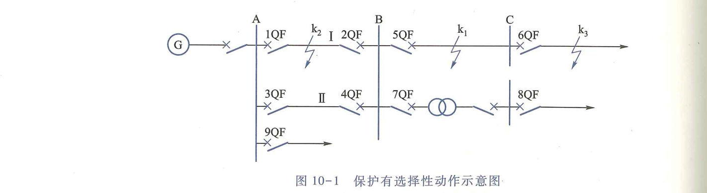

*图10-1保护有选择性动作示意图（原书第272页）*

当k2点短路时，有选择性应由断路器IQF和2QF处保护动作跳开1QF和2QF以切除故障元件AB线路I，使其他非故障元件继续运行，不影响任何用户

<!-- 原书第273页；PDF第128页 -->

供电。

当k3点短路时，应由断路器6QF处保护动作跳6QF切除故障称保护有选择性。但是，若出现6QF或6QF处保护因自身故障而拒绝动作的情况，在断路器5QF处的保护应该动作，使5QF跳闸以切除故障。这种情况下5QF处保护的动作行为也称有选择性，使停电范围达到最小。5QF处的这种保护是6QF处保护的远后备保护或称为相邻元件的远后备保护。

在继电保护中，一般把反映被保护元件严重故障、快速动作于跳闸的保护称为主保护；把主保护系统失效时作备用的保护称为后备保护。

2.速动性

继电保护动作迅速对用户、电气设备和电力系统的稳定运行等带来很大的好处。对用户来说，快速切除故障可以减少非故障元件在低电压下运行的时间，有利于电动机自启动，保持用户电气设备的不间断运行。

对于系统中的电气设备而言，由于系统发生短路时，短路电流将流经电源至短路点之间的所有电气设备，故障点还可能燃起电弧，短路电流的热效应和电动力效应及电弧可能严重损坏设备，短路电弧和电流维持时间越长，对这些电气设备的损坏越严重，甚至烧毁。因此，保护动作越快，对通过故障电流的电气设备损坏越小；对电力系统中并列运行的发电机而言，保护动作太慢，可能将使发电机之间失去同步。若短路时，相关保护迅速动作切除故障，电源间功角不至拉开太大，系统能较容易地使失去同步的电源进入再同步，恢复电力系统的正常运行。电力系统中的故障大多数是单相接地故障，若保护动作迅速可以防止单相接地故障发展为相间故障以及暂时性故障发展为永久性故障，大大有利于电力系统的运行稳定性。

动作迅速而同时又能满足选择性要求的保护装置一般结构都比较复杂，价格较贵。电力系统在一些情况下允许继电保护装置带有一定的延时切除故障元件。因此，对继电保护速动性的具体要求，应该根据电力系统接线以及被保护元件的具体情况确定。故障切除的总时间等于继电保护装置动作时间和断路器全开断时间之和。快速保护的动作时间一般为0.06、0.12，最快的可达0.01、0.04；断路器的动作时间一般为0.06、0，巧s，最快的可达0，02、0.06s。

3.灵敏性

灵敏度是指继电保护对其保护范围内故障或不正常运行状态的反应能力。灵敏度好是指保护在系统任何运行方式下对于自己保护范围内任何地方发生的所有类型的故障均应可靠反应。保护的灵敏度一般用灵敏系数（K“，！）来衡量。灵敏系数的定义因保护的类型而异。

对于反映物理量上升而动作的保护，其灵敏系数为Ksen=保护范围内金属短路时故障参数的最小计算值/保护的整定值（动作值）

对于反映物理量下降而动作的保护，其灵敏系数为

l<sen：保护的整定值/保护范围内金属短路时故庫参数的最大计算值

灵敏度计算时，故障参数的最大（小）值应考虑用实际可能的最不利于保护的运行方式、短路类型和短路点等进行计算。各种保护的灵敏系数要求值在《继

<!-- 原书第274页；PDF第129页 -->

电保护和安全自动装置技术规程》()B14285一2006）中均有规定。

4，可靠性

保护的可靠性是指属于保护范围内的短路故障，保护应动作，对于保护范围外的故障则应不动作。否则，该动作的而不动作称为保护拒动，不该动作而动作称为保护误动。保护拒动或误动都会给用户、电力系统和电气设备带来不应该的损失。

在满足上述对保护要求的前提下，还应考虑保护装置的经济性。保护装置的经济性除考虑自身装置的成本、投资等因素之外，与其他产品有不同之点，如应考虑由于过分强求保护自身的经济性而出现不可靠动作等原因对整个电力系统和国民经济带来的经济损失。

总之，对继电保护的这些要求，选择性应该是首先考虑的因素，但有时也可能出现矛盾，如在有些情况下要求保护满足速动性而失去了选择性。这时，应根据系统和具体保护对象的实际情况进行处理。

对于保护的上述要求是分析、研究、设计、评价继电保护装置的依据，也是继电保护内容学习的基本线索。

## 10.3 继电保护装置

### 10.3.1 继电保护装置的构成

继电保护装置从基本功能要求的角度，可以认为由三部分构成：测量部分、逻辑部分和执行部分，如图10-2所示。

*图10-2继电保护装置功能构成示意图（原书第274页）*

1.测量部分

测量部分是测量从被保护对象输入的有关电气量，并与已给定的整定值进行比较，根据比较的结果，给出是、非、大于、不大于等具有0或1性质的一组逻辑信号，从而判断保护是否应该启动的部件。

2.逻辑部分

逻辑部分根据测量部分输出量的大小、性质、输出的逻辑状态、出现的顺序或它们的组合，使保护装置按照一定的布尔逻辑和时序关系工作，确定是否应该使断路器跳闸或发出信号，并将有关指令传送给执行部分。继电保护中常用的逻辑模块（或回路）有与、或、非、延时启动、延时返回和记忆等。

3.执行部分

执行部分根据逻辑部分传送来的指令，完成相应的操作。例如，检测到故障，发出动作信号使断路器跳闸；在不正常运行时，发出报警信号等。

<!-- 原书第275页；PDF第130页 -->

目前，继电保护装置中应用最广泛的是微机型继电保护装置。微机型继电保护装置硬件结构图如图10-3所示。

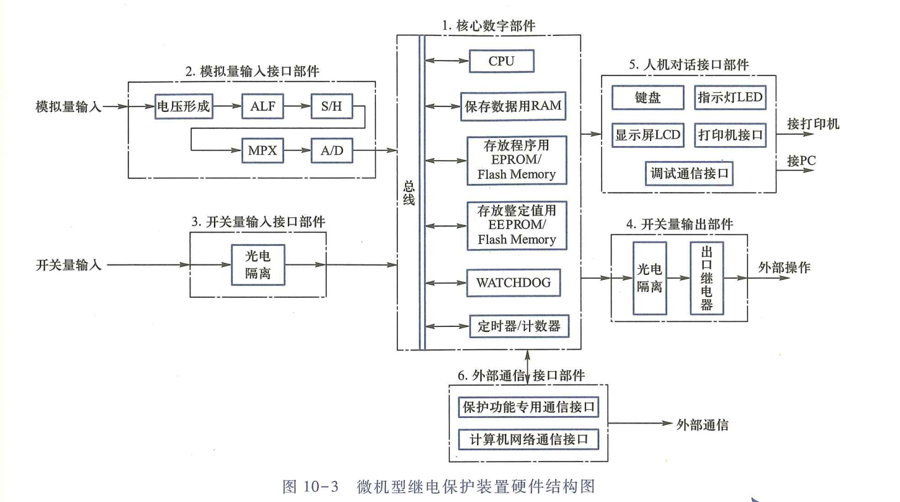

*图10-3微机型继电保护装置硬件结构图（原书第275页）*

微机型继电保护装置从硬件上分为核心数字部件、模拟量输入接口部件、开关量输入接口部件、开关量输出部件、人机对话接口部件和外部通信接口部件等6部分。相关原理和实现内容将在计算机类课程中学习，这里不再赘述。其中核心数字部件目前常用CPU是数字信号处理器（DSP)，主要完成上述测量部分和逻辑部分的计算和逻辑判断功能，是微机型继电保护装置的核心；测量部分所需的整定值由人机对话接口部件和外部通信接口部件通过手动方式和通信方式提供；输出部分由开关量输出部件承担。

### 10.3.2 继电保护装置的继电特性

从10.1.2节可以看出，从实现继电保护的原理上可以将继电保护装置分成两类，一类是反映电量增大的继电保护装置，如过电流保护，称为过量继电器；另一类是反映电量减小的继电保护装置，如低电压保护，称为欠量继电器。

为了保证快速而有选择性地切除故障，首先需要正确的保护原理和准确的测量，同时还要求继电保护的动作状态确切和稳定，这些要求是靠继电特性来保证的。

以过电流保护为例。过电流保护是指测量电流超过给定的整定值就动作的保护，其继电特性如图10-4所示。

在图10-4中，横轴代表流过继电器线圈的电流输入量），纵轴表示过电流保护出口的状态（输出量）：动作状态（如输出常开接点闭合）或返回状态（如输出常开接点断开）。

假设初始很小，保护出口处于返回状态。当逐步增大/，时，保护出口的状态起先维持返回状态不变；进一步增大厶使之达到或超过过电流保护的动作电

<!-- 原书第276页；PDF第131页 -->

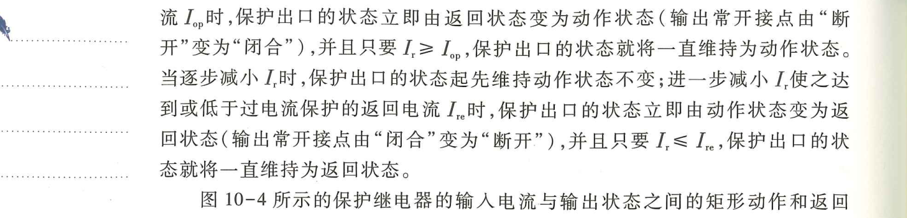

*图10-4所示的保护继电器的输入电流与输出状态之间的矩形动作和返回（原书第276页）*

特性称为继电特性。

下面以目前仍然广泛使用的电磁型电流继电器为例进一步说明过电流继电器的继电特性是如何实现的。如图10-5所示，可动衔铁上装有反作用弹簧，将可动接点片固定在可动衔铁上。

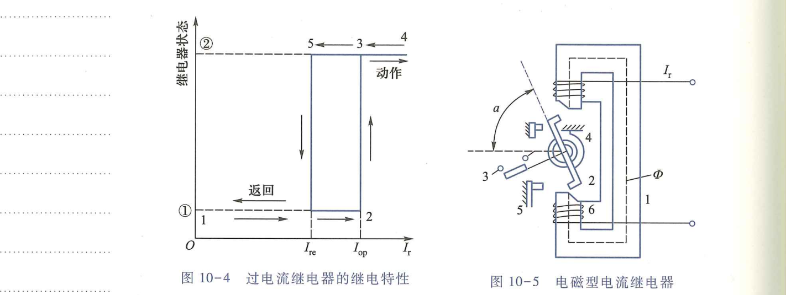

*图10-4；图10-5电磁型电流继电器（原书第276页）*

1一电磁铁；2一可动衔铁；3一接点；

4一反作用弹簧；5一限制支撑；6一线圈

当继电器的线圈输入电流/！时，在铁心中产生的磁通.对转动衔铁产生一对转矩，其大小为：

$$
M=K\frac{W_r^2}{R_M^2}I_r^2
$$

式中，K为比例系数，为继电器线圈的匝数，为磁通所经路经的磁阻，为输入继电器线圈的电流有效值。

设弹簧的反作用力矩为Ms，衔铁在运动过程中的摩擦力矩为MM，当继电器的输入电流增加至一定值后将满足以下关系

$$
M\ge M_S+M_M
\tag{10-1}
$$

将使动、静接点接触（继电器接点3闭合），则继电器动作。从式（10-1）可求得动作电流为

$$
I_{\mathrm{op}}=\frac{R_M}{W_r}\sqrt{\frac{M_S+M_M}{K}}
\tag{10-2}
$$

由式（10-2）可知，这种电磁型电流继电器的动作电流可以用三种办法调节：改变线圈匝数，改变弹簧的反作用力矩，改变磁阻（一般通过改变磁路的气隙大小改变磁阻）。

<!-- 原书第277页；PDF第132页 -->

小以至弹簧的反作用力矩将大于电磁力矩和摩擦力矩的和，即

$$
M_S\ge M+M_M
\tag{10-3}
$$

由式00一3）中，可以求得一个使继电器接点3打开（继电器返回）的最大电流，这个电流就是继电器的返回电流左。欠量继电器的继电特性可以类似地得到。

继电特性表明对保护继电器有两个重要的技术要求：

（1）规定出口状态垂直跃变，使继电器的出口永远处于动作、返回中的一种状态，没有中间状态。

（2）规定动作值（如/。p）与返回值（如左）不相等，使继电器不会因为测量误差在动作、返回两种状态间频繁切换。

保护继电器的返回值与动作值之比称为返回系数。以过电流保护为例，其返回系数定义为

$$
K_{\mathrm{re}}=\frac{I_{\mathrm{re}}}{I_{\mathrm{op}}}
\tag{10-4}
$$

对于过量继电器，K“<1；对于欠量继电器，K“>1。一般要求过量继电器K“冫0.8；对于欠量继电器，K“1.2。

## 10.4 输电线路三段式电流保护

输电线路相间短路的电流保护有三种：无时限电流速断保护，带时限电流速断保护，定时限过电流保护。这三种电流保护分别称为相间短路电流保护I段、II段和III段。其中，I、II段作为线路主保护，III段作为本线路主保护的近后备保护和相邻线路或元件的远后备保护。I、II、III段保护，统称为线路相间短路的三段式电流保护。

### 10.4.1 电流保护Ⅰ段

1.无时限电流速断保护的动作原理与整定计算

无时限电流速断保护的作用是保护在任何情况下只切除本线路上的故障。其原理可用图10-6所示的单电源辐射网络来说明。

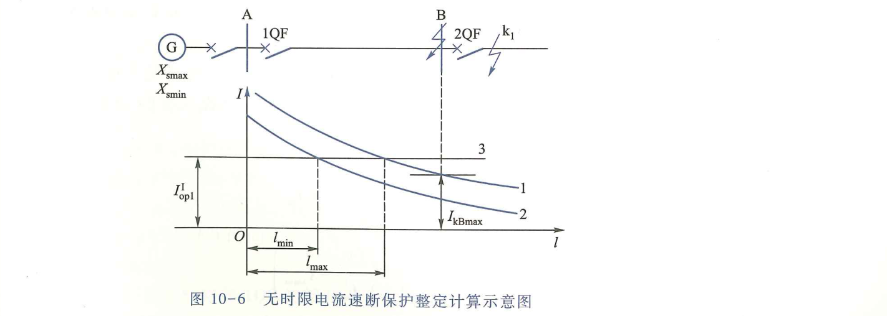

*图10-6无时限电流速断保护整定计算示意图（原书第277页）*

<!-- 原书第278页；PDF第133页 -->

假定图中断路器IQF、2QF处均装无时限电流速断保护。以AB线路断路器IQF处的无时限电流速断保护为例，则必须首先计算AB线路各处三相和两相短路时的短路电流以确定如何计算该保护的动作电流和如何校验该保护的灵敏度。

若忽略线路的电阻分量，归算至断路器IQF处的系统等效电源的相电势为Es，等效电源的阻抗最大值为x（对应于等效电源系统最小运行方式），最小值SmaX为羔一（对应于等效电源系统最大运行方式），故障点至保护安装处的距离为1，设每公里的线路电抗为无1，则在线路各点三相和两相短路时的短路电流分别为

$$
I_{k\max}^{(3)}=\frac{E_s}{X_{s\min}+x_1l}
\tag{10-5}
$$

$$
I_{k\min}^{(2)}=\frac{E_s}{X_{s\max}+x_1l}\frac{\sqrt3}{2}
\tag{10-6}
$$

如图10-6中的曲线1和2所示。

将断路器IQF处无时限电流速断保护装置中使测量元件动作的一次电流称为保护的动作电流，用是，表示。断路器IQF处的无时限电流速断保护的动作电

$$
I_{\mathrm{op}1}^{\mathrm I}=K_{\mathrm{rel}}^{\mathrm I}I_{kB\max}
\tag{10-7}
$$

式中，K《称为电流保护第I段的可靠系数，可取1.2、1.3，以保证在有各种误差的情况下（如元件整定误差和非周期分量影响等）该保护在区外短路时不动作；/为母线B处短路即被保护线路AB末端短路时的最大短路电流。AB线路断kBmax路器IQF处电流保护I段的动作电流可用图10-6中的直线3表示。

从以上分析，可得到以下结论：

0）无时限电流速断保护依靠动作电流保证选择性，即被保护线路外部短路时流过该保护的电流总小于其动作电流，保护不动作；而只有在内部短路时，才有可能使流过保护的电流大于其动作电流，使保护动作。因此，无时限电流速断保护不必外加延迟元件即可保证保护的选择性，也就是说，IQF处电流保护I段的人为延时为0，即电流保护I段的动作时间为=0s。

（2）保护在不同运行方式和短路类型时，保护范围（或灵敏度）各不相同。因此，无时限电流速断保护的灵敏度可用保护范围即它所保护的线路的长度的百分数来表示。如图10-6所示，当系统在最大运行方式下三相短路时保护范围最大为／一，而系统在最小运行方式下两相短路时保护范围最小为lm

（3）无时限电流保护不能保护线路全长，应采用最不利情况下保护的保护范围来校验保护的灵敏度，一般要求保护范围应不少于线路长度的巧%，即，！巧%IABO从图10-6可知1可由解析法求得

因为

2“，+XII

$$
l_{\min}=\frac1{x_1}\left(\frac{\sqrt3E_s}{2I_{\mathrm{op}1}^{\mathrm I}}-X_{s\max}\right)
\tag{10-8}
$$

式中，/由式（10-7）确定。

<!-- 原书第279页；PDF第134页 -->

2.无时限电流速断保护的构成

无时限电流速断保护的构成，可用图10-7所示的单相原理框图表示。

*图10-7无时限电流速断保护单相原理框图（原书第279页）*

1一电流测量元件；2一与门；3一信号元件；4一闭锁元件

一镦称为保护当保护的输入电流/。：一一大于其测量元件的动作电流7《

KT

TA的二次动作电流）时，测量元件1有输出，即在/>/时有输出，启动逻辑元件2。逻辑元件则判断是本保护的保护范围发生短路故障还是其他原因测量元件误动。当在本保护的保护范围发生故障时逻辑元件有输出，一方面启动信号元件KS发出告警信号，提示运行工作人员断路器IQF处无时限电流速断保护动作；另一方面控制断路器IQF跳闸以切除本保护范围内发生的故障；当雷击使线路避雷器对地放电等原因使电流测量元件动作时，因逻辑元件2被闭锁元件4闭锁而无输出，无保护动作信号，断路器IQF不会跳闸。

当无时限电流速断保护灵敏度不满足要求时，即保护范围<巧%时，不宜单独使用，此时可采用无时限电流电压联锁速断保护，以提高电流保护第I段的灵敏度。

### 10.4.2 电流保护Ⅱ段

无时限电流速断保护只能保护线路的一部分，该线路剩下部分的短路故障必须依靠带时限电流速断保护来可靠切除。这样线路上的电流保护I段和II段共同构成整个被保护线路的主保护，以尽可能快的速度可靠并有选择性地切除本线路上任一处的相间短路故障。

根据带时限电流速断保护作用，确定其测量元件的动作电流必须遵循以下原则：

（1）在任何情况下，带时限电流速断保护均能保护本线路的全长（包括本线路的末端），为此，保护范围必须延伸至相邻的下一线路，以保证在有各种误差的情况下仍能保护线路的全长。

（2）为了保证在相邻下一线路出口处短路时保护的选择性，本线路的带时限电流速断保护在动作时间和动作电流两个方面均必须与相邻线路的无时限电流速断保护配合。

以图10-8中断路器IQF的带时限电流速断保护的整定为例，说明带时限电流速断保护的动作电流、动作时间的整定计算方法。

<!-- 原书第280页；PDF第135页 -->

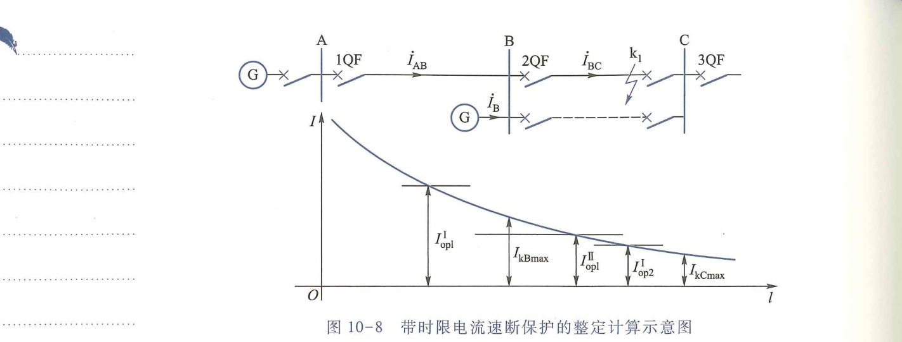

*图10-8带时限电流速断保护的整定计算示意图（原书第280页）*

设断路器IQF处的带时限电流速断保护的动作电流和动作时间为7《和噤，则为保证保护范围超过IAB，必须有I<I·为保证和相邻线路电流保护kBmax，第I段（即断路器2QF处的无时限电流速断保护）配合，必须有1>尸，为保证0P2，在相邻下一线路断路器出口短路时的选择性，即保证相邻下一线路断路器出口短路时只由相邻下一线路的无时限电流速断保护动作跳断路器2Q则应该使断路器IQF处的带时限电流速断保护动作时间比断路器2QF处无时限电流速断保护的动作时限大，即>2，以保证在相邻下一线路的断路器出口处短路时，由断路器2QF处的无时限电流速断保护首先动作，使断路器2QF跳闸切除故障。这时故障电流消失，而断路器IQF处的带时限电流速断保护的测量元件和逻辑元件均会返回且无输出，故不能动作跳断路器IQFO可见，断路器IQF处带时限电流速断保护的动作电流和动作时间应分别整定为

$$
I_{\mathrm{op}1}^{\mathrm{II}}=K_{\mathrm{rel}}^{\mathrm{II}}\frac{I_{\mathrm{op}2}^{\mathrm I}}{K_{b\min}}
\tag{10-9}
$$

$$
t_{\mathrm{op}1}^{\mathrm{II}}=t_{\mathrm{op}2}^{\mathrm I}+\Delta t=\Delta t
$$

式中，2为断路器2QF处无时限电流速断保护的动作电流，等于KI/

relkCmax，0p1为断路器IQF处带时限流速断保护的动作时间；刂。为断路器2QF处无时限电流速断保护的动作时间，一般为0；为电流保护II段的可靠系数，一般取11、1.2；&为时限阶段，与断路器的动作时间、被保护线路的保护的动作时间误差、相邻保护动作时间误差等因素有关，一般取0.3、0.6，在中国通常取0巧s；K为分支系数最小值。

分支系数Kb的定义为在相邻线路I段保护范围末端即kl点短路时，流过故障线路短路电流与流过被保护线路短路电流的比值，如图10-8所示，其分支系

数为$K_b=I_{BC}/I_{AB}$。

。Kb大小因A、B两母线处等值电源的阻抗值不同而不同，也因BC

AB之间是否存在并联回路或环路而不同。在图10-8中，若仅B母线有助增电源而BC线无并联回路，因为kl点短路时有助增电流/，故Kb>1；若B母线处无电源而与BC线路有并联回路时，因并联回路有分流而使<1；若B母线处有电源且BC间有并联回路时，则Kb可能大于1也可能小于1。

当电流保护II段的整定值确定后必须校验其灵敏度是否满足技术规程的要求，即要求满足下式

<!-- 原书第281页；PDF第136页 -->

$$
K_{\mathrm{sen}}^{\mathrm{II}}=\frac{I_{kB\min}}{I_{\mathrm{op}1}^{\mathrm{II}}}\ge1.3\sim1.5
\tag{10-10}
$$

式中，IkB一为在本线末端短路时流过IQF处保护的最小短路电流；K为带时限电流速断保护的灵敏度，其值在技术规程中规定：当线路长度小于50km时，大于等于1.5；当线路长度在50、200km时，大于等于1.4；当长度大于200km时，大于等于1.3。

当该保护灵敏度不满足要求时，动作电流可采用和相邻线路电流保护II段整定值配合，以降低本线路电流保护II段的整定值而提高其灵敏度，整定值为

$$
I_{\mathrm{op}1}^{\mathrm{II}}=\frac{K_{\mathrm{rel}}^{\mathrm{II}}I_{\mathrm{op}2}^{\mathrm{II}}}{K_{b\min}}
\tag{10-11}
$$

动作时间亦和相邻线电流保护段动作时间配合，即

$$
t_{\mathrm{op}1}^{\mathrm{II}}=t_{\mathrm{op}2}^{\mathrm{II}}+\Delta t
\tag{10-12}
$$

可见这种提高灵敏度的办法牺牲了断路器IQF处电流保护I[段的速动性。

当上述电流保护不满足灵敏度或动作时间要求时，也可采用带时限电流电压联锁速断保护以提高电流II段保护的灵敏度，但这种办法一般很少采用。

### 10.4.3 电流保护Ⅲ段

定时限过电流保护是作本线路主保护的后备保护即近后备保护，并做相邻下一线路（或元件）的后备保护即远后备保护。因此它的保护范围要求超过相邻线路（或元件）的末端。

以图10-9中断路器IQF处定时限过电流保护为例，其电流保护第III段的动作电流/当应按以下条件进行整定：

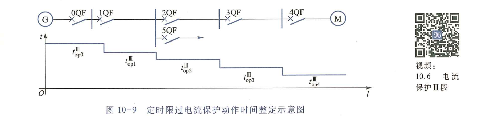

*图10-9定时限过电流保护动作时间整定示意图（原书第281页）*

（1）正常运行并伴有电动机自启动而流过最大负荷电流为l<ssILmax时，该电流保护不动作，即要求动作电流满足下式

$$
I_{\mathrm{op}1}^{\mathrm{III}}>K_{\mathrm{SS}}I_{L\max}
\tag{10-13}
$$

式中，Kss为电动机的自启动系数，由具体接线、负荷性质、试验数据及运行经验等因素确定，一般Kss>1；/L一为正常情况下流过被保护线路可能的最大负荷电流。

（2）外部故障切除后，非故障线路的定时限过流保护在下一母线有电动机启动且流过最大负荷电流时应能可靠返回，即要求满足以下公式

Ire>K／

SSLmax

$$
I_{\mathrm{re}}=K_{\mathrm{rel}}^{\mathrm{III}}K_{\mathrm{SS}}I_{L\max}
\tag{10-14}
$$

式中，7“为电流测量元件的返回电流。

<!-- 原书第282页；PDF第137页 -->

若电流满足式（10-14）则必然满足式（10-13），故取式（10-14）作为整定电

流的计算公式，并将返回系数一而一：K“代人式（10-14）后，经整理得到

$$
I_{\mathrm{op}1}^{\mathrm{III}}=\frac{K_{\mathrm{rel}}^{\mathrm{III}}K_{\mathrm{SS}}}{K_{\mathrm{re}}}I_{L\max}
\tag{10-15}
$$

式中，K为电流保护III段的可靠系数，一般取1.巧、L25；Kr为电流测量元件的返回系数，在0.85、0.99之间，一般取0.85。

由于定时限过电流保护的动作值只考虑在最大负荷电流情况下保护不动作和保护能可靠返回，而无时限电流速断保护和带时限电流速断保护的动作电流必须躲过某一个短路电流，因此，电流保护段动作电流通常比电流保护I段和II段的动作电流小得多，故其灵敏度比电流保护II、III段更高。

若在网络中某处发生短路故障时，从故障点至电源之间所有线路上的电流保护第狙段的电测量元件均可能动作。为了保证选择性，各线路电流保护lll段均需增加延时元件且各线路电流保护世段的延时必须相互配合。例如在图10-9中，断路器IQF处电流保护III段的动作时间噤应与相邻线路断路器2QF所在线段的电流保护瞓段动作时间噤配合，断路器2QF所在线路的电流保护III段的动作时间噤应与断路器3QF所在线路电流保护III段的动作时间配合，以此类推。各线路电流保护瞓段的动作时间之间应有如下关系

$$
t_{\mathrm{op}1}^{\mathrm{III}}>t_{\mathrm{op}2}^{\mathrm{III}}>t_{\mathrm{op}3}^{\mathrm{III}}>t_{\mathrm{op}4}^{\mathrm{III}},\quad t_{\mathrm{op}3}^{\mathrm{III}}=t_{\mathrm{op}4}^{\mathrm{III}}+\Delta t,\quad t_{\mathrm{op}2}^{\mathrm{III}}=t_{\mathrm{op}3}^{\mathrm{III}}+\Delta t,\quad t_{\mathrm{op}1}^{\mathrm{III}}=t_{\mathrm{op}2}^{\mathrm{III}}+\Delta t
\tag{10-16}
$$

各线路定时限过电流保护动作时间的相互配合关系为两相邻线路电流保护III段动作时间之间相差一个时限阶段，这种整定方法称阶梯原则整定方法。

对于所计算的动作电流必须按其保护范围末端最小可能的短路电流进行灵敏度校验。例如，断路器IQF处定时限过电流保护的灵敏度校验，当它作为近后备保护时，灵敏度要求满足（10-17）式，当它作为远后备保护时，灵敏度要求满足（10-18）式。

$$
K_{\mathrm{sen}1}^{\mathrm{III}}=\frac{I_{kB\min}}{I_{\mathrm{op}1}^{\mathrm{III}}}\ge1.3
\tag{10-17}
$$

$$
K_{\mathrm{sen}1}^{\mathrm{III}}=\frac{I_{kC\min}}{I_{\mathrm{op}1}^{\mathrm{III}}}\ge1.2
\tag{10-18}
$$

式中，IkB“，，为被保护线路末端短路时流过该保护处的最小短路电流；/为相kCmin邻线路末端短路时流过该保护处的最小短路电流。

*图10-10（b）为不完全星形接线，用于小接地电流系统。（原书第282页）*

### 10.4.4 电流保护的接线方式

图中的两种接线方式均能反映所有的相间短路，且进入电流测量元件电流与电流互感器的二次电流之比为1，即保护的接线系数均等于1。但是在以

<!-- 原书第283页；PDF第138页 -->

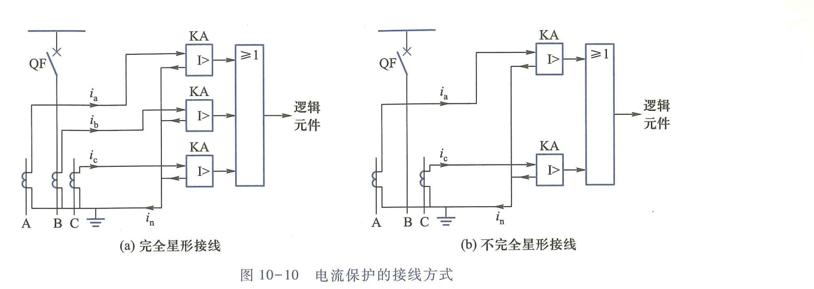

*图10-10电流保护的接线方式（原书第283页）*

下几方面两种接线方式的电流保护表现出不同的特点：

（1）两种接线的投资不同。

（2）在大接地电流系统中，完全星形接线能反映所有单相接地故障，不完全星形接线不能反映B相接地故障。

（3）在小接地电流系统中，当在不同线路上发生两点接地时，一般情况下只要求切除一个接地点，而允许带一个接地点继续运行一段时间。但当在保护动作时间相同的并行线路上发生两点接地时，在接地电流足够大的情况下，不完全星形接线只有三分之一的机会切除两条线，而完全星形接线则均切除两条线，因此，前者供电可靠性较高；在串联运行的两相邻线路上发生两点接地时，不完全星形接线方式的电流保护有三分之一的机会无选择性动作，而完全星形接线则百分之百有选择性。

（4）对于星形一三角形接线的变压器后发生两相短路时，完全星形接线方式

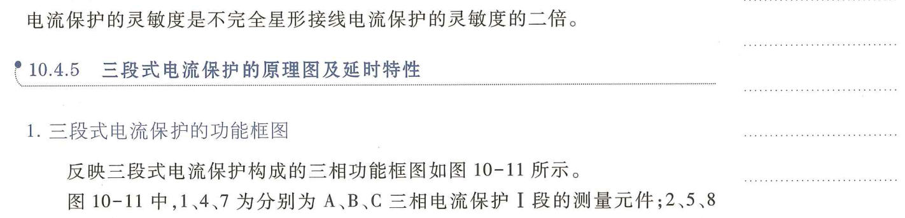

*图10-11中，1、4、7为分别为A、B、c三相电流保护I段的测量元件；2、5、8（原书第283页）*

### 10.4.5 三段式电流保护的原理图及延时特性

分别为A、B、C三相电流保护II段的测量元件；3、6、9分别为A、B.、C三相电流保护III段的测量元件；11、12分别为电流II、III段电流保护的逻辑延时元件2KT、3KT；13、14、巧分别为电流保护I、II、瞓段的报警用信号元件IKS、2KS、3KS;16为出口跳闸继电器KCOO

2.延时特性

如图10-12所示，当网络中k]点（在该处电流保护I段保护范围内）发生AB两相短路时，这时测量元件1、2、3、4、5、6均动作，其中测量元件1、4直接启动出口跳闸的继电器KCO和信号元件IKS，并跳开断路器IQF，使故障切除。故障时，虽然测量元件2、5启动延时元件2KT，测量元件3、6启动延时元件3KT，但因故障切除后，故障电流已消失，所有测量元件、延时元件2KT、3KT和出口跳闸继

<!-- 原书第284页；PDF第139页 -->

电器KCO均将返回。电流保护II、III段不会送出跳闸信号。

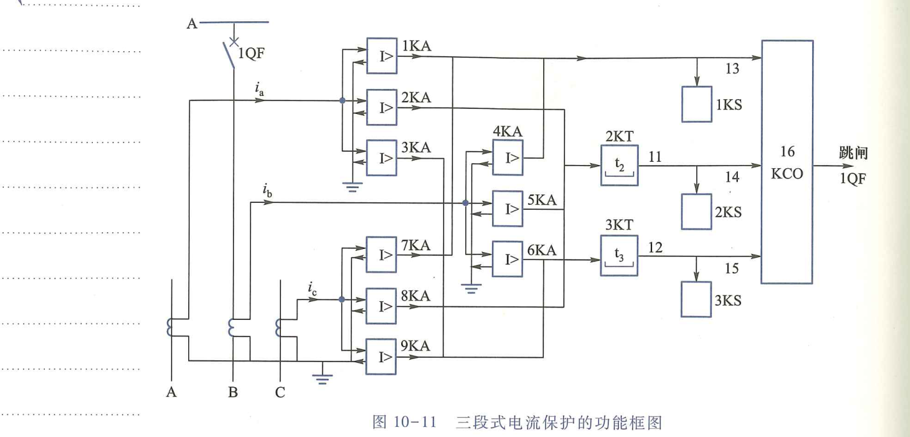

*图10-11（原书第284页）*

同一路断路器处电流保护I、II和狙段的动作时间与其保护范围之间的关系称为三段电流保护的延时特性。这种特性如图10-12所示。图中尸

，0p1、opl、0P1分别为断路器1QF处I、II和瞓段电流保护的动作时间为在一定运行方式下该处电流保护I、II和III段电流的保护范围。

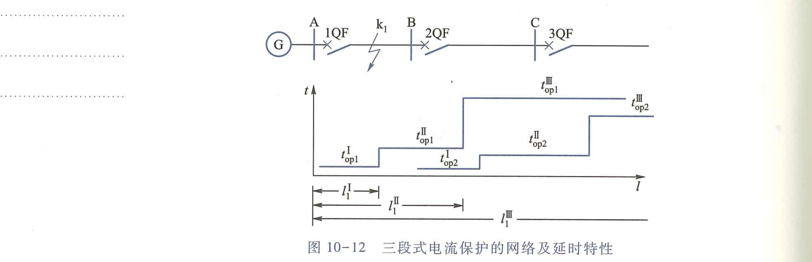

*图10-12三段式电流保护的网络及延时特性（原书第284页）*

由图可见，不仅同一断路器处各段电流保护之间的动作时间和灵敏度有相互配合的关系，而且相邻线路保护之间的动作电流和动作时间也有互相配合关系。

电流保护因为选择性、灵敏度和动作速度等方面存在不足，故主要用于35kV及以下单电源辐射网络作为线路保护，也可作为电动机和小型变压器等元件的保护。

### 10.4.6 三段式电流保护的整定计算举例

例10一1如图10-13所示电网中，每条线路的断路器处均装三段式相间方向电流保护。试求AB线路断路器IQF处电流保护I、II段的动作电流、动作时

<!-- 原书第285页；PDF第140页 -->

间和灵敏度。图中，电源电势为115kV，A处电源的最大、最小等值阻抗为$X_{sA\max}=20\,\Omega$、$X_{sA\min}=15\,\Omega$；B处电源的最大、最小阻抗为$X_{sB\max}=25\,\Omega$、$X_{sB\min}=20\,\Omega$。各线路阻抗为$X_{AB}=40\,\Omega$、$X_{BC}=26\,\Omega$、$X_{BD}=24\,\Omega$、$X_{DE}=20\,\Omega$。电流保护Ⅰ、Ⅱ段的可靠系数为$K_{\mathrm{rel}}^{\mathrm I}=1.3$、$K_{\mathrm{rel}}^{\mathrm{II}}=1.15$。

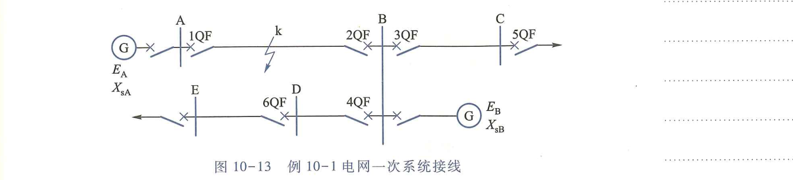

**解（a）断路器1QF处电流保护Ⅰ段的整定计算。**

动作电流应躲过本线路AB末端的最大短路电流：

$$
\begin{aligned}
I_{\mathrm{op}1}^{\mathrm I}&=K_{\mathrm{rel}}^{\mathrm I}I_{kB\max}^{(3)},\\
I_{kB\max}^{(3)}&=\frac{E_s}{X_{sA\min}+X_{AB}}=\frac{115/\sqrt3}{15+40}\,\mathrm{kA}\approx1.21\,\mathrm{kA},\\
I_{\mathrm{op}1}^{\mathrm I}&=1.3\times1.21\,\mathrm{kA}\approx1.57\,\mathrm{kA},\\
x_1l_{\min}&=\frac{\sqrt3E_s}{2I_{\mathrm{op}1}^{\mathrm I}}-X_{sA\max}=\left(\frac{115}{2\times1.57}-20\right)\Omega\approx16.6\,\Omega,\\
\frac{x_1l_{\min}}{x_1l_{AB}}&\approx\frac{16.6}{40}\times100\%\approx41.6\%>15\%.
\end{aligned}
$$

满足灵敏度要求。该处电流保护Ⅰ段动作时间$t_{\mathrm{op}1}^{\mathrm I}=0\,\mathrm s$。

当电流保护Ⅰ段的动作电流应躲过最大振荡电流时，按下式计算：

$$
\begin{aligned}
I_{\mathrm{op}1}^{\mathrm I}&=K_{\mathrm{rel}}^{\mathrm I}I_{\mathrm{OS}\max},\\
I_{\mathrm{OS}\max}&=\frac{2E_s}{X_{sA\min}+X_{AB}+X_{sB\min}}=\frac{2\times115/\sqrt3}{15+40+20}\,\mathrm{kA}\approx1.77\,\mathrm{kA},\\
I_{\mathrm{op}1}^{\mathrm I}&\approx2.3\,\mathrm{kA},\\
x_1l_{\min}&=\left(\frac{\sqrt3E_s}{2I_{\mathrm{op}1}^{\mathrm I}}-X_{sA\max}\right)=\left(\frac{115}{2\times2.3}-20\right)\Omega=5\,\Omega,\\
\frac{x_1l_{\min}}{x_1l_{AB}}&=\frac5{40}\times100\%=12.5\%<15\%.
\end{aligned}
$$

不满足灵敏度要求，应考虑采用无时限电流电压联锁速断保护。

**（b）断路器1QF处电流保护Ⅱ段的整定计算。**

1QF处Ⅱ段与相邻线路BD的Ⅰ段配合：

$$
I_{\mathrm{op}1}^{\mathrm{II}}=K_{\mathrm{rel}}^{\mathrm{II}}\frac{I_{\mathrm{op}4}^{\mathrm I}}{K_{b\min}}.
$$

<!-- 原书第286页；PDF第141页 -->

相邻线BD电流保护Ⅰ段按躲过该线路末端的最大短路电流整定：

$$
I_{\mathrm{op}4}^{\mathrm I}=K_{\mathrm{rel}}^{\mathrm I}I_{kD\max}^{(3)}=K_{\mathrm{rel}}^{\mathrm I}\frac{E_s}{(X_{sA\min}+X_{AB})\parallel X_{sB\min}+X_{BD}}=1.3\frac{115/\sqrt3}{55\parallel20+24}\,\mathrm{kA}\approx2.23\,\mathrm{kA}.
$$

分支系数最小值为

$$
K_{b\min}=1+\frac{X_{sA\min}+X_{AB}}{X_{sB\max}}=1+\frac{55}{25}=3.2.
$$

所以，1QF处电流保护Ⅱ段动作电流及灵敏度为

$$
\begin{aligned}
I_{\mathrm{op}1}^{\mathrm{II}}&=\frac{1.15\times2.23}{3.2}\,\mathrm{kA}\approx0.8\,\mathrm{kA},\\
I_{kB\min}^{(2)}&=\frac{\sqrt3}{2}\frac{E_s}{X_{sA\max}+X_{AB}}\approx0.96\,\mathrm{kA},\\
K_{\mathrm{sen}}^{\mathrm{II}}&=\frac{I_{kB\min}^{(2)}}{I_{\mathrm{op}1}^{\mathrm{II}}}=\frac{0.96}{0.8}=1.2<1.4.
\end{aligned}
$$

不满足灵敏度要求。考虑1QF处电流保护Ⅱ段与相邻线路4QF处电流保护Ⅱ段配合：

$$
\begin{aligned}
I_{\mathrm{op}1}^{\mathrm{II}}&=K_{\mathrm{rel}}^{\mathrm{II}}\frac{I_{\mathrm{op}4}^{\mathrm{II}}}{K_{b\min}},\\
I_{\mathrm{op}4}^{\mathrm{II}}&=K_{\mathrm{rel}}^{\mathrm{II}}\frac{I_{\mathrm{op}6}^{\mathrm I}}{K_{b\min}}=K_{\mathrm{rel}}^{\mathrm{II}}K_{\mathrm{rel}}^{\mathrm I}I_{kE\max}\\
&=1.15\times1.3\frac{115/\sqrt3}{(15+40)\parallel20+44}\,\mathrm{kA}\approx1.69\,\mathrm{kA}.
\end{aligned}
$$

式中，4QF处保护的最小分支系数为1；1QF处保护的最小分支系数仍为3.2。故

$$
\begin{aligned}
I_{\mathrm{op}1}^{\mathrm{II}}&=\frac{1.15\times1.69}{3.2}\,\mathrm{kA}\approx0.61\,\mathrm{kA},\\
K_{\mathrm{sen}}^{\mathrm{II}}&=\frac{0.96}{0.61}\approx1.58>1.4,\\
t_{\mathrm{op}1}^{\mathrm{II}}&=t_{\mathrm{op}4}^{\mathrm{II}}+\Delta t=1\,\mathrm s.
\end{aligned}
$$

满足灵敏度要求，动作时间与4QF处Ⅱ段配合。

## 10.5 相间短路的方向电流保护

### 10.5.1 方向电流保护的提出

在图10-14所示两端有电源的线路上，为了切除线路上的故障必须在线路两侧均装设断路器及其相应的保护。若A侧为小容量电源，D侧为大容量电源，将对该网络中的前述三段式电流保护进行选择性、灵敏度等性能的分析。

在图10-14中，对于断路器2QF和3QF处的电流保护I[I段的动作时间整定来说，当kl点短路时，按满足选择性要求应‰2>噤，而k2点短路时，按满足选择性又要求噤>严这种矛盾的要求对时间元件来说无法实现。

0p2，

为了解决上述矛盾，若考虑在每个断路器的电流保护中增加一个功率方向

<!-- 原书第287页；PDF第142页 -->

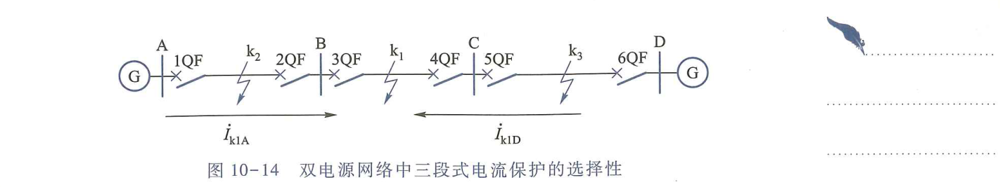

*图10-14双电源网络中三段式电流保护的选择性（原书第287页）*

测量元件，该功率方向测量元件在短路功率从母线流向线路（为正）时动作，而线路流向母线（为负）时不动作。当k3点短路时，仅断路器IQF、3QF、5QF、6QF处的电流保护流过的短路功率方向为正，其功率方向测量元件将动作；当k2点短路时，则只有断路器IQF、2QF、4QF、6QF处电流保护流过的短路功率方向为正，其功率方向测量元件动作。那么，对电流保护I段（如断路器3QF处的电流保护I段）来说，因反方向短路时功率方向测量元件不动作，其整定值就只需躲过正方向线路末端（即c母线）短路电流最大值而不必躲过反方向短路（B母线短路）的最大短路电流整定，因而提高了灵敏度。对于断路器2QF、3QF处的电流保护瞓段在整定时间上已不存在配合关系，而仅需功率方向相同的断路器IQF、3QF、5QF处的电流保护瞓段的动作时间之间配合，断路器2QF、4QF、6QF处电流保护

IIIlll段的动作时间之间配合，按阶梯原则应满足>>

t>在》4>t

0p5、0p6

0p20

这种增加了功率方向测量元件（它和电流测量元件均动作后才启动逻辑元件）的电流保护即为方向电流保护。在双电源网络或其他复杂网络中，可以采用带方向的三段式电流保护（称三段式方向电流保护）以满足各种保护性能的要求。

### 10.5.2 方向电流保护的构成

三段式方向电流保护的构成，可用图10一巧所示的原理框图来说明。图中，1、2、3为方向电流保护I、II、III段的电流测量元件；4为功率方向测量元件，在保护线路正方向短路时动作，即短路功率为正时动作；5、6、7为与门逻辑元件；8、9为方向电流保护II、瞓段的延时逻辑元件；10、11、12分别为方向电流保护I、II、段的信号元件；13为或门；14为出口跳闸继电器。

1

1KS

KCO

10

13

2

跳闸

1

8

2KS

3

9

3KS

12

4

图10一巧三段式方向电流保护的构成原理框图

为简化保护接线和提高保护的可靠性，电流保护每相的I、、狙段可共用一个方向元件。实际上各开关处电流保护并非一定装设方向元件，而仅在用动作电流、动作时间不满足选择性时才加方向元件。一般来说，电流保护I段在动

<!-- 原书第288页；PDF第143页 -->

作电流满足选择性时，不加方向元件；电流保护II段用动作电流和动作时间能满足选择性时，不加方向元件；电流保护III段则应按以下原则考虑：同一变电站内，电流保护III段的动作时间较小而可能失去选择性时加方向元件，动作时间相同可能失去选择性时加方向元件。

### 10.5.3 功率方向元件

从三段式方向电流保护的单相原理框图（见图10一巧）可知，方向电流保护与一般电流保护的差别仅多了一个功率方向元件。因此，下面讨论功率方向元件的构成原理、接线方式和动作特性等。

1.功率方向元件的构成原理

功率方向元件利用保护正、反方向短路时，保护安装处母线电压与流过保护电流之间的相位变化构成。如图10-16（a）所示，功率方向测量元件加入母线电压$\dot U_r$和线路电流$\dot I_r$。以$\dot U_r$为参考，正方向$k_1$点短路时，两矢量相位角$\varphi_r=\varphi_{k1}$，一般在$0^\circ\sim90^\circ$之间，此处取$70^\circ$；反方向$k_2$点短路时，电流反向，相位角$\varphi_r=\varphi_{k2}=180^\circ+\varphi_{k1}$。

正方向短路时$-90^\circ\le\varphi_r\le90^\circ$；反方向短路时$\varphi_r>90^\circ$或$\varphi_r<-90^\circ$。据此判别正、反方向。

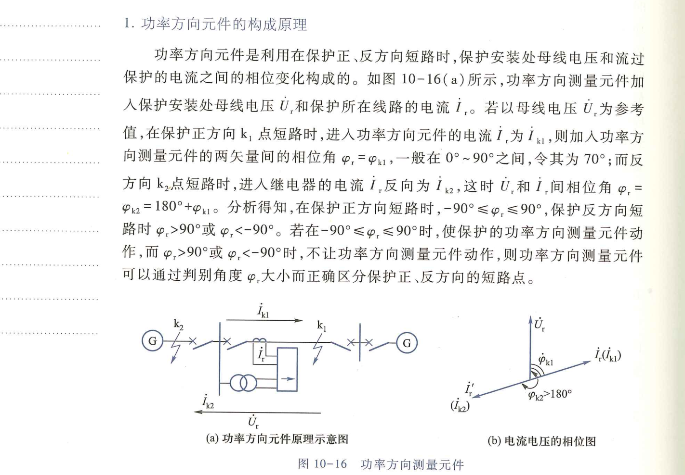

*图10-16（原书第288页）*

若令

$$
K_1\dot U_r+K_2\dot I_r=\dot A,\qquad K_1\dot U_r-K_2\dot I_r=\dot B,
$$

其中$K_1$为常量，$K_2$为复常量（称模拟阻抗），其角度在$0^\circ\sim90^\circ$之间，本处设为$70^\circ$。$A$与$B$的大小关系由电压、电流夹角$\varphi_r$决定：当$-90^\circ\le\varphi_r\le90^\circ$时，$A\ge B$；当$\varphi_r>90^\circ$或$\varphi_r<-90^\circ$时，$A<B$。令元件在$A\ge B$时动作、$A<B$时不动作，即可区分保护正、反方向短路，满足功率方向测量元件的动作要求。

当然，从上述分析知，不仅比较A、B大小可以正确区分短路点的方向，且直

<!-- 原书第289页；PDF第144页 -->

接比较两个电量0和不的相位也可正确区分短路点的方向。

2.功率方向元件的接线方式

功率方向元件的接线方式主要要求相间短路时有良好的方向性和有很高的

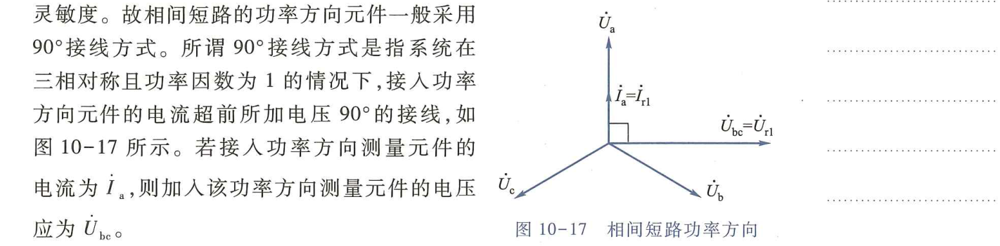

*图10-17所示。若接人功率方向测量元件的；图10-17相间短路功率方向（原书第289页）*

元件的90。接线

方向电流保护中，对三个相功率方向元件所加电流、电压如表10-1所示。

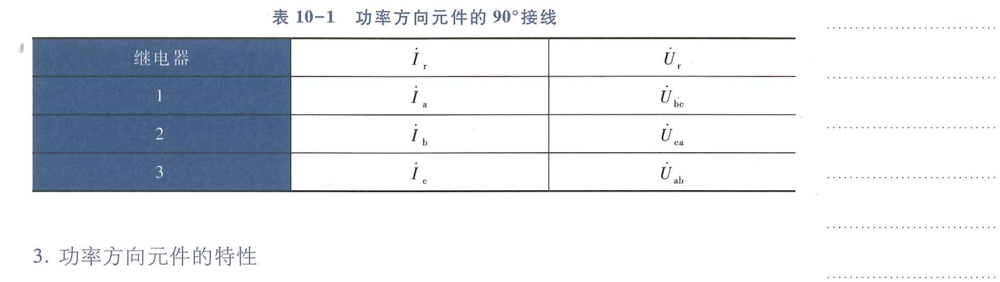

*表10-1功率方向元件的90。接线（原书第289页）*

可以推得功率方向元件的动作方程为

$$
-90^\circ-\alpha\le\arg\frac{\dot U_r}{\dot I_r}\le90^\circ-\alpha
\tag{10-19}
$$

对式（10-19）用图形表示，即为功率方向元件的动作区域，如图10-18（a）所示阴影区。在图10-18（）中，若反时针旋转角后与/！同相，这时功率方向元件处于最灵敏状态，称为功率方向元件的内角，且将其此时所加电压和电流0之间的角称为功率方向元件的最大灵敏角，用，，表示。分析可知，最大

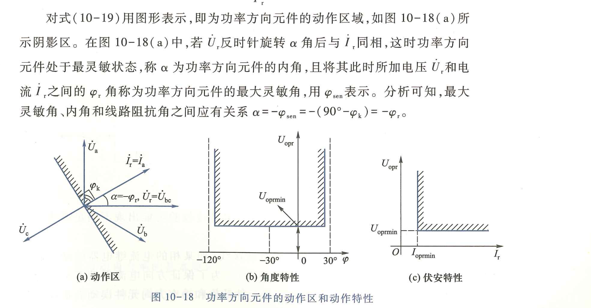

*图10-18功率方向元件的动作区和动作特性（原书第289页）*

<!-- 原书第290页；PDF第145页 -->

另外，功率方向元件的动作不仅与所加的电流、电压间的角度大小有关，还与电流、电压值的大小有关。当<7或<0时，实际上功率方向元件因oprmln内部机械运动中的摩擦或电路损耗等都将不会动作。7为功率方向元件的最

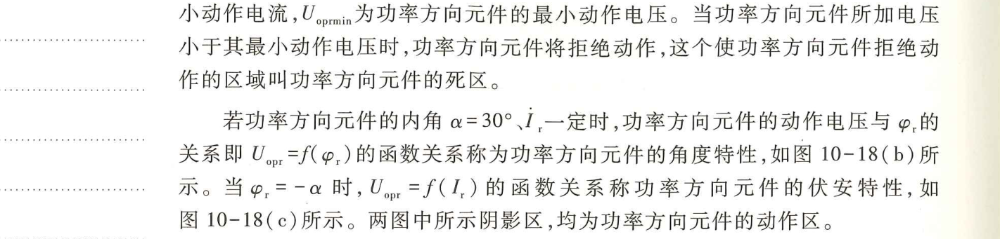

*图10-18（c）所示。两图中所示阴影区，均为功率方向元件的动作区。（原书第290页）*

### 10.5.4 三段式方向电流保护的特点

三段式方向电流保护在作用原理、整定计算原则等方面与无方向三段式电流保护基本相同。但方向电流保护用于双电源网络和单电源环形网络时，在构成、整定、相互配合等问题上还有以下特点：

（1）在保护构成中应增加功率方向测量元件，它与电流测量元件共同判别是否在所保护线路的正方向发生故障。

（2）方向电流保护I段，即无时限方向电流速断保护的动作电流整定可以不必躲过反方向外部最大短路电流。

（3）电流保护III段动作电流除按（10一巧）式计算外，还应考虑躲过反方向不对称短路时，流过非故障相的电流/即

$$
I_{\mathrm{op}}^{\mathrm{III}}=K_{\mathrm{rel}}^{\mathrm{III}}I_{\mathrm{unf}},\qquad K_{\mathrm{rel}}^{\mathrm{III}}=1.15\sim1.3
\tag{10-20}
$$

零序电流。这样可防止因反方向单相接地故障时非故障线功率方向元件误动而造成保护误动。

（4）在环网和双电源网中，功率方向可能相同的电流保护III段的动作电流之间和动作时间之间应相互配合以保证保护的选择性，在图10-19中，应有

$$
I_{\mathrm{op}6}^{\mathrm{III}}>I_{\mathrm{op}4}^{\mathrm{III}}>I_{\mathrm{op}2}^{\mathrm{III}},\qquad t_{\mathrm{op}6}^{\mathrm{III}}>t_{\mathrm{op}4}^{\mathrm{III}}>t_{\mathrm{op}2}^{\mathrm{III}}
\tag{10-21}
$$

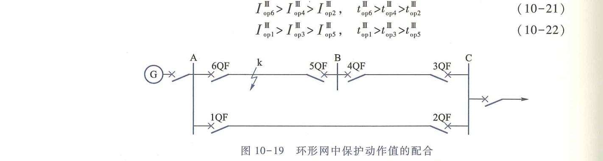

*图10-19环形网中保护动作值的配合（原书第290页）*

$$
I_{\mathrm{op}1}^{\mathrm{III}}>I_{\mathrm{op}3}^{\mathrm{III}}>I_{\mathrm{op}5}^{\mathrm{III}},\qquad t_{\mathrm{op}1}^{\mathrm{III}}>t_{\mathrm{op}3}^{\mathrm{III}}>t_{\mathrm{op}5}^{\mathrm{III}}
\tag{10-22}
$$

（5）环网中方向电流保护II、III段的灵敏度校验可能出现不满足要求的情况时可用相继动作校验保护的灵敏度。

（6）方向电流保护应采用按相启动接线（即某相的电流继电器的动合触点串接该相的功率方向继电器的动合触点）。为了保证方向电流保护不会因为反方向不对称短路时非故障相电流测量元件动作和功率方向元件误动而造成的保

<!-- 原书第291页；PDF第146页 -->

护误跳闸，方向电流保护必须采用按相启动接线。

（7）方向电流保护主要用于35kV及以下的双电源和单电源环网中，做相间短路保护。

## 10.6 输电线路的自动重合闸概述

运行经验表明，电力系统中发生的故障大多都属于瞬时性故障，如雷击过电压引起的绝缘子表面闪络，大风时的短时碰线，通过鸟类身体的放电，风筝绳索或树枝落在导线上引起的短路等。这些故障，当被断路器迅速切除后，电弧即可熄灭，故障点的绝缘可以恢复，故障随即自行消除。这时，若使断路器重新合上，往往能恢复供电，因而减小用户停电的时间，提高供电的可靠性。当然，重新合上断路器的工作也可由运行人员手动操作进行，但手动操作时，停电时间太长，用户电动机可能停转，重新合闸取得的效果并不显著；对于高压和超高压线路而

，系统可能失去稳定性。为此，在电力系统中，往往用自动重合闸装置（用符号ARD表示）代替运行人员的手动合闸。因此，自动重合闸在输、配电线路中尤其是高压输电线路上得到极其广泛的应用。

### 10.6.1 自动重合闸的作用

在输、配电线路上装设自动重合闸ARD，对于提高供电的可靠性无疑会带来极大的好处。但由于自动重合闸ARD本身不能判断故障的性质是暂时性的，还是永久性的，因此，在重合之后，可能成功（恢复供电），也可能不成功。根据运行资料统计，输电线自动重合闸ARD的动作成功率（重合闸成功的次数/总的重合闸的动作次数）相当高，在（600）%之间。可见采自动重合闸ARD的效益是比较可观的。

一般说来，在输电线路上，采自动重合闸ARD的作用可归纳如下：

（1）在线路上发生暂时性故障时，迅速恢复供电，从而可提高供电的可靠性；

（2）对于有双侧电源的高压输电线路，可以提高系统并列运行的稳定性；

（3）可以纠正由于断路器机构不良，或继电保护误动作引起的误跳闸；

（4）在电网建设过程中，考虑自动重合闸作用，可暂缓架设双回线路以节约投资。

由于自动重合闸ARD本身的投资低，工作可靠，采用自动重合闸ARD后可避免因暂时性故障停电而造成的损失，因此，规程规定在1kV及以上电压的架空线路或电缆与架空线的混合线路上，只要装有断路器，一般都应装设自动重合闸装置。但是，采用自动重合闸ARD后，当重合于永久性故障时，系统将再次受到短路电流的冲击，可能引起电力系统振荡，继电保护应再次使断路器断开。并且，断路器在短时间内连续两次切断故障电流，恶化了断路器的工作条件。因此，对油断路器而言，其实际切断的短路容量应比正常的额定切断容量有所降低。

### 10.6.2 对自动重合闸的基本要求

作为安全自动装置之一的自动重合闸同继电保护装置一样应满足选择性、

<!-- 原书第292页；PDF第147页 -->

速动性、可靠性和灵敏性要求。根据生产的需要和运行经验，对线路的自动重合闸装置，提出了如下的基本要求。

（1）动作迅速。在满足故障点去游离（即介质恢复绝缘能力）所需的时间和断路器灭弧室及断路器的传动机构准备好再次动作所必需的时间的条件下，自动重合闸ARD装置的动作时间应尽可能短。因为，故障后从断路器断开到自动重合闸ARD发出合闸脉冲的时间愈短，停电的时间就可以相应缩短，从而可以减轻故障对用户和系统带来的不良影响。自动重合闸动作的时间，一般采用0.5、1.5s。

（2）不允许任意多次重合。自动重合闸ARD动作次数应符合预先的规定。如一次重合闸就只应重合一次。当重合于永久性故障而断路器再次跳闸时，就不应再重合。在任何情况下，例如自动重合闸装置本身的元件损坏、继电器拒动等，都不应把断路器错误地多次重合到永久性故障上去。因为自动重合闸ARD多次重合于永久性故障，将使系统多次遭受冲击，还可能使断路器损坏，从而扩大事故。

（3）动作后应能自动复归。当自动重合闸ARD成功动作一次后，应能自动复归，准备好再次动作。对于受雷击机会较多的线路，为了发挥自动重合闸ARD的效果，这一要求更有必要。

（4）手动跳闸时不应重合。当运行人员手动操作或遥控操作使断路器断开时，自动重合闸装置不应自动重合。当有其他情况不允许重合时，应可以对自动重合闸ARD进行闭锁。

（5）手动合闸于故障线路不重合。当手动合闸于故障线路时，继电保护动作使断路器跳闸后，装置不应重合，因为在手动合闸前，线路上还没有电压，如果合闸后就已存在有故障，则故障多属永久性故障。

（6）一般自动重合闸ARD可用控制开关位置和断路器位置不对应启动，对综合重合闸ARD宜用不对应原则和保护同时启动。

（7）应考虑继电保护和自动重合闸之间动作的相互配合。

### 10.6.3 自动重合闸的类型和配置原则

1.类型

自动重合闸的采用是系统运行的实际需要。因此，随着电力系统的发展，自动重合闸的类型有一个从三相重合闸到单相重合闸，再到综合重合闸的发展过程。故一般认为自动重合闸有以下三种类型。

（1）三相重合闸。所谓三相重合闸是指不论在输、配线上发生单相短路还是相间短路，继电保护装置均将线路三相断路器同时跳开，然后启动自动重合闸同时合三相断路器。若为暂时性故障则重合闸成功，否则保护再次动作跳三相断路器。重合闸是否再重合要视情况而定。目前，一般只允许重合闸动作一次，称为三相一次自动合闸。特殊情况下，如无人值班变电站的无遥控单回线、无备用电源的单回重要负荷供电线、断路器遮断容量允许时，可采用三相二次重合闸装置。

（2）单相重合闸。单相重合闸是指线路上发生单相接地故障时，保护动作

<!-- 原书第293页；PDF第148页 -->

只跳开故障相的断路器，然后进行单相重合。如果故障是暂时性的，则重合后，便恢复三相供电；如果故障是永久性的，而系统又不允许长期非全相运行时，则重合后，保护动作跳开三相断路器，不再进行重合。当采用单相重合闸时，如果发生相间短路，一般都跳开三相断路器，并不进行三相重合；如果因任何其他原因断开三相断路器时，也不进行重合。

在110kV及以上的大接地电流系统中，由于架空线路的线间距离较大，相间故障的机会比较少，而单相接地短路的机会却比较多，占总故障的90%左右。从录波图的分析中发现，在发生的相间故障中，相当一部分也是由单相接地故障发展而成的。如果能在线路上装设三个单相的断路器，当发生单相接地故障时，只把故障相的断路器断开，而未发生故障的其余两相仍继续运行。这样，不但可以提高供电的可靠性和提高系统并联运行的稳定性，还可以减少相间故障的发生概率。因此，在输电线路上，若不允许进行快速非同期三相重合闸，而采用检查同期重合闸，又因恢复供电的时间太长，满足不了系统稳定运行的要求时，可以采用单相重合闸方式。

（3）综合重合闸。在线路上设计自动重合闸装置时，将单相重合闸和三相重合闸综合在一起。当发生单相接地故障时，采用单相重合闸方式；当发生相间短路时，采用三相重合闸方式。综合考虑这两种重合闸方式的装置称为综合重合闸装置。继单相重合闸使用后不久，综合重合闸迅速得到了应用和推广。

由于综合重合闸装置经过转换开关的切换，一般都具有单相重合闸、三相重合闸、综合重合闸和直跳（即线路上发生任何类型的故障，保护可通过重合闸装置的出口，断开三相，不进行重合闸）等四种运行方式。所以，在110kV及以上高压电力系统中，综合重合闸得到了广泛应用。

2.配置原则

《技术规程》规定自动重合闸的配置原则如下：

（1）1kV及以上架空线和电缆与架空线混合线路，在具有断路器的条件下，如果用电设备允许且无备用电源自动投入时，应装设自动重合闸装置。

（2）旁路断路器和兼作旁路的母联断路器或分段断路器，应装设自动重合闸装置。

（3）低压侧不带电源的降压变压器，可装设自动重合闸装置。

（4）必要时，母线故障可采用自动重合闸装置。

### 10.6.4 重合闸和继电保护的配合

重合闸和继电保护之间的关系极为密切。重合闸和继电保护之间密切良好的配合可以较迅速切除多数情况下的故障，提高供电可靠性和对系统安全稳定产生极其重要的作用。

在电力系统中，自动重合闸与继电保护配合的方式有两种，即自动重合闸前加速保护动作和自动重合闸后加速保护动作。

1.自动重合闸前加速保护动作

自动重合闸前加速保护动作方式简称前加速。其意义可用图10-20所示的

<!-- 原书第294页；PDF第149页 -->

单电源辐射网络来说明。图中每一线路上均装设带延时的过电流保护，其动作时限是按阶梯形原则选择的。断路器IQF处的继电保护时限最长。为了加速切除故障，在断路器IQF处采用自动重合闸前加速保护动作方式，即在断路器IQF处不仅装有过电流保护，而且还装有能保护到最末级线路L3的无时限电流速断保护和自动重合闸装置ARD。这样配置后，在线路LI（或L2或L3）上发生故障时，断路器IQF处的电流速断保护都能无延时跳开断路器1QF，然后自动重合闸将断路器IQF重合一次。如果是暂时性故障，则重合成功，迅速恢复正常供电；如果是永久性故障，则在断路器IQF重合之后，过电流保护将按时限有选择性地将故障线路的断路器跳开。

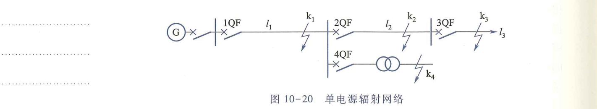

*图10-20单电源辐射网络（原书第294页）*

采用前加速的优点是，能快速切除瞬时性故障，使暂时性故障来不及发展成为永久性故障，而且使用设备少，只需一套ARD自动重合闸装置；其缺点是重合于永久性故障时，再次切除故障的时间会延长，装有重合闸的线路断路器的动作次数较多，若此断路器的重合闸拒动，就会扩大停电范围，甚至在最后一级线路上故障，也可能造成全网络停电。因此，前加速方式只用于35kV及以下的网络。

2.自动重合闸后加速保护动作

重合闸后加速继电保护动作方式简称后加速。采用这种方式，一般每条线路均配备完善的保护（如距离保护1、I[、III段等）和自动重合闸装置。如果在线路上发生故障，保护均按有选择性的方式跳闸。若重合于永久性故障，则加速保护动作，瞬时切除故障。

重合闸后加速工作方式。如图10-20所示，当任一条线路上发生故障时，首先由故障线路有选择性的保护（一般是线路的主保护）将故障切除，然后由故障线路的自动重合闸装置ARD进行重合，自动重合闸动作后将本线有选择性动作保护的延时部分退出工作。如果是暂时性故障，则重合成功，恢复正常供电。如果是永久性故障，故障线路的保护便瞬时将故障再次切除。

采用“后加速"的优点是，第一次跳闸是有选择性的，不会扩大事故。在重要高压网络中，是不允许无选择性跳闸的，应用这种方式特别适合。同时，这种方式使再次断开永久性故障的时间缩短，有利于系统并联运行的稳定性。其主要缺点是第一次切除故障可能带时限，当主保护拒动，而由后备保护来跳闸时，时间可能比较长。

问题：所有配电线路上都需要装设完整的三段式电流保护吗？

三段式电流保护是110kV及以下配电线路常用保护。但是，所有110kV及

<!-- 原书第295页；PDF第150页 -->

以下配电线路上都需要同时装设电流I段、II段、III段保护吗？什么条件下可以仅装设其中的一段或二段保护？

## 课外阅读资料

本章推荐如下课外阅读内容：

（1）GB/T14285一2006《继电保护技术规程》；

（2）10kV中压配电线路继电保护配置和整定；

（3）380v低压配电线路保护配置和整定。

## 思考题与习题

何谓保护的最大和最小运行方式？确定保护最大、最小运行方式时应考虑哪些

10一1因素？

比较电流保护第I.、II、段的灵敏度，哪一段保护的灵敏度高和保护范围最长？

10一2为什么？

相间短路电流保护的第I、II、III段各有什么办法提高其灵敏度？

10一3

为什么电流保护第III段整定值中考虑电动机自启动系数和返回系数，而电流保护

10一4第I段、第II段的整定计算不考虑？

10一5某电网装相间短路电流三段式保护，试分析在某断路器保护安装处出口AB两相短路时，该处保护第I、II、III段逻辑框图中各相元件的动作如何？

10一6电流保护第III段的动作时间应按什么原则确定？凡相邻元件动作的时间差都相同吗？为什么？

10一7试说明方向电流保护第I段和第卅段中，在什么情况下有必要装功率方向元件。变电站分支负荷线上的电流保护是否需要装设方向元件？为什么？

10一8为什么电流保护中第II和第III段必须有延时元件？试举例分析说明。

10一9分析比较电流保护中完全星形接线和不完全星形接线在小接地电流系统中的选择性和可靠性。

**10-10** 图10-21所示网络装三段式相间电流保护，变压器用纵差保护。保护采用完全星形接线。AB线路最大负荷电流为200A：

$$
K_{\mathrm{SS}}=1.5,\quad K_{\mathrm{rel}}^{\mathrm I}=1.25,\quad K_{\mathrm{rel}}^{\mathrm{II}}=1.15,\quad K_{\mathrm{rel}}^{\mathrm{III}}=1.15,\quad K_{\mathrm{re}}=0.85.
$$

电源电压为115kV，电源阻抗为$X_{s\min}=13\,\Omega$、$X_{s\max}=18\,\Omega$。归至115kV电压等级的各线路阻抗为$X_{AB}=24\,\Omega$、$X_{BC}=20\,\Omega$、$X_{BD}=16\,\Omega$；变压器阻抗$X_{T1}=185\,\Omega$、$X_{T2}=138.8\,\Omega$；$t_{\mathrm{op}6}^{\mathrm{III}}=1.5\,\mathrm s$、$t_{\mathrm{op}7}^{\mathrm{III}}=2\,\mathrm s$。试求AB线路上电流保护Ⅰ、Ⅱ、Ⅲ段的动作电流、动作时间和灵敏度。

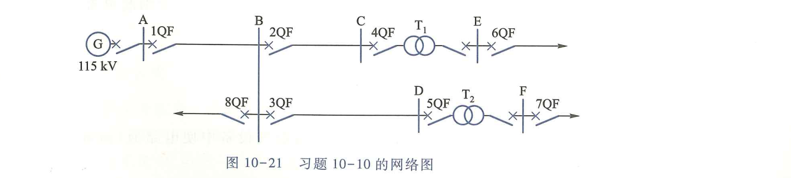

*图10-21习题10一10的网络图（原书第295页）*

## 其他章节

- [第1章 走进电力系统](CH1走进电力系统.md)

- [第2章 电力系统的组成环节及工作原理](CH2电力系统的组成环节及工作原理.md)

- [第3章 电气一次设备](CH3电气一次设备.md)

- [第4章 电气一次系统](CH4电气一次系统.md)

- [第11章 电气二次系统](CH11电气二次系统.md)
