# 第11章 电气二次系统

> 来源：《电气工程基础》罗毅编著。原书第 296-321 页；本PDF第 151-176 页。

> 本文件由扫描教材转换，保留原书顺序、小节、例题、思考题及阅读资料。编号公式经对照原书转录为 LaTeX；插图、接线图与复杂表格保留为图片，位于相邻 assets 文件夹。正文为OCR识别稿，个别文字仍可能有识别误差。

## 小节目录

- [11.1 二次设备及二次系统](#sec-11-1)

- [11.1.1 二次设备](#sec-11-1-1)

- [11.1.2 接点（触点）的基本概念](#sec-11-1-2)

- [11.1.3 二次系统](#sec-11-1-3)

- [11.1.4 二次系统的分层](#sec-11-1-4)

- [11.2 二次接线图](#sec-11-2)

- [11.2.1 二次回路的符号](#sec-11-2-1)

- [11.2.2 原理接线图](#sec-11-2-2)

- [11.2.3 展开接线图](#sec-11-2-3)

- [11.2.4 安装接线图](#sec-11-2-4)

- [11.3 断路器控制和信号回路](#sec-11-3)

- [11.3.1 断路器控制回路的基本要求](#sec-11-3-1)

- [11.3.2 断路器手动/自动分合闸及分合闸指示](#sec-11-3-2)

- [11.3.3 熔断器及分合闸回路的完整性监视](#sec-11-3-3)

- [11.4 变电站的综合自动化](#sec-11-4)

- [11.5 智能变电站](#sec-11-5)

## 原文

<!-- 原书第296页；PDF第151页 -->

## 11.1 二次设备及二次系统

### 11.1.1 二次设备

二次设备是指对一次设备的工作状态进行监测、控制、调节、保护和管理以及为运行、维护人员提供运行工况或生产指挥信号所需的低压电气设备。

二次设备包括：

（1）监视与测量仪表和装置，如电压表、电流表、功率表、电度表、频率表、间隔层微机测控装置、在线监测装置等。

（2）控制及信号器件，如各种手动控制开关、接触器、指示灯、蜂鸣器等。

（3）继电保护类装置，如微机保护装置、各种继电器、重合闸装置、备用电源自动投入装置等。

（4）自动化装置。例如，用于合闸时判断开关两侧电压相量是否相等的同期装置，用于调整发电机励磁的励磁调节器，用于发电机调速的调速器、自动电压控制（AVC）装置和系统、自动频率控制（AGC）装置和系统、低频减载装置等。

（5）连接电缆。

（6）操作、信号电源。电源包括电流互感器二次侧和电压互感器二次侧（但需要注意：电流互感器和电压互感器是一次设备，而不是二次设备）、蓄电池组或其他低压电源等。中国变电站二次系统的主要电压等级是110VDC或220VDC（不包括二次设备内部各低压电压等级）。

（7）端子排。应该特别注意在端子排中连接电流互感器的端子必须采用专用的电流端子，这种电流端子上有短接片，在端子上接线时不会引起电流互感器二次侧开路。

（8）低压熔断器。

### 11.1.2 接点（触点）的基本概念

接点一般指开关、插销、电键和继电器等电气设备中使电路通（或断）的开合点。

下面以电磁型电流继电器为例说明接点的基本概念

电磁型电流继电器的原理结构如图11-1所示。可动衔铁上装有反作用弹簧，将可动接点片固定在可动衔铁上。

<!-- 原书第297页；PDF第152页 -->

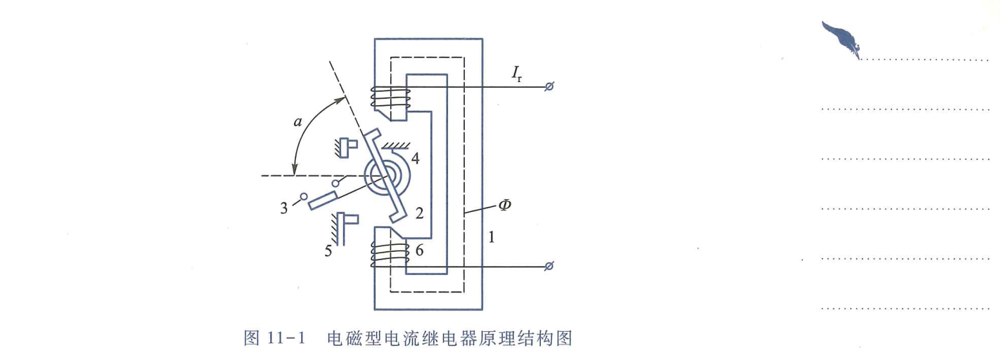

*图11-1电磁型电流继电器原理结构图（原书第297页）*

1一电磁铁；2一可动衔铁；3一接点；4一反作用弹簧；5一限制支撑；6一线圈

当继电器的线圈输入电流时，在铁心中产生的磁通对转动衔铁产生一对转矩，如果输入电流足够大，使得该转矩大于弹簧4的反作用力矩和可动衔铁2在运动过程中的摩擦力矩之和，则可动衔铁2顺时针转动（继电器动作），并带动固定在可动衔铁2上的金属片与接点3的两个触点接触（闭合）。因此接点3称为动合接点，也称为常开接点、常开触点、动合触点。

如果减小继电器的线圈输入电流/“当线圈输入电流足够小时，弹簧4的反作用力矩大于铁心磁通对可动衔铁2产生的转矩和可动衔铁2运动的摩擦力矩之和，则可动衔铁2逆时针转动（继电器返回），并带动固定在可动衔铁2上的金属片与接点3的两个触点断开。此时常开接点断开。

一般地，在二次接线图中，所有继电器的接点（触点）和开关电器的辅助接点（触点）都是按照它们的正常状态来表示。这里所谓的正常状态是指开关断开（或继电器不通电）时辅助接点的状态。在开关断开（或继电器不通电）时，其辅助接点是断开的接点称为常开接点；其辅助接点是闭合的接点称为常闭接点。在继电器通电和开关合闸的状态下，常开接点是闭合的，常闭接点是断开的。

接点本质上就是金属片，其载流量是受限的，因此无论是常开接点还是常闭接点都存在额定容量，称为接点容量。目前接点容量通常是指在一定直流电压下的额定电流值，如24V1A、24V5A、220V1A、220V5A等。通常高压断路器辅助接点容量要远高于继电器辅助接点容量。

当接点容量不足时，可以采用接触器和中间继电器扩展接点容量。其方法详见本书11.3.2节的合闸回路。

### 11.1.3 二次系统

由二次设备按照一定规则相互连接，构成对一次设备进行监测、控制、调节、保护和管理的电气回路称为二次系统或二次回路。

在电力系统中，虽然一次系统是主体，但是要实现一次系统的安全、可靠、优质、经济运行，二次接线是不可缺少的重要组成部分和安全措施。因此，电力系统是由一次设备和二次设备组成的互相联系的有机系统。

变电站二次系统按照功能可以分为：

<!-- 原书第298页；PDF第153页 -->

（1）控制回路：对一次设备进行各种控制操作。主要是间隔层对一次设备的控制、过程层对一次设备的内部控制。

（2）调节回路：根据一次设备运行参数的变化，实时在线调节一次设备的工作状态，以满足运行要求。

（3）继电保护回路：对系统的故障和异常状态进行处理。

（4）测量回路：采集、指示或记录一次设备和系统的运行参数，以便运行人员掌握一次系统的运行情况。

（5）信号回路：反映一、二次设备的工作状态。

（6）通信回路：变电站内部通信、变电站与调度之间的通信

（7）操作电源系统：包括直流电源系统和交流电源系统。给二次设备提供工作电源与操作电源。

### 11.1.4 二次系统的分层

为了设计和运行的规范性和开放性，二次系统从纵向划分成了多个层次。

在电力系统中，为了实现对电力系统运行状态的测量、控制、调节和管理，采用了用于电网调度的能量管理系统（management，EMS)和用于生产管理的调度管理信息系统（dispatchmanagementinformationsystem，DMIS)等。这些系统从纵向都分成了三个层次，以EMS为例，分为国家级EMS、省级EMS、地区级EMSO

IEC对变电站二次系统进行了纵向分层，如图11-2所示。

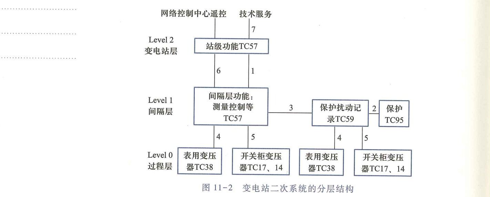

*图11-2变电站二次系统的分层结构（原书第298页）*

变电站二次系统从纵向分为变电站层、间隔层和过程层。

（1）变电站层：完成变电站全站的监视、控制、调节、保护、通信、管理等功能。其常见设备如监控系统设备、通信系统设备、站域保护设备、故障录波装置等。

（2）间隔层：完成电气间隔内的测量、监视、控制、调节、保护等功能。其常见设备如间隔层保护测控装置、间隔层各种测量仪表、励磁调节器、同期装置、检测仪表、信号装置和控制开关等。

（3）过程层：完成设备级的测量控制功能。其常见设备如各类智能一次设

<!-- 原书第299页；PDF第154页 -->

备、电子式互感器及其合并器等。

为了实现变电站各层之间的通信，需要建立通信网络。目前主要采用基于TCP/IP架构的计算机网络来实现。通信网络可以是整个变电站建立一个通信网络，也可以在层与层之间分别建立通信网络。目前主要采用的是建立两个网络：实现变电站层和间隔层之间通信的网络、实现间隔层和过程层之间通信的网络。这样，变电站二次系统从纵向分为三层，建立了两个通信网络，统称变电站

## 11.2 二次接线图

### 11.2.1 二次回路的符号

表明二次设备之间连接关系的图称为二次接线图。实际中常见的一

一次接线图主要有原理接线图、展开接线图和安装接线图三种。

在二次接线图中，二次回路的符号包括图形符号和文字符号。

1.图形符号

图形符号用于表征二次设备及其部件的类型和功能。GB-T4728《电气简图用图形符号》规定了各类电气设备的标准图形符号。表11-1作为例子给出了一部分常用的开关、触头和触点（接点）类国家标准图形符号。从表11-1可以看出，图形符号不仅标识了一、二次设备类型，而且还标识出了该设备的典型功能，这样使得读图人通过图纸可以明确很多的相关信息，这也是各类电气图纸得到广泛应用的原因之一。因此绘制电气图，不论是一次系统图还是二次系统图，都必须遵守最新的标准图形符号规定。

2，文字符号

文字符号在设备或元件的图形符号上方或其近旁，用字母表示出其名称。与图形符号类似，相关国家标准也给出了文字符号标准。表11-2、表11-3作为例子分别给出了一部分常用的开关控制类文字符号和接触器继电器类文字符号。

3.回路编号

二次回路编号的目的有两个：一是根据编号能了解回路的性质及用途，二是便于记忆，按编号进行正确的接线、维修和检查。

二次回路编号的方法：按“等电位"原则标注，在电气回路中相同电位的回路采用同一编号。如跳闸回路的7、分闸回路的37，电流回路的A411等。这一编号方法便于读图时了解回路的作用，在原理图中运用最多。

二次回路编号用3位或3位以下数字组成，需要标明回路的相别或某些主要特征时，可在数字标号的前面（或后面）增注文字符号，如37a、A630等。

二次回路数字编号的分配原则如表11-4所示。

<!-- 原书第300页；PDF第155页 -->

亘回

0

<!-- 原书第301页；PDF第156页 -->

回回

饲回

到回

<!-- 原书第302页；PDF第157页 -->

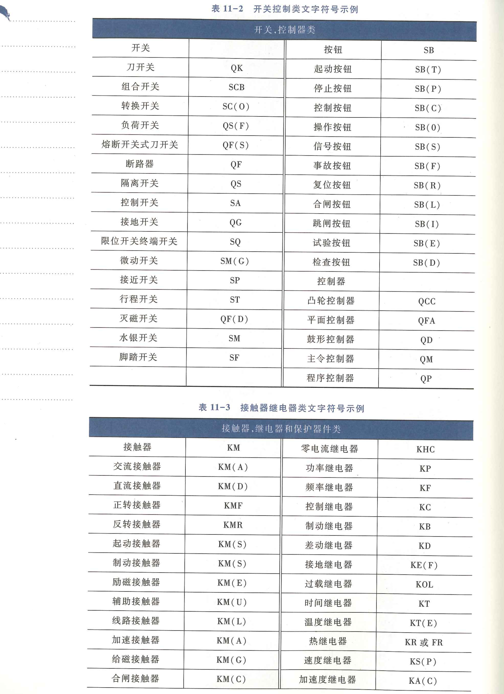

*表11-2；表11-3接触器继电器类文字符号示例（原书第302页）*

<!-- 原书第303页；PDF第158页 -->

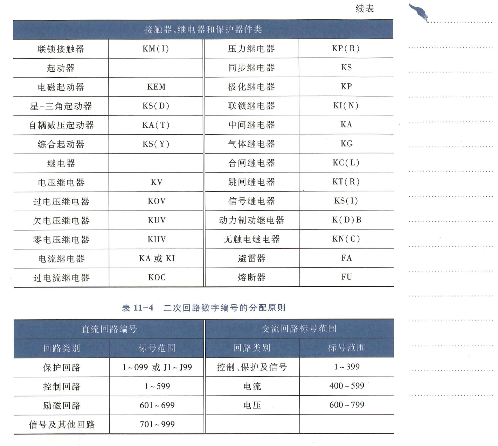

*续表；表11-4二次回路数字编号的分配原则（原书第303页）*

回路编号应用遵循一定的规则如下：

（1）对不同用途的直流回路，使用不同的数字范围，如控制与保护回路用1、399（400、599），励磁回路用600、699。

（2）保护与控制回路使用的数字按熔断器（或小开关）分组，每一百为一组，如101、199、301、399等。其中正极性回路编为单数，由小至大；负极性回路编为双数，由大至小。

（3）信号回路的数字编号，按事故、位置、预告、指挥信号进行分组，按数字大小进行排列。

（4）开关设备、控制回路的数字编号组，应按开关设备的数字序号选取。如1KK所在的回路选10199，3KK所在的回路选301、399。

（5）对接点、开关、按钮等两侧，虽然闭合时为等电位，应编号不同，但只能改变编号大小而不改变单、双数（极性）。经过回路中主要降压元件（如线圈、电阻等）后改变其单、双数（极性）。

（6）某些回路形成了特定编号，不能随意挪作他用。例如，正负电源的101、

<!-- 原书第304页；PDF第159页 -->

102，红绿灯回路的135、105等。

### 11.2.2 原理接线图

原理接线图是用来表示继电保护、测量仪表和自动装置等的工作原理和构成这套装置所需要的二次设备的一种二次接线图。绘制原理接线图的目的是能

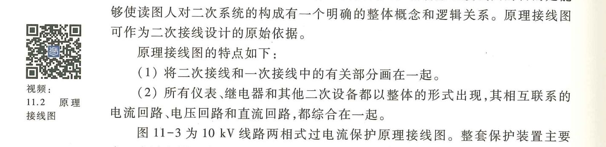

*图11-3为10kV线路两相式过电流保护原理接线图。整套保护装置主要（原书第304页）*

由四个继电器组成，电流继电器KAI和为测量元件，其线圈分别串接于A、c相电流互感器TA“、TA。的二次线圈回路中，两个电流继电器的常开接点并联后接到逻辑元件时间继电器KT的线圈上。时间继电器KT的接点与信号继电器KS线圈串联后，通过断路器QF辅助常开接点QF2接到断路器QF跳闸线圈YR上。

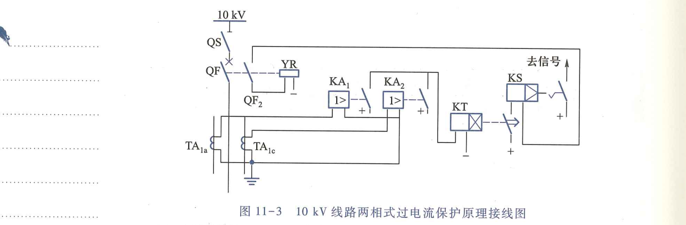

*图11-310kV线路两相式过电流保护原理接线图（原书第304页）*

TA一电流互感器；KAI、KA2一电流继电器；KT一时间继电器；KS一信号继电器；QF一断路器；

QF2一断路器QF的辅助常开接点；YR一断路器QF的跳闸线圈；QS一隔离开关

当流过电流继电器线圈的电流超过其动作电流时，电流继电器常开接点闭合，将由直流操作电源母线正极来的电源加在时间继电器KT线圈上；时间继电器KT线圈的另一端是直接接在由操作电源负母线引来的电源负极上，故时间继电器KT启动，经过一定时限后其延时常开接点闭合，电源正极经过其延时接点、信号继电器KS的线圈、断路器QF的辅助常开接点QF2、跳闸线圈YR接至电源负极。信号继电器KS的线圈和跳闸线圈YR中有电流流过，两者同时动作，使断路器QF跳闸，并由信号继电器KS的接点发出信号。断路器QF跳闸后由其辅助常开接点QF2断开，切断跳闸线圈中的电流。

由于原理接线图上各元件之间的联系是以元件的整体形式来表示的，没有给出元件的内部接线、元件引出端子的编号和回路的编号，直流部分仅标出电源的极性，没有具体标明是从哪一组熔断器下面引来的。另外，关于信号部分在图中只标出了“去信号"，而没有画出具体的接线。特别对于复杂设备，由于接线复

<!-- 原书第305页；PDF第160页 -->

杂，回路中的缺陷不易发现和寻找。因此，仅有原理接线图还不便对二次回路进行检查、维修和安装配线，下面介绍的展开接线图便可弥补这些缺陷。

### 11.2.3 展开接线图

展开接线图（简称展开图）用来说明二次回路的动作原理，在现场使用极为普遍。展开接线图的特点如下：

（1）将每套装置的有关设备部件解体，按供电电源的不同分别画出电气回路接线图，如交流电流回路、交流电压回路和直流回路等分开表示。于是，将同一个仪表或继电器的电流线圈、电压线圈和接点分别画在不同的回路里，为了避免混淆，将同一个元件及设备的线圈和接点采用相同的文字标号。

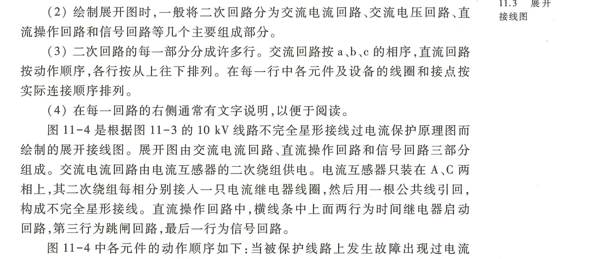

*图11-4是根据图11-3的10kV线路不完全星形接线过电流保护原理图而；图11-4中各元件的动作顺序如下：当被保护线路上发生故障出现过电流（原书第305页）*

时，使电流继电器KAI或KA2动作，其常开接点闭合，接通时间继电器的线圈回路。时间继电器KT动作经过整定时限其延时接点闭合后，接通跳闸回路。断路器在合闸状态时，其与主轴联动的常开接点QF2是闭合的，因而此时在跳闸线圈YR中有电流流过，使断路器跳闸。同时串联于跳闸回路中的信号继电器KS动作，其在信号回路中的KS接点闭合，接通小母线WAS，发出事故音响等信号。

比较图11-3和图11-4可知，展开接线图接线清晰，易于阅读，便于了解整套装置的动作程序和工作原理，特别是在复杂电路中其优点更为突出。同时便于检查二次回路接线是否正确，有利于寻找故障。

### 11.2.4 安装接线图

安装接线图是制造厂加工制造屏（柜、盘）和现场施工安装所必不可少的图，也是运行试验、检修和事故处理等的主要参考图。

一般，二次设备按照其功能和间隔统一安装在屏、柜或箱体内。屏、柜的差别在于前后是否装门、侧面是否密封。柜的前后都装门，侧面密封。按照国家标准规定，中国的屏、柜尺寸（不计底座、顶部散热尺寸）是：2260×800×800mm3、2260×800×600mm、2260×600×800mm、2260×600×600mm、2200×800×800mm3、2200×800×600mm、2200×600×800mm、2060×600×600mm

屏、柜或箱体内部设置有若干对外的接线端子，若干接线端子组合在一起构

<!-- 原书第306页；PDF第161页 -->

TAI

A相过流

交

10kV

流

C相过流

流

QS

回

路

公共线

+从℃

—WC

保护直

时间继电器

2

表计TA2

回路

操

回

路

跳闸回路

2

WAS

线路

示意图

信号回路

去信号

KS

图一410kV线路过电流保护展开接线图

WAS一事故音响信号小母线；wc一控制电路电源小母线

成端子排。屏、柜或箱体相互之间的连接，以及屏、柜或箱体与其外部其他二次设备之间的连接，都通过端子排连接。屏、柜或箱体内部的二次设备仅与端子排相连。

安装接线图包括屏面布置图、屏背面接线图和端子排图三个组成部分，它们相互对应，相互补充。

屏面布置图是说明屏上各个元件及设备的排列位置和其相互间距离尺寸的图。通常采用屏、柜（开门）的正视图，要求按照一定

丨。240·320。240》《的比例尺绘制。屏面布置图用于确定屏柜上二次设《备的位置，如图11-5所示。

390

屏背面接线图是在屏上配线所必需的图，其中应标明屏上各二次设备在屏背面的引出端子的位置、屏

300内端子排的位置，屏内端子之间的连接情况，以及屏上设备与端子排的连接情况，如图11-6所示。

300

端子排图是表示屏上需要装设的端子数目、类型

KSL和排列次序，以及与屏外、屏内设备端子连接情况的图，如图11-7所示。图中，左上角“I"表示端子排设备编号；右上角“10kV线路"是端子排简要说明；中间一列数字是端子编号；左边一列表示端子的含义；

1210右边一列表示端子排上对应端子与屏内设备上的端子或其他屏的连接情况；端子1、2、3旁的竖直线表示这3个端子连接电磁设备；端子5、6旁边带小圆圈的竖直线表示这两个端子直接在端子排上用导线连接

图II一5

屏面布置图起来。

<!-- 原书第307页；PDF第162页 -->

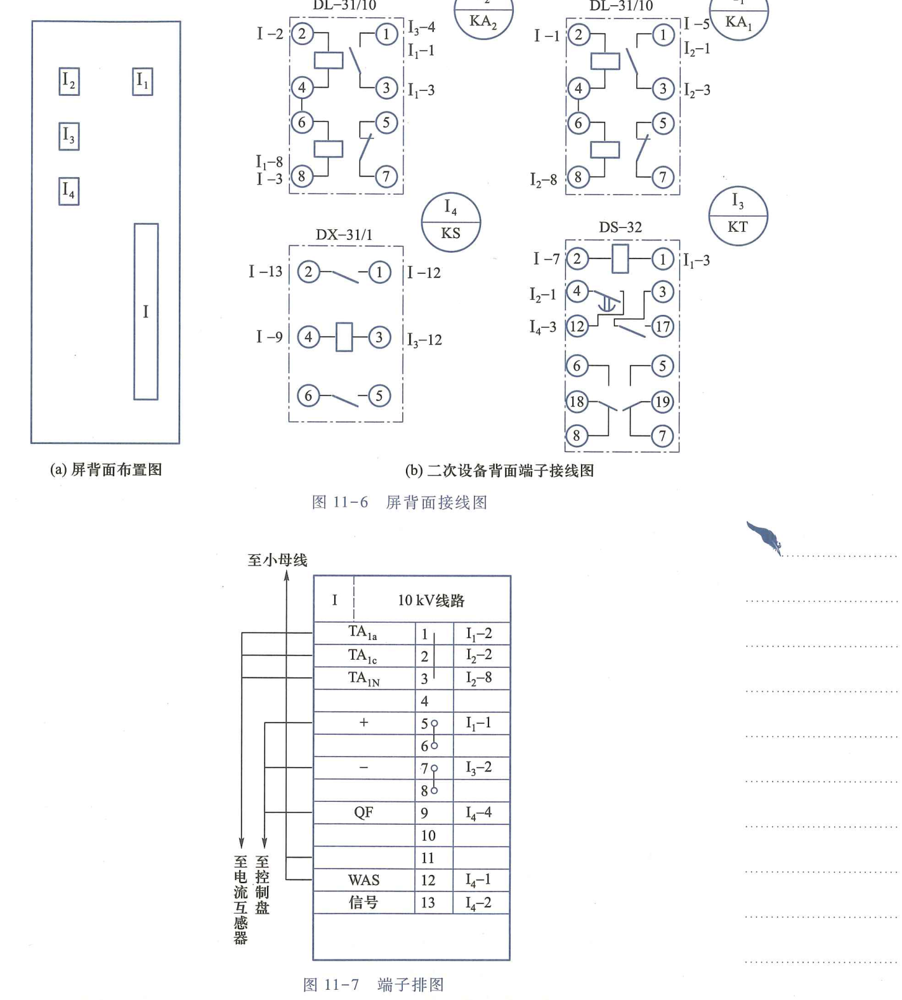

*图11-6；图11-7端子排图（原书第307页）*

屏背面接线图和端子排图必须说明每根二次电缆是连接哪两个端子的，这样就必须对变电站的每一个端子都给出一个唯一的标识号。

唯一标识端子号的方法是采用“屏号一二次设备号一端子号"的组合，如PI屏1设备的3号端子标识为“一I一3”；若都是同一个屏内部的接线，所有端子都在同一个屏内部，通常可以省略屏号，如“I一3”。

通常变电站内都对所有屏、柜、箱和一些零散的二次设备进行了唯一的编

<!-- 原书第308页；PDF第163页 -->

号，日P1、PI、P2、P3

二次设备的编号方法如图11-8所示。安装单位编号和设备顺序号一起构成了二次设备编号。其中安装单位编号经常以罗马数字I、II、III、一或其他文

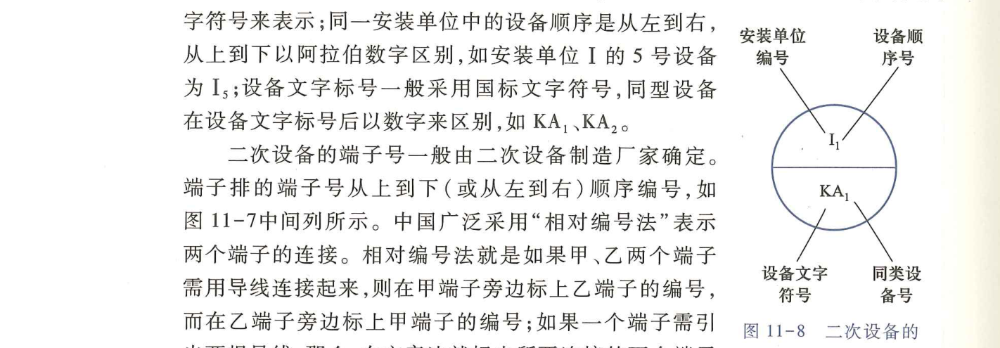

*图11-7中间列所示。中国广泛采用“相对编号法"表示；图11-8二次设备的（原书第308页）*

出两根导线，那么，在它旁边就标出所要连接的两个端子

编号方法编号，如图11-6（b）、图11-7所示。

## 11.3 断路器控制和信号回路

### 11.3.1 断路器控制回路的基本要求

断路器控制包括断路器分闸控制和合闸控制。断路器控制按控制地点可分为远方遥控和就地控制两种。远方遥控是指在远离断路器的控制主站发出控制指令，控制指令通过通信网络传送到断路器安装地点附近的控制装置，控制装置执行控制指令对断路器进行控制的控制模式。就地控制是指在断路器安装地点进行的手动或自动控制。当前，变电站内的任何一台断路器一般都要求同时具有远方遥控和就地控制功能。

断路器控制按控制设备安装位置还可分为集中控制和分散控制两种。所谓集中控制是指变电站内所有断路器的控制都集中在一个地点（如主控室内）进行控制。被控制的断路器与主控制室之间一般都有几十米到几百米的距离，通过控制电缆连接。所谓分散控制是指变电站内断路器控制分散在各个断路器所在电气间隔内对断路器进行控制。分散控制可以大大地减少主控制室的建筑面积和节省控制电缆。分散控制是当前技术的主流。

断路器控制是通过相应的二次设备和二次回路实现的。当断路器的控制通过手工实现时，在控制屏上应当有能发出跳、合闸命令的控制开关，而在断路器上应当有执行操作命令的操动机构、跳闸线圈、合闸线圈等。控制开关与断路器之间是通过控制电缆连接起来的。

断路器控制回路的基本要求如下：

（1）既能进行手动跳、合闸，又能由继电保护与自动装置实现自动跳、合闸，当跳、合闸操作完成后，应能自动切断跳、合闸脉冲电流；

<!-- 原书第309页；PDF第164页 -->

（2）应有防止断路器多次连续跳、合闸的“跳跃"闭锁装置；

（3）应能指示断路器的合闸与分闸位置的信号；

（4）自动跳闸或合闸应有明显的信号；

（5）应能监视熔断器的工作状态及断路器跳、合闸回路的完整性。

下面以直流操作的电磁操动机构为例，分别说明实现上述要求的方法。

### 11.3.2 断路器手动/自动分合闸及分合闸指示

1.控制开关

控制开关主要有两种类型。一种是跳、合闸操作都分两步进行，手柄有两个固定位置和两个操作位置的控制开关；另一种是跳、合闸操作只用一步进行，手柄有一个固定位置和两个操作位置的控制开关。前者用于火电厂和有人值班的变电站中，后者用于遥控及无人值班的变电站中。

LW2系列封闭式万能转换开关在发电厂和变电站中应用很广，除了在断路器及接触器的控制回路中用作控制外，还在测量表计回路、信号回路、各种自动装置及监察装置回路中用作转换开关。

LW2系列转换开关制成旋转式，它从一种位置切换到另一种位置是通过将手柄向左或向右旋转一定角度来实现的。为了说明操作手柄在不同位置时，各接点通、断情况，一般都列出接点图表。表11-5为LW2一z一la、4、6a、40、20、6a/F8型控制开关的接点图表。型号中:LW2-Z为开关型号；la、4、6a、40、20、6a为开关上所带接点盒的形式，它们的排列次序就是从手柄处算起的装配顺序；斜线后面的F8为面板及手柄的形式。

表中手柄样式是正面图，这种控制开关是有两个固定位置（垂直和水平）和两个操作位置（由垂直位置再顺时针转45。和由水平位置再逆时针转45。）的开关，由于有自由行程的接点不是紧跟着轴转动的，所以按操作顺序的先后，接点位置实际上有六种，即跳闸后、预备合闸、合闸、合闸后、预备跳闸和跳闸。

当断路器是在断开状态时，操作手柄是在跳闸后位置（水平位置）。如果需要进行合闸操作，则应首先顺时针方向将手柄转动90。至预备合闸位置（垂直位置），然后再顺时针方向旋转45。至合闸位置，此时4型接点盒内的5一8接点接通，发出合闸命令，此命令称为合闸脉冲。合闸操作必须用力克服控制开关中自动复位弹簧的反作用力，当操作完成松开手后，操作手柄在复位弹簧的作用下自动返回到原来的垂直位置，但这次复位是在发出合闸命令之后，所以称其为合闸后位置。从表面上看，预备合闸与合闸后手柄是处在同一固定位置上，但从接点图表中可以看出，对于具有自由行程的40、20两种形式的接点盒，其接通情况是前后不同的，因为在进行合闸操作时，40、20型接点盒中的动接点随着切换，但在手柄自动复归时，它们仍保留在合闸时的位置上，未随着手柄一起复归。

<!-- 原书第310页；PDF第165页 -->

表11

一5

LW2

一Z一la、4、6a、40、20、6a/F8型控制开关的接点图表

21

22

跳

24

23

F8

la

40

20

1一32一45一86一79一109一1210一1113一1414一巧13一1617一1917一1818一2021一2221一2422一23

跳闸操作是从合闸后位置（垂直位置）开始，逆时针方向进行。即先将操作手柄逆时针方向转动90。至预备跳闸位置，然后再继续用力旋转45。至跳闸位置。此时4型接点盒中的6一7接点接通，发出跳闸脉冲。松开手后，手柄自动复归，此时的位置称为跳闸后位置。这样，跳、合闸操作都分成两步进行，对于防止误操作有很大的意义。

在看控制开关接点图表时必须注意，表中所给出的接点盒背面接线图是从屏后看的，而手柄是从屏前看的。两者对照看时，当手柄顺时针方向转动，接点盒中的可动接点应逆时针方向转动，两者恰相反。

2.断路器操动机构

操动机构是断路器本身附带的跳、合闸传动装置，其种类很多，有电磁操动机构、弹簧操动机构、液压操动机构、气压操动机构等，其中应用最广的是电磁操

<!-- 原书第311页；PDF第166页 -->

动机构。

与电气二次接线关系比较密切的是操动机构中跳、合闸线圈的电气参数。各种形式操动机构的跳闸电流一般都不很大（当直流操作电压为110、220v时跳闸电流约0巧、5A），而合闸电流则相差较大，如果利用弹簧、液压、气压等操作，则合闸电流较小（当直流操作电压为110、220v时，一般不大于5A），如果利用电磁操动机构合闸，则合闸电流很大，可由几十安培至数百安培，此点在设计控制回路时必须注意。对于电磁型操动机构，合闸线圈回路不能利用控制开关接点直接接通，必须采用中间接触器，利用接触器带灭弧装置的接点去接通合闸线圈回路。

3.断路器的简化控制回路

简化的断路器控制回路如图11-9所示。断路器的手动合闸回路由控制开关SA的5一8接点、断路器QF的常闭接点QFI、断路器QF操动机构上的合闸接触器线圈KO组成。

KO

QFI

5

8

回

自动

路

跳

SA

手动

6

7

自动

路

YO

合闸线圈回路

K01

K02

图一9简化的断路器控制回路图一控制开关，KO一合闸接触器线圈；YR一断路器QF的跳闸线圈；QFI一断路器QF的辅助常闭接点；

KM]一自动装置接点；一继电保护出口继电器接点；YO一断路器QF的合闸线圈

手动合闸前，断路器处于分闸状态，断路器QF的常闭接点QFI闭合。手动合闸时，将控制开关的SA的手柄转至“合闸"位置，5一8接点接通，合闸接触器线圈KO中即有电流流过，接触器的常开接点K01和K02闭合，将断路器QF的合闸线圈YO回路接通，断路器即行合闸。当断路器合闸过程完成，与断路器传动轴连动的常闭接点QFI立即断开，自动地切断合闸接触器线圈中的电流。可见，在合闸回路中串人断路器常闭接点QFI的作用是在合闸完成后自动切断合闸脉冲

断路器的手动跳闸回路由控制开关SA的6一7接点、断路器QF的常开接点QF2、断路器QF操动机构上的跳闸线圈YR组成。

手动跳闸前，断路器处于合闸状态，断路器QF的常开接点QF2闭合。手动跳闸时，将控制开关的SA的手柄转至跳闸位置，6一7接点接通，跳闸线圈YR中即有电流流过，断路器进行跳闸。当断路器跳闸过程完成，与断路器传动轴连动的常开接点QF2立即断开，自动地切断跳闸线圈中的电流。可见，在跳闸回路中串人断路器常开接点QF2的作用是在跳闸完成后自动切断跳闸脉冲。

合闸回路中使用合闸接触器KO的原因是很多断路器合闸电流很大（合闸时

<!-- 原书第312页；PDF第167页 -->

断路器主触头受到的电磁力是斥力），可达几十安培，控制开关SA的5一8接点和继电器的KMI的接点容量不足，因此采用合闸接触器扩展接点容量。断路器分闸时的分闸电流小，一般小于5A，因此不需要采用接触器扩展接点容量。

为了实现断路器自动合闸，可以将自动合闸装置（如重合闸装置）的出口继电器的常开接点KM]和控制开关SA的5一8接点并联。这样，自动合闸装置需要合闸时通过控制出口继电器动作闭合常开接点KMI，可以控制断路器合闸。

同理，为了实现断路器自动跳闸，可以将自动跳闸装置（如继电保护装置）的出口继电器的常开接点KMO和控制开关SA的6一7接点并联。这样，自动合闸装置需要跳闸时通过控制出口继电器动作闭合常开接点KMO，可以控制断路器

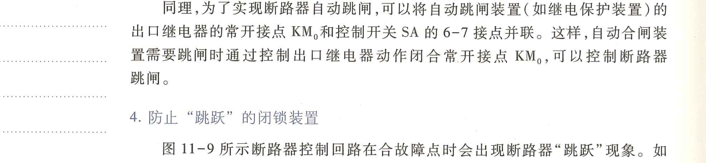

*图11-9所示断路器控制回路在合故障点时会出现断路器“跳跃"现象。如（原书第312页）*

果被合闸投运的电气设备存在短路故障，此时若控制开关SA的5一8接点未复归（例如操作手柄未松开或故障焊住）或自动装置的接点KMI接点故障焊住，继电保护动作使断路器自动跳闸后，合闸回路又接通使接触器线圈KO带电，断路器合闸；但故障并未消失、保护又动作使断路器跳闸，接触器线圈KO带电又合

，则会出现多次的“跳一合"现象，这种现象称为跳跃。断路器如果多次跳跃，会使断路器毁坏，造成事故扩大。

所谓防跳就是要采取措施防止这种跳跃的发生。防跳通过跳跃闭锁继电器KLB来实现，如图11-10所示。

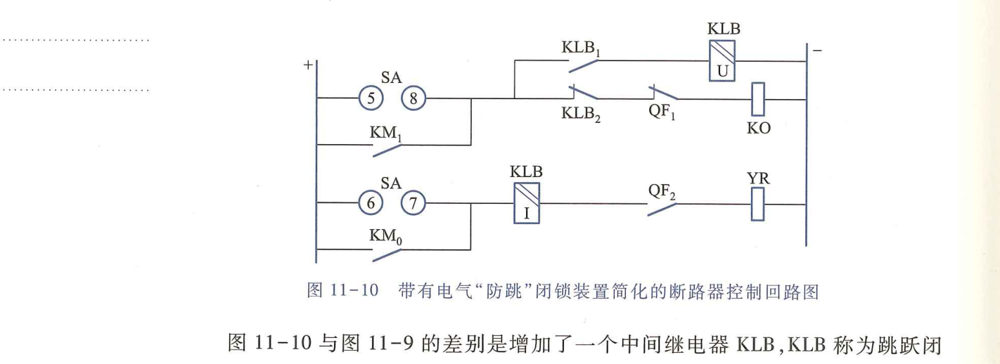

*图11-10带有电气“防跳"闭锁装置简化的断路器控制回路图；图11-10与图11-9的差别是增加了一个中间继电器KLB，KLB称为跳跃闭（原书第312页）*

锁继电器。它有两个线圈，一个是电流启动线圈，串联于跳闸回路中；另一个线圈为电压自保持线圈，经过自身的常开接点KLBI并联于合闸接触器回路中。此外，在合闸回路中还串联接人了一个KLB的常闭接点KLB2

防跳的工作原理：当利用控制开关SA的5一8接点或自动装置KMI进行合闸时，如果合闸在短路故障上，继电保护装置动作，其接点KMO闭合，将跳闸回路接通，使断路器跳闸。同时跳闸电流也流过跳跃闭锁继电器KLB的电流启动线圈，使KLB动作，其常闭接点KLB2断开合闸回路，常开接点KLBI接通KLB的电压线圈。此时，如果合闸脉冲未解除，例如，控制开关SA的5一8接点未复归或自动装置接点KMI被卡住等，则KLB的电压线圈通过SA的5一8接点或KMI接点实现

<!-- 原书第313页；PDF第168页 -->

的电压自保持线圈断电后，才能恢复至正常状态。

5.断路器的分合闸位置指示灯回路

断路器的分合闸位置可利用信号灯来指示，其接线原理图如图11-11所示。

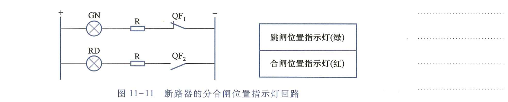

*图11-11断路器的分合闸位置指示灯回路（原书第313页）*

指示灯是利用与断路器的常闭接点QFI和常开接点QF2来进行切换的。当断路器在分闸位置时，常闭接点QFI接通，在控制屏上绿灯GN亮；当断路器在合闸位置时，常开接点QF2接通，红灯RD亮

6.断路器自动分合闸指示

在继电保护装置动作使断路器跳闸或自动装置动作将断路器合闸时，为了能给值班人员一个明显的信号，目前广泛采用指示灯闪光的办法。其接线图是按照不对应原则设计的。

所谓不对应原则是指控制开关的位置与断路器的分合闸位置不一致。例如，断路器原来是在合闸位置，控制开关是在合闸后位置，两者是一致的；当由于发生短路故障，继电保护装置动作使断路器自动跳闸后，断路器已处在断开状态，而控制开关仍保留在原来的合闸后位置，两者就出现了不一致。凡属自动跳、合闸都将出现控制开关与断路器实际分合闸位置不一致的情况，因此，可利用这一特征来发出自动跳、合闸信号，其接线原理图如图11-12所示。

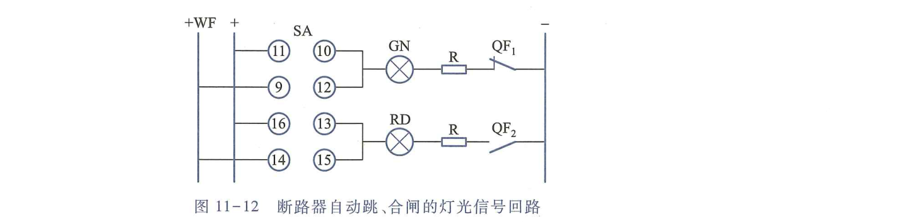

*图11-12断路器自动跳、合闸的灯光信号回路（原书第313页）*

为了减少屏上信号指示灯数目及简化接线，自动跳、合闸指示灯与断路器分合闸位置指示灯共用一组灯泡。为了区别手动跳、合闸与自动跳、合闸，在接线图中增加了控制开关SA的接

、、0

当值班人员手动操作使断路器跳闸后，控制开关是处在跳闸后位置，SA的10一11接点接通，绿灯GN发出平光，指示断路器在分闸状态。

当正常运行中断路器由继电保护动作自动跳闸后，控制开关仍处在原来的合闸后位置，而断路器已经跳开，两者的分合闸位置不一致，此时绿灯GN经SA

<!-- 原书第314页；PDF第169页 -->

的9一10接点接至闪光电源小母线+WF上，所以绿灯闪光。

当断路器正在合闸且存在故障，断路器由继电保护动作自动跳闸后，控制开关仍处在合闸位置，而断路器已经跳开，两者的分合闸位置不一致，此时绿灯GN经SA的9一12接点接至闪光电源小母线+WF上，所以绿灯闪光。

当值班人员将控制开关切换至跳闸后位置时，则控制开关与断路器两者的分合闸位置对应，绿灯闪光停止，发出平光。

当由自动装置进行自动合闸后，也将出现分合闸位置不对应情况，此时红灯闪光，原理与上述相同。

在有人值班的变电站和发电厂，当断路器由继电保护装置动作跳闸后，为了引起值班人员注意，不仅已跳闸的断路器的绿色指示灯闪光，而且还要发出事故

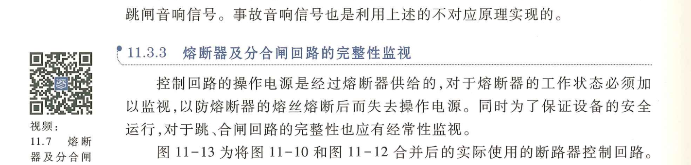

*图11-13为将图11-10和图11-12合并后的实际使用的断路器控制回路。（原书第314页）*

### 11.3.3 熔断器及分合闸回路的完整性监视

该图还可以指示熔断器及分合闸回路完整性。

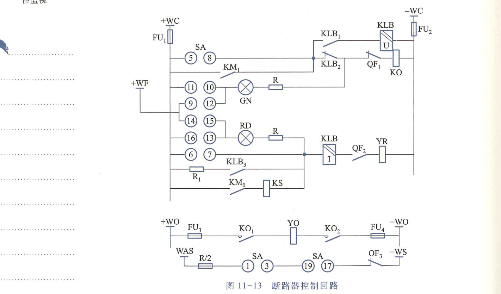

*图11-13断路器控制回路（原书第314页）*

显然，如果绿灯GN和红灯RD任一灯亮，说明熔断器FUI和FU2没有熔断。

如果绿灯GN亮，表示GN-R-QFI-KO回路正常。在合闸回路中，故障最多的是连接控制屏和断路器之间的电缆（KLB2一QFI之间的电缆）、断路器常闭接点QFI。因为连接控制屏和断路器之间的电缆距离较长，可能由于绝缘损坏、人为破坏和老鼠啃咬等原因短路或断路；QFI大多处于室外露天，容易氧化、生锈和金

<!-- 原书第315页；PDF第170页 -->

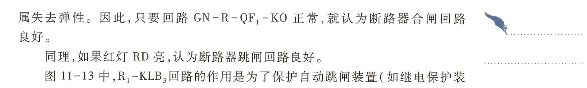

*图11-13中，RI一KLB3回路的作用是为了保护自动跳闸装置（如继电保护装（原书第315页）*

置）输出的常开接点KMO而设置的。一般常开接点KMO容量很小，切断跳闸线圈YR的大电感电流容易造成的损坏（电弧造成粘连、烧断），需要用容量大的断路器常开接点QF2切断跳闸线圈YR的大电感电流，因此设置RI-KLB3回路。如果在自动跳闸完成后常开接点KMO先于断路器常开接点QF2断开，由于RI-KLB3回路存在，流经常开接点KMO的电流很小，不会产生电弧。

## 11.4 变电站的综合自动化

所谓变电站综合自动化系统是将变电站的所有二次设备（包括测量仪表、信号系统、继电保护、自动装置、远动通信等）经过功能组合和优化设计，利用计算机技术、通信技术、信号处理技术等，实现对整个变电站的设备和系统进行自动监视、测量、控制、调整、保护、通信和管理等的综合性自动化系统。

变电站综合自动化系统具有功能综合化、装置微机化、测量数字化、结构分层分布化、通信网络化、运行管理智能化等技术特征。

变电站综合自动化系统始于20世纪80年代，发展很快，目前中国110kV及以上的绝大多数都安装了变电站综合自动化系统。

变电站综合自动化系统结构形式包括集中式、分布分散式和分布式结构集中组屏式三种。

集中式综合自动化系统结构典型技术特征是所有功能都在主控室集中布置的监控台上完成，监控台内有一台或多台主计算机，扩展其输入输出及外围接口实现集中采集信息、集中处理与计算、集中控制、集中通信，以及部分集中保护功能等。这种系统的可靠性差、功能有限、很难推广应用。目前集中式综合自动化系统基本淘汰。

随着TCP/IP架构的网络技术在电力系统中的成功应用，变电站综合自动化系统向分布、分散式系统快速发展。逐步形成了两种典型结构：分布分散式和分布式结构集中组屏式。其典型技术特征如下：

（1）变电站综合自动化系统包含IEC分层模型的变电站层和间隔层两层。

（2）变电站层一般包含监控计算机、数据服务器、前置通信、数据处理机和维护计算机等，布置在主控室内。

（3）按照间隔配置间隔层设备（保护设备、测控设备等）。若间隔层设备放置在电气间隔内，称为分布分散式变电站综合自动化系统；若间隔层设备按照每个间隔组屏，并统一布置在继电保护室内，称为分布式结构集中组屏式变电站综合自动化系统。

（4）间隔层设备与变电站层设备采用TCP/IP架构的以太网连接。目前主流采用光纤以太网和IEC61850通信协议。

变电站综合自动化系统的主要功能一般有如下方面：

（1）数据采集与显示。采集变电站内相关设备的模拟量和开关量并实时地显示在屏幕上供运行人员使用。

<!-- 原书第316页；PDF第171页 -->

（2）安全监视及报警。对所有采集的实时数据、信息进行监视，并在出现异常状态时（如保护动作、数据越限、设备异常等）时报警、显示和信息上传等。

（3）事件顺序记录。对变电站内的异常状态、故障按时间进行自动记录、信息远传。

（4）电能计算。系统应自动实现电能分时统计和累加。

（5）控制操作。系统可实现对断路器、隔离开关、变压器分接头的控制及防误操作等，并在特殊情况下可进行人工操作。

（6）可实现变压器、线路、母线、电容器等设备的各种保护功能及合理的配置保护。

（7）进行电压和无功控制，如变压器的分接头自动调节、补偿电容调节等。

（8）实现远动功能，如遥测、遥信、遥调、遥控、遥视、保护定值的远方监视和修改、故障录波和测距并远方传输等。

（9）实现监控系统和保护之间的通信与数据交换，以及交换相互间必要的报告和响应。

（10）具有自身的在线自诊断功能。

## 11.5 智能变电站

1.智能变电站的基本概念

智能变电站(smartsubstation）是指采用先进、可靠、集成、低碳、环保的智能设备，以全站信息数字化、通信平台网络化、信息共享标准化为基本要求，自动完成信息采集、测量、控制、保护、计量和监测等基本功能，并可根据需要支持电网实时自动控制、智能调节、在线分析决策、协同互动等高级功能，实现与相邻变电站、电网调度等互动的变电站。

2.智能变电站的技术特征

（1）智能变电站具有高可靠性。高可靠性不仅意味着站内设备和变电站本身具有高可靠性，而且要求变电站本身具有自诊断和自治功能，能够对设备故障提早预防、预警，并在故障发生的第一时间内对其做出快速反应，将设备故障带来的供电损失降到最低程度。

（2）智能变电站具有很强的交互性。智能变电站必须向智能电网提供可靠、充分、准确、实时、安全的信息。为了满足智能电网运行、控制的要求，智能变电站所采集的各种信息不仅要求能够实现站内共享，而且要求实现与电网内其他高级应用系统相关对象之间的互动，为各级电网的安全稳定经济运行提供基本信息保障。

（3）智能变电站具有高集成度的特点。智能变电站将通信技术、网络技术、计算机技术、传感测量技术、控制技术、电力电子技术等诸多先进技术和原有的变电站技术进行高度的融合，简化了变电站的数据采集模式，形成了统一的电网信息支撑平台，从而为实现电网的实时控制、智能调节、在线分析决策等各类高级应用提供了信息支持。

（4）智能变电站还应具有低碳、环保的特点。智能变电站内部使用光纤代

<!-- 原书第317页；PDF第172页 -->

电子设备；采用电子式互感器代替粗重的传统电磁式互感器。这些不但节省了资源消耗，降低了变电站的建设成本，而且减少了变电站内部的电磁污染、噪声、辐射和电磁干扰，净化了变电站内部的电磁环境，优化了变电站的性能，使智能变电站更加符合环境保护的要求。

3，智能变电站体系结构

设备智能化和高级功能是智能变电站的两个重要特征。与基于DL/T860的数字化变电站的三层结构划分（过程层、间隔层、变电站层）不同，智能变电站基于设备智能化的发展和高级功能的实现，可分为设备层和系统层（如图11-14所示），其划分依据是智能变电站的功能特征。

未来智能化的设备可能将过程层、间隔层、一次设备本体有机融合为一体，因此，在智能变电站中引人设备层的概念，更能体现变电站智能化技术的发展方向，更能引领和指导设备智能化的发展趋势。

基于目前的认知，设备层可看作对应于过程层和间隔层，实现过程层和间隔层的功能，系统层可看作对应于变电站层，实现变电站层功能。但随着智能变电站技术的发展，其对应关系将越来越模糊，融合性更强。

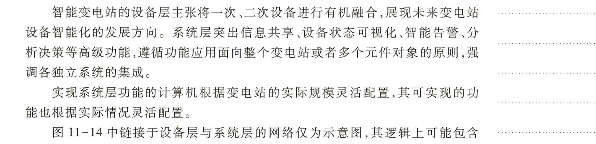

*图11-14中链接于设备层与系统层的网络仅为示意图，其逻辑上可能包含（原书第317页）*

了过程层网络、间隔层网络、变电站层网络，其物理上可以是一个或多个网络。

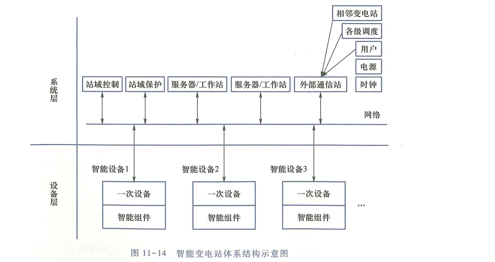

*图11-14智能变电站体系结构示意图（原书第317页）*

<!-- 原书第318页；PDF第173页 -->

图11一巧示意了设备智能化发展的三个阶段：

（1）属于智能组件的保护、测控、状态监测等装置都是独立外置，属于传统的二次设备，其与一次设备构成了一个松散的“智能设备"。而智能组件和一次设备之间的横线刚好划出了相当于过程层和间隔层的界限，其表现形式适合现阶段的变电站技术。由此可见该阶段的设备层带有明显的过程层、间隔层痕迹。

（2）在过渡阶段，状态监测设备（主要指传感器）应逐步融人一次设备中，监测一次设备的诊断信息，其余的组件可独立于一次设备外部，也可安装在一次设备附近。各功能单元之间应尽可能集成，逐步实现智能设备的紧凑化，逐步实现过程层与间隔层的有机融合，形成设备层。

（3）随着技术发展，智能组件和一次设备进一步紧密结合，一次设备可以集成的组件也越来越多，最终形成紧凑型的一体化的智能设备。该阶段的设备层主要考虑过程层、间隔层的一体化设计，因而使得过程层、间隔层难以分清，以致于消融。

目前设备组成

过渡阶段

未来智能设备

一次设备

一次设备

状态监测单元

智能设备

（内置部分）

（一次设备与智能组件（分散布置）

智能组件（一体化）

智能组件高度

集成，实现一保测控计状态

保测控计状态

体化）护量制量监测

护量制量

监测

单单单单

单元

兀兀兀元单元

图11一巧设备智能演变示意图

智能设备采用一次设备+智能组件的模式。智能组件是各种保护、测量、控制、计量和状态监测等单元的有机结合，紧密宿主一次设备。智能组件的物理形态和安装方式是灵活的，既可以外置，也可以内嵌，同时在一定技术条件下智能组件既可以分散，也可以集中。

对于保护、测量、控制、计量、通信、状态监测等各种组件与一次设备的集成，需要充分考虑传统二次设备与一次设备融合的技术难度与复杂性。在技术发展的不同阶段，应考虑不同的技术方案，但原则上在保证安全可靠性的前提下，应尽可能采用设计紧凑的集成方案，同时兼顾经济性。

4，设备层功能要求

（1）一次设备。

一次设备要求具备高可靠性，其外绝缘采用复合材料，与当地环境相适应。信号传变、数据采集时，一般将压力、油位等直接反映设备运行状况的模拟量数字化，满足各种应用对数据采集精度、频率的要求，并以网络方式送出。互感器采用电子式互感器，并将互感器与一次设备集成。

（2）智能组件。

智能组件的基本功能要求包括：

(D采集与控制系统就地设置，与一次设备一体化设计，安装时能适应现场电

<!-- 原书第319页；PDF第174页 -->

磁、温度、湿度、沙尘、振动等恶劣运行环境。

2具备异常时钟信息的识别防误功能，同时具备一定的守时功能

具备参量自检测、就地综合评估、实时状态预报、自诊断、自恢复功能，设备故障自动定位，相关信息能以网络方式输出。

@有标准化的物理接口及结构，具备即插即用功能。

0将测量、控制、计量、保护和检测等功能进行一体化设计，集成到统一的硬件平台上，不同功能区有足够绝缘强度的电气隔离功能。

@采用测控、保护一体化设备，装置可分散就地安装。

0考虑通信网络的延时情况并采取措施，不影响相关智能组件（特别是保护）的功能及性能要求。

O支持在线调试功能。

9通过智能组件能对站内主要设备的健康状况和变化趋势作出综合评估。

（3）测量单元。

采用高精度数据采集技术，用不小于16位的数据长度表示。实现统一断面实时数据的同步采集，提供带精确的绝对时标的电网数据。采用基于三态数据（稳态数据、暂态数据、动态数据）综合测控技术，进行全站数据的统一采集及标准方式输出。满足测量输出数据与被测电力参量在较大频谱范围内的响应一致性要求。具备电能质量的数据测量功能。

（4）控制单元。

具备全站防止电气误操作闭锁功能、同期电压选择功能、本间隔顺序控制功能，遥控回路采用两级开放方式抗干扰，以及支持紧急操作模式。

（5）保护单元。

遵守继电保护基本原则，满足DL/T769等相关保护的标准要求。通过网络通信方式接人电流、电压等数值和输出控制信号，信号的输入输出环节的故障不应导致保护误动作，并发出告警信号。保护单元不依赖外部对时系统实现其保护功能。双重化配置的两套保护，其信息输入输出环节完全独立。当采用电子式互感器时，针对电子式互感器特点优化相关保护算法，提高保护动作性能。纵联保护支持一端为电子式互感器另一端为常规互感器或两端均为电子式互感器的配置形式。

（6）状态监测单元。

逐步扩展设备的自诊断范围，提高自诊断的准确性和快速性。具备通过传感器自动采集设备状态信息（可采集部分）的能力，同时具备从生产管理系统(PMS)自动复制宿主设备其他状态信息的能力，包括指纹信息、家族缺陷信息、现场试验信息等。在不影响测量和可靠性的前提下，将传感器外置，仅内置最必要的部分。不论内置或外置，传感器的接人不影响宿主一次设备的安全运行。具备远方设定采集信息周期、报警阈值功能。

（7）计量单元。

能准确地计算电能量，计算数据完整、可靠、及时、保密，满足电能量信息的唯一性和可信度的要求。具备分时段、需量电能量自动采集、处理、传输、存储等功能，并能可靠的接人网络。根据重要性对某些部件采用双重设备以提高冗余度。计量用互感器的选择配置及准确度要求符合DL/T448的规定。电能表具备可靠的数字量或模拟量输入接口，用于接收合并单元输出的信号。合并单元

<!-- 原书第320页；PDF第175页 -->

具备参数设置的硬件防护功能，其准确度要求能满足计量的需要。针对不同计量单元特点制订各方认可的检验和溯源规程。

（8）通信单元。

采用完全自描述的方法实现站内信息与模型的交换。具备对报文丢包及数据完整性甄别功能。网络上的数据应分级，具备优先传送功能，并计算和控制流量，满足在全站电力系统故障时保护与控制设备正常运行的需求。按照IEc62351要求，采用信息加密、数字签名、身份认证等安全技术，满足信息通信安全的要求。

5.系统层功能要求

（1）本功能要求。

0顺序控制。满足无人值班及区域监控中心站管理模式的要求。可接收和执行监控中心、调度中心和当地后台系统发出的控制指令，经安全校核正确后，自动完成符合相关运行方式变化要求的设备控制。具备自动生成不同主接线和不同运行方式下典型操作流程的功能。具备投退保护软压板功能、急停功能。可配备直观图形图像界面，在站内和远端实现可视化操作。

2站内状态估计。具备站内状态估计功能，实现数据辨识与处理，保证基础数据的正确性，并支持智能调度技术，实现系统电网状态估计。

.与主站系统通信。采用基于模型的通信协议与主站进行通信。

@同步对时系统。建立统一的同步对时系统。全站采用基于卫星时钟与地面时钟互备方式获取精确时间。用于数据采样的同步脉冲源全站唯一，可采用不同接口方式将同步脉冲传递到相应装置。同步脉冲源同步于正确的精确时间秒脉冲，不受错误的秒脉冲的影响。同步对时可采用IEC61588、、SNTP、IRIG-B等方式。

0通信系统。具备网络风暴抑制功能，网络设备局部故障不导致系统性问题。具备方便的配置向导进行网络配置、监视、维护。具备对网络所有节点的工况监视与报警功能。具备Dos防御能力和防止病毒传播的能力。

@电能质量评估与决策系统。实现包含电压、谐波监测在内的电能质量监测、分析与决策的功能，为电能质量的评估和治理提供依据。

0区域集控功能。当智能变电站在系统中承担区域集中控制功能时，除本站功能外，支持区域智能控制防误闭锁，同时满足集控站相关技术标准及规范的要求。

O防误操作。根据变电站高压设备的网络拓扑结构，对开关、刀闸操作前后不同的分合状态，进行高压设备的有电、停电、接地三种状态的拓扑变化计算，自动实现防止电气误操作逻辑判断。

9维护。通过统一的配置工具对全站设备进行全站数据模型及通信配置。变电站作为调度/集控系统数据采集的源端，提供各种可自描述的配置参量，维护时仅需在变电站利用统一配置工具进行配置，生成标准配置文件，包括变电站主接线图、网络拓扑等参数及数据模型。变电站自动化系统与调度/集控系统可自动获得变电站的标准配置文件，并自动导人自身系统数据库中。同时，变电站自动化系统的主接线图和分画面图形文件，以网络图形标准SVG格式提供给调度/集控系统。

@网络记录分析系统。配置独立的网络报文记录分析系统，实现对全站各种网络报文的实时监视、捕捉、存储、分析和统计功能。网络报文记录分析系统

<!-- 原书第321页；PDF第176页 -->

具备变电站网络通信状态的在线监视和状态评估功能。

（2）高级功能要求。

(D设备状态可视化。采集主要一次设备（变压器、断路器等）状态信息，进行可视化展示并发送到上级系统，为电网实现基于状态检测的设备全寿命周期综合优化管理提供基础数据支撑。

0智能告警及分析决策。建立变电站故障信息的逻辑和推理模型，实现对故障告警信息的分类和信号过滤，对变电站的运行状态进行在线实时分析和推理，自动报告变电站异常并提出故障处理指导意见。可根据主站需求，为主站提供分层分类的故障告警信息。

故障信息综合分析决策。在故障情况下对包括事件顺序记录信号及保护装置、相量测量、故障录波等数据进行数据挖掘、多专业综合分析，并将变电站故障分析结果以简洁明了的可视化界面综合展示。

@支撑经济运行与优化控制。综合利用FACTS、变压器自动调压、无功补偿设备自动调节等手段，支持变电站系统层及智能调度技术支持系统安全经济运行及优化控制。

0站域控制。利用对站内信息的集中处理、判断，实现站内安全自动控制装置（如备自投、母线分合运行）的协调工作，适应系统运行方式的要求。

@站域保护。适应智能变电站多种运行方式，运用集中或分布协调的方式采集全站运行数据进行分析计算，优化后备保护功能，提高保护自适应能力。汇总全站信息，侧重于系统稳定控制功能。

0与外部系统交互信息。具备与大用户、各类电源等外部系统进行信息交换的功能，能转发相关设备运行状况等佇审

丨是L、0

问题：是否可以采用软件代替防跳继电器实现防跳功能？

在CPU中，运算逻辑很容易采用软件实现。是否可以采用软件代替防跳继电器实现防跳功能？

## 课外阅读资料

本章推荐如下课外阅读内容：

GB/T30155一2013《智能变电站技术导则》

## 思考题

什么是一次接线和二次接线？它们之间有何联系？

11

一1

二次接线图有几种形式？各有何特点？在什么场合下使用？

11

一2

对断路器的控制回路有哪些基本要求？试说明如何实现这些要求。

11

一3

断路器的控制回路接线是如何防止跳跃的？

11

一4

在断路器的控制和信号回路中“不对应"原则指的是什么？

11

一5

## 其他章节

- [第1章 走进电力系统](CH1走进电力系统.md)

- [第2章 电力系统的组成环节及工作原理](CH2电力系统的组成环节及工作原理.md)

- [第3章 电气一次设备](CH3电气一次设备.md)

- [第4章 电气一次系统](CH4电气一次系统.md)

- [第10章 电力系统继电保护](CH10电力系统继电保护.md)
