# 第1章 走进电力系统

> 来源：《电气工程基础》罗毅编著。原书第 1-22 页；本PDF第 7-28 页。

> 本文件由扫描教材转换，保留原书顺序、小节、例题、思考题及阅读资料。编号公式经对照原书转录为 LaTeX；插图、接线图与复杂表格保留为图片，位于相邻 assets 文件夹。正文为OCR识别稿，个别文字仍可能有识别误差。

## 小节目录

- [1.1 什么是电力系统](#sec-1-1)

- [1.1.1 电力系统的产生和发展](#sec-1-1-1)

- [1.1.2 电力系统的基本概念](#sec-1-1-2)

- [1.1.3 电力系统的缺省假设](#sec-1-1-3)

- [1.2 电力系统的特点](#sec-1-2)

- [1.3 对电力系统的要求](#sec-1-3)

- [1.4 衡量电能质量](#sec-1-4)

- [1.4.1 电压质量](#sec-1-4-1)

- [1.4.2 频率质量](#sec-1-4-2)

- [1.4.3 波形质量](#sec-1-4-3)

- [1.5 电力系统的额定电压](#sec-1-5)

- [1.5.1 额定电压和最高电压](#sec-1-5-1)

- [1.5.2 电力系统的电压等级](#sec-1-5-2)

- [1.6 交流大电网联网的优劣](#sec-1-6)

- [1.7 变压器分接头额定电压的规定](#sec-1-7)

- [1.8 定制电力](#sec-1-8)

## 原文

<!-- 原书第1页；PDF第7页 -->

## 1.1 什么是电力系统

### 1.1.1 电力系统的产生和发展

电力系统是伴随着用户对电力的需求而产生和发展起来的，也是伴随着人类对能源的需求和利用而产生和发展起来的。

在电力工业发展初期，采用发电机组一负荷直接供电模式向用户供电。当某一用户有电力需求时，往往单独设置一台发电机组对该用户供电。这种发电机组一负荷直接供电模式可靠性差，当发电机组故障或检修、线路故障或检修时经常会对用户停电。

为了满足用户对供电可靠性的要求，可将多个用户的发电机组采用输电线路互联，多台发电机组同时对多个用户供电。这样，当其中一台发电机组出现故障时，其他发电机组可以满足多个用户中重要用户的电力需求，因此提高了重要用户的供电可靠性。

采用输电线路将发电机组互联后，由于输电线路存在电阻、电抗和电容效应，输电线路上输送电力时必然会产生电压损耗和功率损耗公式如下：

$$
\Delta U=\frac{PR+QX}{U}
\tag{1-1}
$$

$$
\Delta S=\Delta P+j\Delta Q=\frac{P^2+Q^2}{U^2}(R+jX)
\tag{1-2}
$$

式中：AU为输电线路上的电压损耗；AP为输电线路上的有功功率损耗；AQ为输电线路上的无功功率损耗；P为输电线路上传输的有功功率；0为输电线路上传输的无功功率；U为输电线路线电压。

当互联的发电机组相距越来越远时，总负荷（P，Q）越来越大，输电线路上的电压损耗和功率损耗也越来越大，输电效率越来越低，造成了能源的大量浪费。为了减小功率损耗厶P、提高输电效率，根据式（1-2），可以采用升高输电线路电压U的方法，故在输电线路首端采用变压器升高电压，在输电线路末端采用变压器降低电压。这就是电力系统的雏形。

随着工农业生产的发展，用户对电力需求日益增多。一方面，电力系统需要互联的地域范围越来越大，其规模也越来越大，为了保证输电效率而采用的输电

<!-- 原书第2页；PDF第8页 -->

电压也越来越高；另一方面，发电用的一次资源和电能用户往往不在一个地区，例如，水能资源集中在河流水位落差较大的地方，燃料资源集中在煤、石油、天然气的矿区；而大工业、大城市和其他用电部门则因其原料产地、消费中心或受历史、地理条件的限制，可能与动力资源所在地区相隔很远。这样，水电只能通过高压输电线路把电能输送到用户地区才能利用；火电厂虽然能通过燃料运输在用户所属地区建设发电厂，但随着机组容量的增大，运输燃料常常不如输电经济，只能通过升压变电站、高压输电线路以及降压变电站把电能送到离电厂很远的用户地区。这样，电力系统逐步形成了多电压等级输配电的格局。

电力系统的发展历史是输电电压从低到高的发展历史。中国电力系统的交流输电电压经历了110kV、220kV、500kV(330kV）、1000kV等发展阶段。

### 1.1.2 电力系统的基本概念

电力系统是由发电机、变压器、输电线路和用电设备构成的按照一定规律连接而组成的统一整体，完成电能的生产、输送、分配、消费四个职能。

煤、石油、天然气、水能、风能、太阳能等随自然演化生成的动力资源是能源的直接提供者，称为一次能源。电能是由一次能源转换而成的，称为二次能源。

发电厂是生产电能的工厂，它把不同种类的一次能源转换成电能。发电厂内有很多动力设备，如火电厂的锅炉、汽轮机，水电厂的水库、水轮机，核动力发电厂的反应堆等。电力系统与发电厂动力部分一起构成的系统，则称之为动力系统。

发电厂生产的电能，经过由变压器和输电线路组成的网络输送到城市、农村和工矿企业供给用户的用电设备消耗。变电站是联系发电厂和用户的中间环节，一般安装有变压器及各类开关设备，起着变换和分配电能的作用。由变电站和不同电压等级输电线路组成的网络，称为电力网（简称“电网"）。

下面以水电厂为例来说明动力系统、电力系统和电力网三者之间的关系，如图1-1所示。

发电厂变电站

变电站用户

水轮机发电机升压变压器输电线路降压变压器用电设备

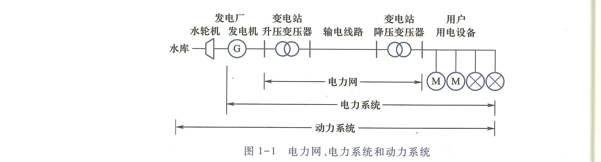

*图1-1电力网、电力系统和动力系统（原书第2页）*

由图1-1可以看出，为减少输送过程中的电能损耗，由发电机生产的电能一般先经过发电厂内的升压变压器将电压升高后，再送入电力网。由于用户用电设备的额定电压较低，因此电能送到用户地区后要经过变电站的降压变压器将电压降低后供给用户的用电设备消耗。

电力网有输电网和配电网之分。输电网将一次能源集中区域发出的电力输送到负荷中心。配电网将输电网输送来的电力分配给用电设备消费。

<!-- 原书第3页；PDF第9页 -->

电力网还可以分为特/超高压远距离输送网络、区域电力网和地区电力网。特/超高压远距离输送网络将一次能源集中区域发出的电力输送到负荷中心区域，例如中国将西南地区的水电输送到珠江三角洲、华中、华东地区；将西北和北方的风电输送到京津唐、华中、华东地区。特/超高压远距离输送网络属于输电网范畴，可采用交流也可采用直流输送电力，交流电压等级为1000kV、750kV和500kV；直流电压等级为±1000kV、±800kV和±500kV。区域电力网将电能在区域内部输送到负荷中心，中国各大区电力网（如华中电网）和各省级电力网可以认为是区域电力网。区域电力网属于输电网范畴，中国区域电力网一般为交流输电，电压等级为500kV和330kV0地区电力网是指负荷中心向用户供电的网络，如北京市电网。地区电力网属于配电网范畴，中国地区电力网一般为交流输电，电压等级为220kV、110kV、35kV、10kV和380vo

变电站起着变换和分配电能的作用。变电站具有多种分类方法，一般根据变电站内最高电压等级和变电站在电力系统中的地位来进行分类。

（1）根据变电站内最高电压等级，可以将交流电力系统中的变电站分为1000kV变电站、750kV变电站、500kV变电站、330kV变电站、220kV变电站、110kV变电站、35kV变电站、10kV变电站等；可以将直流输电系统中的变电站按照直流输电线路的最高电压分为±1000kV直流换流站、±800kV直流换流站、±500kV直流换流站等。

（2）根据变电站在电力系统中的地位，可以将变电站分为枢纽变电站、中间变电站、地区变电站和终端变电站。枢纽变电站是指位于电力系统的枢纽点，高压侧电压为330凵000kV，输送容量大，连接电力系统多个区域或多个负荷中心，汇集多个电源的变电站，全站一旦停电，将引起整个电力系统解列，甚至使部分系统瘫痪，造成大量用户停电。中间变电站是指以长距离输电线路分段为主，对长距离输电进行调整的变电站，高压侧电压为330、1000kV，全站一旦停电后，将引起区域电力系统解列。地区变电站是一个地区或城市的主要变电站。地区变电站是以向地区或城市用户供电为主，高压侧电压一般为110一220kV的变电站。全站一旦停电后，将使该地区中断供电。终端变电站是在电力系统的终端，连接负荷点，直接向用户供电的变电站，高压侧电压为10、110，全站一旦停电后，将使用户中断供电。

电力系统的规模通常用装机容量来衡量。电力系统装机容量是指电力系统中所有可运行的发电机组铭牌有功容量之和（万kW或(W)0发电厂装机容量是指发电厂中所有可运行的发电机组铭牌有功容量之和（万kW或MW）。电力系统的规模有时也采用年最大有功负荷（万kW）、年有功电量（万kW。h）来衡量。

### 1.1.3 电力系统的缺省假设

假设交流电力系统是线性三相对称系统，所有非线性、三相不对称均是设备局部造成的。因此，可以采用一相等值电路来等值。绘图时通常采用单线图，即用一根线表示A、B、C三相。

若无特殊说明，交流输电系统参数具有如下缺省含义：功率（有功功率、无功功率、视在功率）是指三相功率，电压是指线电压，电流是指线电流，阻抗是指一

<!-- 原书第4页；PDF第10页 -->

相等值阻抗，三相对称交流系统采用Y接或YO接。

若无特殊说明，直流输电系统电压是指线对地电压。

## 1.2 电力系统的特点

电能的生产、变换、输送、分配及使用与其他工业不同，它具有下述特点。

1.电能不能大量存储

尽管人们对电能的存储进行了大量的研究，并在一些新的存储方式上取得了某些突破性的进展，但是仍未解决经济的、高效率的以及大容量电能的存储问题。迄今为止，电力系统中采用的储能手段包括抽水蓄能、蓄热、电池（铅酸、锂离子、钒液等）、压缩空气、超级电容、飞轮储能、超导磁储能等，但是除了抽水蓄能电厂具有较大容量外，其他的储能方式容量都很小，储能容量相比于电力系统容量不到1%，如表1-1所示。目前储能技术在电力系统中主要应用于调节，例如用于配电网平抑波动、提高电能质量、提高供电可靠性、可再生能源并网时的调节等。

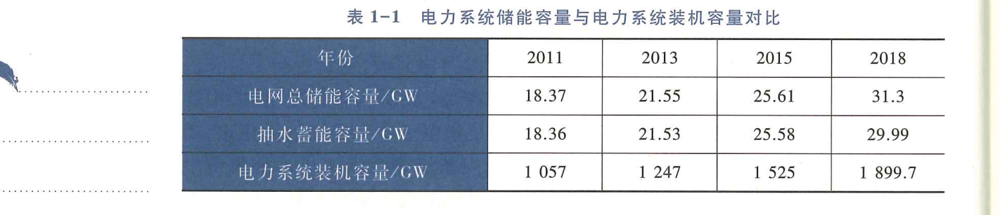

*表1-1电力系统储能容量与电力系统装机容量对比（原书第4页）*

在电力系统已经投运的储能中，只有抽水蓄能能够与电力系统调节容量匹配。因此，中国近年来加快了抽水蓄能电厂建设，如表1-2所示。

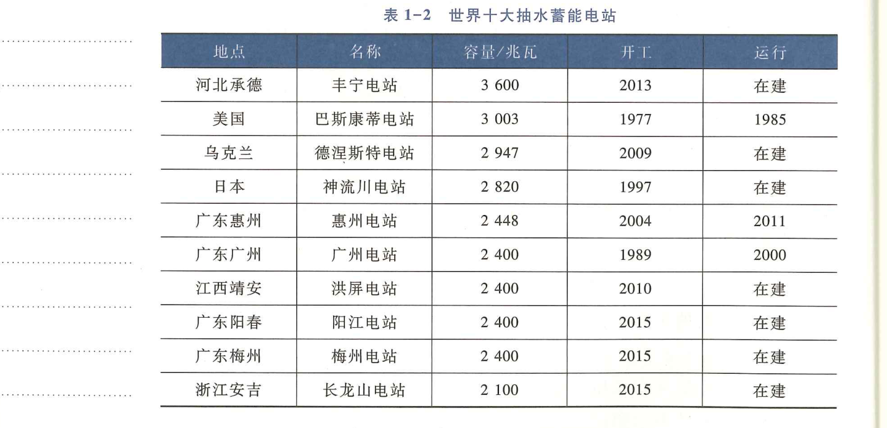

*表1-2世界十大抽水蓄能电站（原书第4页）*

根据能量守恒定律，存在如下功率平衡关系式

$$
P_{\mathrm G}=P_{\mathrm{LD}}+\Delta P
\tag{1-3}
$$

<!-- 原书第5页；PDF第11页 -->

$$
Q_{\mathrm G}=Q_{\mathrm{LD}}+\Delta Q
\tag{1-4}
$$

式中：为所有有功电源发出的有功功率之和；QG为所有无功电源发出的无功功率之和；PLD为电力系统的有功负荷；QLD为电力系统的无功负荷；厶p为电力系统的有功功率损耗；AQ为电力系统的无功功率损耗。

式（1-3）和式（1-4）在任意时刻都成立。可见，在电力系统中，电能的生产、变换、输送、分配和使用是同时进行的。发电厂在任何时刻生产的电能必须等于该时刻用电设备消耗的电能与变换、输送和分配环节中损耗的电能之和，即发电功率和用电功率随时应保持平衡。

如果电力系统的负荷功率发生变化，由于目前储能容量非常小，储能充放电功率经常不能平衡负荷功率的变化，因此必须调节同步发电机的输出功率使之满足功率平衡；同理，由于风力发电和太阳能发电功率受风速和照度的影响具有波动性，从而引起PG变化，储能充放电功率也经常不能平衡PG的变化，因此必须调节同步发电机的输出功率使之满足功率平衡。

无论电力系统处于正常运行状态还是非正常运行状态，只要式（1-3）和式（1-4）的功率平衡关系式不能满足，都会使得电力系统的两个重要的状态量（频率和电压）偏离允许的运行范围（见本书第8章），影响电力系统安全运行并造成电能质量问题。保证功率平衡是电网调度的基本职能。

如果电力系统的任一元件发生故障，不论是转换能量的原动机或发电机，或是输送、分配电能的变压器或输电线路以及用电设备等，都将破坏式（1-3）和式（1-4）的功率平衡关系，从而影响电力系统的正常工作。

实际上，电力系统的负荷是受用户控制的，电力系统对负荷的调控手段目前仅局限于对负荷的停送电。因此可以认为、QLD在时刻变化，即式0一3）和式（1-4）的功率平衡关系式是动态平衡关系式，电力系统的频率和电压也时刻处于变化中。在此背景下，为了对电力系统进行度量，可以将电力系统状态分为稳态和暂态：

（1）电力系统稳态：在电力系统运行的某一段时间内，其状态参数只在某一恒定的平均值附近发生微小的变化。稳态包括正常稳态、故障稳态和故障后稳态。

（2）电力系统暂态：电力系统从一种稳态到另一种稳态的过渡过程。

综上，电能不能大量存储是电能的最大特点。

2.过渡过程十分短暂

电能是以电磁波的形式传播的，根据Maxwell方程组，电磁波的传播速度应为（尸/2，式中为介电常数为磁导率。根据国际计量大会的定义，真空中电磁波速的准确值应为299792458m/so

电力系统运行状态发生变化时所引起的电磁方面和机电方面的过渡过程是十分短暂的。正常运行状态变化（如用户用电设备的操作，电动机、电热设备的起停或负荷增减，变压器、输电线路的投入运行或切除等），所引起的电磁暂态和机电暂态的过渡过程受电网相应的时间常数制约，通常可在2、3个周期（一个周期为20左右）内完成。当电力系统出现异常状态，如短路故障、过电压、发电机失去稳定等，其暂态过程一般也在10个周期内完成。

<!-- 原书第6页；PDF第12页 -->

因此，不论是正常运行时所进行的调整和切换操作，还是故障时为切除故障部分或为将故障限制在一定范围内以迅速恢复供电所进行的一系列操作，仅仅依靠人工操作是不能达到满意效果的，甚至是不可能的。必须采用各种自动装置（如继电保护装置等）来迅速而准确地完成各项调整和操作任务。

3.电能生产与国民经济各部门和人民生活有着极为密切的关系

由于电能是洁净的能源，具有使用灵活、易于转换、控制方便等优点，国民经济各部门广泛使用电能作为生产的动力。现代工业、现代农业、交通运输、通信等都广泛用电能作为动力来进行生产，把电力系统视为各工业企业的“动力车间"。此外，在日常生活中人们广泛使用各种家用电器用电。因此，电能生产与国民经济各部门和人民生活关系密切，息息相关。随着社会现代化的进展，各部门中的电气化程度愈来愈高，因而电能供给的中断或不足，不仅将直接影响工农业生产，造成人民生活秩序紊乱，在某种情况下甚至会酿成极其严重的社会性灾难。

根据负荷对电能的依赖程度，可以将电力系统负荷分为一类负荷、二类负荷和三类负荷。

（1）一类负荷。对这类负荷中断供电，将带来人身危险，设备永久性损坏，引起生产混乱，出现大量废品，重要交通枢纽受阻，城市水源、通信、广播中断，因而造成巨大经济损失和重大政治影响。例如大型运动会期间的运动场馆、大医院的手术室、钢铁厂的炼钢高炉等就是一类负荷。

（2）二类负荷。对这类负荷中断供电，将造成大量减产、停工，局部地区交通受阻，大部分城市居民的正常生活被打乱。例如大型的纺织厂、电解厂等就是二类负荷。

（3）三类负荷。指不属于第一类、第二类的其他负荷。对这类负荷中断供电，造成的损失不大。例如居民小区就是典型的三类负荷。

4.电力系统的地区性特点较强

不同国家的电力系统规范不同。不同国家制定的电力系统相关规范和标准都是根据本国的实际情况制定的，例如中国民用电压为220v/50，美国民用电压为120V/60Hzo

同一个国家内部各个电力系统的组成情况不同。电力系统的电源结构与能源资源分布情况和特点有关，而负荷结构却与工业布局、城市规划、电气化水平等有关，至于输电线路的电压等级、线路配置等则与电源和负荷间的距离、负荷的集中程度等有关，因而同一个国家内部各个电力系统的组成情况将不尽相同，甚至可能很不一样。例如，有的系统内水能资源丰富，以水电厂为主，而有的系统内煤炭资源丰富，以火电厂为主，有的系统电源与负荷距离近，联系紧密，而有的系统却正好相反。

同一个国家内部各个电力系统中的电气设备运行环境也存在较大差异。典型地，中国东南沿海地区存在高盐雾、高湿度的特点，对电气设备的腐蚀性更强；中国湖北、湖南、江西、贵州等地需要考虑覆冰影响；中国青藏高原电气设备需要考虑高海拔的影响。

<!-- 原书第7页；PDF第13页 -->

因此，在做电力系统规划设计与运行管理时，必须针对具体电力系统的情况和特点进行。如果盲目地搬用其他系统或国外系统的一些经验而不加以仔细分析，则必将违反客观规律，酿成错误。

## 1.3 对电力系统的要求

1.保证供电可靠

电力系统运行的首要任务是满足用户对供电可靠的要求。所谓保证供电可靠是指保证对用户的持续供电。中断用户供电，会使生产停顿，生活混乱，甚至危及人身和设备的安全，给国民经济造成极大损失。停电给国民经济造成的损失远远超过电力系统本身少售电所造成的损失。某市电力系统停电直接经济损失的统计值如表1-3所示。

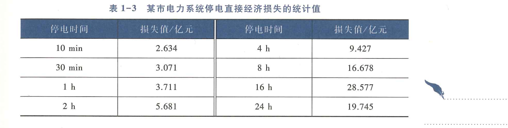

*表1-3某市电力系统停电直接经济损失的统计值（原书第7页）*

供电可靠性是指电力系统对负荷持续供电的能力。常用的供电可靠性的衡量指标包括：

（1）供电可靠率：供电可靠率是以某一统计时间内，实际供电时间与统计时间的比值，用百分数表示。常以年计算统计时间。

$$
\text{供电可靠率}=\frac{\text{实际供电时间}}{\text{统计时间}}\times100\%=\frac{\text{统计时间}-\text{停电时间}}{\text{统计时间}}\times100\%
\tag{1-5}
$$

式中，停电时间一般包括事故停电时间、计划检修停电时间、临时性停电时间。

（2）用户平均停电时间：用户在统计时间内的平均停电小时数。

$$
\text{用户平均停电时间}=\frac{\sum(\text{每次停电时间}\times\text{每次停电用户数})}{\text{总供电用户数}}
\tag{1-6}
$$

（3）用户平均停电次数：用户在统计时间内的平均停电次数。

$$
\text{用户平均停电次数}=\frac{\sum(\text{每次停电用户数})}{\text{总供电用户数}}
\tag{1-7}
$$

中国常用供电可靠率来衡量供电可靠性。中国目前一般城市地区供电可靠率达到了99.9%（俗称3个9）以上，用户年平均停电时间少于8.76h；重要城市中心地区达到了99.99%（俗称4个9）以上，用户年平均停电时间少于53mino

影响供电可靠率的因素有很多，主要包括：

（1）电网稳定运行（详见本书第9章）。电网稳定事故是威胁供电可靠性的最严重事故。要求提高系统运行的稳定性，增强系统的抗干扰能力，保证不发生或不轻易发生造成大面积停电的系统瓦解事故。为此，要不断提高运行人员的技术水平和责任心，防止误操作，在事故发生后应尽量采取措施以防止事故扩

<!-- 原书第8页；PDF第14页 -->

大，还要采用现代化的监测、控制和保护装置等。

（2）电气设备的故障率及修复时间。高可靠性的电气设备建设成本高，但可以提高供电的可靠性。实际工程中需要根据供电可靠性要求选择电气设备。

（3）电网结构。环形结构和网状结构比放射性结构、树状结构、干线式结构具有更高的可靠性和更高的建设成本。结合供电可靠性的要求和建设成本，中国输电网主要采用环形结构和网状结构，闭环运行；城区配电网采用环形结构，开环运行；城郊和农村配电网采用放射性结构、树状结构、干线式结构。用户类型对供电可靠性要求不同，一类负荷供电可靠性要求最高，要求2路及以上独立电源供电，电网结构要求环形结构和网状结构。这里所说的独立电源，是指其中任意一个电源故障或停电检修时，不影响其他电源供电。有特殊要求的一类负荷，两个独立电源应该来自不同的变电站。若一类负荷容量不大，可采用蓄电池组、自备发电机作为备用电源。二类负荷供电可靠性要求比一类负荷低，要求2路电源供电（不要求独立电源），电网结构也要求环形结构和网状结构。二类负荷可以采用双回线路供电。对重要的二类负荷，其双回线路应该引自不同的变压器，也可以由两个独立电源供电。三类负荷供电可靠性要求最低，因此对三类负荷的供电无特殊要求，电网结构可采用放射性结构、树状结构、干线式结构。

（4）电气作业停运率及停运时间。通过制订电气作业规范、培训工作人员熟练操作技能、储备必要的备品备件等都可以减少电气作业停运率及停运时间。

（5）人为因素。预防人为事故停电是提高供电可靠性的重要方面。一方面要加强思想教育，提高工作人员的安全意识；另一方面可以强化安全管理和安全措施，杜绝人为停电事故。

2.保证良好的电能质量

电能质量：供电装置正常工作情况下不中断和不干扰用户使用电力的物理

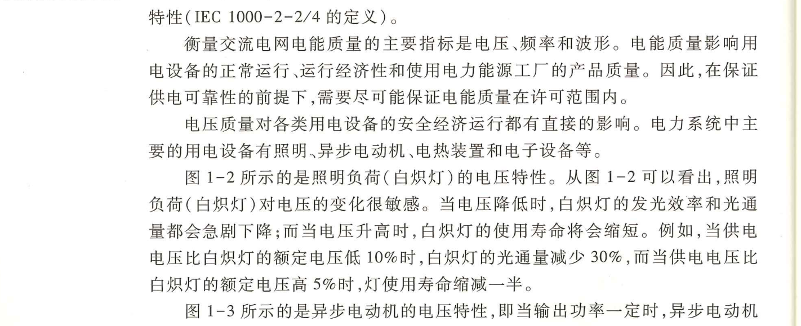

*图1-2所示的是照明负荷（白炽灯）的电压特性。从图1-2可以看出，照明；图1-3所示的是异步电动机的电压特性，即当输出功率一定时，异步电动机（原书第8页）*

的定子电流、功率因数和效率随电压而变化的曲线。从图1-3可以看出，当端电压下降时，定子电流增加很快。当电压降低时，电动机的转矩将显著减小，这是因为异步电动机的最大转矩与其端电压的平方成正比，以致转差增大，使得定子电流和转子电流都显著增大，从而引起电动机的温度升高，甚至可能烧毁电动机。反之，当电压过高时，对于电动机、变压器一类具有励磁铁心的电气设备而

<!-- 原书第9页；PDF第15页 -->

口，铁心磁通密度将增大以致饱和，励磁电流和铁损耗都大为增加，致使电机过热，效率降低，波形畸变，甚至可能导致发生谐波谐振。

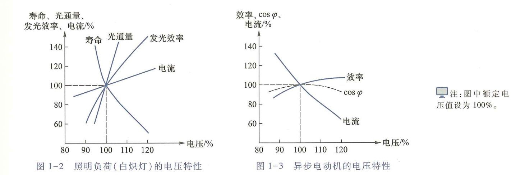

*图1-2照明负荷（白炽灯）的电压特性；图1-3异步电动机的电压特性（原书第9页）*

对电热装置来说，其消耗的功率也与电压的平方成正比，过高的电压将损坏设备，过低的电压则达不到所需要的温度。

此外，对计算机、电视、广播、通信、雷达等设备来讲，它们对电压质量的要求更高。电子设备中的各种半导体器件、集成电路、磁芯装置等的特性，对电压都极其敏感，电压过高或过低都将使其特性严重变差，影响正常工作。例如，电视机的电压过高将会使其损坏，而电压过低则影响其接收灵敏度，以及收看、收听的效果。

由于上述各类用电设备的工作情况都与电压的变化有着极为密切的关系，故在运行中必须规定电压的允许变化范围，这也就是电压的质量标准。据统计，目前世界上许多国家根据运行实践规定的电压允许变化范围都为额定电压的±5%，少数国家也有高到±10%，或低到±3%。

频率的偏差同样会影响电力用户的正常工作。对于电动机来说，频率降低将使电动机的转速下降，从而使生产率降低，并影响电动机的使用寿命；反之，频率增高将使电动机的转速上升，增加功率消耗，使经济性降低。特别是某些对转速要求较严格的工业部门（如纺织、造纸等），频率的偏差将严重影响产品质量，甚至产生大量废品。另外，频率偏差对发电厂本身将产生更为严重的影响。例如，火电厂内锅炉的给水泵和风机的离心式机械，当频率降低时其出力将急剧下降，从而迫使锅炉的出力大为减少，甚至引起紧急停炉，这样势必进一步减少系统发电出力，导致系统频率进一步下降。另外，在频率降低的情况下运行时，汽轮机叶片将因振动加大而产生裂纹，或断掉，缩短汽轮机的使用寿命。如果系统频率急剧下降的趋势不能及时得到制止，势必造成恶性循环以致整个系统发生崩溃。

此外，频率的变化还将影响电钟的正确运行以及计算机、自动控制装置等电子设备的准确工作。

目前世界各国对频率变化的允许偏差的规定不一样，有些国家规定为不超过±0巧Hz，也有一些国家规定为不超过±（0.1、02）Hzo

电力系统供电电压（或电流）的波形通常要求为正弦波。为此，首先要求发电机发出符合标准的正弦波电压。其次，在电能变换、输送和分配过程中不应使

<!-- 原书第10页；PDF第16页 -->

波形发生畸变。例如，当变压器或电抗器铁心饱和时，或变压器无三角形接法的绕组时，都可能导致波形畸变，此外，还应注意消除电力系统中由于具有非线性特性的用电设备产生的谐波，如换流装置、电气铁道和电弧炉等产生的谐波电流。

当电源波形不是标准的正弦波形时，必然包含着多种高次谐波分量，这些谐波分量的出现将影响电动机的效率和正常运行，还可能使系统发生谐波谐振而危害电气设备的安全运行。例如，由于谐波电流放大或谐振过电压烧坏变电站中无功补偿电容器的事故时有发生。此外，谐波分量还将影响电子设备的正常工作并造成对通信线路的干扰，以及其他不良后果等。

为了严格地保证波形的质量指标，在发电机、变压器等的设计、制造时都已经考虑并采取了相应的措施。因此，只要在运行中严格遵守有关规程，则保证波形质量是可能的。但是，随着电力电子技术在电力系统中的应用和扩大，由其产生的谐波污染日趋严重，引起电能质量下降，威胁着电力系统和各种电气设备的安全经济运行。谐波与电压、频率等电能质量指标一样，是电力系统运行的一项重要指标。对电力系统来说，主要考核系统的谐波电压含有率。为了限制谐波电压分量，首先应限制各个非线性负荷所产生的谐波电流，其次是采取一些抑制谐波的措施。若要求限制电力系统谐波绝对为零并不合理，这会造成很大的投资负担，但是将谐波限制在一定范围内，使电力系统运行的各种电气设备能保证正常工作，免受干扰，是较为合理的。

衡量交流电网电能质量的主要指标及其保证电能质量的措施详见本章1.4节。

3.提高电力系统运行经济性

电能是国民经济各生产部门的主要动力，电能生产消耗的能源在中国能源总消耗中占的比重很大，因此提高电能生产的经济性具有十分重要意义。

运行经济性是指电力系统运行中具有最小的运行费用，包括发电厂燃料费、发电厂厂用电费用、电网损耗费用等。

衡量电力系统运行经济性的指标包括：

（1）煤耗率。煤耗率是指在一定时间段内，燃烧化石燃料电厂所消耗的燃料量与输出电量之比，简称煤耗，单位为g/(kW。h)。

（2）厂用电率：发电厂的厂用电率是指单位时间内厂用耗电量与发电量的

$$
\text{综合厂用电率}=\frac{\text{发电机有功电量}-\text{上网电量}}{\text{发电机有功电量}}\times100\%
\tag{1-8}
$$

（3）网损率：在同一时间内，电力网的损耗电量占供电量的百分值，称为电力网的网损率，又称线损率。

$$
\text{网损率}=\frac{\text{损耗电量}}{\text{供电量}}\times100\%
\tag{1-9}
$$

在保证供电可靠和良好电能质量的前提下，可以进行电力系统的优化调度，最大限度地提高电力系统运行的经济性，为用户提供充足的、廉价的电能。为此，可以采取的措施有：安装大容量的发电机组，充分发挥水电、风电、太阳能发电在系统中的作用，尽量降低发电厂的煤耗率，合理分配各发电厂间的负荷，减

<!-- 原书第11页；PDF第17页 -->

少厂用电和电网损耗等。

上述对电力系统的要求，有的是相互联系的，有的是相互矛盾的，应从实际出发，采取切实可行的措施，提高系统安全优质高效运行水平。一般地讲，一个可靠性指标差的电力系统就谈不上优质和经济，安全就是最大的效益；而电能质量差的电力系统也不会是可靠的和经济的。对供电可靠和优质的要求，有时又会与经济性发生矛盾，因此，在考虑满足其中一项要求时，必须兼顾其他三项要求。

## 1.4 衡量电能质量

### 1.4.1 电压质量

衡量电压质量的指标通常包括供电电压允许偏差、电压允许波动和闪变、相供电电压允许不平衡度。

供电电压偏差是指实际电压偏离系统标称电压（对电力网而言是指额定电

$$
\text{电压偏差}=\frac{\text{实际电压}-\text{电网额定电压}}{\text{电网额定电压}}\times100\%
\tag{1-10}
$$

> 转录校注：原书该式分子印为“实际电压”，与前文“偏离额定电压”的定义不一致；此处按电压偏差定义写为“实际电压－电网额定电压”。

电压波动是以用户公共供电点在时间上相邻的最大与最小电压（方均根值）之差对电网额定电压的百分值来表示。

电压闪变是指造成灯光照度不稳定（灯光闪烁）的人眼视感反映的电压波动。

三相供电电压不平衡度是指电力系统的三相电流（或电压）幅值不一致的程度。

$$
\text{三相供电电压不平衡度}=\frac{\text{三相电流（或电压）的负序值}}{\text{三相电流（或电压）的有效值}}\times100\%
\tag{1-11}
$$

衡量电压质量的标准如表1-4所示。

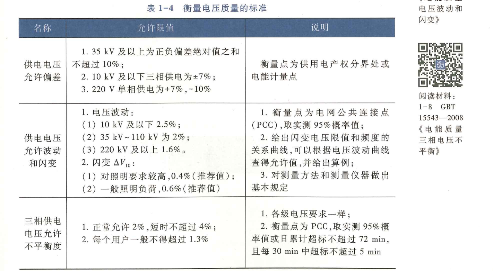

*表1-4衡量电压质量的标准（原书第11页）*

<!-- 原书第12页；PDF第18页 -->

保证无功功率平衡式（1-4）是保证电压质量的关键措施。为此，必须配置充足的无功电源，通过调节无功电源的无功功率，跟踪无功负荷的变化；尽可能实现无功功率的就地平衡，减少电网的电压损耗。此外，电力系统还必须采取一定的调压措施。

### 1.4.2 频率质量

频率质量的衡量指标是频率值和频率偏差。其中频率偏差是指频率值偏离额定频率的数值。

中国的技术标准规定电力系统额定频率为50Hz，在3000MW及以上的系统，频率偏差不得超过±0.2Hz；在不足3000MW的系统，频率偏差不得超过±0.5Hz，由此可见，频率变化的允许偏差为±（0.2、0.5）Hz。

中国的技术标准还规定，应保证电钟所示时间的准确性：3000MW及以上系统，电钟在任何时间的偏差不应大于±30；不足3000MW的系统，不应大于±1mino

根据频率的质量指标，要求同一电力系统在任何一瞬间的频率值必须保持一致。在系统稳态运行情况下，频率值决定了发电机组的转速。而机组的转速则主要决定发电机组输出功率与输入功率的平衡情况。所以，要保证频率的偏差不超过规定值，首先应当维持电源与负荷间的有功功率平衡，其次还要采取一定的调频措施，即通过调节使有功功率保持平衡来维持系统频率的偏差在规定允许限值之内。

### 1.4.3 波形质量

辶一

波形质量要求电力系统供电电压（或电流）的波形应为标准正弦波。衡量波形质量就是衡量波形偏离正弦波的程度。当电源波形不是标准的正弦波形时，必然包含着多种高次谐波分量。因此，电力系统采用谐波来衡量波形质量。

谐波是指对周期性非正弦交流量进行傅里叶级数分解所得到的大于基波频率整数倍的各次分量，通常称为高次谐波，而基波是指其频率与工频（50Hz）相同的分量。

（1）谐波电压限值

国家标准《公用电网谐波》中规定了各次谐波电压含有率和电压总谐波畸变率，如表1-5所示。

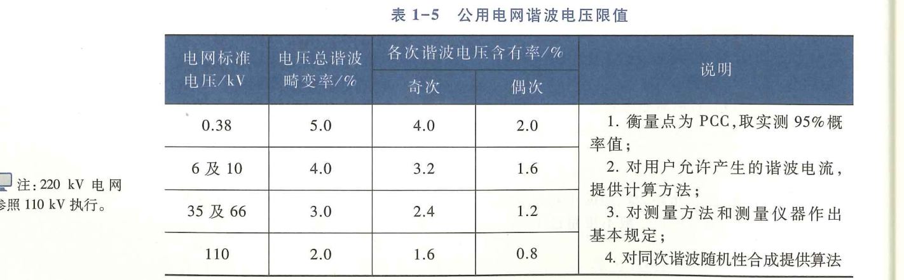

*表1-5公用电网谐波电压限值（原书第12页）*

<!-- 原书第13页；PDF第19页 -->

由表1-5可以看出，随着电网标准电压的提高，规定的电压总谐波畸变率限值变小。对于220kV电网谐波电压限值，可参照电网标准电压110kV的有关规定执行。

（2）谐波电流允许值

为了限制电力系统的谐波电压，必须限制各个谐波源用户注人电力系统的谐波电流，为此，国家标准规定了注人公共连接点的谐波电流（有效值）允许值，如表1-6所示。

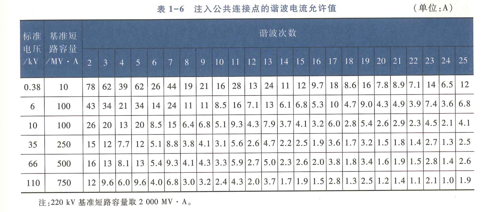

*表1-6注入公共连接点的谐波电流允许值（原书第13页）*

当一个新的含有谐波源的负荷接人某电力系统之前，该电力系统公共连接点的谐波电压距规定的限值应有一定裕度，同时，含有谐波源的负荷注人电力系统的谐波电流不超过表1-6中所列的允许值时，才准许接人电力系统。否则，可能造成电力系统电压波形畸变率超过限值。

谐波电压是谐波电流在系统谐波阻抗上的压降。当谐波电压为限定值时，谐波电流允许值与谐波阻抗成反比，而系统谐波阻抗近似认为与系统短路容量成反比。所以，电力系统中公共连接点的短路容量越大，其谐波阻抗越小，则允许注人该点的谐波电流也越大。表1-6中的谐波电流允许值是根据表1-6中第二列所示基准短路容量并留有适当裕度后计算确定的。

当实际电力系统公共连接点的最小短路容量不等于表1-6中所列的基准短路容量时，说明该电力系统容纳用户谐波电流的能力不同于基准短路容量所代表系统的情况，则注人公共连接点的谐波电流允许值应按与实际系统最小短路容量成正比进行换算，计算式如下：

$$
I_h=\frac{S_{k1}}{S_{k2}}I_{hp}
\tag{1-12}
$$

式中，为实际电力系统公共连接点处最小运行方式时的短路容量（MV。A）；Sk2为表1-6中所示的相应电压等级的基准短路容量（MV·A)涛为表1-6中所示的第h次谐波电流允许值（A）涛为实际电力系统短路容量为Skl时的第次谐波电流允许值（A）。

为了获得良好的波形质量，要求发电机发出符合标准的正弦波电压；在电能变换、输送和分配过程中不应使波形发生畸变。例如当变压器或电抗器铁心饱

<!-- 原书第14页；PDF第20页 -->

和时，或变压器无三角形接法的绕组时，都可能导致波形畸变。应注意消除电力系统中由于具有非线性特性的用电设备产生的谐波，如换流装置、电气铁道和电弧炉等产生的谐波电流。

装设滤波器和采用无功补偿装置补偿谐波是改善波形质量的常用有效措施。

## 1.5 电力系统的额定电压

### 1.5.1 额定电压和最高电压

电力系统中的发电机、变压器和开关等电气设备都是按照额定电压和额定频率来设计的。当这些电气设备在额定电压和额定频率下运行时，将具有最好的技术性能和经济性能。为此，各国根据本国国情制定出标准的额定电压和额定频率。中国采用的额定频率为50Hz，这里主要讨论电力系统的电压等级。

电力系统的电压等级包括电力系统的额定电压和最高电压、电气设备的额定电压和最高电压。

1.电力系统的额定电压和最高电压

输电线路中通过电流的大小是由传输的视在功率和电压决定的，输电线路的功率损耗是由电流和输电线路参数决定的。由三相功率s：、0毋可知，在传输功率s一定的条件下，电压愈高，则电流/愈小，功率损耗也小，要求导线的截面积小，投资可减少；但是，电压U愈高，绝缘能力要求高，断路器、变压器和杆塔等设备的投资增加。综合考虑各种因素，对应一定传输功率和输送距离的输电线路应有一个合理的电压值，该电压值通常称为经济电压。

对一个国家来说，不可能建设一条输电线路就确定一个电压等级，因为这样会造成设备通用性差，备用设备增加，网络连接和管理困难。因此，为了使电力系统和电气设备制造厂的生产标准化、系列化和统一化，电力系统的电压等级应有统一的标准。世界上每个国家都根据本国的技术经济条件，规定自己的电压等级标准。该电压等级标准称为电力系统额定电压，又称为电力网额定电压或线路额定电压。

电力系统正常稳态运行时，在任何时间系统中任何一点上所出现的电压最高值（不包括系统的暂态和异常电压，如系统的操作所引起的瞬时电压变化等），称为电力系统的最高电压。

2.电气设备的额定电压和最高电压

各种电气设备都是在一定条件下工作的。电气设备制造厂根据所规定的电气设备工作条件而确定的电压，称为电气设备的额定电压。电气设备的最高电压是考虑到设备的绝缘性能和与最高电压有关的其他性能（如变压器的励磁电流、电容器的损耗等）所确定的最高运行电压，其数值等于所在电力系统的最高电压值。

为了保证设备在偏离其额定电压允许值的范围内工作，在同一电力系统的

<!-- 原书第15页；PDF第21页 -->

额定电压下，电气设备的额定电压值是不相同的。

发电机容量越大，额定电压值越高。额定电压在10巧kV以下的发电机，其额定电压一般比相应的系统额定电压高5%。

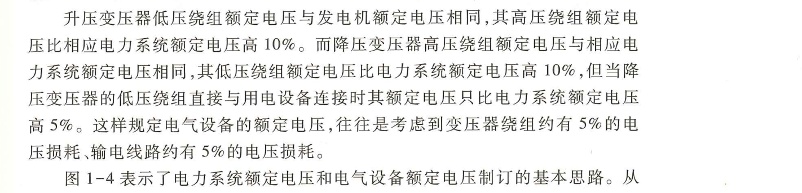

*图1-4表示了电力系统额定电压和电气设备额定电压制订的基本思路。从（原书第15页）*

该图可以看出，从电力系统实际情况出发确定电气设备的额定电压值是合理的。

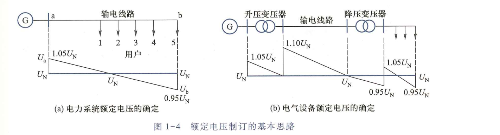

*图1-4额定电压制订的基本思路（原书第15页）*

实际上要保证所有电气设备的运行电压都在允许的电压变动范围内是一件非常困难的事情。因为实际电力网接线复杂，输电距离有长有短，负荷又是随时变化的，使得电压的控制与调整极为复杂。因此，合理确定电气设备的额定电压将有利于电力系统电压的控制与调整。

### 1.5.2 电力系统的电压等级

电力系统额定电压是根据技术经济上的合理性、电气制造工业的水平和发展趋势等各种因素而规定的。各种电气设备在额定电压下运行时，能获得最高效率和经济性。中国规定的额定电压分为低于3kV系统的额定电压和3kV及以上系统的额定电压两类。

1.低于3kV系统的额定电压

低于3kV系统的额定电压包括三相与单相交流以及直流三种。

受电设备的额定电压与电力系统的额定电压是一致的。供电设备的额定电压是指电源的额定电压，如蓄电池、发电机和变压器二次绕组的额定电压等。直流电压为平均值，交流电压则为有效值。

在直流100v以下的直流系统中，受电设备与供电设备额定电压相同；对于受电设备为110v、220v和440v的直流系统，供电设备的额定电压分别为1巧V、230V和460V。

低于3kV交流电力系统的额定电压和电气设备的额定电压，如表1-7所示

<!-- 原书第16页；PDF第22页 -->

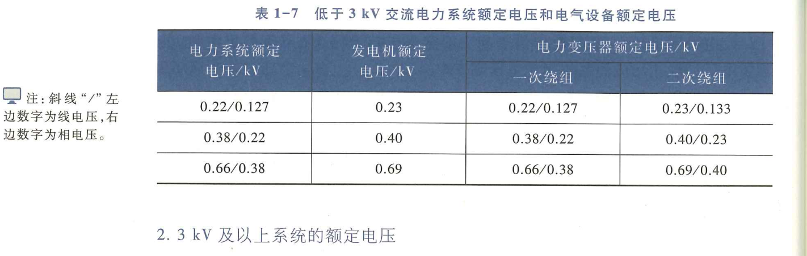

*表1-7（原书第16页）*

中国制定的3kV及以上交流三相电力系统额定电压及电气设备额定电压如表1-8所示。

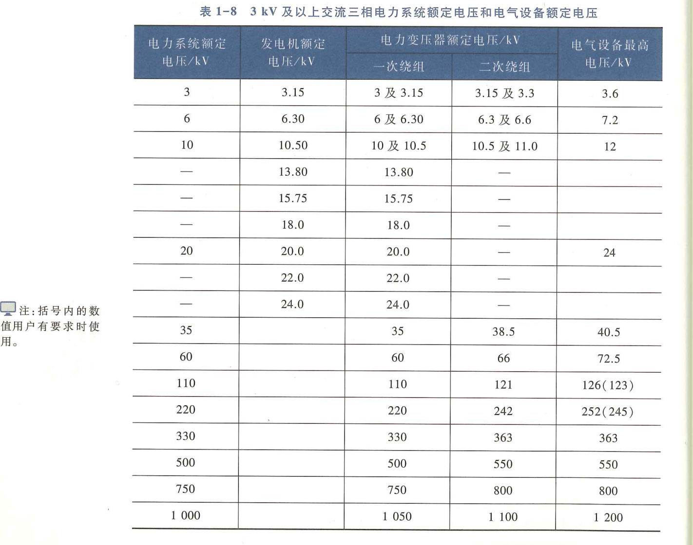

*表1-83kV及以上交流三相电力系统额定电压和电气设备额定电压（原书第16页）*

由表1-8可以看出，在同一电压等级下，各种电气设备的额定电压并不完全相同，这是为了使各种电气设备都能在较有利的电压水平下运行。但是在规定它们的额定电压时，应使之能相互配合，下面具体加以说明。

<!-- 原书第17页；PDF第23页 -->

（1）电力系统额定电压

电力线路的额定电压和电力系统的额定电压相等。这是因为通过线路输送功率时，沿线路的电压分布往往是首端高于末端，线路的额定电压实际上是线路的平均电压，即线路首端电压和末端电压的算术平均值，而系统的额定电压应与电力线路的额定电压相等，为使各用电设备能在接近它们的额定电压下运行。

（2）发电机额定电压

发电机往往接在升压变压器的一次侧绕组上，考虑发电机有直供线路，因此有些发电机的额定电压比电力系统的额定电压高5%，用于补偿电力网上的电压损耗。

（3）变压器额定电压

电力变压器起着供电设备和用电设备的双重作用。变压器一次侧绕组连接电源，或连接发电机，接受电能，相当于用电设备；变压器二次侧绕组连接负荷，向负荷提供电能，相当于发电机，或供电设备。因此，变压器一次侧绕组额定电压应等于电力系统的额定电压，对于直接和发电机连接的变压器一次侧绕组额定电压应等于发电机的额定电压，使之相互配合；变压器二次侧绕组的额定电压是指变压器空载运行时的电压。当变压器在额定负载下运行时，其内部阻抗会造成大约5%的电压损失。为使变压器在额定负载下工作，二次侧绕组的电压比同级电网的额定电压高5%，规定变压器二次侧绕组的额定电压较电力系统额定电压高10%。若变压器阻抗较小，内部电压降落也较小，其二次侧绕组直接与用电设备相连接，对于电压特别高的变压器，则其二次侧绕组额定电压较同级电力系统额定电压高5%。

## 1.6 交流大电网联网的优劣

为什么世界各国电力系统的规模越来越大？这是因为电力系统规模越大，给人们带来的技术经济效益越大。大电网联网的优势主要体现在以下几个方面。

1.可以提高供电可靠性

大型电力系统能在各地区之间互供电能，互为备用，增强抵抗事故的能力，提高供电可靠性。电力系统中有大量的发电机、变压器和输电线路。这些设备在运行中难免会发生故障。因为电力系统中所有并列运行的发电厂同时发生事故的概率较其中一个发电厂发生事故的概率小得多，所以组成电力系统后由于装机容量大，抗干扰能力强，提高了对用户供电的可靠性，特别是提高了对重要用户供电的可靠性。

2、可以减少备用容量

电能的生产、变换、输送、分配和使用几乎同时进行，电能又不能大量储存，

<!-- 原书第18页；PDF第24页 -->

而用户的用电又有随机性和不均衡性，因此为了保证电力系统安全、可靠、连续地发供电，必须设置足够的备用容量。另外，电力系统在运行中难免会有发电机组发生故障，有些发电机组要停机检修。如果电力系统中发电设备总装机容量刚好等于该系统的最大负荷，那么当某一机组发生故障时，势必引起对一部分用户中断供电，给用户造成损失。为避免这些情况发生，一般都要使发电设备总装机容量稍大于系统的最大负荷。这部分容量称为备用容量。由于备用容量在电力系统中可以互相通用，所以电力系统容量越大，备用容量可少一些，它在总装机容量中所占的百分比就会小一些

3、可以减少系统装机容量

电力系统内各地区负荷具有不同时性。可利用地区之间的时间差、季节性，错开高峰负荷用电，可削弱系统负荷的尖峰，因而可减轻高峰负荷时电源紧张情况，在满足用电高峰负荷条件下，可以减少系统装机容量。例如，一个地区最大负荷出现在17：00，另一地区最大负荷发生在18：00，两个地区连接成一个系统后，系统最大负荷小于两个地区的最大负荷之和，因而减少了系统的装机容量。

4.可促进可再生能源消纳，合理利用能源，充分发挥可再生能源发电在系统中

的作用

水电厂发电量受季节的影响大，在夏季丰水期水量过剩，在冬季枯水期水量短缺，水电厂单独运行或在地区性系统中水电厂容量占的比重较大时，将造成枯水期缺电、丰水期弃水的情况。如果将水电厂与火电厂连接在一起构成电力系统，实现水、火电厂联合运行，在枯水期火电机组多发电、水电厂机组少发电并安排检修，而在丰水期水电机组多发电，火电机组少发电，安排火电机组检修。此外，水电机组启动方便，宜作为调频电厂，还可减少火电机组作调频时的启动煤耗。这样，扬长避短，充分利用水能资源，减少燃料消耗。

随着风力发电和太阳能光伏发电的渗透率提高，大电网中风力发电和太阳能光伏发电的空间平滑特性和时间互补特性更加明显，有利于在较大范围内消纳可再生能源电量，并可以利用水电机组和火电机组跟踪可再生能源发电的功率波动。

5.采用高效率大容量的火电机组

大容量火电机组效率高，节省原材料，造价低，占地少，运行费用较少。大容量火电机组和小容量火电机组的安装周期基本相同。但是，一个电力系统允许安装的发电机组最大单机容量受电力系统容量的制约。孤立运行的发电厂或者容量较小的电力系统，因为没有足够的备用容量，不允许采用大容量机组，否则，一旦机组因事故或检修退出运行，就将造成电力系统大面积中断供电，给国民经济带来极大损失。而且，即使同一台发电机组在不同容量电网发生事故时对系统频率的影响大不相同。一般要求电力系统中最大的一台发电机组容量不得超过全网容量的10%、巧%。因此，大型电力系统拥有足够的备用容量，非常有利于安装高效率大容量的发电机组。目前，国外已制造投产了发电机组单机容量

<!-- 原书第19页；PDF第25页 -->

为130×104kW的机组，中国已制造投产了发电机组单机容量为100×104kW的机组。

6.可以提高系统运行的经济性

除上述优点外，还可以在机组间合理分配负荷，充分发挥煤耗低、效率高的发电机组的作用，使整个系统在满足用户负荷需求的前提下，实现合理的经济还仃。

上述原因使世界各国电力系统的规模越来越大，一些经济发达的国家已经形成全国统一的电力系统或跨国电力系统。

然而，大电网联网也存在弊端，主要表现在：

（1）电网安全稳定问题突出。

随着电网规模扩大，各类新能源机组并网，电网稳定产生的机理发生了变化。电力系统各类稳定问题从影响因素、影响原理、判断方法、分析计算等都变得异常复杂。电网稳定事故的后果更加严重，造成的停电范围更大。

（2）电网运行状态的判断和处理困难，电力系统调度管理难度大。

随着电网规模扩大，电网元件数目庞大，网络结构复杂，增加了电网分析计算的难度。同时，电网运行域很难用单一的函数表征，增加了电网运行状态的判断和处理困难，电力系统调度管理难度大。

综合交流大电网联网的优点和弊端，交流电网应该存在一个合理的规模。

## 1.7 变压器分接头额定电压的规定

改变变压器的变比可以升高或降低变压器次级绕组的电压。为了实现调压，双绕组变压器的高压绕组，三绕组变压器的高、中压绕组都设有若干分接头（也称为抽头）以供选择。分接头的数量为奇数，其中最中间的分接头称为主分接头（也称为主抽头）。

容量为6300kV。A及以下的变压器，高压侧一般有三个分接头。容量为8000kV。A及以上的变压器，高压侧有五个或更多个分接头。

变压器分接头额定电压的规定：主分接头的额定电压UN满足本书1.5节相关规定；最上面分接头的额定电压为1.05UN，最下面分接头的额定电压为0.95UN；中间的其他分接头额定电压在1.05UN和0，95UN之间等分。

如果变压器绕组有“个分接头，该绕组额定电压可以表示为

$$
\text{额定电压}=U_{\mathrm N}\left(1\pm\frac{n-1}{2}\times\left(\frac{10}{n-1}\right)\%\right)
\tag{1-13}
$$

例如，若连接110kV电网和10kV电网的双绕组降压变压器有5个分接头，五个分接头额定电压分别为1.05UN、1.025UN、UN、0.975UN和0.95UN，其中UN一110kV，该降压变压器的变比可以写成110×（1±2×2巧%）kV/11kV。

例如，若连接110kV电网和10kV电网的双绕组升压变压器有5个分接头，五个分接头电压分别为1.05、1.025、UN、0.975UN和0.95UN，其中UN121kV，该升压变压器的变比可以写成10kV/121×（1±2×2.5%）kV，或121×（1±2×2，5%）kV/10kV。

<!-- 原书第20页；PDF第26页 -->

## 1.8 定制电力

定制电力技术（powertechnology)是指应用电力电子技术和控制技术实现电能质量控制，为用户提供特定可靠性要求和电能质量要求的电力供应的技术。

现代工业的发展对提高供电可靠性、改善电能质量提出了越来越高的要求。重要用户需要保证优质的不间断供电。高新产业和高附加值行业往往采用精密仪器和尖端设备，对电能质量提出了苛刻要求，如半个周波的电压暂降就能导致设备损坏、生产线停产，造成巨大经济损失；各类非线性、冲击性负荷日益增多，电压质量不能满足要求。因此用户提出了特殊的可靠性要求和电能质量需求。

常规需求用户和定制电力用户对可靠性和电能质量的要求对比如表1-9所示。可见应用定制电力技术是为了解决用户对可靠性和电能质量方面的特殊需求而采用的技术。

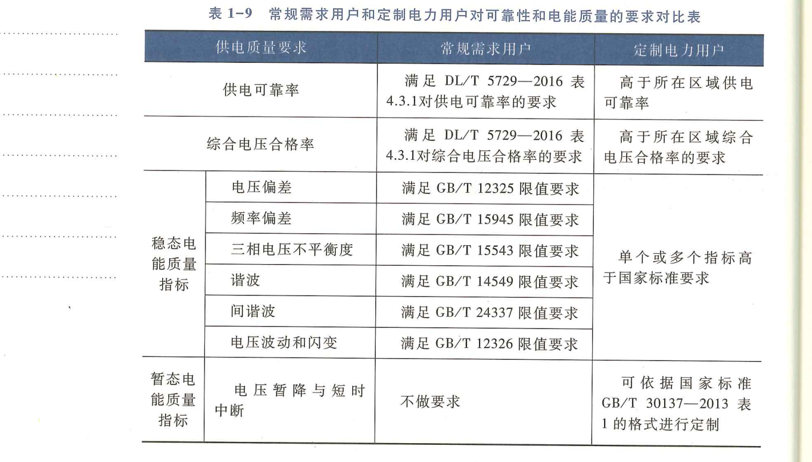

*表1-9常规需求用户和定制电力用户对可靠性和电能质量的要求对比表（原书第20页）*

目前已经研制出了一些定制电力设备来满足用户定制可靠性和电能质量的需求。NB/T41009一2017《定制电力技术导则》列举了常见的定制电力设备及其功能如表1-10所示。

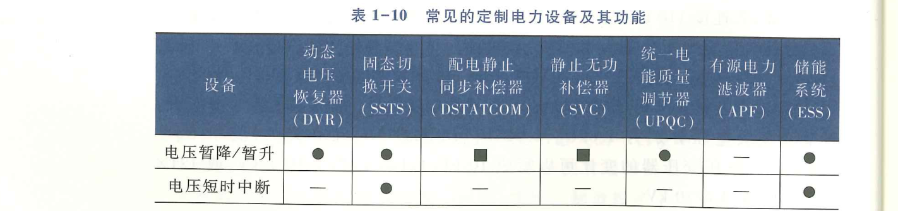

*表1-10（原书第20页）*

<!-- 原书第21页；PDF第27页 -->

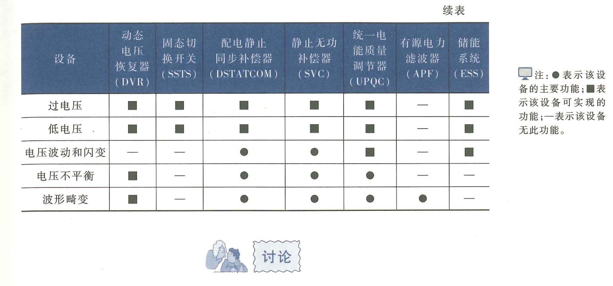

*续表（原书第21页）*

问题：升压变压器和降压变压器可以相互替换吗？

为了减小输电电能损耗，电力系统往往在发电侧采用升压变压器升高电压，在负荷侧采用降压变压器降低电压供给负荷。这样，电力系统中就存在多台升压变压器和降压变压器。习惯上，该用升压变压器的场合一定是用升压变压器；该用降压变压器的场合一定是用降压变压器。但是在实际工作中会遇到一些特殊情况，如需要的变压器没有现货，需要定制，工程上时间来不及；由于负荷增大等原因进行电网改造，原来的变压器退役，但变压器未到使用年限，而电力系统中某些负荷小的地方恰恰又需要该容量的变压器；等等。

分析升压变压器和降压变压器是否可以相互替换。需要从建设成本、对电力系统运行电压的影响、调压措施、电能损耗、变压器在使用年限内的负荷发展等多方面综合考虑。不是简单的可以/不可以能够回答的。

## 课外阅读资料

本章推荐如下课外阅读内容：

（1）GB/T巧6一2017《标准电压》；

（2）GB/T762一2002《标准电流》；

一2005《标准频率》；

（3）

GB/T1980

一2008《电能质量供电电压偏差》；

（4）

GB/T12325

一2008《电能质量电力系统频率偏差》；

（5）

GB/T15945

一2008《电能质量电压波动和闪变》；

（6）

GB/T12326

一1993《电能质量公用电网谐波》；

（7）

GB/T14549

一2008《电能质量三相电压不平衡》；

（8）

GB/T巧543

一2009《电能质量公用电网间谐波》；

（9）

GB/T24337

一2013《电能质量电压暂降与短时中断》。

（10）GB/T30137

<!-- 原书第22页；PDF第28页 -->

## 思考题

动力系统、电力系统及电力网各由哪些部分组成？

1

一1

电能生产的主要特点是什么？

1

一2

对电力系统有哪些要求？

1一3

简述衡量电能质量的主要指标及其重要意义。

1

一4

如何衡量配电网的可靠性和运行经济性？

1

一5

发电机、变压器和电力系统额定电压之间有联系吗？为什么？

一6

1

如何确定变压器主分接头的额定电压？

1

一7

交流大电网联网有何优势？

1

一8

## 其他章节

- [第2章 电力系统的组成环节及工作原理](CH2电力系统的组成环节及工作原理.md)

- [第3章 电气一次设备](CH3电气一次设备.md)

- [第4章 电气一次系统](CH4电气一次系统.md)

- [第10章 电力系统继电保护](CH10电力系统继电保护.md)

- [第11章 电气二次系统](CH11电气二次系统.md)
