# 第2章 电力系统的组成环节及工作原理

> 来源：《电气工程基础》罗毅编著。原书第 23-64 页；本PDF第 29-70 页。

> 本文件由扫描教材转换，保留原书顺序、小节、例题、思考题及阅读资料。编号公式经对照原书转录为 LaTeX；插图、接线图与复杂表格保留为图片，位于相邻 assets 文件夹。正文为OCR识别稿，个别文字仍可能有识别误差。

## 小节目录

- [2.1 发电一次能源](#sec-2-1)

- [2.1.1 一次能源的分类](#sec-2-1-1)

- [2.1.2 中国发电一次能源的分布](#sec-2-1-2)

- [2.2 发电厂的生产过程](#sec-2-2)

- [2.2.1 火电厂](#sec-2-2-1)

- [2.2.2 水电厂](#sec-2-2-2)

- [2.2.3 核电厂](#sec-2-2-3)

- [2.2.4 风电场](#sec-2-2-4)

- [2.2.5 太阳能光伏发电场](#sec-2-2-5)

- [2.3 输电网](#sec-2-3)

- [2.3.1 交流输电](#sec-2-3-1)

- [2.3.2 直流输电](#sec-2-3-2)

- [2.3.3 交直流输电的等价距离](#sec-2-3-3)

- [2.4 配电网](#sec-2-4)

- [2.4.1 配电网的构成及特点](#sec-2-4-1)

- [2.4.2 配电网故障隔离和网络重构基础](#sec-2-4-2)

- [2.5 电力系统负荷](#sec-2-5)

- [2.5.1 电力系统负荷的基本概念及分类](#sec-2-5-1)

- [2.5.2 电力系统负荷的表征方法](#sec-2-5-2)

- [2.6 输电容量](#sec-2-6)

- [2.7 计算负荷](#sec-2-7)

- [2.8 负荷特性及负荷模型](#sec-2-8)

- [2.9 分布式发电与微电网](#sec-2-9)

- [2.9.1 分布式发电](#sec-2-9-1)

- [2.9.2 微电网](#sec-2-9-2)

## 原文

<!-- 原书第23页；PDF第29页 -->

下础《

## 2.1 发电一次能源

### 2.1.1 一次能源的分类

能源是能够提供能量的资源。一次能源是指自然界中现成存在，可直接取得和利用而又不改变其基本形态的能源，如煤、石油、天然气、水能、风能等。次能源是指由一次能源经加工转换成的另一种形态的能源产品，如电力、蒸汽、煤气、焦炭、汽油等，它们使用方便，易于利用，是高品质的能源。

中国发电用的一次能源主要是煤、水能、核燃料、风能和太阳能，其他还包括很少量的天然气、油渣、地热、生物质能、海洋能等。2018年中国发电装机容量结构图如图2-1所示。

*图2-12018年中国发电装机容量结构图（原书第23页）*

发电一次能源有多种分类方法，常用的如下所述。

1.按被利用的程度分为常规能源和新能源

（1）常规能源，是指在一定的历史时期和科学技术水平下，已经被人们广泛利用的能源，如煤、石油、天然气、水能等。

（2）新能源，是指许多古老的能源，采用先进的方法加以广泛利用，以及用新发展的技术开发的能源，如太阳能、风能、海洋能、地热能、生物质能、氢能等。核能通常也被看作新能源，因为从被利用程度看还远不能与已有的常规能源相比，此外，核能利用技术非常复杂，可控核聚变反应至今还未实现，这也是将核能

<!-- 原书第24页；PDF第30页 -->

视为新能源的主要原因之一

2.按能否再生分为可再生能源和非再生能源

0）可再生能源，是指自然界中可以不断再生并有规律地得到补充的能源，如水能、风能、太阳能、海洋能等。

（2）非再生能源，它随人类的利用而越来越少，总有枯竭之时，如煤、石油、天然气、核燃料等。

3.按对环境的污染程度分为清洁能源和非清洁能源

0）清洁能源，是指对环境无污染或污染很少的能源，如风能、太阳能、水能、海洋能等。

（2）非清洁能源，是指对环境污染较大的能源，如煤、石油等。

4.按能源本身的性质可分为含能体能源和过程性能源

（1）含能体能源，是指可以直接储存的能源，如煤、石油、天然气、核燃料、地热、氢能等。

（2）过程性能源，是指无法直接储存的能源，如水能、风能、太阳能、海洋能、电能等。例如，为了储存流水的能量就要修筑拦水大坝；为了储存电能，就要建立抽水蓄能电站或利用蓄电池将其转换为其他形式的能量形态。

### 2.1.2 中国发电一次能源的分布

中国煤炭预测资源量为45521亿吨，除上海以外其他各省区均有分布，但分布不均衡。中国煤炭预测资源主要分布在中国北方。在中国北方的大兴安岭一太行山、贺兰山之间的地区，地理范围包括煤炭资源量大于1000亿吨以上的内蒙古02250.4亿吨）、山西（3899.18亿吨）、陕西（2031.10亿吨）、宁夏（1721.11亿吨）、甘肃0428.87亿吨）、河南（919.71亿吨）6省区的全部或大部，是中国煤炭资源集中分布的地区，其资源量占全国煤炭资源量的48.88%，占中国北方地区煤炭资源量的55%以上。在中国南方，煤炭资源量主要集中于贵州、云南、四川三省，这三省煤炭资源量之和为3525.74亿吨，占中国南方煤炭资源量的9L47%；探明保有资源量也占中国南方探明保有资源量的90%以上。

中国大陆水力资源技术可开发装机容量54164万千瓦。水力资源分布也极不均匀。从河流看，中国水电资源主要集中在长江、黄河的中上游，雅鲁藏布江的中下游，珠江、澜沧江、怒江和黑龙江上游。这七条江河可开发的大中型水电资源都在1000万kW以上，总量约占中国大中型水电资源量的90%。按行政区域划分，中国水电主要集中在经济发展相对滞后的西部地区。西南、西北11个省市自治区，包括云、川、藏、黔、桂、渝、陕、甘、宁、青、新，水电资源约为4.07亿kW，占全国水电资源量的78%，其中云、川、藏三省共2.9473亿千瓦，占57%。而经济发达人口集中的东部沿海11个省市，包括辽、京、津、冀、鲁、苏、浙、沪、穗、闽、琼，仅占6%。此外，中国江河来水量年内和年际变化大，冬春干旱少水，夏秋季高温多雨，降水时间和降水量在年内高度集中，一般雨季2、4个月的降水量能达到全年的60%、80%；降水量年际变化大，年径流最大与最小比值，长江、

<!-- 原书第25页；PDF第31页 -->

珠江、松花江为2、3倍，淮河达巧倍，海河更达20倍之多。

中国离地10m高的风能资源总储量约32.26亿kW，其中可开发和利用的陆地上风能储量有2.53亿kW；50m高度的风能资源比10m高度多1倍，约为5亿多kW0近海可开发和利用的风能储量有7巧亿kW0中国风能资源丰富的地区主要分布在以下地区：

三北（东北、华北、西北）地区丰富带，风能功率密度在200、300W/m2以上，有的可达500w/以上，如阿拉山口、达坂城、辉腾锡勒、锡林浩特的灰腾梁等，可利用的小时数在5000h以上，有的可达7000h以上。

（2）东南沿海及附近岛屿包括山东、江苏、上海、浙江、福建、广东、广西和海南等省市沿海近10km宽的地带，年风功率密度在200w/m2以上。

（3）内陆个别地区由于湖泊和特殊地形的影响，形成一些风能丰富点，如鄱阳湖附近地区和湖北的九宫山和利川等地区。

（4）近海地区，中国东部沿海水深5、20m的海域面积辽阔，按照与陆上风能资源同样的方法估测，10米高度可利用的风能资源约是陆上的3倍，即7亿多kW。

中国属太阳能资源丰富的国家之一，全国总面积2/3以上地区年日照时数大于2000h，年辐射量在5000MJ/m2以上。中国陆地面积每年接收的太阳辐射总量为3.3×103、8.4×103MJ/m2，相当于2.4×104亿吨标准煤的储量。中国绝大部分地区都具有良好的太阳能资源开发潜力，按照辐射量可将中国太阳能资源分布划分为5类区域，如表2-1所示。

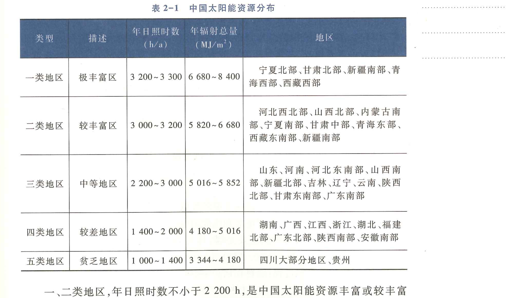

*表2-1（原书第25页）*

的地区，面积较大，约占全国总面积的2/3以上，具有利用太阳能的良好资源条件。

地球上的铀储量有限，已探明的仅500×104t，其中有经济开发价值的仅占一

<!-- 原书第26页；PDF第32页 -->

半。中国的铀储量可供4000×104kW核电站运行30年。经过多年的研究，人们发现海水中含有铀，据估计虽然每1000t海水仅含铀3g,而全球有巧×10园×108t海水，则含铀总量高达45×108t，几乎比陆地上的铀含量多千倍。如果按热值计算，45×108t铀裂变约相当于1×108×108t优质煤，比地球上全部煤的地质储量还多千倍。

从上述中国发电一次能源分布情况看，一次能源与电力需求存在不匹配的情况，中国电力需求主要集中在京津唐、长江三角洲、珠江三角洲以及华中地区。因此，中国电力输送将呈现“西电东送、北电南送"的超/特高压远距离输送格局。

## 2.2 发电厂的生产过程

发电厂是将一次能源转变成电能的工厂。

按一次能源的不同发电厂分为火电厂（以煤、石油和天然气为燃料）、水电厂（以水的位能和动能作动力）、核电厂、风力发电场、太阳能发电场、地热发电厂，以及潮汐发电厂等。此外，还有直接将热能转换成电能的磁流体发电等。

### 2.2.1 火电厂

火力发电厂简称火电厂，是利用煤、石油或天然气作为燃料生产电能的工厂，其能量的转换过程是：燃料的化学能乛热能乛机械能乛电能。

1.火电厂的多种分类方法

（1）按燃料分。可分为燃煤发电厂、燃油发电厂、燃气发电厂、余热发电厂，此外还有利用垃圾及工业废料作为燃料的发电厂。

（2）按蒸汽压力和温度分。

.亚临界发电厂，其蒸汽压力一般为16.7MPa(170.3kgf/cm2)左右、温度为537/537℃左右。

2超临界发电厂，其蒸汽压力大于24.1MPa(245，75kgf/cm2）、温度高于537/566℃。

.超超临界发电厂，其蒸汽压力大于25.1MPa（255.95kgf/cm2)、温度高于595/600℃。

（3）按原动机分。可分为凝汽式汽轮机发电厂、燃气轮机发电厂、内燃机发电厂和蒸汽一燃气轮机发电厂等。

（4）按输出能源分。

.凝汽式发电厂，即只向外供应电能的发电厂，其效率较低，只有30%、40%。

2热电厂，即同时向外供应电能和热能的电厂，其效率较高，可达60%、70%。

中国火电厂所使用的燃料主要是煤，且主力电厂为凝汽式火电厂。凝汽式火电厂由三大主机（锅炉、汽轮机、发电机）及其辅助设备组成。

火电厂的基本生产过程：燃料在锅炉中燃烧产生的热对工质（水）加热，将工质加热成高温高压的过热蒸汽；过热蒸汽在汽轮机中膨胀做功，推动汽轮机旋转，汽轮机带动发电机旋转发电。

凝汽式火电机组典型的燃烧系统由运煤、磨煤、燃烧、风烟、灰渣等环节组成，如图2-2所示。

<!-- 原书第27页；PDF第33页 -->

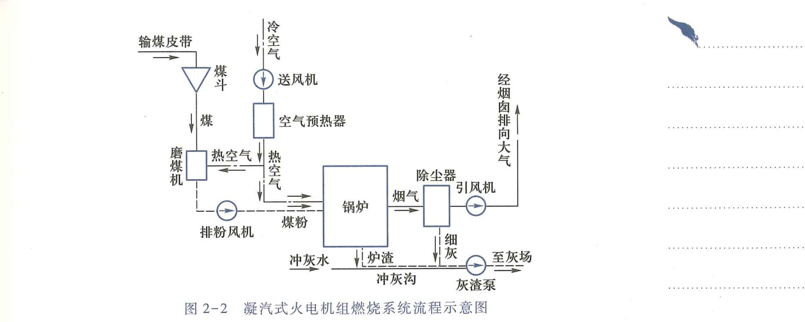

*图2-2凝汽式火电机组燃烧系统流程示意图（原书第27页）*

原煤由产地运到火电厂的卸煤间或储煤场，经筛分机械和破碎机械将大块煤打碎并除去铁件和木块，由输煤皮带送到锅炉车间的原煤斗。为使煤能在锅炉内迅速而有效地燃烧，大、中型发电厂多采用悬浮式燃烧的锅炉一一煤粉炉，需将煤块磨制成煤粉。原煤斗中煤由给煤机送入磨煤机，磨制成煤粉。在排粉风机的抽吸作用下，煤粉与热空气一起经煤粉燃烧器喷人炉膛，燃烧放热。燃烧需要的空气由送风机压人空气预热器中预热，一部分热空气引人磨煤机对原煤进行干燥，并作为输送煤粉的介质，大部分直接经燃烧器送入炉膛助燃。炉膛内煤粉燃烧产生的高温烟气，在引风机的抽吸作用下，在锅炉本体的n形烟道内，依次经炉膛、水冷壁、过热器、再热器、省煤器、空气预热器，逐步将热能传递给工质（水或水蒸汽），成为低温烟气，最后被送入除尘器内净化、除尘，再经引风机、烟卤、向大气排放。炉膛下部渣斗内的灰渣和除尘器收集到的细灰，经冲灰沟，由灰渣泵加压，经管道输送到储灰场。

2.凝汽式火电机组的构成

凝汽式火电机组汽水系统由锅炉、汽轮机、凝汽器、除氧器、加热器等设备及管道构成，包括给水系统、循环水系统和补充给水系统，如图2-3所示。

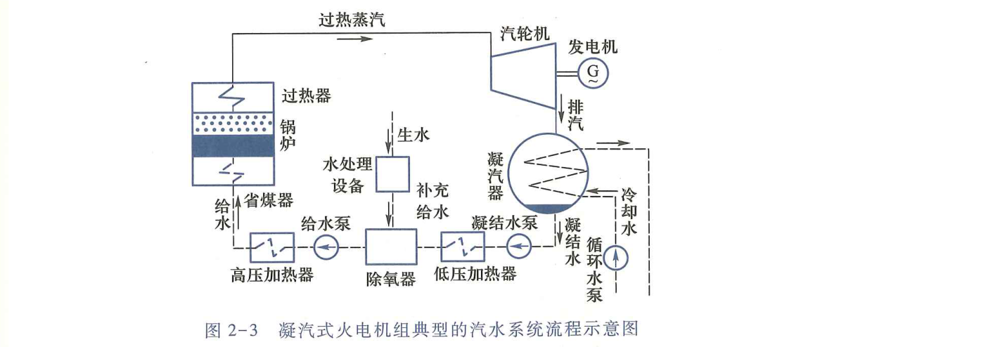

*图2-3凝汽式火电机组典型的汽水系统流程示意图（原书第27页）*

（1）给水系统。由锅炉产生的过热蒸汽沿主蒸汽管道进入汽轮机，高速流动的蒸汽冲动汽轮机叶片转动，带动发电机旋转产生电能。在汽轮机内做功后

<!-- 原书第28页；PDF第34页 -->

的蒸汽，其温度和压力大大降低，被排人凝汽器并被冷却水（循环水）冷却凝结成水（称为凝结水），汇集在凝汽器的热水井中。凝结水由凝结水泵打至低压加热器中加热，再经除氧器除氧并继续加热。由除氧器出来的水（称为锅炉给水），经给水泵升压和高压加热器加热，最后送入锅炉。在现代大型机组中，一般都从汽轮机的某些中间级抽出做过功的部分蒸汽（称为抽汽），用以加热给水（称为给水回热循环），或把做过一段功的蒸汽从汽轮机某一中间级全部抽出，送到锅炉的再热器中加热后再引人汽轮机的以后几级中继续做功（称为再热循环）。

（2）补充给水系统。在汽水循环过程中总难免有汽水泄漏等损失，为维持汽水循环的正常进行，必须不断地向系统补充经过化学处理的软化水，这些补充给水一般补人除氧器或凝汽器中，即是补充给水系统。

（3）循环水系统。为了将汽轮机中做过功后排人凝汽器中的乏汽冷却凝结成水，需由循环水泵从凉水塔抽取大量的冷却水送入凝汽器，冷却水吸收乏汽的热量后再回到凉水塔冷却，冷却水是循环使用的。这就是循环水系统。

火电厂的电气系统，包括发电机、励磁装置、厂用电系统和升压变电站等，如图2-4所示。

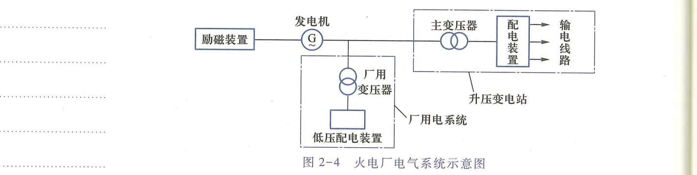

*图2-4火电厂电气系统示意图（原书第28页）*

发电机的机端电压和电流随着容量的不同而各不相同，额定电压一般在10巧、24kV之间，而额定电流可达20kA及以上。发电机发出的电能，其中一小部分（约占发电机容量的4%、8%）由厂用变压器降低电压后，经厂用电配电装置由电缆供给水泵、送风机、磨煤机等各种辅机和电厂照明等设备用电，称为厂用电（或自用电）。其余大部分电能，由主变压器升压后，经高压配电装置、输电线路送入电力系统。

3，火电厂的特点

火电厂与其他类型的发电厂相比，具有以下运行特点：

（1）火电厂耗煤量大，目前发电用煤约占全国煤炭总产量的50%，加上运煤费用和大量用水，其生产成本比水电要高出3、4倍。装机容量4×30×104kW的发电厂，煤耗率按360g/kW。h计，每天需用标准煤（每千克煤产生29295J热量）360g×120×104kW><24h=10368to为保证电厂安全生产，一般要求电厂储备十天以上的用煤量。

（2）火电厂动力设备繁多，发电机组控制操作复杂，运行人员多，厂用电量大，运行费用高。

（3）由于热应力的限制，火电机组负荷的调节速度非常缓慢，国产30万kW机组试验表明，改变负荷的速率仅为每分钟1%、2%。燃煤发电机组由停机到开

<!-- 原书第29页；PDF第35页 -->

机并带满负荷需要几小时到十几小时，并附加耗用大量燃料。火电厂担负急剧升降的负荷时，必须付出附加燃料消耗的代价。例如，据统计某电网火电平均煤耗约400g/kW。h，而参与调峰煤耗将增至468～511g/kW。h，平均增加22%、29%。

（4）火电厂担负调峰、调频或事故备用时，相应事故增多，强迫停运率增高，厂用电率增高。火电厂应该尽可能担负较均匀的负荷。

（5）火电厂的各种排放物（烟气、灰渣、废水）对环境的污染大。国家标准规定燃煤电厂允许排放烟尘最高允许排放浓度为200rng/m3，二氧化硫最高允许排放浓度为1200，氮氧化物最高允许排放浓度为650mg/m3。需要采用静电除尘、脱硫技术、废水处理系统、灰渣综合利用等技术减少排放，保护环境。

此外，火电厂还具有如下其他特点：

（1）火电厂布局灵活，装机容量的大小可按需要决定。

（2）火电厂的一次性建造投资少，仅为水电厂的一半左右。火电厂建造工期短，例如，2×300MW发电机组，工期为3、4年。发电设备年利用小时数较高，约为水电厂的1.5倍左右。

### 2.2.2 水电厂

水力发电厂简称水电厂，又称水电站，是把水的位能和动能转换成电能的工厂。

水电厂的基本生产过程是：从河流较高处或水库内引水，利用水的压力或流速冲动水轮机旋转，将水能转变成机械能，然后由水轮机带动发电机旋转，将机械能转换成电能。因此，在能量转换过程中损耗较小，发电效率较高。

水电厂的发电容量取决于水流的水位落差和水流的流量，如下式

$$
P=9.8\eta QH
\tag{2-1}
$$

式中，P为水电机组的轴向功率（kW）；0为通过水轮机的水的流量（rn3/s）为作用于水电厂的水位落差，也称水头（m）为水电机组的效率，一般为0，80、0.85。

因为水的能量与其流量和落差（水头）成正比，所以利用水能发电的关键是集中大量的水和造成大的水位落差。在流量一定的条件下，水流落差愈大，水电厂出力就愈大。为了充分利用水力资源，应尽量抬高水位。因此水电厂往往需要修筑拦河大坝等水工建筑物，以形成集中的水位落差，并依靠大坝形成具有一定容积的水库，用以调节水的流量。

1.水电厂的分类

（1）按集中落差的方式分类

堤坝式水电厂。在河流中落差较大的适宜地段拦河建坝，形成水库，将水积蓄起来，抬高上游水位，形成发电水头，这种开发模式称为堤坝式。由于水电厂厂房在水利枢纽中的位置不同，又分为坝后式和河床式两种形式。举世瞩目的三峡工程就是堤坝式水电厂。

2引水式水电厂。水电厂建筑在山区水流湍急的河道上，或河床坡度较陡的地方，由引水渠道造成水头，而且一般不需修坝或只修低堰，适用于水头很高的情况。

<!-- 原书第30页；PDF第36页 -->

混合式水电厂。在适宜开发的河段拦河筑坝，坝上游河段的落差由坝集中，坝下游河段的落差由压力引水道集中，而水电厂的水头则由这两部分落差共同形成，这种集中落差的方式称为混合开发模式，由此而修建的水电厂称为混合式水电厂，它兼有堤坝式和引水式两种水电厂的特点。

（2）按径流调节的程度分类

.无调节水电厂。河川径流在时间上的分布往往与水电厂的用水要求不一致。如果水电厂取水口上游没有大的水库，就不能对径流进行调节以适应用水要求，这种水电厂称为无调节水电厂或径流式水电厂。例如引水式水电厂、水头很低的河床式水电厂，多属此种类型。这种水电厂的出力变化主要取决于天然来水流量。往往是枯水期水量不足，出力很小，而洪水期流量很大，产生弃水。

2有调节水电厂。如果在水电厂取水口上游有较大的水库，能按照发电用水要求对天然来水流量进行调节，则这种水电厂称为有调节水电厂。例如堤坝式、混合式和有日调节池的引水式水电站，都属此类。

（3）根据水库对径流的调节程度分类

.日调节水电厂。日调节水电厂库容较小，只能对一日的来水量进行调节，以适应水电厂日出力变化对流量的要求。

2年调节水电厂。年调节水电厂有较大的水库，能对天然河流中一年的来水量进行调节，以适应发电厂年出力变化（包括日出力变化）和其他用水部门对流量的要求。它能将丰水期多余水量蓄存于库中供枯水期应用，以增大枯水期流量，提高水电厂的出力和发电量。

多年调节水电厂。多年调节水电厂一般有较高的堤坝和很大的库容，能改变天然河流一个或几个丰水、枯水年循环周期中的流量变化规律，以适应水电厂和其他用水部门对流量的要求。完全的多年调节水库，弃水很少，可使水电厂的枯水期出力和年发电量得以很大提高。

2.抽水蓄能电厂

有一种特殊形式的发电厂，叫做抽水蓄能电厂，如图2-5所示。

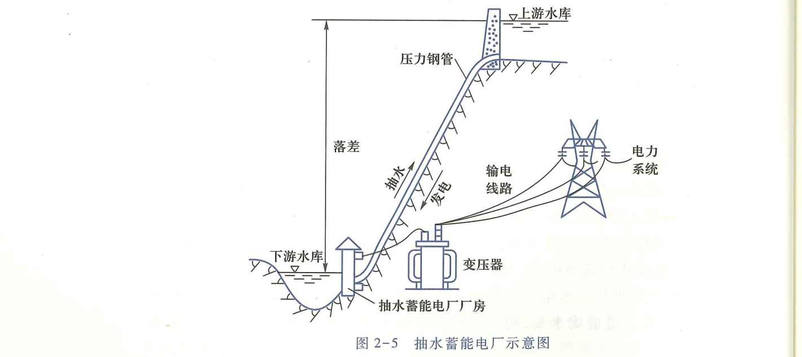

*图2-5抽水蓄能电厂示意图（原书第30页）*

<!-- 原书第31页；PDF第37页 -->

抽水蓄能电厂是以一定水量作为能量载体，通过能量转换向电力系统提供电能。为此，其上、下游均需有水库以储蓄能量转换所需要的水量。

在抽水蓄能电厂中，必须兼备抽水和发电两类设施。在电力负荷低谷时（或丰水时期），利用电力系统的富余电能（或季节性电能），将下游水库中的水抽到上游水库，以位能形式储存起来；待到电力系统负荷高峰时（或枯水时期），再将上游水库中的水放下，驱动水轮发电机组发电，并送往电力系统，这时，用以发电的水又回到下游水库。显而易见，抽水蓄能电厂既是一个吸收低谷电能的电力用户（抽水工况），又是一个提供峰荷电力的发电厂（发电工况）。

3.水电厂的特点

水电厂具有以下运行特点：

（1）发电成本低，效率高。

（2）运行维护人员少，厂用电率低。

（3）调节性能好。机组启动快，水电机组从静止状态到满负荷运行只需4、5min，紧急情况可只用1mino水电厂能适应负荷的急剧变化，适合于承担系统的调峰、调频和作为事故备用。

（4）不污染环境，属于可再生能源发电和洁净能源发电方式。大型水库可调节空气的温度和湿度，改善自然生态环境。

（5）受到水文气象条件的制约，有丰水期和枯水期之别，发电不均衡。

此外，水电厂与其他类型的发电厂相比，具有以下运行特点：

（1）可综合利用水能资源。除发电以外，还有防洪、灌溉、航运、供水、养殖及旅游等多方面综合效益，并且可以因地制宜，将一条河流分为若干河段，分别修建水利枢纽，实行梯级开发。

（2）水能可储蓄和调节。电能的生产是发、输、配、用同时完成的，不能大量储存，而水能资源则可借助水库进行调节和储蓄，而且可兴建抽水蓄能发电厂，扩大利用水能资源。

（3）水电厂建设投资较大，工期较长。

（4）由于水库的兴建，淹没土地，移民搬迁，给农业生产带来一些不利影响，还可能在一定程度上破坏自然界的生态平衡。

由此可知，抽水蓄能电厂具有更加优异的调节性能。可以实现调峰、填谷、备用、调频、调相等功能，是当前可再生能源发电并网后实现电力系统调节的最好手段之一

### 2.2.3 核电厂

核能发电厂，又称为核电厂，利用反应堆中核燃料裂变链式反应所产生的热能，按火电厂的发电方式，将热能转换为机械能，再转换为电能。核电厂的核反应堆相当于火电厂的锅炉。

核电厂的基本生产过程：核燃料裂变链式反应产生的热对工质（水）加热，将工质加热成高温高压的过热蒸汽；过热蒸汽在汽轮机中膨胀做功，推动汽轮机旋转，汽轮机带动发电机旋转发电。

核能能量密度高,lg铀一235全部裂变时所释放的能量为8×1010J，相当于

<!-- 原书第32页；PDF第38页 -->

2.7t标准煤完全燃烧时所释放的能量。作为发电燃料，其运输量非常小，发电成

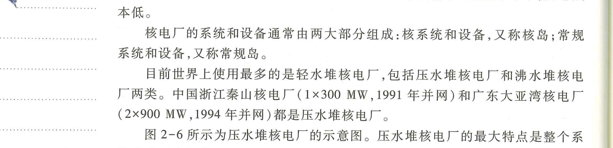

*图2-6所示为压水堆核电厂的示意图。压水堆核电厂的最大特点是整个系（原书第32页）*

统分成两大部分，即一回路系统和二回路系统。一回路系统中压力为巧MPa的高压水被冷却剂主泵送进反应堆，吸收的燃料元件释热后，进入蒸汽发生器下部的U形管内，将热量传给二回路的水，再返回冷却剂主泵人口，形成一个闭合回路。二回路系统的水在U形管外部流过，吸收一回路水的热量后沸腾，产生的蒸汽进入汽轮机的高压缸做功；高压缸的排汽经再热器再热提高温度后，再进入汽轮机的低压缸做功；膨胀做功后的蒸汽在凝汽器中被凝结成水，再送回蒸汽发生器，形成一个闭合回路。一回路系统和二回路系统是彼此隔绝的，万一燃料元件的包壳破损，只会使一回路水的放射性增加，而不致影响二回路水的品质。这样就大大增加了核电站的安全性。

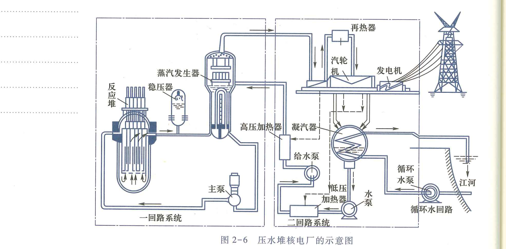

*图2-6压水堆核电厂的示意图（原书第32页）*

稳压器的作用是使一回路水的压力维持恒定。它是一个底部带电加热器，顶部有喷水装置的压力容器，其上部充满蒸汽，下部充满水。如果一回路系统的压力低于额定压力，则接通电加热器，增加稳压器内的蒸汽，使系统的压力提高。反之，如果系统的压力高于额定压力，则喷水装置启动，喷冷却水，使蒸汽冷凝，从而降低系统压力。通常一个压水堆有2、4个并联的一回路系统（又称环路），但只有一个稳压器。每一个环路都有一台蒸汽发生器和1、2台冷却剂主泵。

压水堆核电厂由于以轻水作慢化剂和冷却剂，反应堆体积小，建设周期短，造价较低；加之一回路系统和二回路系统分开，运行维护方便，需处理的放射性废气、废液、废物少，因此在核电厂中占主导地位。

<!-- 原书第33页；PDF第39页 -->

核电厂的运行特点：

0）核电厂只能对反应堆堆心一次装料，并定期停堆换料，一般每年换料1次。

（2）核电厂在运行过程中，会产生放射性废物。反应堆不管是在运行中或停闭后，都有很强的放射性。

（3）核电厂应在额定功率或尽可能在接近额定功率的工况下带基本负荷连续运行。

### 2.2.4 风电场

中国近年来风电和太阳能光伏发电得到快速发展，主要原因是化石能源（煤、石油等）日益紧缺。

风电场是将风能转换为电能的工厂。风电场基本生产过程是：风吹动风力机旋转，将风能转换成机械能；风力机带动发电机发电，将机械能转换成电能。

1.风电场的分类

风电场由3部分组成：风力发电机组、集电线路和升压站。

风力发电机组包括风力机部分和发电机部分。根据风机这两部分采用的不同结构类型、技术方案的不同特征，再加上它们的不同组合，风力发电机组可以有多种多样的分类。

（1）按照风机旋转主轴的方向（即主轴与地面相对位置）分类，可分为：

0水平轴式风机。转动轴与地面平行，叶轮需随风向变化而调整位置。

2垂直轴式风机。转动轴与地面垂直，设计较简单，叶轮不必随风向改变而调整方向。

（2）按照桨叶数量分类可分为单叶片、双叶片、三叶片和多叶片型风机。

叶片的数目由很多因素决定，包括空气动力效率、复杂度、成本、噪音、美学要求等。大型风力发电机可由1、2或者3片叶片构成。叶片较少的风力发电机通常需要更高的转速以提取风中的能量，因此噪音比较大。而如果叶片太多，它们之间会相互作用而降低系统效率。目前3叶片风机是主流。

（3）按照风机接受风的方向分类，可分为上风向型和下风向型风机。

上风向型风机的叶轮正面迎着风向，即在塔架的前面迎风旋转；下风向型风机的叶轮背顺着风向。上风向风机一般需要有某种调向装置来保持叶轮迎风。而下风向风机则能够自动对准风向，从而免除了调向装置，但由于一部分空气通过塔架后再吹向叶轮，塔架就干扰了流过叶片的气流而形成塔影效应，使性能有所降低。所以大多数风机都是上风向风机。

（4）按照功率传递的机械连接方式的不同，可分为有齿轮箱型风机和无齿轮箱的直驱型风机。

（5）根据按桨叶接受风能的功率调节方式，可分为：

(D定桨距（失速型）机组。桨叶与轮毂的连接是固定的。

2变桨距机组。叶片可以绕叶片中心轴旋转，使叶片攻角可在一定范围内（一般0、90。）调节变化。

（6）按照叶轮转速是否恒定，可分为恒速风力发电机组和变速风力发电

<!-- 原书第34页；PDF第40页 -->

机组。

（7）根据风力发电机组的发电机类型分类，可分为：异步发电机型、双馈发电机型和直驱风力发电机型。

（8）根据风机的输出端电压高低，可分为：

.高压风力发电机。风力发电机输出端电压为10、20kV，甚至40kV，可省掉风机的升压变压器直接并网。

2低压风力发电机。输出端电压为1kV以下（如690v），目前市面上大多为此机型。

风力风电机组的轴向功率可以表示为：

$$
P_w=\frac12\rho Av^3
\tag{2-2}
$$

式中，P为空气密度为风轮受风面积“为风速。

可见，由于风速耖是时刻变化的，风力风电机组的有功功率也是时刻变化的，发电有功功率不恒定。

集电线路担负着将每台风力发电机组所发的电力汇集起来并输送到风电场升压站的任务，集电线路通常采用2回路或3回路10kV、35kV电缆线路或架空线路。每台风力发电机组经过升压变压器与集电线路连接，如图2-7所示。

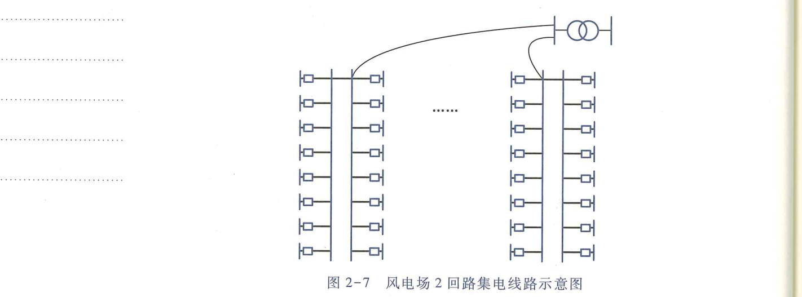

*图2-7风电场2回路集电线路示意图（原书第34页）*

风电场升压站汇集多回集电线路传送来的电力，经过升压变压器送入电网。

2，风电场的运行特点

0）受气象条件等因素制约，风电场有功功率出力具有波动性。

（2）为保证最大风能利用率，目前大多数风电场不参与电力系统有功调节。

（3）风电场是洁净能源发电，其电能生产不污染环境。

### 2.2.5 太阳能光伏发电场

光伏发电是利用半导体界面的光生伏特效应而将光能直接转变为电能的一种技术。太阳光照在半导体p-n结上，形成新的空穴一电子对，在P一n结电场的作用下，空穴由n区流向P区，电子由P区流向n区，接通电路后就形成电流。

太阳能光伏发电场是一种利用光生伏特效应将太阳能转换成电能的发电

<!-- 原书第35页；PDF第41页 -->

所示。

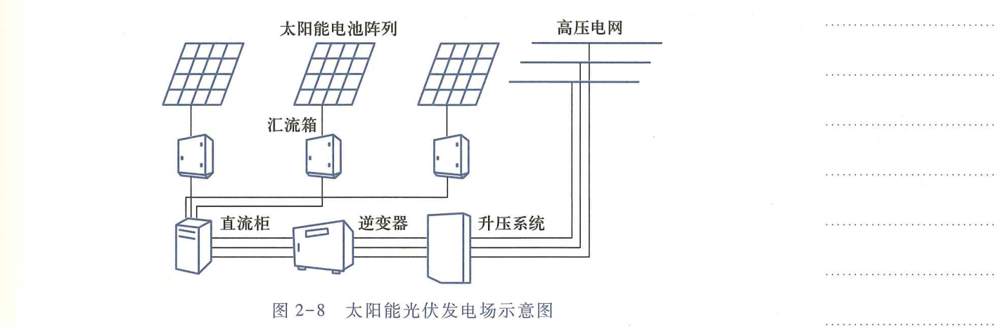

*图2-8太阳能光伏发电场示意图（原书第35页）*

太阳能电池是一种由于光生伏特效应而将太阳光能直接转化为电能的器件，是一个半导体光电二极管，当太阳光照到光电二极管上时，光电二极管就会把太阳的光能变成电能，产生电流。当许多个电池串并联起来就可以构成有比较大的输出功率的太阳能电池阵列，再配合功率控制器等部件就形成了光伏发电装置。

1.太阳能电池的主要构成

0）电池片：采用高效率06巧%以上）的单晶硅太阳能片封装，保证太阳能电池板发电功率充足。

（2）玻璃：采用低铁钢化绒面玻璃（又称为白玻璃），厚度3.2rnm，在太阳电池光谱响应的波长范围内（320100nm）透光率达91%以上，对于大于1200nm的红外光有较高的反射率。此玻璃同时能耐太阳紫外光线的辐射，透光率不下降。

（3）太阳电池的背面覆盖物TPT：氟塑料膜为白色，对阳光起反射作用，因此对组件的效率略有提高，并因其具有较高的红外发射率，还可降低组件的工作温度，也有利于提高组件的效率。氟塑料膜具有太阳电池封装材料所要求的耐老化、耐腐蚀、不透气等基本要求。

（4）边框：所采用的铝合金边框具有高强度，抗机械冲击能力强。

由于太阳能的直接输出一般都是12v、24v、48v、96v、192vo为了能与电网并网，需要将直流转换为交流，因此使用DC-AC逆变器。

逆变器的输出经过升压变压器接人电网。

2.太阳能光伏发电场的运行特点

（1）受四季、昼夜及阴晴等气象条件等因素制约，太阳能光伏发电场有功功率出力具有波动性。

（2）大型太阳能光伏发电场一般不带储能装置。为保证最大太阳能利用率，目前太阳能光伏发电场一般不参与电力系统有功调节。

（3）太阳能光伏发电是洁净能源发电，其电能生产不污染环境。

<!-- 原书第36页；PDF第42页 -->

## 2.3 输电网

### 2.3.1 交流输电

1.交流输电网的工作原理与构成

输电的目的是将电能从发电厂高效地输送到负荷中心，在电力输送过程中尽可能减少输电网中的有功功率损耗。因此，输电网的工作原理是在尽可能减少输电元件电阻上的有功损耗，即减小流经输电元件上电流的基础上将电能从发电厂高效地输送到负荷中心。

$$
\Delta P=3I^2R
$$

$$
\Delta P=\frac{P^2+Q^2}{U^2}R
\tag{2-3}
$$

式中:AP为输电线路上的有功功率损耗；P为输电线路上传输的有功功率；0为输电线路上传输的无功功率；U为输电线路线电压。

可见，在输送功率尸不变的情况下，为了减小输电网有功损耗厶P，需要减小电阻R，减少输电网传输的无功功率0和提高输电电压UO但由于减小电阻需要增大导线截面，使导线的金属耗量增加，因此，减小AP主要通过减小0和提高U来实现。

为了提高输电电压0，可以在发电厂装设升压变压器升高输电电压，在靠近负荷处装设降压变压器降低电压供负荷使用电能；为了减少输电网传输的无功功率0，可以在靠近负荷处装设无功电源（即装设无功补偿装置），抵消无功负荷。

交流输电网由输电线路和变电站构成。变电站的主要电气设备是变压器和开关设备，其中开关设备用于正常投切操作和切断故障电流。某些变电站还装设有无功补偿装置（如电容器组等）。

2.对称三相三线制输电

对称三相交流电压可以表述为

$$
\begin{cases}\dot U_a=\dot U\sin(\omega t+\alpha)\\\dot U_b=\dot U\sin(\omega t+\alpha-120^\circ)\\\dot U_c=\dot U\sin(\omega t+\alpha+120^\circ)\end{cases}
\tag{2-4}
$$

对称三相交流电具有如下优点：

0）易于产生旋转磁场。

（2）瞬时功率不随时间变化而保持恒定。

（3）输电线路所用导线的金属消耗量少。

因此，目前除了室内配电等小功率供电时采用单相交流方式外，其他场合都采用三相交流。对称三相三线制输电具有最高的效率和最小的金属耗量，如表2-2和表2-3所示，这是为什么采用对称三相三线制输电的重要原因。

<!-- 原书第37页；PDF第43页 -->

不同输电方式每根导线的输电功率

表2

一2

每根导线输电功率

输电方式

输电功率

比率（$I_0/I_N$

UIcos

单相二线制

UIcos

100

2

.、PUIcos

二相三线制

OUIcos

94

3

dSUIcos

三相三线制

寻《乙(lcos

1巧

3

、/0/cos

三相四线制

v/SUIcos

4

4U/cos

U/cos

四相四线制

100

2

2

U/cos

nUIcos对称“相。线制(n为偶数）

100

2

2

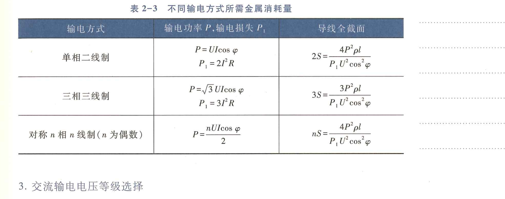

*表2-3不同输电方式所需金属氵肖耗量（原书第37页）*

电力系统额定电压的选择，在规划设计中又称电压等级的选择，它是关系到电力系统网架结构、建设费用的高低、运行灵活与否、设备制造是否经济合理的一个综合性问题，是较为复杂的。一般地说，传输功率愈大，输送距离愈远，则选择较高的电压等级就比较有利。

220v及以上电力系统的额定电压与相应的传输功率和传输距离的关系如表2-4所示。

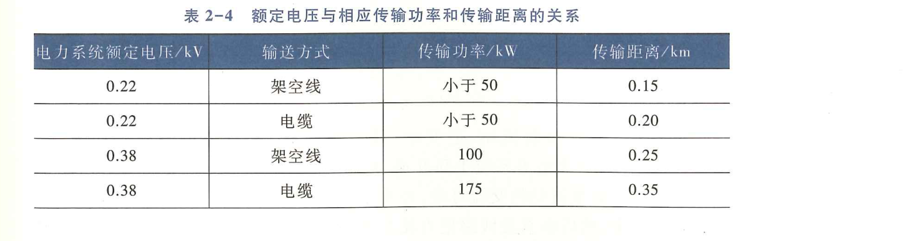

*表2-4额定电压与相应传输功率和传输距离的关系（原书第37页）*

<!-- 原书第38页；PDF第44页 -->

### 2.3.2 直流输电

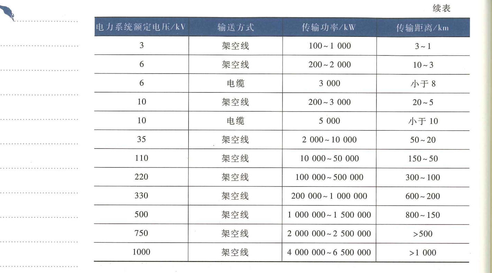

*续表（原书第38页）*

电力系统额定电压为220kV及以上电压等级与其相适应的传输功率和传输距离的关系曲线如图2-9所示。

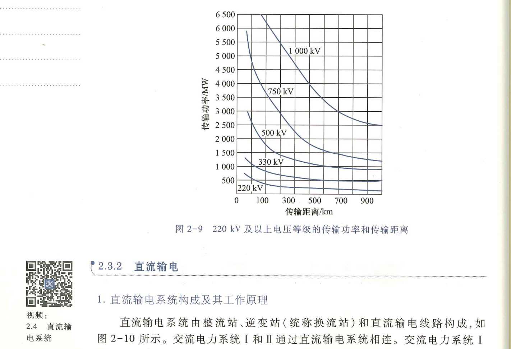

*图2-9；图2-10所示。交流电力系统I和I[通过直流输电系统相连。交流电力系统I（原书第38页）*

送出交流功率给整流站的交流母线，经换流变压器1，送到整流器，把交流功率变换成直流功率，然后由直流线路把直流功率输送给逆变站内的逆变器，逆变器把

<!-- 原书第39页；PDF第45页 -->

电力系统II。

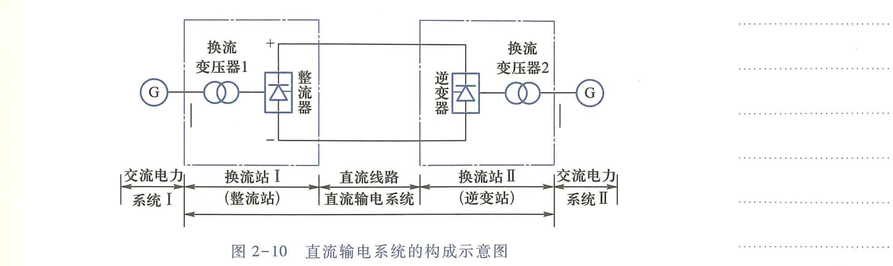

*图2-10直流输电系统的构成示意图（原书第39页）*

整流站和逆变站统称换流站。整流器和逆变器统称换流器。

目前常用6脉波或12脉波换流器。

直流输电系统工作原理是：

如图2-11（）所示，换流器1作为整流器运行，换流器2作为逆变器运行，两侧的直流电压平均值分别为0和Ud2。当UdI>Ud2时，能使直流电流沿着可控硅元件可导通方向流动。

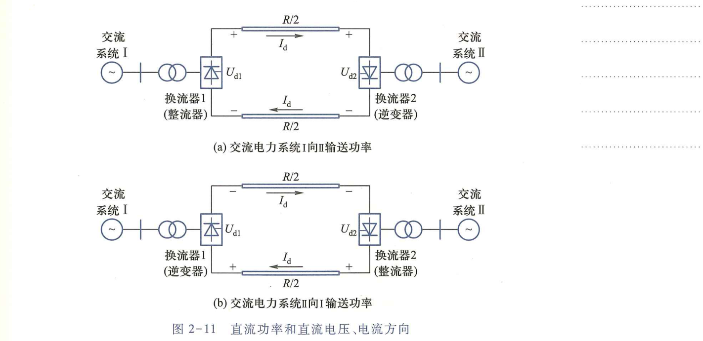

*图2-11直流功率和直流电压、电流方向（原书第39页）*

直流电流

$$
I_d=\frac{U_{d1}-U_{d2}}{R}=\frac{\Delta U}{R}
\tag{2-5}
$$

$$
P_1=U_{d1}I_d
\tag{2-6}
$$

$$
P_2=U_{d2}I_d
\tag{2-7}
$$

<!-- 原书第40页；PDF第46页 -->

$$
\Delta P=P_1-P_2=\Delta U I_d
\tag{2-8}
$$

改变式（2-5）中AU的值，可改变/，并相应改变输送功率。如果调节AU=0，此时1d=00若调节使得和Ud2极性都反转，而且使得的代数值仍大于Ud2，即|Ud2《>《》，虽然保持电流流向不变，但功率输送方向已改变为交流电力系统向I输送电力，这种功率方向的改变称为潮流反转，此时，换流器2为整流器，换流器1为逆变器，如图2-11（b）所示。可见，换流器即可用作整流器，又可用作逆变器，只是工作状态不同而已。

直流输电的优点如下：

（1）联网后不会增大短路容量。

（2）两端交流系统之间不存在稳定问题和同期问题。

（3）稳态下，不存在交流长电缆线路的容性电纳引起的电压升高。

（4）直流线路由于电压没有正负交替，所以无充放电电流。

（5）会产生较大的谐波电流和电压。

（6）用直流联网，便于分区调度，有利于故障时交流系统间快速紧急支援和限制事故扩大。

（7）长距离电力电缆输电宜采用直流输电。

直流输电的缺点如下：

（1）换流器消耗无功功率大。

（2）可控硅元件过载能力低。

（3）以大地（海水）方式工作时，对沿途金属设施造成腐蚀。

（4）灭弧困难，灭弧问题是直流断路器制造的难气

2.两端直流输电

直流输电系统按照它与交流系统连接的节点数不同，可以分为两端直流输电系统和多端直流输电系统两类。

两端直流输电系统是指具有一个整流站和一个逆变站的直流输电系统。两端直流输电系统可分为三类单极、双极、非同步联络站。

（1）单极系统。

换流站出线端对地电压为正的称为正极；对地电压为负的称为负极。单极系统一般采用正极接地，相当于只有一个负极。单极系统有两种构成方式：大地（海水）回流方式、导线回流方式。

大地（海水）回流方式：也称一线一地制，利用大地或海水作为直流输电系统的回流电路。大地（海水）回流方式会对沿线管道、金属设施产生电化腐蚀，对通信和磁性罗盘产生不利影响，如图2-12（）所示。

导线回流方式：也称两线制，以低绝缘导线作为回流电路，克服了腐蚀问题，但增加了投资，一般用于双极系统过渡方式，如图2-12（b）所示。

（2）双极系统。

双极系统有三种构成方式：中性点两端接地方式、中性点一端接地方式、中性线方式。

中性点两端接地方式：接地点在换流器的中性点，可以看作两个一线一地制

<!-- 原书第41页；PDF第47页 -->

但实际上正常运行时存在不平衡电流（只有百分之几），大大减轻了腐蚀问题。当任何一极故障时可以采用单极运行，如图2-13（）所示。

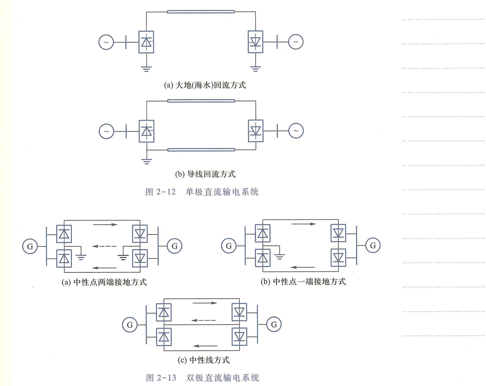

*图2-12单极直流输电系统；图2-13双极直流输电系统（原书第41页）*

中性点一端接地方式：也称两线制。避免了腐蚀问题。但是一极线路发生故障，迫使健全极停运。若未接地换流站中性点可以接地，则可以恢复单极运行，如图2-13（b）所示。

中性线方式：也称三线制。避免了腐蚀问题，单极可以连续运行，如图2-13（c）所示。

（3）非同步联络站。

非同步联络站可联络两个非同步交流系统。非同步联络站没有直流线路，故也称背靠背直流系统。并联型非同步联络站方便增加并联支路，扩大非同步联络站的容量，如图2-14（a）所示。串联型非同步联络站的特点是除换流器外，大部分电路接近或等于地电位，可以降低绝缘费用，如图2-14（b）所示。

3.多端直流输电

多端直流系统是指与交流电力系统有3个或3个以上连接节点的直流系统，其每个换流站都与各自的交流系统连接。两端直流系统是多端直流系统的基础

<!-- 原书第42页；PDF第48页 -->

和特例，上述两端直流系统的构成在多端直流系统中都适用。

多端直流输电线路构成直流网络。直流网络可分为分支方式和闭环方式，闭环方式又分为并联型和串联型，如图2一巧所示。

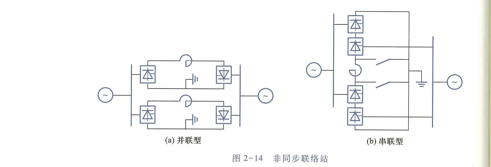

*图2-14非同步联络站（原书第42页）*

(b)换流器并联一直流网络闭环方式

(c)换流器串联一直流网络闭环方式

图2一巧双极直流输电系统

### 2.3.3 交直流输电的等价距离

直流输电一般采用双极中性点接地方式，直流线路只需2根导线；交流输电采用三相三线制，需要3根导线。可以推导出，假设在直流和交流线路的导线截面积相等、电流密度也相等的条件下，2根导线的直流线路所能输送的功率和3根导线的交流线路所能输送的有功功率几乎相等。因此直流输电方式线路投资比交流输电方式线路投资少。

但是，直流换流站设备比交流变电站复杂，存在造价昂贵的可控硅换流器，以及换流器的控制调节装置、换流变压器、滤波装置、平波电抗器及其他附属设备，直流换流站的投资高于同等容量的交流变电站。如输电功率为1200MW的工程，用交流500kV输电，交流变电站投资约为±400kV直流换流站投资的66%。

等价距离是指输送功率相同和输电可靠性相当的条件下，直流输电方式与交流输电方式相比，当输电距离达到某一长度时，直流线路比交流线路节省的那部分建设费用刚好抵偿直流换流站比交流变电站增加的那部分费用，这个输电距离称为交直流输电的等价距离。如图2-16所示，当输电距离大于等价距离

<!-- 原书第43页；PDF第49页 -->

时，采用直流输电所需的建设费用比交流输电省。

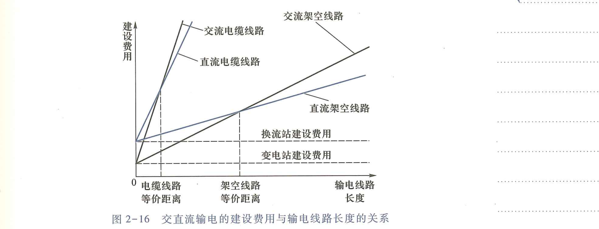

*图2-16交直流输电的建设费用与输电线路长度的关系（原书第43页）*

## 2.4 配电网

### 2.4.1 配电网的构成及特点

配电网是指在电力网中起电能分配作用的网络。通常是指电力系统中二次降压变压器低压侧直接或降压后向用户供电的网络。

1.配电网的构成

由于中国的用户设备多数是380v/220V的低压用电设备，因此配电网主要由配电线路、配电开关设备和配电变压器构成。包括：

（1）架空或电缆配电线路。

（2）配电开关设备（将在本书第3章介绍）。

（3）配电所，是一种用于配电的变电站。

（4）环网柜，它是一组高压开关设备装在钢板金属柜体内或做成拼装间隔式环网供电单元的电气设备，其核心部分采用负荷开关和熔断器，可以用于配电网连接，并且能抽取电能。

（5）电缆分支箱。仅作为电缆分支使用，电缆分支箱的主要作用是将电缆分接或转接，主要起电缆分接作用和电缆转接作用。

（6）柱上变压器。它是指装设在电杆上的配电变压器。

（7）配电箱。它是按电气接线要求将开关设备、测量仪表、保护继电器和辅助设备组装在封闭或半封闭金属柜中或屏幅上，构成低压配电装置。正常运行时可借助手动或自动开关接通或分断电路。故障或不正常运行时借助保护继电器切断电路或报警。借测量仪表可显示运行中的各种参数，还可对某些电气参数进行调整，对偏离正常工作状态进行提示或发出信号。

2.配电网的分类

（1）按照电压等级分为高压配电网（110、220kV，中国也称为供电网络）、中压配电网（10kV、20kV、35kV）、低压配电网（380V/220V、660V/380V）。

<!-- 原书第44页；PDF第50页 -->

（2）按照配电用户类型分为城市配电网（简称城网）、农村配电网（简称农网）、工厂配电网。

3.配电网的特点

配电网具有很多与输电网不同的特点，主要有以下几点。

（1）配电网规模增长迅速。配电网规模发展需要与国民经济发展相适应，配电网将延伸到各车间、各个家庭。近年来中国经济快速发展，配电网规模也因此快速发展，局部地区的配电网出现了爆炸式增长趋势。配电网规模增长迅速使得配电网负荷预测困难，网络改建、扩建频繁，要求配电网具有比输电网更强的开放性，方便接纳和管理新用户。

（2）配电设备数量庞大，类别繁多。由于向国民经济各行业和居民区供电，配电网延展到人类活动的各角落，因此配电设备众多。一个大型城市的配电设备数量是以“万"为单位计算的。常规的表格式显示、查询、管理、控制手段在以万为单位计算的配电设备数量面前显得苍白无力。如何管理配电设备、如何确定运行设备的状态、如何运行配电网、如何处理配电网故障等问题都因此变得非常复杂。近年来，基于GIS（地理信息系统）的配电网管理思路得到了广泛应用。

（3）配电网异常和故障频繁。由于配电设备数量庞大，配电设备运行环境恶劣，配电设备靠近用户，因此配电网每天发生多起故障是正常现象。为了保证经济性，配电网基于统计负荷采用经济电流密度选择导线截面和配电变压器，在负荷高峰时段经常出现线路和变压器的过载现象。为了保证供电可靠性，配电网采用了负荷转供策略，但是选择导线截面和配电变压器经常是按照非转供考虑的，因此在需要进行负荷转供时也会出现线路和变压器过载现象。可见，处理异常和故障是配电网的日常工作。表2-5所示给出了某年某大城市和某地区供电局配电网的故障统计数据。

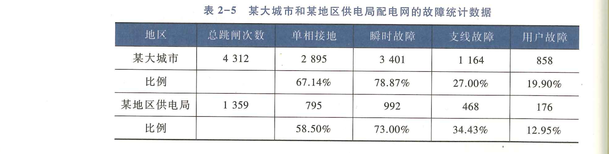

*表2-5某大城市和某地区供电局配电网的故障统计数据（原书第44页）*

从表2-5中可以看出，配电架空线路故障多于电缆线路故障；单相接地故障多于相间故障；绝大多数故障属于瞬时故障。随着城农网改造的深人，支线故障和用户故障所占比例越来越大。

（4）中低压配电网保护选择性配合困难。中低压配电线路距离短，根据相关规程规范，10kV线路供电半径一般不超过巧km（包括支线的长度），线路沿线T接了多个电力负荷，有多个配电开关设备。在开关设备处，除了采用广域保护方案外（由于有通信信道要求很难实现），继电保护几乎不能按照电流整定值实现保护选择性配合；向10kV供电的变压器二次侧的后备保护动作时间一般是

<!-- 原书第45页；PDF第51页 -->

电网都采用简单的过电流保护，无论相间故障发生在配电网什么位置，大多数依靠变电站出口断路器跳闸，扩大了停电范围；或者配电线路沿线过电流保护无选择性跳闸。相关原理见本书第10章。

（5）中国配电网采用开环运行方式（除香港外）。采用开环运行，主要是为了降低短路电流、节省设备投资。但是为了提高供电可靠性，中国城市配电网普遍采用了闭环结构，当配电网发生异常和故障时可以实现负荷转供。

（6）10kV、35kV是小电流接地系统。10kV、35kV中性点采用不接地或经消弧线圈接地，发生单相接地故障后允许带接地点运行0.2h，设备按照线电压绝缘。参见本书4.3节。

配电网与输电网运行特点比较见表2-6。

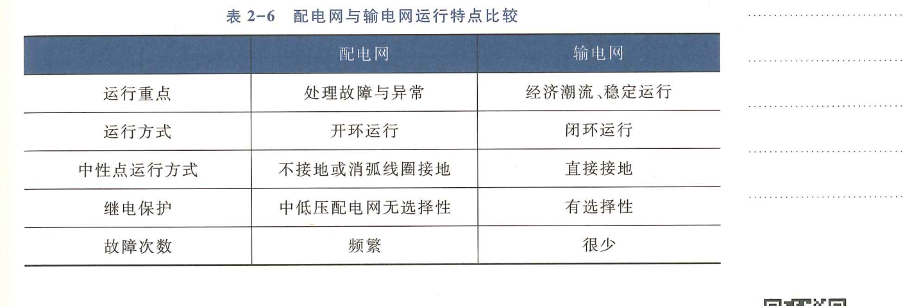

*表2-6配电网与输电网运行特点比较（原书第45页）*

### 2.4.2 配电网故障隔离和网络重构基础

配电网故障隔离是指当配电网发生故障且继电保护跳闸后，找到距故障点最近的配电开关，并将其断开，使故障区段与正常区段隔离开。

之所以配电网需要进行故障隔离，是因为中低压配电网保护动作没有选择性，为了弥补保护动作没有选择性带来的供电可靠性降低问题，需要采用自动化的手段实现故障隔离。

要实现故障隔离，首先需要实现配电线路分段。所谓分段就是在配电线路（架空线、电缆线）中间加装配电开关，将配电线路分成若干段。换言之，配电线路分段的目的是为了提高供电可靠性，如图2-17所示。

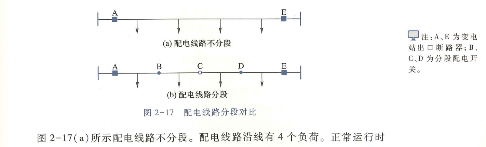

*图2-17配电线路分段对比；图2-17（）所示配电线路不分段。配电线路沿线有4个负荷。正常运行时（原书第45页）*

其中1个变电站出口断路器闭合，另1个变电站出口断路器断开（开环运行）。

<!-- 原书第46页；PDF第52页 -->

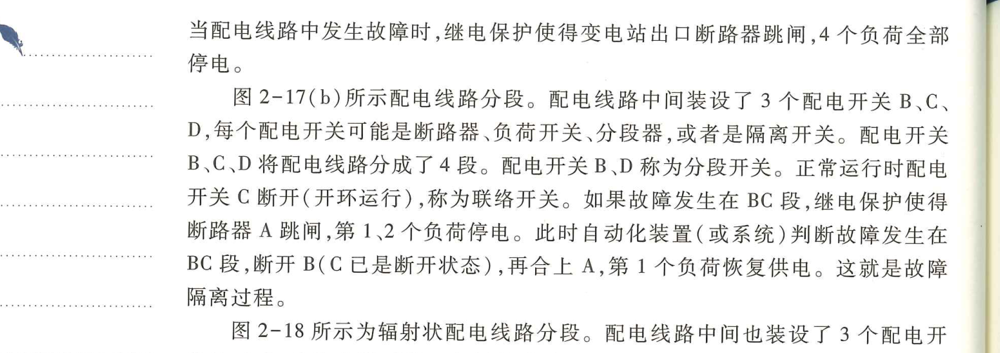

*图2-17（b）所示配电线路分段。配电线路中间装设了3个配电开关B、C、；图2-18所示为辐射状配电线路分段。配电线路中间也装设了3个配电开（原书第46页）*

关B、c、D，称为分段开关。如果故障发生在BC段，继电保护使得断路器A跳闸，4个负荷都停电。此时自动化装置（或系统）判断故障发生在BC段，断开B，再合上A，第1个负荷恢复供电。

*图2-18辐射状配电线路分段（原书第46页）*

可见，配电线路分段和故障隔离提高了供电可靠性。

常见的分段开关可以是柱上开关（即装设在柱上的配电开关）、环网柜中的配电开关。

在图2-17（b）中，如果故障发生在AB段，继电保护使得断路器A跳闸，第1、2个负荷停电，同上述故障隔离过程断开了B。此时BC段没有故障，可以通过闭合c恢复BC段供电。“闭合c恢复BC段供电"这一过程就是网络重构。

所谓网络重构是指为了恢复故障后非故障区域供电，或为了消除配电元件过载等异常，或为了使配电网运行更加高效可靠而进行的配电网运行拓扑结构调整。其中，为了恢复故障后非故障区域供电而进行的配电网运行拓扑结构调整称为故障重构；为了消除配电元件过载等异常而进行的配电网运行拓扑结构调整称为异常重构；为了使配电网运行更加高效可靠而进行的配电网运行拓扑结构调整称为正常重构。

由于配电网开环运行，当配电网发生故障，且故障隔离完成，经常会造成非故障区域停电。故障重构主旨是为了尽可能多地恢复非故障停电区域供电。故障重构经常在故障隔离之后实施。故障重构完成后仍然可能存在配电元件过载等异常。当配电网故障处理完成，经常需要调整运行方式，恢复到正常运行方式以应对下次发生的故障。

异常重构主旨在于消除配电元件过载等异常。由于瞬间的异常无法通过运行方式调整消除，并且大多数情况下只有超过热时间常数的持续异常才对配电设备产生不利影响。因此，异常重构不需要频繁进行，大于巧、20min的控制周期足以满足要求。正常重构的控制周期可以更长，因为配电线路数目众多，运行方式不宜频繁调整，配电网的高效和可靠主要是关注长期（以月为时间单位甚至更长）的安全性和可靠性。

在配电自动化水平较低的场合，异常重构基本上是人工处理的，因此配电网

<!-- 原书第47页；PDF第53页 -->

经常出现配变烧毁等事故，并且基本上不进行正常重构。

在配电自动化水平较高的配电网中，常以较短的控制周期进行异常重构和正常重构，并将异常重构和正常重构结合起来进行优化。实现网络重构需要在配电网中设置联络开关。所谓联络是指将两个配电电源供电的线路连接在一起。联络开关是实现联络的配电开关。如图2-17（b）所示配电开关就是联络开关。联络开关在配电网中一般是固定设置的，正常运行时是断开的，保证配电网开环运行，当配电网发生故障时，有选择地闭合联络开关，可以实现负荷转供。

常见的联络开关可以是柱上开关、环网柜中的配电开关，或设置专用的联络柜。利用联络开关可以实现多回手拉手线路（即两端供电线路，如图2-17所示）之间的联络，实现手拉手多联络接线，如图2-19所示，可满足城区高负荷密度区域高可靠性供电的要求。

*图2-19（原书第47页）*

## 2.5 电力系统负荷

### 2.5.1 电力系统负荷的基本概念及分类

电力系统负荷是指电力系统在某一时刻各类用电设备消耗功率的总和。电力系统负荷包括异步电动机、同步电动机、整流设备、电热设备和照明设备等设备的消耗功率。由于消耗功率有有功功率、无功功率、视在功率之分，因此电力系统负荷也包含有功负荷、无功负荷、视在负荷三种。若非特殊说明，下述负荷泛指这三类负荷。

电力系统负荷的分类方法很多，不同的场合采用不同的分类方法。

1.根据消耗功率的性质分类

（1）用电负荷。用户的用电设备在某一时刻消耗功率的总和称为用电负荷。用电负荷是站在用户角度衡量的。

（2）供电负荷。用电负荷加上电力网损耗的功率（也称线损负荷）称为供电负荷。供电负荷是站在变电站角度衡量的。

（3）发电负荷。供电负荷加上发电厂本身所消耗的功率（也称发电厂厂用电负荷）称为发电负荷。发电负荷是站在发电厂角度衡量的。

2.按供电可靠性分类

可以将负荷划分成一类负荷、二类负荷和三类负荷。

<!-- 原书第48页；PDF第54页 -->

3.根据用户在国民经济中的部门分类

0）工业用电负荷

中国省级及以上电力网中，工业用电负荷比重一般在50%以上；大城市电力网工业用电负荷比重超过50%，有些工业城市可能高达80%；中小城市和地县级电力网工业用电负荷比重视国民经济结构而有差异。

工业用电负荷最主要的特征绝大多数是电动机负荷，因此整体特性表现为电动机类似的特性。工业负荷的大小不仅取决于工业用户的工作方式，包括设备利用情况、企业的工作班制等，而且与工业行业的行业特点、季节因素都有紧密联系。

在一年时间范围内，工业用电中除部分建材、榨糖等季节性生产的企业外，一般用电负荷是比较恒定的。但也有一些变化因素，如北方集中采暖地区，冬季用电比夏季高，南方高温地区，因通风降温，夏季负荷高于冬季。一些连续性生产的化工行业，因夏季单位产品耗电较高，多集中在夏季停电检修。连续生产的冶金行业，因夏季炉旁温度高、劳动条件差，也多集中在夏季停产检修。春节期间工业用电下降幅度较大。

从一天来看，一般一天内出现用电的三个高峰，两个低谷。尤以一班制生产企业占较大比重的地区更为明显。早晨上班半小时至一小时，出现早高峰，发生的时间受作息时间影响，冬季晚一些，夏季早一些，午休时用电陡降，成为中午低谷；午休后下午一般又出现一个高峰，但不如早峰突出；傍晚开始照明后又出现一个高峰，但对工业本身而言，晚峰比早峰负荷低得多。

（2）居民生活用电负荷

改革开放以来，城乡人民生活迅速改善，随着人民生活水平日益提高，电视机、空调器、电磁炉、电暖气等家用电器的逐步普及，生活用电负荷急剧上升。高峰时段以后，有些地区电力网中生活用电负荷已经超过40%。城乡居民用电仍将有较快增长，农村居民用电由于基数较小，增长速度将快于城市。

从负荷特点看，城乡间、地区间呈现不同特点，如夏季的南方空调投入，负荷剧增，而北方的冬季则取暖器投运，也会造成用电负荷增长等。

（3）其他行业用电负荷

不同行业用电负荷的特征不同，具有较大差异性。

### 2.5.2 电力系统负荷的表征方法

电力系统负荷的表征方法有很多种，常用的有：负荷曲线、负荷实时值、最大负荷利用小时数7'，，，灬负荷密度、计算负荷、负荷特性及负荷模型等。其中负荷曲线主要应用于电力系统的规划、调度、可靠性分析计算和管理；负荷实时值主要应用于电力系统的运行和控制；最大负荷利用小时数“主要应用于电力系统的规划和管理；负荷密度和计算负荷主要应用于电力系统的规划；负荷特性及负荷模型主要应用于电力系统的分析、计算和控制。

1.电力系统的负荷曲线

负荷是时时刻刻变动的，表达电力负荷随时间变动情况的曲线图形称为负

<!-- 原书第49页；PDF第55页 -->

间（一般以h（小时）为单位），曲线在两坐标轴之间所包容的面积表示该段时间内用电设备的耗电量（或供电量）。

负荷曲线可按时间和按用电特性划分为两大类。按时间分类主要有日负荷曲线和年负荷曲线两个系列，它们又可根据所求负荷的性质，生成若干种负荷曲线。

（1）日负荷曲线。以全日小时数为横坐标而以负荷值为纵坐标绘制而成的曲线，按照负荷性质又可分为：电力系统的综合负荷曲线、发电厂的日发电负荷曲线、个别用户的日负荷曲线、分类用户的用电综合负荷曲线。

（2）日平均负荷曲线。按其代表的负荷性质，最常用的是：系统日平均负荷曲线、分类用户的平均负荷曲线。

（3）负荷持续曲线。负荷持续曲线的主要作用是掌握系统的基本负荷（最低负荷）的大小以及高出基本负荷的持续小时数。按其记录时间的长短可分为日、月及年的负荷持续曲线。

（4）年负荷曲线。年负荷曲线一般是由日负荷曲线叠成的。最常见的有：逐日负荷变动曲线、月最高负荷曲线、月平均最高负荷曲线、月最低负荷曲线。

（5）历年负荷曲线。最常见的有：历年的月平均和月最高负荷曲线、历年的月最低负荷曲线、历年的月发电量和历年的日平均发电量曲线。

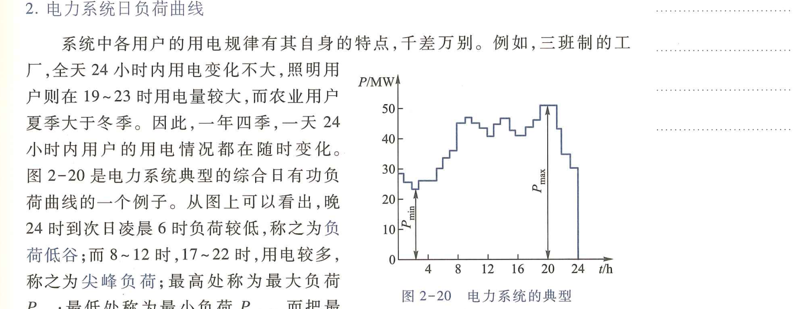

*图2-20是电力系统典型的综合日有功负；图2-20电力系统的典型（原书第49页）*

日有功负荷曲线小负荷以下的部分称为基本负荷，显然，基本负荷是不随时间变化而变化的。

不同类型的用户其负荷曲线是很不相同的。一般来说，负荷曲线的变化规律取决于负荷的性质、厂矿企业的生产情况、班次、地理位置、气候等许多因素。例如，钢铁工业为三班制连续生产，因而负荷曲线很平坦；食品工业多为一班制生产，因而负荷曲线变化幅度较大；农副业加工负荷每天往往只是持续一段时间；市政生活用电的最大特点则是具有明显的照明用电高峰。

负荷曲线除了用来表示负荷功率随时间变化的关系外，还可用来计算用户取用电能的大小。在某一时间&内用户所取用的电能AA为该时间内用户的有功功率P和&的乘积。因此，在一昼夜内用户所消耗的总电能为

<!-- 原书第50页；PDF第56页 -->

$$
A=\int_0^{24}P\,\mathrm dt
\tag{2-9}
$$

显然，式（2-9）即表示日有功负荷曲线下所包围的面积。在式（2-9）中，如果尸的单位为kW，时间的单位为h，则电能的单位为kW·ho

负荷曲线对电力系统的规划设计和运行调度十分有用，电力系统的计划生产主要是建立在预测的负荷曲线的基础之上的。

3.电力系统年负荷曲线

在电力系统的运行和设计中，不仅要知道一昼夜内负荷的变化规律，而且要知道一年之内负荷的变化规律，最常用的是年最大负荷曲线，如图2-21所示。它反映了从年初到年终的整个一年内的逐月（或逐日）综合最大负荷的变化规律。从图2-21可以看出，夏季的最大负荷较小，这是由于夏季日长夜短，照明负荷普遍减小的缘故。但是，如果季节性负荷（农业排灌，空调制冷等）的比重较大，则可能使夏季的最大负荷反而超过冬季，这种情况在国内外的实际系统中也是不少的。至于年终的负荷较年初为大，则是由于各工矿企业为超额完成年度计划而增加生产，以及新建、扩建厂矿投入生产的结果。年最大负荷曲线用来作为制作发电机组检修计划的依据。同时，也为有计划地扩建发电机组或新建发电厂提供依据。图2-21中，阴影部分表示计划检修机组的容量，F为新装机容量。

在电力系统的运行分析中，还经常用到年持续负荷曲线，如图2-22所示，按一年内系统负荷的数值大小及其持续小时数依次排列绘制而成。例如，全年8760h中，尸1负荷值共计tl(h)，P2负荷值共计t2(h)，

.，P4负荷值共计t4(h)，依此可绘出图2-22所示曲线。按此曲线可以算出系统负荷全年耗电量为

$$
A=\int_0^{8760}P\,\mathrm dt
\tag{2-10}
$$

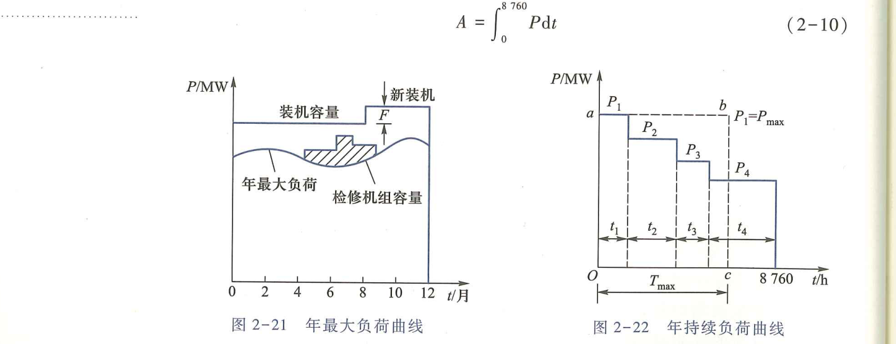

*图2-21年最大负荷曲线；图2-22年持续负荷曲线（原书第50页）*

4.负荷实时值

负荷实时值是指在电力系统运行过程中，通过变电站或用户处安装的测量仪表或自动化系统的采集装置测量到的负荷值。

负荷实时值是电力系统保证功率平衡的关键。一般在每回线路出线端、每台变压器各侧、发电机机端装设功率表或/和电流表，测量负荷实时值。根据测

<!-- 原书第51页；PDF第57页 -->

力系统的运行电压和频率在允许的范围内。

负荷实时值是进行电力系统控制的重要参数。发电机组的有功功率控制、电力系统自动频率控制、电力系统自动电压控制、电力系统自动减负荷控制都需要根据负荷实时值进行控制决策。

负荷实时值是其他负荷表征方法的基础。利用负荷实时值可以绘制各种负荷曲线、统计最大负荷利用小时数尹一和计算负荷，分析负荷密度、负荷特性及负荷模型。

5.最大负荷利用小时数丆一

如果用户始终保持最大负荷值P一运行，经过7'一小时后所消耗的电能恰好等于全年的实际耗电量，则称T一为年最大负荷利用小时数，即

$$
T_{\max}=\frac{A}{P_{\max}}=\frac1{P_{\max}}\int_0^{8760}P\,\mathrm dt
\tag{2-11}
$$

$$
P_{\max}T_{\max}=A=\int_0^{8760}P\,\mathrm dt
\tag{2-12}
$$

年最大负荷利用小时数的大小，在一定程度上反映了实际负荷在一年内的变化程度。如果负荷曲线较为平坦，则7'，“值较大；反之，则7'！“值较小。因此，它在一定程度上反映用户的用电特点。统计表明，对于各类负荷的“值，大体在一定的范围内，如表2-7所示。

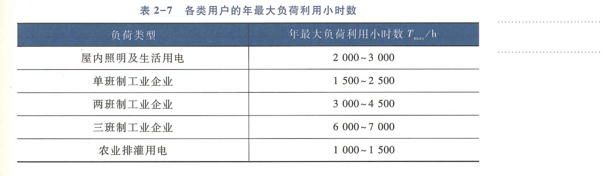

*表2-7各类用户的年最大负荷利用小时数（原书第51页）*

在知道了7'，“`值后，应用式（2-11）即可估算出用户全年的耗电量。7'，，“的作用主要如下：

（1）衡量发电厂的技术经济效益。

式（2-12）表明，发电厂的“反映了发电厂售电量的大小，因此不“、可以作为发电厂的宏观经济指标之一。无论发电厂的类型、装机容量、地理位置、资源情况、接人电网的电压等级的情况如何，“都可以作为发电厂之间经济技术比较的指标。

（2）衡量电气设备资产利用情况。

衡量电气设备资产利用情况不仅仅看其服役时间长短，更重要的是看其负荷的轻重。用“可以对电气设备负荷情况进行衡量，因此是衡量电气设备资产利用情况的有效指标。

<!-- 原书第52页；PDF第58页 -->

（3）规划对新用户的供电。

对规划的新用户，可以先从手册上查出“，根据用户规模（如工厂年产量）和单位产品的耗电量可以估算出用户全年用电量；然后根据全年用电量和“计算出0“。根据0“就可以设计向该用户供电的一次设备。这在电网规划时是常用的方法。

6.负荷密度

负荷密度伊是表征负荷分布密集程度的量化参数，它是单位面积的平均用电有功功率数值，以MW/m2表示。负荷密度是配电网设计的主要依据之一

在电网设计中，为了更好地区分所在区域用户的重要程度，《配电网规划设计技术导则》Q/GDW1738一2012中将供电区域划分成了6类，如表2-8所示。

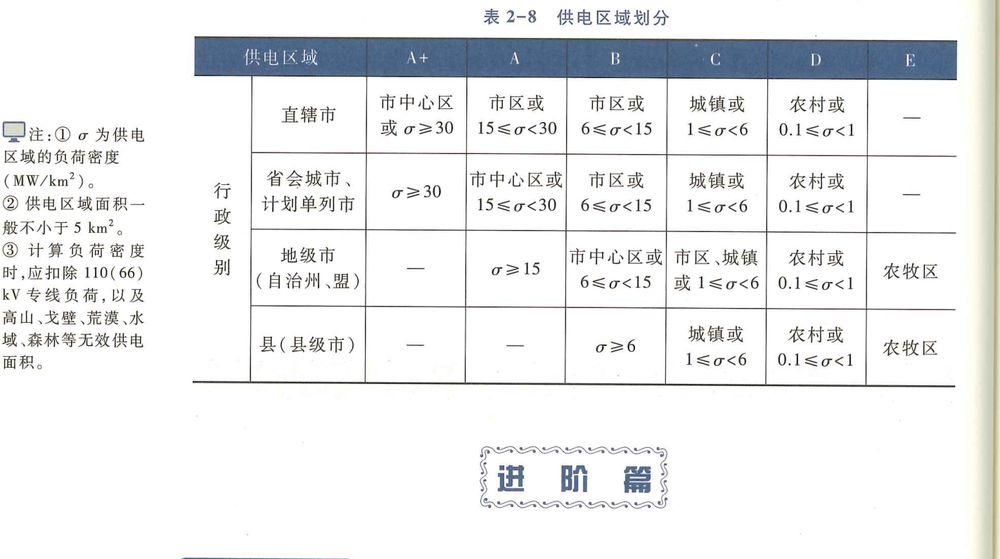

*表2-8供电区域划分（原书第52页）*

## 2.6 输电容量

输电容量是指输电线路所能输送的最大有功功率。

当输电线路上通过电流时，会产生功率损耗，损耗的电能引起导体发热。输电线路（及其绝缘）需要承受导体发热的影响。能够满足长期发热要求的流经输电线路的长期工作电流或有功功率称为输电线路的热极限。

热极限是影响输电容量的重要因素。此外，电压损耗、电力损失和电力系统运行稳定极限功率也是确定输电容量的因素。一般在短距离输电线路中，输电容量取决于输电线路热极限、电压损耗和电力损耗（即通过电压损耗和电力损耗选择导线截面），稳定性几乎不是问题；在长距离输电线路中，输电容量除受热极限影响外，还需考虑电力系统稳定性影响因素，一般不考虑电压损耗、电力损失的影响。关于电力系统稳定性将在本书第9章介绍。下面主要介绍输电线路热极限。

<!-- 原书第53页；PDF第59页 -->

根据输电线路中流过电流大小和时间长短，输电线路的发热分为正常工作条件下引起的发热，称为长期发热，由短路电流引起的发热，称为短时发执

为了限制发热的有害影响，规定了载流导体和电气设备的长期发热和短时发热的最大允许温度如表2-9所示。

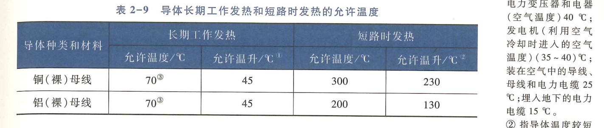

*表2-9导体长期工作发热和短路时发热的允许温度（原书第53页）*

工作电流流过导体时，在电阻上产生功率损耗/2山，几乎全部转化成热量。其中一部分热量使导体温度升高，另一部分热量，当导体的温度高于周围环境温度后，主要通过辐射、对流的方式向外散发出去。伴随着导体温度的上升，散热量也随之增大，直到导体发热量等于散热量后，导体的温度就不再上升。可列出如下热平衡微分方程式。

$$
I^2R\,\mathrm dt=mC\,\mathrm d\theta+aF(\theta-\theta_0)\,\mathrm dt
\tag{2-13}
$$

$$
I^2R=aF(\theta-\theta_0)
\tag{2-14}
$$

式中，为导体的质量（kg）；c为导体的比热容（J/kg。℃）“为导体的总换热系数（W/m2。℃）为导体的散热面积（m2）；为周围环境的温度（℃）。

若已知导体的长期发热时最高允许温度1（如表2-9所示），实际环境温度，则导体的最大允许温升$\tau_{\mathrm{st}}=\theta_{\mathrm{al}}-\theta_0$。由式（2-14），可计算导体的热极限

$$
I=\sqrt{\frac{aF\tau_{\mathrm{st}}}{R}}=\sqrt{\frac{aF(\theta_{\mathrm{al}}-\theta_0)}{R}}
\tag{2-15}
$$

根据式（2一巧），增大输电线路的热极限的方法包括增大线径、采用分裂导线、采用双回线或多回线。一般在输电网中，经常采用分裂导线、双回线或多回线提高热极限；在电压等级较低的配电网中，主要采用增大线径的办法提高配电线路的热极限。

## 2.7 计算负荷

通过负荷的统计计算求出的、用来按发热条件选择配电网中各组成元件的负荷值，称为计算负荷。计算负荷是配电网设计的基本依据。计算负荷确定的是否合理，直接影响电气设备和导线的选择是否经济合理。如果计算负荷确定过大，将使电气设备容量和导线截面选的过大，造成投资和有色金属的浪费；如果计算负荷确定过小，又将使电气设备和导线运行时增加电能损耗，并产生过热，引起绝缘过早老化，甚至烧毁，以致发生事故，同样给国家造成损失。由此可见，正确确定计算负荷具有很大意义。

目前比较普遍采用的确定计算负荷的方法有两种：需要系数法和二项式系数法。本节简单介绍需要系数法。

<!-- 原书第54页；PDF第60页 -->

用电设备组的计算负荷0是指用电设备组从供电系统中取用的半小时最大负荷。用电设备组的设备容量0是指用电设备组所有设备（不包括备用设备）的额定容量PN之和，即$P_s=\sum P_N$。而设备的额定容量是指设备在额定条件下的最大输出功率。根据不同工作制、单相用电、两相用电的用电设备，其用电设备容量必须进行折算，参见相关手册。

一般，用电设备组的多数设备实际上不一定都同时运行，运行的那些设备又不太可能都满负荷。另外，设备和配电线路都有功率损耗，因此，用电设备组的有功计算负荷（见图2-23）应为

$$
P_c=\frac{K_tK_H}{\eta_s\eta_t}P_s
\tag{2-16}
$$

式中，为设备同时运行系数，即设备组在最大负荷时运行的设备容量与总容量之比；KH为设备组负荷系数，即设备组在最大负荷时的输出功率与总容量之比；

为设备组的平均效率，即设备组在最大负荷时的输出功率与取用功率之比；为配电线路的平均效率，即配电线路在最大负荷时的末端功率（设备组的取用功率）与首端功率（计算功率）之比。

*图2-23用电设备组的计算负荷与设备容量（原书第54页）*

令K“：KtKH/喏，则按需要系数法确定三相用电设备组有功计算负荷户

$$
P_c=K_{\mathrm{nc}}P_s
\tag{2-17}
$$

式中，K“为需要系数，一般小于1。

从式（2-17）可以看出，需要系数就是用电设备在最大负荷时需要的有功功率与其设备容量的比值。

实际上，需要系数不仅与用电设备的工作性质、设备台数、设备效率和线路损耗等因素有关，而且与操作人员的技术熟练程度和生产组织等多种因素有关，因此，应尽可能通过实测分析确定，使之尽量接近实际。表2-10列出了各种用电设备组的需要系数值。

*表2-10用电设备组的需要系数及功率因数（原书第54页）*

0.3一0.4

大批和流水作业生产的热加工机床电动机

5

0.65

大批和流水作业生产的冷加工机床电动机

0.2、0.25

5

L73

<!-- 原书第55页；PDF第61页 -->

*续表（原书第55页）*

小批和单独生产的冷加工机床电动机

0.16、0.2

5

L73通风机、水泵、空压机及电动发电机组电动机

0.75一0，85

5

0.75连续运输机械和铸造车间造型机械（连锁的）

0.65、0.7

5

0.75

0.88

锅炉房机修、机加工、装配等类车间的吊车

0.1、0.15

3

L73=25%）

铸造车间的吊车=25%）

0，巧、0，3

3

L73

自动连续装料的电阻炉设备

0.6、0.7

1

0，95

L33非自动连续装料的电阻炉设备

0.6、0.7

1

0.95

0.33实验室用的小型电热设备（电阻炉、干燥箱等）

1

0

低频感应电炉

0，65

L02高频感应电炉

0.87

0巧7

电焊机、缝焊机

0.35

1.33对焊机、铆钉加热机

0.35

1.02

自动弧焊变压器

2，29单头手动弧焊变压器

0.35

0.35

2.68多头手动弧焊变压器

0，7、0.9

0.35

2，68单头弧焊电动发电机组

0.35

L33多头弧焊电动发电机组

0.7·0.9

0.75

0.38生产厂房及办公室、试验场所照明

1

0变电站、仓库照明

0巧、0.7

1

0宿舍、生活区照明

0.6、0.8

1

0室外照明

1

1

0事故照明

1

1

0

表2-10中的用电设备组的需要系数值是设备台数较多时的数据，主要是从车间范围内来统计计算各用电设备组的计算负荷时用的，因此，需要系数值一般都比较低。例如，各类冷加工机床的需要系数平均只有0.2左右。如果采用需要系数法来计算干线或分支线上的用电设备组的计算负荷，则表中的需要系数值往往偏小，可适当取大。对于只有1、2台设备的用电设备组，需要系数值宜取为1。对于单台电动机，其尸。：地砌，这里为电动机的额定效率，也应取额定值。

在求出有功计算负荷P。以后，可按下式求出无功计算负荷（单位用kvar)。

$$
Q_c=P_c\tan\varphi
\tag{2-18}
$$

可按下式求出视在计算负荷（单位用kV。A)

<!-- 原书第56页；PDF第62页 -->

$$
S_c=\frac{P_c}{\cos\varphi}
\tag{2-19}
$$

$$
S_c=\sqrt{P_c^2+Q_c^2}
\tag{2-20}
$$

可按下式求出计算电流（单位用A）

$$
I_c=\frac{S_c}{\sqrt3U_{\mathrm N}}
\tag{2-21}
$$

$$
I_c=\frac{P_c}{\sqrt3U_{\mathrm N}\cos\varphi}
\tag{2-22}
$$

式中，UN为用电设备的额定电压（kV）；和tan分别为用电设备组的平均功率因数及对应的正切值（参见表2-10）。

**例2-1** 已知一小批量生产的冷加工机床组，拥有电压为380V的三相电动机38台，其中7kW的3台，4.5kW的8台，2.8kW的17台，1.7kW的10台。试求其计算负荷。

**解** 冷加工机床组电动机的总容量为

$$
P_s=(3\times7+8\times4.5+17\times2.8+10\times1.7)\,\mathrm{kW}\approx122\,\mathrm{kW}
$$

查表2-10，$K_{\mathrm{ne}}=0.16\sim0.2$，取$K_{\mathrm{ne}}=0.2$，又$\cos\varphi=0.5$、$\tan\varphi=1.73$。因此可得：

$$
\begin{aligned}
P_c&=K_{\mathrm{ne}}P_s=0.2\times122\,\mathrm{kW}=24.4\,\mathrm{kW},\\
Q_c&=P_c\tan\varphi=24.4\times1.73\,\mathrm{kvar}\approx42.2\,\mathrm{kvar},\\
S_c&=\frac{P_c}{\cos\varphi}=\frac{24.4}{0.5}\,\mathrm{kVA}=48.8\,\mathrm{kVA},\\
I_c&=\frac{S_c}{\sqrt3U_N}=\frac{48.8\,\mathrm{kVA}}{\sqrt3\times0.38\,\mathrm{kV}}\approx74.1\,\mathrm A.
\end{aligned}
$$

确定拥有多组（设有组）用电设备的计算负荷时，应适当考虑各组用电设备的最大负荷不同时出现的因素。因此，在确定低压干线上或低压母线上的计算负荷时，可结合具体情况计人一个同时系数（又叫参差系数或混合系数）K〗对于低压干线，可取=0.9、1.0；对于低压母线，用电设备组计算负荷直接相加来计算时，可取=0.8、0，9。

总的有功计算负荷为

$$
P_c=K_{\Sigma}\sum_{i=1}^{n}P_{ci},\qquad i=1,2,\ldots,n
\tag{2-23}
$$

总的无功计算负荷为

$$
Q_c=K_{\Sigma}\sum_{i=1}^{n}Q_{ci},\qquad i=1,2,\ldots,n
\tag{2-24}
$$

以上两式中的〗P。和〗0。分别表示所有各组设备的有功和无功计算负荷之和。在计算各组计算负荷时，为了简化和统一，每组中的设备台数不论多少，其

、和tan可以都按表2-10所列数据取值。

总的视在计算负荷，按式（2-20）计算。总的计算电流，按式（2-21）计算。

由于各组设备的cos不同，总的计算负荷和计算电流，一般不能按式（2-19）和式（2-22）计算，也不能用各组的视在计算负荷之和或计算电流之和来计算。

例2一2某机修车间380v线路上，接有冷加工机床电动机20台，共50kW（其中较大容量电动机7kW的1台，4巧kW的2台，2.8kW的7台），通风机2，共5，6kW，电阻炉一台，2kW。试确定此线路上的计算负荷。

解各设备组的计算负荷为

<!-- 原书第57页；PDF第63页 -->

（a）冷加工机床组，查表2-10得$K_{\mathrm{ne}1}=0.2$、$\cos\varphi=0.5$、$\tan\varphi=1.73$：

$$
P_{c1}=K_{\mathrm{ne}1}P_{s1}=0.2\times50\,\mathrm{kW}=10\,\mathrm{kW},\qquad Q_{c1}=P_{c1}\tan\varphi=10\times1.73\,\mathrm{kvar}=17.3\,\mathrm{kvar}.
$$

（b）通风机组，$K_{\mathrm{ne}2}=0.8$、$\cos\varphi=0.8$、$\tan\varphi=0.75$：

$$
P_{c2}=K_{\mathrm{ne}2}P_{s2}=0.8\times5.6\,\mathrm{kW}=4.48\,\mathrm{kW},\qquad Q_{c2}=P_{c2}\tan\varphi=4.48\times0.75\,\mathrm{kvar}=3.36\,\mathrm{kvar}.
$$

（c）电阻炉，$K_{\mathrm{ne}3}=0.7$、$\cos\varphi=1$、$\tan\varphi=0$：

$$
P_{c3}=K_{\mathrm{ne}3}P_{s3}=0.7\times2\,\mathrm{kW}=1.4\,\mathrm{kW},\qquad Q_{c3}=0.
$$

总的计算负荷，取同时系数$K_\Sigma=0.95$，则有

$$
\begin{aligned}
P_c&=0.95(10+4.48+1.4)\,\mathrm{kW}\approx15.1\,\mathrm{kW},\\
Q_c&=0.95(17.3+3.36+0)\,\mathrm{kvar}\approx19.6\,\mathrm{kvar},\\
S_c&=\sqrt{P_c^2+Q_c^2}\approx24.7\,\mathrm{kVA},\\
I_c&=\frac{S_c}{\sqrt3U_N}=\frac{24.7\,\mathrm{kVA}}{\sqrt3\times0.38\,\mathrm{kV}}\approx37.5\,\mathrm A.
\end{aligned}
$$

> 转录校注：原书最后一项代入式的“×1000”与“0.38kV”混用，和37.5A结果不一致；此处统一使用kVA、kV，保留原书结果。

## 2.8 负荷特性及负荷模型

分析电力系统在各种状态下的特性必须研究系统的负荷特性并建立其数学模型。将电力网覆盖的广大地区内难以胜数的电力用户合并为数量不多的负荷，分接在不同地区不同电压等级的母线上。每一个负荷都代表一定数量的各类用电设备及相关的变配电设备的组合，这样的组合就称为综合负荷。各个综合负荷功率大小不等，成分各异。一个综合负荷可能代表一个企业，也可能代表一个地区。

综合负荷的功率一般是要随系统的运行参数（主要是电压和频率）的变化而

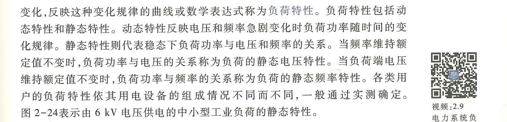

*图2-24表示由6kV电压供电的中小型工业负荷的静态特性。（原书第57页）*

负荷模型是指在电力系统分析计算中对负荷特性所做的物理模拟或数学描述。对负荷模型本身的分类方法很多。例如，从模型是否反映负荷的动态特性来看，可以分为静态模型和动态模型。显然，静态模型是代数方程式，而动态模型则是微分方程式。由于对负荷动态特性的认知还十分有限，下面主要阐述负荷的静态特性和静态模型。

（1）用多项式表示的负荷静态电压特性和频率特性。

将负荷的静态特性用数学公式表述出来，就是负荷的静态数学模型。不计

<!-- 原书第58页；PDF第64页 -->

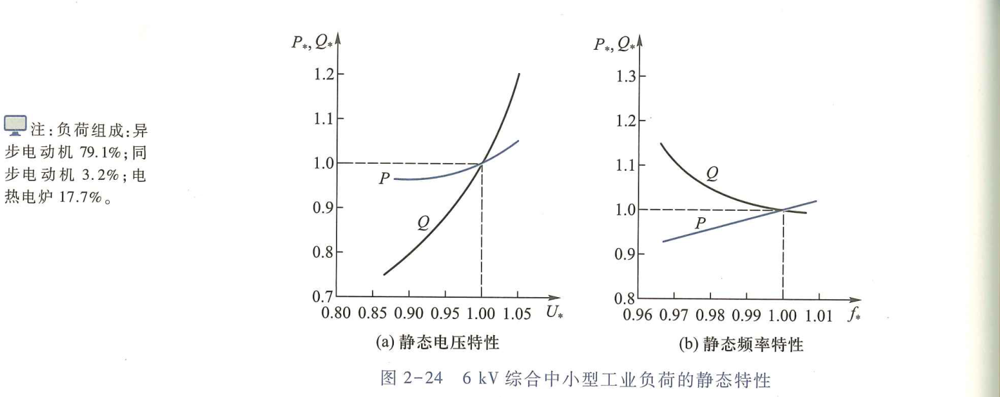

*图2-246kV综合中小型工业负荷的静态特性（原书第58页）*

频率变化，负荷吸收的功率与节点电压的关系一般用如下的二次多项式表示

$$
P_L=P_N\left[a_P\left(\frac{U_L}{U_N}\right)^2+b_P\frac{U_L}{U_N}+c_P\right]=P_N(a_PU_{L*}^2+b_PU_{L*}+c_P)
\tag{2-25}
$$

$$
Q_L=Q_N\left[a_Q\left(\frac{U_L}{U_N}\right)^2+b_Q\frac{U_L}{U_N}+c_Q\right]=Q_N(a_QU_{L*}^2+b_QU_{L*}+c_Q)
\tag{2-26}
$$

式中，为额定电压，和QN为额定电压时的有功和无功功率，参数、

、bQ和对于不同的节点取值是不同的，可根据实际的静态电压特性用最小二乘法拟合求得，这些系数应满足

$$
a_P+b_P+c_P=1
\tag{2-27}
$$

$$
a_Q+b_Q+c_Q=1
\tag{2-28}
$$

公式（2-25）和式（2-26）表明，负荷的有功和无功功率都由三个部分组成，第一部分与电压平方成正比，代表恒定阻抗消耗的功率；第二部分与电压成正比，代表与恒电流负荷相对应的功率；第三部分为恒功率分量。

负荷的静态频率特性也可以用类似的多项式表示。当电压和频率都在额定值附近小幅度变化时，还可以对静态特性做线性化处理，将负荷表示为

$$
P_L=P_N(1+k_{pu}\Delta U)
\tag{2-29}
$$

$$
Q_L=Q_N(1+k_{qu}\Delta U)
\tag{2-30}
$$

$$
P_L=P_N(1+k_{pf}\Delta f)
\tag{2-31}
$$

$$
Q_L=Q_N(1+k_{qf}\Delta f)
\tag{2-32}
$$

不同

$$
k_{pu}=\left.\frac{U_N}{P_N}\frac{\mathrm dP_L}{\mathrm dU}\right|_{U=U_N}=\left.\frac{\mathrm dP_{L*}}{\mathrm dU_*}\right|_{U=U_N}
\tag{2-33}
$$

$$
k_{qu}=\left.\frac{U_N}{Q_N}\frac{\mathrm dQ_L}{\mathrm dU}\right|_{U=U_N}=\left.\frac{\mathrm dQ_{L*}}{\mathrm dU_*}\right|_{U=U_N}
\tag{2-34}
$$

$$
k_{pf}=\left.\frac{f_N}{P_N}\frac{\mathrm dP_L}{\mathrm df}\right|_{f=f_N}=\left.\frac{\mathrm dP_{L*}}{\mathrm df_*}\right|_{f=f_N}
\tag{2-35}
$$

<!-- 原书第59页；PDF第65页 -->

$$
k_{qf}=\left.\frac{f_N}{Q_N}\frac{\mathrm dQ_L}{\mathrm df}\right|_{f=f_N}=\left.\frac{\mathrm dQ_{L*}}{\mathrm df_*}\right|_{f=f_N}
\tag{2-36}
$$

需要同时考虑电压和频率的变化时，也可以采用

$$
P_L=P_N(1+k_{pu}\Delta U)(1+k_{pf}\Delta f)
\tag{2-37}
$$

$$
Q_L=Q_N(1+k_{qu}\Delta U)(1+k_{qf}\Delta f)
\tag{2-38}
$$

（2）用指数形式表示的负荷静态电压特性。

将负荷的静态电压特性在稳态运行点附近表示成指数形式，当不计频率变

$$
P_L=P_N\left(\frac{U_L}{U_N}\right)^\alpha
\tag{2-39}
$$

$$
Q_L=Q_N\left(\frac{U_L}{U_N}\right)^\beta
\tag{2-40}
$$

对于综合负荷，指数的取值通常在0巧、1.8；指数的值随节点不同变化很大，典型值约为1.5、6。

当同时计及频率变化的影响时，可表示为

$$
\frac{P_L}{P_N}=\left(\frac{U_L}{U_N}\right)^\alpha(1+k_{pf}\Delta f)
\tag{2-41}
$$

$$
\frac{Q_L}{Q_N}=\left(\frac{U_L}{U_N}\right)^\beta(1+k_{qf}\Delta f)
\tag{2-42}
$$

必须指出，尽管负荷的静态模型形式简单，而在通常的电力系统稳定性计算中得到了广泛的应用。但必须注意，当所涉及的节点电压幅值变化范围过大时，采用静态模型将会使计算误差过大。常用的处理方法是在不同的电压范围采用不同的模型参数，或者当电压低于（0.3、0.7）v时，程序将负荷简单处理成恒定阻抗。

## 2.9 分布式发电与微电网

### 2.9.1 分布式发电

在电力能源更迭的大背景下，分布式发电（distributed，(G)是伴随着风力发电和太阳能光伏发电的发展而在配电侧、用户侧出现的新型发电方式。

分布式发电是指发电功率在几kW至数百MW（也有的建议限制在30、50MW以下）的小型模块化、分散式、布置在用户附近的高效、可靠的发电单元。

分布式发电的优势在于可以充分开发利用各种可用的分散存在的能源，包括本地可方便获取的可再生能源和化石类燃料，并提高能源的利用效率。

1.技术特点

分布式发电主要技术特点如下：

（1）一般建设在用户附近，输电通道较短，且输送方式灵活。

（2）具备接人现有网架的技术基础，通过一定的技术手段可以接人电网。

（3）较多地利用新能源发电，成本低。

（4）电能质量难以保证，电压波形十分不稳定。

<!-- 原书第60页；PDF第66页 -->

分布式发电技术主要技术类型如表2-11所示。

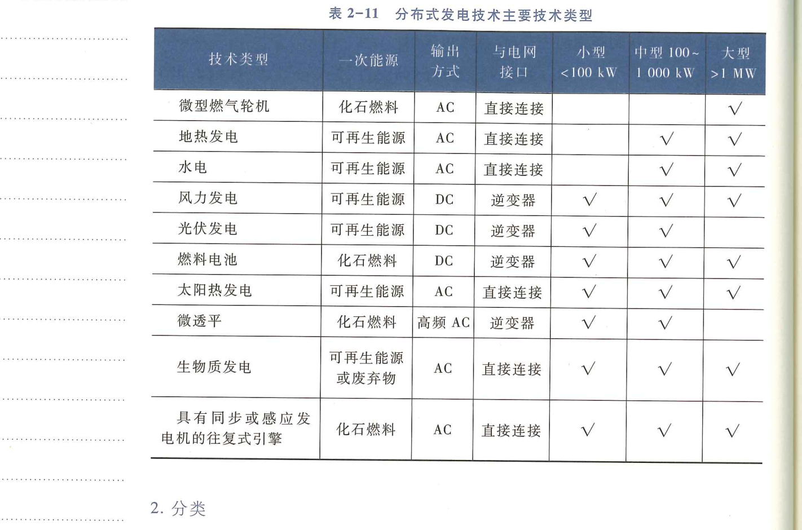

*表2-11分布式发电技术主要技术类型（原书第60页）*

分布式发电技术的应用优势很快得到广泛认可，并快速推广应用。目前，应用较为广泛的分布式发电技术主要有：

（1）分布式太阳能光伏发电。

分布式光伏发电指在用户场地附近建设，运行方式以用户侧自发自用、多余电量上网，且在配电系统平衡调节为特征的光伏发电设施。

目前应用最为广泛的分布式光伏发电系统，是建在建筑物屋顶的光伏发电系统，并具有十分广泛的应用前景。分布式光伏发电系统接人公共配电网，与公共配电网一起为附近的用户供电。

分布式光伏发电系统的基本设备包括光伏电池组件、光伏方阵支架、直流汇流箱、直流配电柜、并网逆变器、交流配电柜等，另外还有供电系统监控装置和环境监测装置。其运行模式是在有太阳辐射的条件下，光伏发电系统的太阳能电池组件阵列将太阳能转换输出的电能，经过直流汇流箱集中送入直流配电柜，由并网逆变器逆变成交流电供给建筑自身负载，多余或不足的电力通过连接电网来调节。

（2）分布式风力发电。

并网型分布式风力发电装置容量通常超过150kW0分布式风力发电系统主要由风力发电机、蓄电池、控制器、并网逆变器组成。风力发电和光伏发电一样，能源获取成本较低，技术相对较为成熟，在中国西部和东部沿海地区应用已十分成熟，受到了当地政府和群众的大力支持。分布式风力发电受限于风力的不稳定性，风力发电谐波问题较为严重，电能质量提升是严峻挑战。

<!-- 原书第61页；PDF第67页 -->

（3）微型燃气轮机

微型燃气轮机是容量为数百kW以下的以天然气、甲烷、汽油、柴油为燃料的超小型燃气轮机。微型燃气轮机与现有的其他发电技术相比，效率较低。满负荷运行的效率只有30%，而在半负荷时，其效率更是只有10%～巧%，所以多采用家庭热电联供的办法利用设备废弃的热能，提高其效率。

（4）燃料电池

燃料电池是一种在等温状态下直接将化学能转变为直流电能的电化学装置。燃料电池工作时，不需要燃烧，同时不污染环境，其电能是通过电化学过程获得的。在其阳极上通过富氢燃料，阴极上面通过空气，并由电解液分离这两种物质。在获得电能的过程中，一些副产品仅为热、水和二氧化碳等。氢燃料可由各种碳氢源，在压力作用下通过蒸汽重整过程或由氧化反应生成。因此它是一种很有发展前途的洁净和高效的发电方式，被称为21世纪的分布式电源。

以上四种分布式发电方式的对比如表2-12所示。

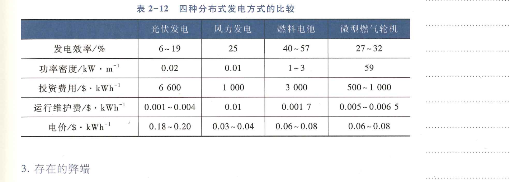

*表2-12四种分布式发电方式的比较（原书第61页）*

分布式电源通常接人中压或低压配电网，虽然会从很大程度上缓解发电化石能源紧缺问题，但也会产生很多不利影响。主要表现在：

（1）接人分布式发电的应用会引起配电网局部节点电压波动加剧，用户电能质量变差。并且由于分布式发电在局部地区的空间互补特性不明显，接人数量越多，容量越大，产生的影响越难以消除。如果分布式发电量不能就地消纳，需要反送电网，此时将抬高分布式发电机端电压，造成深夜和节假日独特的用户电压过高现象。

（2）分布式发电装置并网经常采用电力电子装置，会对配电网产生谐波污染。

（3）随着分布式发电接人容量越来越大，分布式发电以一种较大的等值发电容量对电力系统特性和安全运行产生影响，电力系统规划、运行将不能忽视这种影响。

（4）分布式发电的应用改变了配电网单向潮流的特征，将对继电保护和安全自动装置的工作原理产生影响。

分布式发电是发电技术的发展趋势之一，也是目前研究的前沿技术之一0关于分布式发电带来的问题目前已经提出了很多的解决方案，随着研究的深人必将产生多种高效使用的措施，更好地促进分布式发电的良性发展。

<!-- 原书第62页；PDF第68页 -->

### 2.9.2 微电网

微电网（microgrid）是指由分布式电源、储能装置、能量转换装置、相关负荷和监控、保护装置汇集而成的小型发配电系统。微电网的工作电源主要是配电网的配电线路、容量较小的分布式电源。其中分布式电源包括含有电力电子接口的小型机组，如小型光伏发电系统、小型风力发电机组、燃料电池、微型燃气轮机，以及电池（铅酸、锂离子、钒液等）、压缩空气、超级电容、蓄热等储能装置。

微电网应用的一个主要驱动力是用户对高供电可靠性的要求。例如，2008年中国南方发生的冰灾，冰灾造成了输电杆塔倒塌和输电线路断线，京广铁路因为停电中断。如果能够在配电网供电中断的情况下，可以保证铁路调度和道口等重要负荷的供电，将会减少和避免京广铁路因为停电中断造成的损失。

微电网有两种运行方式：并网运行方式和孤网运行方式。在并网运行方式下，微电网由配电网的配电线路供电；在孤网运行方式下，配电网的配电线路供电中断，微电网由分布式电源供电。由于微电网可以平滑切换两种运行方式，因此能满足用户对高供电可靠性的要求。

从技术上看，微电网是一个可以实现自我控制、保护和管理的自治系统，它作为完整的电力系统，依靠自身的控制及管理能够实现能量（功率）平衡控制、系统运行优化、故障检测与保护、电能质量治理等方面的功能。

1.微电网的控制部件

微电网的控制主要通过如下部件完成：

0）能量管理器。能量管理器主要是对微电网进行调度的元件，预先对电压和频率进行整定，实施微电网能量平衡。

（2）微电源控制器。微电源控制器是微电网中的一个重要元件，微电网的控制功能主要依靠微电源控制器实现。通过微电源控制器可以对微电源并网和解网运行进行控制，实现即插即拔。

2.微电网控制的主要技术

（1）有功功率平衡控制和无功功率平衡控制。通过能量管理器，对微电网实现有功功率调度和无功功率调度，实现功率平衡。

（2）频率调差控制。当微电网孤网运行时，微电网中各个机组所承担的荷载比例不相同，要通过频率调差控制，对各个机组承担的负荷进行调整，从而使得各个机组得到有效调配，对资源进行充分利用，防止某个机组荷载过大的现象。

（3）电压调差控制。在一些规模较大的电网中，各个电源之间的阻抗较大，因此不会出现无功环流现象，但是微电网中的电压整定值相对较小，如果微电网中有大量的微电源接人，而不能进行就地电压控制，则可能会产生电压以及无功振荡，对电压进行控制的要求就是要保证微电网中不会出现无功环流。因此，要对微电网中微电源所发出的电流进行分析，看电流属于感性还是容性，根据电流性质再确定电压整定值。一般产生的电流为容性时，其电压整定值要相应降低，而产生的电流为感性时，其电压整定值要相应升高。

<!-- 原书第63页；PDF第69页 -->

有的电源的响应时间较长，因此当微电网与配电网之间断开，分别独立运行的时候，微电网必须要借助蓄电池、超级电容器、飞轮等储能设备，对系统的惯性进行增加，才能确保电网的正常运行。

问题1：能源输送是采用输送电能方式还是采用输送其他能源方式？

“输煤"还是“输电"是曾经在中国能源发展史上引起争议的话题。由于输电电压等级引起的电能损耗限制，有一段时间我国采用了“近输电远输煤"的能源输送策略。但是随着超/特高压电网的建设，电能损耗大幅度降低，输电的优势逐步显现，“输煤"还是“输电"问题被重新评估。随即大量坑口电厂出现，输电方式在能源输送领域占据优势。即便如此，中国交通运输中仍有40%以上的运量是输送电煤。

近年来，随着以煤为代表的化石能源日益短缺，以风电和太阳能发电为主的可再生能源发电方式受到重视。正如本书2.1.2节所述，我国风能资源和太阳能资源的分布与电力负荷的分布也极不均衡。西电东送和北电南送的趋势会长期存在。风电和太阳能发电并网，要求电力系统具有良好的调节性能以平抑其有功功率的波动，并且要求西电东送和北电南送的远距离输送通道更加坚强，这对目前和将来的电力系统都提出了巨大挑战，需要重新论证能源输送的方式。即是采用电能远距离输送，还是将风电和太阳能发电转换成其他能源（如氢）再输送好呢？

能源输送是一个涉及多方面因素的综合问题。

问题2：城市配电网提高供电可靠性的措施。

影响供电可靠性的因素有很多，在本书1.3节已经做过一般性介绍。但是配电网具有其特殊性，对配电网的可靠性产生很大影响。这些特殊性主要表现在：

0）配电网的任何措施都需要巨大的经济投资，存在性价比问题。

（2）配电网采用开环运行方式，一次电网结构需要与二次故障隔离和网络重构相互配合才能很好地提高供电可靠性。

（3）分布式电源接人配电网后，对供电可靠性存在正面和负面的影响。

（4）配电网的地区性特点更强，需要有针对性地分析影响配电网可靠性的因素。

因此，提高配电网供电可靠性的措施实施了几十年，至今仍然是各电网公司讨论的热门话题。

## 课外阅读资料

本章推荐如下课外阅读内容：

（1）火电厂动力部分组成及工作原理；

（2）水电厂动力部分组成及工作原理；

（3）核电厂动力部分组成及工作原理；

<!-- 原书第64页；PDF第70页 -->

（4）风力发电系统组成及工作原理；

（5）太阳能光伏发电系统组成及工作原理；

（6）中国特高压交流电网建设现状；

（7）中国直流输电工程建设现状。

## 思考题

发电能源分布对电力系统规划有何影响？

2

一1

简述不同类型发电厂的运行特点。

2

一2

不同类型发电厂的调节特性有何差异？

2

一3

比较直流输电方式与交流输电方式的优缺点。

2

一4

什么是交直流输电等价距离？交直流输电等价距离有何作用？

2

一5

什么是输电容量？如何确定特高压远距离输电线路的输电容量？

2

一6

配电线路分段有何作用？

2

一7

配电网为什么要进行故障隔离和网络重构？如何实现故障隔离和网络重构？

2

一8

什么是年最大负荷利用小时数？年最大负荷利用小时数有何作用？

2

一9

简述各类负荷曲线的主要作用。

2

一10

## 其他章节

- [第1章 走进电力系统](CH1走进电力系统.md)

- [第3章 电气一次设备](CH3电气一次设备.md)

- [第4章 电气一次系统](CH4电气一次系统.md)

- [第10章 电力系统继电保护](CH10电力系统继电保护.md)

- [第11章 电气二次系统](CH11电气二次系统.md)
