# 第3章 电气一次设备

> 来源：《电气工程基础》罗毅编著。原书第 65-91 页；本PDF第 71-97 页。

> 本文件由扫描教材转换，保留原书顺序、小节、例题、思考题及阅读资料。编号公式经对照原书转录为 LaTeX；插图、接线图与复杂表格保留为图片，位于相邻 assets 文件夹。正文为OCR识别稿，个别文字仍可能有识别误差。

## 小节目录

- [3.1 交流一次设备概述](#sec-3-1)

- [3.2 输电线路和母线](#sec-3-2)

- [3.2.1 架空线路](#sec-3-2-1)

- [3.2.2 电缆线路](#sec-3-2-2)

- [3.2.3 母线](#sec-3-2-3)

- [3.3 交流开关设备](#sec-3-3)

- [3.3.1 高压断路器](#sec-3-3-1)

- [3.3.2 隔离开关](#sec-3-3-2)

- [3.3.3 负荷开关](#sec-3-3-3)

- [3.3.4 重合器](#sec-3-3-4)

- [3.3.5 分段器](#sec-3-3-5)

- [3.4 互感器](#sec-3-4)

- [3.4.1 电流互感器](#sec-3-4-1)

- [3.4.2 电压互感器](#sec-3-4-2)

- [3.5 直流输电系统的一次设备](#sec-3-5)

- [3.6 气体绝缘组合电器设备](#sec-3-6)

- [3.7 基于重合器与分段器相互配合的配电网故障隔离](#sec-3-7)

- [3.7.1 重合器与电压-时间型分段器相互配合](#sec-3-7-1)

- [3.7.2 重合器与过流脉冲计数型分段器相互配合](#sec-3-7-2)

## 原文

<!-- 原书第65页；PDF第71页 -->

## 3.1 交流一次设备概述

所谓一次设备是指直接用于生产、输送、分配、消费电能的电气设备

。交流一次设备是交流电力系统的一次设备，包括如下设备：

（1）生产电能的设备，如发电机组。

（2）变换电压的设备，如变压器。

（3）消费电能的设备，如电动机、电磁炉、电热装置等。

（4）接通和开断电路的开关设备，如断路器、重合器、负荷开关、隔离开关、分段器、熔断器和接触器等。

（5）防御过电压，限制故障电流的电气设备，如避雷器、避雷针、避雷线、电抗器等。

（6）无功补偿设备，如电力电容器、同步调相机、静止补偿器等。

（7）载流导体，如母线、引线、电缆线路、架空线路。

（8）接地装置，如变压器中性点接地、设备外壳接地、防雷接地等。

## 3.2 输电线路和母线

### 3.2.1 架空线路

架空线路架设在户外，由导线、避雷线（又称架空地线）、杆塔、绝缘子及金具等部件组成，如图3-1所示。其中，导线用来传导电流，输送电能；避雷线用来将雷电流引人大地，对输电线路进行直击雷保护；杆塔用来支撑导线和避雷线，并使导线与导线、导线与接地体之间保持一定的安全距离；绝缘子用来使导线与导线、导线与杆塔之间保持绝缘状态；金具是用来固定、悬挂、连接和保护架空线路各主要部件的金属器件的总称。图3-2是架空线路及杆塔示意图。

*图3-1架空线路组成（原书第65页）*

<!-- 原书第66页；PDF第72页 -->

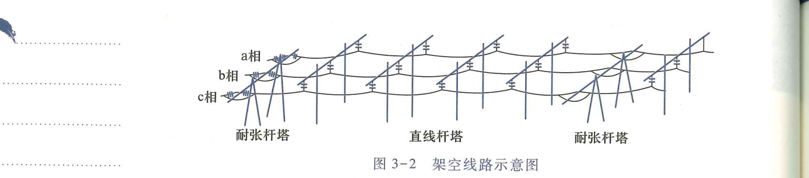

*图3-2架空线路示意图（原书第66页）*

1.导线和避雷线

导线和避雷线工作于露天，除要承受导线自重、风吹、覆冰和气温变化的作用外，还要受空气中有害气体的化学侵蚀。因此，导线和避雷线不仅要有良好的导电性能，还要有足够的机械强度和抗化学腐蚀能力。

导线常用的材料有铜、铝、铝合金和钢等。

铜具有良好的导电性能和抗拉强度，且有较强的抗化学腐蚀能力，是理想的导线材料；但铜的用途广、产量也有限，因此，除特殊需要外，架空线路一般不采用铜导线。

铝的导电性能仅次于铜，且密度小、蕴藏量大、价格低，但铝的机械强度低、抗酸碱盐的腐蚀性能差，通常采用铝合金（含少量镁、硅等元素）来改善其机械强度。

钢的导电性能差，感抗大，集肤效应显著，但其机械强度高。根据上述材料的性能特点，目前导线大量使用铝或铝合金，钢导线通常用作避雷线和钢心铝绞

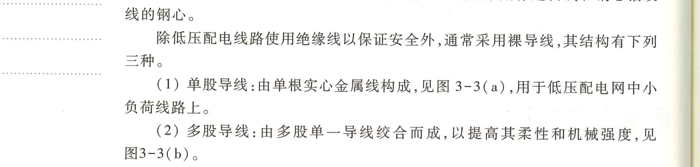

*图3-3（b）。（原书第66页）*

（3）钢心铝绞线：由多股铝绞线绕在单股或多股钢导线的外层而构成，见图3-3（c）。

*图3-3裸导线的结构（原书第66页）*

在钢心铝绞线中，由于铝线具有良好的导电性，导线通过电流时又有集肤效应的作用，故电流绝大部分从铝线部分通过，而机械载荷则由钢线和铝线共同承担，从而充分利用了铝线导电性能好、钢线机械强度高的优点。在10kV以上的线路上广泛采用钢心铝绞线。

<!-- 原书第67页；PDF第73页 -->

表示载流部分的截面积（）。例如：LJ一50为铝绞线，铝线的标称截面积为50mm2;TJ-25为铜绞线，铜线的标称截面积为25mm2；GJ一35为钢绞线，钢线的标称截面积为35mm2；LGJ一300/50为钢心铝绞线，铝线的标称截面积为300mm2，钢线的标称截面积为50mm20

在旧标准中，钢心铝绞线又根据其机械强度的不同，按其铝线和钢线截面比的差别分为普通型、轻型和加强型三类，目前尚在沿用。

0）普通型钢心铝绞线，型号LGJ，其铝线和钢线部分的截面积之比为5，3、6.1；

（2）轻型钢心铝绞线，型号LGJQ，其铝线和钢线部分的截面积之比为7，6、8.3；

（3）加强型钢心铝绞线，型号LGJJ，其铝线和钢线部分的截面积之比为4、4巧。

线路电压等级超过220kV时，为了降低线路电抗和电晕损耗，通常采用扩径空心导线或分裂导线（见图3-4）。

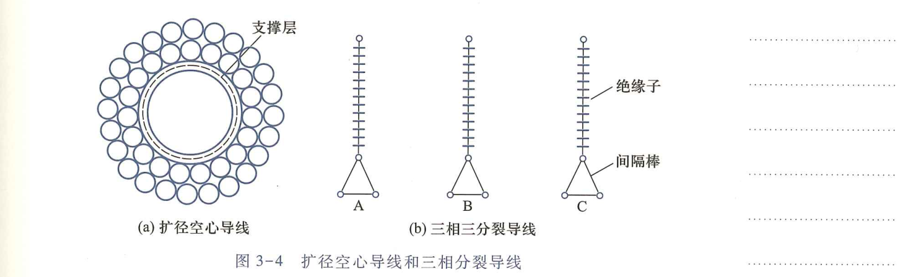

*图3-4扩径空心导线和三相分裂导线（原书第67页）*

扩径空心导线不易制造，且安装困难，故在工程上多采用分裂导线。所谓分裂导线，就是将输电线的每相导线分裂成若干根子导线，用金属材料或绝缘材料制作的间隔棒支撑，按一定的规则分散排列所构成的导线。分裂导线能使导线的等效半径增大，从而减小线路的等值电抗、增大线路的等值电容以及降低线路的电晕损耗。中国500kV输电线路采用4分裂导线；750kV输电线路采用6分裂导线；1000kV输电线路采用8分裂导线。一般单导线每公里的电抗约为0.40，而分裂根数为2、3、4、6、8根时，每公里的电抗分别降低到0.33、0.30、0，28、0.266、0.260。

由于分裂导线能够改变输电线路参数，因此，可以通过对分裂导线的合理布置及适当排列三相导线的位置，使输电线路的参数接近或达到阻抗匹配，从而可以大大提高线路的传输功率，这就是现代紧凑型输电线路的基本原理。

2.杆塔

杆塔按组成材料可分木杆、钢筋混凝土杆和铁塔三种。

木杆质量轻，制作安装方便，但要消耗大量木材，且易腐、易燃，现在已基本

<!-- 原书第68页；PDF第74页 -->

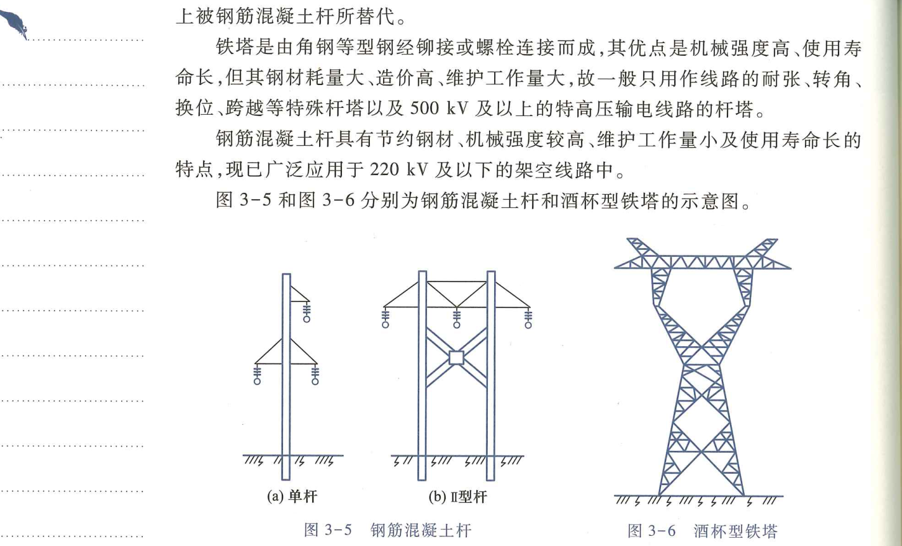

*图3-5和图3-6分别为钢筋混凝土杆和酒杯型铁塔的示意图。；图3-5钢筋混凝土杆；图3-6（原书第68页）*

根据所承担的任务杆塔可分为：

（1）直线杆塔，又称中间杆塔，主要是用于悬挂导线。

（2）耐张杆塔，又称承力杆塔，承受导线的拉力使线路分段，便于施工和检修。杆塔两边的同相导线间是通过跳线接通的。

（3）终端杆塔，它是最靠近变电站的一座杆塔，承受了最后一个耐张挡距导线的单向拉力。

（4）转角杆塔，用于线路拐弯处。

（5）特种杆塔，特殊情况下使用的一类杆塔。如用于导线换位的换位塔，跨越河流山谷的跨越杆塔等。

直线杆塔用于线路的直线走向段内悬挂导线，仅承受导线自重、覆冰重及风压，是线路上最普通的一种杆塔，约占线路杆塔总数的80%。

耐张杆塔用于承受正常及故障（如断线）情况下导线和避雷线顺线路方向的水平张力，以限制故障范围。在线路较长时，一般每隔3、5km设置一个耐张杆塔。

转角杆塔装设于线路的转角处，用来承受线路方向的侧向拉力。

终端杆塔设置在进入发电厂或变电站的线路末端，用来承受最后一个耐张段内导线的单向拉力。

跨越杆塔是为线路跨越河流、山谷、铁路、公路、居民区等中间无法设置杆塔的地方而特殊设计的大跨越杆塔，其高度较一般杆塔高。

换位杆塔是为了在一定长度内实现三相导线的轮流换位以便使三相导线的电气参数均衡而设计的特种杆塔。规程规定凡线路长度超过100km时，导线必须换位。当线路长度大于200km时，要用两个或多入换位循环。

<!-- 原书第69页；PDF第75页 -->

3.绝缘子

绝缘子是用来支撑或悬挂导线，并使导线与杆塔绝缘的一种瓷质、钢化玻璃或高分子合成材料制作的元件。它具有良好的绝缘性能和足够的机械强度。架空线路使用的绝缘子分为针式绝缘子、悬式绝缘子、棒式绝缘子及瓷横担绝缘子等，如图3-7、图3-10所示。

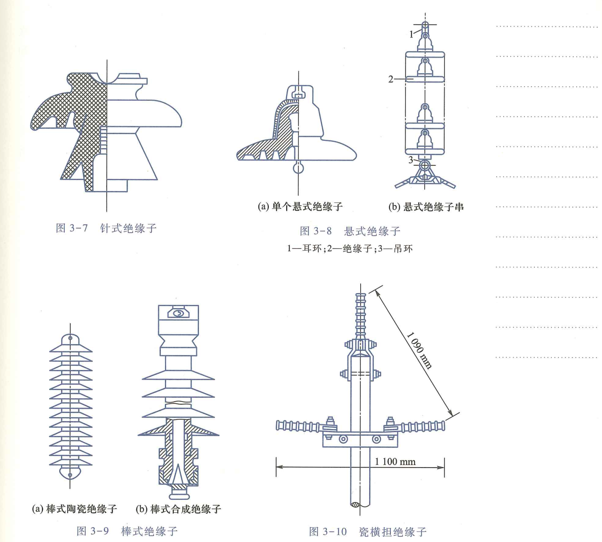

*图3-7；图3-8悬式绝缘子；图3-9棒式绝缘子；图3-10瓷横担绝缘子（原书第69页）*

针式绝缘子主要用在电压不超过35kV、导线拉力不大的直线杆塔和小转角杆塔上。

悬式绝缘子主要用于35kV及以上的线路上，通常将它们组装成绝缘子串，每串绝缘子片数应根据线路的电压等级按绝缘要求确定，表3-1中列出了与不同线路额定电压相应的悬式绝缘子串中绝缘子的片数。耐张杆塔绝缘子串中绝缘子的片数一般比同级电压直线杆塔绝缘子串多1、2片。通常可根据架空线路上所用的绝缘子串上的片数判断其电压等级。

<!-- 原书第70页；PDF第76页 -->

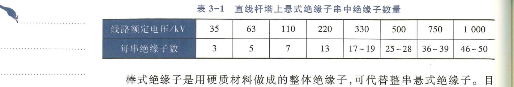

*表3-1（原书第70页）*

前多采用高分子合成材料制作成合成绝缘子，这种新型棒式合成绝缘子不仅比瓷绝缘子造价低、损耗小，而且质量轻，耐震、防污性能好。

瓷横担绝缘子是棒式绝缘子的另一种形式，它可以兼作横担用，具有绝缘强度高，运行安全，维护简单的特点，而且由于它能部分替代横担，大量节约木材和

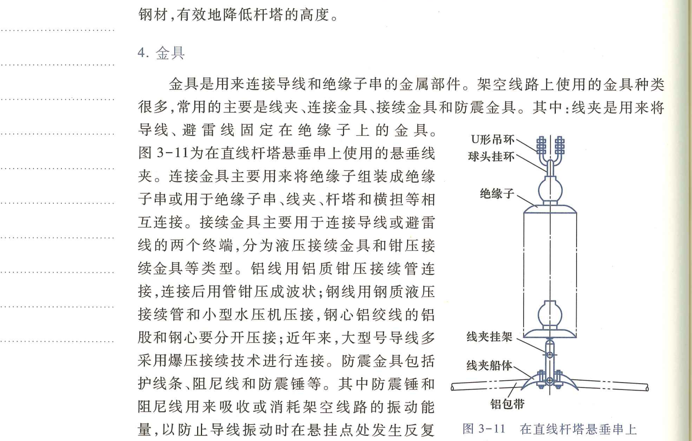

*图3-11为在直线杆塔悬垂串上使用的悬垂线；图3-11在直线杆塔悬垂串上（原书第70页）*

使用的悬垂线夹拗折，造成导线断股甚至断线的事故。护线条是用来加强架空线的耐振强度，以降低架空线的负载应力。

### 3.2.2 电缆线路

大城市的配电网络，发电厂、变电站内部线路，穿越江河、海峡线路以及国防或特殊需要的场合，往往都要采用电力电缆线路。

电力电缆的结构主要包括导体、绝缘层和保护层三个部分，如图3-12所示。

电缆的导体通常用多股铜绞线或铝绞线，以增加其柔性，使之能在一定程度内弯曲，以利施工及存放。常见的电力电缆有单心、三心和四心电缆。单心电缆的导体截面是圆形的，多心电缆的导体截面除圆形外，还有扇形和腰圆形，以充分利用电缆的总面积。

电缆的绝缘层用来使各导体之间以及导体与保护包皮之间保持绝缘。通常

<!-- 原书第71页；PDF第77页 -->

缘，带绝缘指包裹全部导体的绝缘。心绝缘和带绝缘间的空隙处要填以充填物。绝缘层所用的材料有油浸纸、橡胶、聚乙烯、交联聚乙烯等。

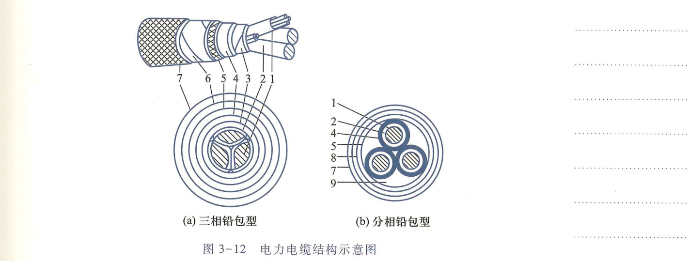

*图3-12电力电缆结构示意图（原书第71页）*

1一导体；2一相绝缘；3一纸绝缘，4一铅包皮；5一麻衬；6一钢带铠甲；7一麻皮；8一钢丝铠甲；9一填充物

电缆的保护层用来保护绝缘物及心线使之不受外力损伤，可分为内保护层和外保护层。内保护层用铅或铝制成，呈筒形，用来提高电力电缆绝缘的抗压能力，并可防水、防潮、防止绝缘油外渗。外保护层由衬垫层（油浸纸、麻绳、麻布等）、铠装层（钢带、钢丝）及外被层（浸沥青的黄麻）组成，其作用是防止电缆在运输、敷设和检修过程中受机械损伤。

电力电缆的敷设方法通常为直接埋人土中、电缆沟敷设和穿管敷设。图3-13为敷设于沟道内的电缆。

一般来说，架空线路的建设费用比电缆线路低得多，电压等级越高，二者在投资上的差异就越显著；同时，架空线路还具有建设工期短、图3-13敷设于沟道内的电缆易于维护等优点。所以，架空线路比电缆线路得到了更广泛的应用。但由于架空线路露天架设，容易遭受雷击和风雨冰雪等自然灾害的侵袭，且需要大片土地用作出线走廊，有时会影响交通、建筑、市容和人身安全。而电缆线路不需占用空间，不易受外力和自然环境的影响，供电可靠性高，所以，在一些不宜采用架空线路的地方（如城市的人口稠密区、重要的公共场所、过江、跨海、严重污秽区以及某些工矿企业厂区等），往往采用电缆线路。

### 3.2.3 母线

母线是一段金属导体，用于连接多个导体（如多根输电线路）、导体与一次设备、一次设备与一次设备。母线的作用是汇集、分配和传送电能。由于母线在运行中，有巨大的电流流过，短路时，承受着很大的发热和电动力效应，因此，必须合理的选用母线材料、截面形状和截面积以符合安全经济运行的要求。

常用的母线材料是铜和铝。

母线按外型和结构，大致分为以下三类：

<!-- 原书第72页；PDF第78页 -->

（1）硬母线：包括矩形母线、槽型母线、菱形母线、管形母线等。

（2）软母线：包括铝绞线、铜绞线、钢心铝绞线、扩径空心导线等。

（3）封闭母线：包括共箱母线、离相母线等。

矩形母线一般使用于主变压器至配电室内，其优点是施工安装方便，运行中变化小，载流量大，但造价较高。软母线用于室外，因空间大，导线有所摆动也不至于造成线间距离不够。软母线施工简便，造价低廉。

软母线常用的就是铝绞线，有的为了加大强度，采用钢心铝绞线。按它的截面积分类，有50、70、95、120、巧0、240、.

硬母线常用的型号有50×5、60×6、80×8、100×10、120×12、一（mm

GB/T8349一2000定义离相封闭母线指每相具有单独金属外壳且各相外壳间有空隙隔离的金属封闭母线。离相封闭母线广泛应用于50MW及以上发电机引出线回路及厂用分支回路。

JB/T9639一1999定义分相封闭母线是指将各相导体分别用金属屏蔽外壳单独封闭起来的母线，主要应用于200MW及以上发电机组从发电机出线端子开始，到主变压器低压侧引出端子的主回路母线，以及从主回路母线引出至厂用高压变压器和电压互感器、避雷器等设备柜的各分支线。

离相封闭母线和分相封闭母线可以避免相间短路，消除外界潮气、灰尘以及外物引起的接地故障，减少相间短路电动力，消除钢结构发热，因此提高了运行的安全可靠性。

共箱封闭母线包括不隔相共箱封闭母线、隔相共箱封闭母线及交直流励磁共箱母线。广泛用于100MW以下发电机引出线与主变压器低压侧之间，或75MW及以上机组厂用变压器低压侧与高压配电装置之间，共箱封闭母线也可用于发电机交直流励磁回路、变电所所用电引人母线或其他工业民用设施的电源引线。

## 3.3 交流开关设备

开关设备按功能可划分为以下几类：

（1）仅用于断开或闭合正常工作电流的开关设备，如负荷开关、交流接触器等。

（2）仅用于断开过负荷电流或短路电流的开关设备，如熔断器。

（3）用于断开或闭合正常工作电流、短路电流的开关设备，如交流断路器、直流断路器、交流重合器。

（4）不能断开或闭合电流，只用于检修和运行方式切换的开关设备，如隔离开关、分段器。

上述开关设备中，以断路器性能最完善，结构最复杂，具有较强的灭弧能力。

### 3.3.1 高压断路器

1.简介

高压断路器的主要功能是开断或接通正常工作电流以及开断短路电流。具有灭弧装置是断路器能够开断大电流的根本原因。

<!-- 原书第73页；PDF第79页 -->

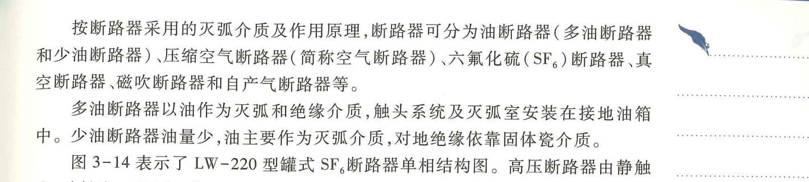

*图3-14表示了LW一220型罐式SF6断路器单相结构图。高压断路器由静触（原书第73页）*

头、动触头、灭弧室、接线端子、出线瓷套管、机械箱等部分组成。

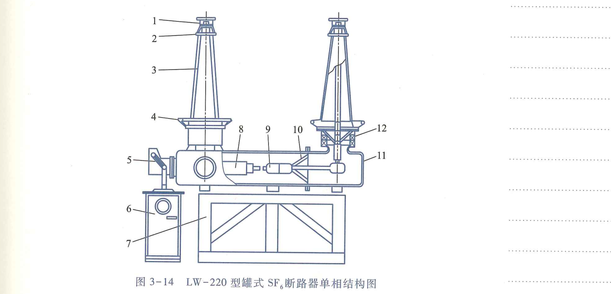

*图3-14LW一220型罐式断路器单相结构图（原书第73页）*

1一接线端子；2一上均压环；3一出线瓷套管，4一下均压环；5一拐臂箱；6一机械箱；

7一基座；8一灭弧室；9一静触头；10一盆式绝缘子；11一壳体；12一电流互感器

高压断路器最重要的任务就是开断电路，熄灭电弧。不同的断路器具有不同介质的灭弧装置。油断路器是利用电弧燃烧分解的油和气将电弧吹灭，属于自能式原理灭弧。压缩空气断路器和六氟化硫（SF6）断路器是利用有压力的气体或气体的优良灭弧性能将电弧吹灭，属外能式灭弧。真空断路器内，气体稀薄，碰撞概率小，电弧的产生主要是由于电极表面微小突起，引起电场强度的高度集中，而发热、产生金属蒸汽电离，故游离作用并不大。稀薄气体内强烈的去游离以及真空的高介质强度，有利于电弧电流过零点时，随着金属蒸汽蒸发量的减少而使电弧熄灭。

户内断路器一般使用在35kV及以下。户外断路器则可使用在110kV及以上的输电系统和高压配电系统。110kV以上的户外少油、空气和SF6断路器采用积木式结构。每一基本单元有两个灭弧室串联（即两个断口），可用于110kV电压。当用于220kV时，必须用两个基本单元，四个灭弧室；用于330kV时则用三个基本单元。如图3一巧所示。SF6断路器的灭弧性能好，可减少串联的断口数。这种结构的优点可使产品系列化、标准化，并在相同的触头行程下，增加了电弧的长度，降低每一断口两端的恢复电压。缺点是采用了多断口结构后，增加了装置复杂性，使在开断过程中和开断后断口间电压分配不均匀，为此常与断口并联一个1000、2000pF的均压电容。

<!-- 原书第74页；PDF第80页 -->

图3一巧

断路器的积木式结构图

2.基本参数

高压断路器和操作机构的特性和工作原理，可用基本参数描述。高压断路器的基本参数如下：

（1）额定电压UN。额定电压是保证高压断路器正常长期工作的电压。产品铭牌上标示的额定电压是指高压断路器正常工作时的线电压。

（2）额定电流/N。额定电流是指高压断路器在规定的条件下，可以长期通过的最大工作电流。高压断路器额定电流的大小决定了断路器触头及导电部分的截面积和结构。

（3）额定开断电流/额定电压下能正常开断的最大短路电流称为额定Nbr0开断电流，它表征断路器的开断能力。在低于额定电压时，开断电流可以提高，但由于受灭弧装置机械强度的限制，故开断电流仍有一个极限值，此极限值为极限开断电流。

（4）全开断时间。断路器从接到分闸命令起到电弧熄灭的时间为全开断时间。全开断时间等于固有分闸时间加上电弧燃烧时间。固有分闸时间为断路器接到分闸命令起到触头分离的这一段时间，固有分闸时间反映断路器分闸机构动作的特性。

（5）合闸时间。断路器从接到合闸命令起到主触头刚接触为止的时间。电力系统大部分对合闸时间要求不高，但要求三相合闸同期性好，且合闸时稳定。

（6）额定动稳定电流（峰值）0。表明断路器能承受短路电流电动力作用的能力，此电流又称极限通过电流。它决定于导电部分及绝缘支持部分的机械强度，并决定于触头的结构形式。

（7）热稳定电流lt。表明断路器承受短路电流热效应的能力。

（8）自动重合闸性能。架空线路的短路大多是瞬时性故障，当短路电流切断后，故障原因就迅速消除。为了提高供电的可靠性，输电线路一般装有自动重合闸装置。自动重合闸性能是断路器应具有固有的特性，其操作循环为

分一0一合一分一'一合一分式中，为无电流间隔时间，指断路器断开故障电流从电弧熄灭到电路重新接通的时间，一般为0.3s或0巧s，反映了断路器内介质强度恢复的快慢为强送电时间，一般为180，是指重合后故障未消除，断路器又跳闸，需经时间'后，人工强送电一次。

3，使用寿命

高压断路器存在电气寿命。高压断路器尽管存在灭弧装置，但是毕竟产生了电弧，由于电弧具有高温，对金属动静触头产生烧蚀。多次电弧烧蚀的结果是

<!-- 原书第75页；PDF第81页 -->

弧效果。因此，规定高压断路器的电气寿命是指设备技术条件中规定的和型式试验中实际进行的满容量开断次数。例如，早期中国高压真空断路器的电气寿命一般为30多次，某些油断路器的电气寿命仅有几次。高压断路器开断短路电流达到电气寿命次数，必须进行大修，更换断路器的动静触头。

高压断路器也存在机械寿命。高压断路器机械寿命主要指弹簧、转轴、连动杆等构成机械传动控制系统的各个机械部件的整体使用寿命，系统中其中任一个部件损坏则使用机械寿命终止。中国高压真空断路器的机械寿命一般为10000、20000次。

### 3.3.2 隔离开关

隔离开关是一种没有灭弧装置的开关设备。隔离开关具有如下作用：

（1）隔离开关和断路器相配合，进行倒闸操作，以改变运行方式。

（2）在设备检修时，用隔离开关来隔离有电和无电部分，造成明显的断开点，检修的设备与电力系统隔离，以保证工作人员和设备的安全。

（3）用隔离开关进行500kV小电流电路合旁（环）路电流的操作。

（4）用来开断小电流电路和旁（环）路电流。

0拉、合电压互感器和避雷器。

2拉、合母线及直接连在母线上设备的电容电流。

对双母线带旁路接线，当某一线路断路器因某种原因出现分、合闸闭锁，用旁路断路器代其运行时，可用隔离开关并联回路，但操作前必须停用旁路母线

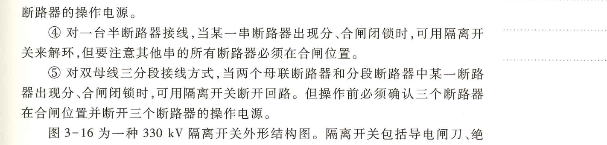

*图3-16为一种330kV隔离开关外形结构图。隔离开关包括导电闸刀、绝（原书第75页）*

缘子、底座等部分构成。

### 3.3.3 负荷开关

负荷开关是介于断路器和隔离开关之间的一种开关电器，具有简单的灭弧装置，能切断额定负荷电流和一定的过载电流，但不能切断短路电流。高压负荷的负荷开关主要有以下6种：

（1）固体产气式高压负荷开关。利用开断电弧本身的能量使弧室的产气材料产生气体来吹灭电弧，其结构较为简单，适用于35kV以下的产品。

（2）压气式高压负荷开关。利用开断过程中活塞的压气吹灭电弧，其结构也较为简单，适用于35kV以下产品。

（3）压缩空气式高压负荷开关。利用压缩空气吹灭电弧，能开断较大的电流，其结构较为复杂，适用于60kV以上的产品。

（4）SF6式高压负荷开关。利用SF6气体灭弧，其开断电流大，开断电容电流

<!-- 原书第76页；PDF第82页 -->

合闸状态导电闸刀

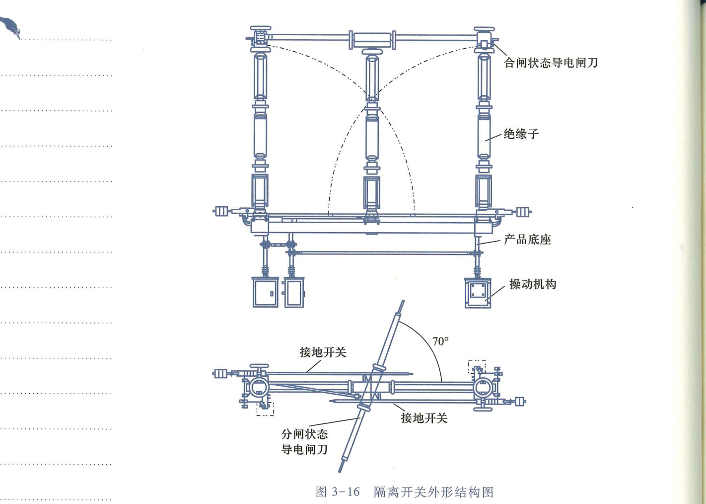

*图3-16隔离开关外形结构图（原书第76页）*

性能好，但结构较为复杂，适用于35kV以上产品。

（5）油浸式高压负荷开关。利用电弧本身能量使电弧周围的油分解气化并冷却熄灭电弧，其结构较为简单，但重量大，适用于35kV以下的户外产品。

（6）真空式高压负荷开关。利用真空介质灭弧，电寿命长，相对价格较高，适用于220kV以下的产品。

负荷开关由底架、传动机构、支柱绝缘子、闸刀及灭弧装置等部分组成。底架由钢板焊接而成，并装有传动机构。闸刀借支柱绝缘子固定在底架上。在底架上还可配有跳扣、凸轮与快速合闸弹簧，可进行快速合闸动作。

### 3.3.4 重合器

重合器是一种具有控制及保护功能的开关设备，它能够检测故障电流，在监测到故障电流后能在给定时间内遮断故障电流，并能够进行给定次数的重合。因此重合器兼顾断路器、电流保护和重合闸三重功能，是一种智能开关设备。

在现有的重合器中，通常可进行三次或四次重合。如果故障是永久性的，重合器经过预先整定的重合次数以后，则不再进行重合，即进行闭锁。如此可使故障线段与配电网隔离开来。如果故障是瞬时性的，重合器重合成功，则自动终止后续动作，并经过一段延时后恢复到预先的整定状态，为下一次故障做好准备。

<!-- 原书第77页；PDF第83页 -->

1.分类

重合器可按相别、控制方式、使用介质进行分类。

（1）按相别分类

@单相。三相线路的单相分支或主要负荷为单相的三相线路。

2三相。又可分为单相跳闸三相闭锁模式和三相跳闸三相闭锁模式。

（2）按控制方式分类

0液压控制。用于单相和额定电流较小的三相重合器中，电流检测由与线路串联的跳闸线圈来完成。

2电子控制。用于三相大型重合器，利用电流变换器来检测线路。

（3）按使用介质分类

.油介质。灭弧和绝缘均用油。

2真空介质。灭弧用真空，绝缘用油或空气。

SF6介质。灭弧和绝缘用SF6

重合器的主要技术参数有额定电压、额定电流、短路开断电流、动稳定电流、热稳定电流、灭弧介质、控制方式、典型操作顺序以及复位时间等。

2.动作特性

重合器的动作特性可以分为瞬时动作特性（又称快速动作特性）和延时动作特性两种，通常采用时间一电流曲线（TCC曲线）来描述，如图3-17所示。瞬时特性是指重合器按照快速动作时间一电流特性跳闸；延时动作特性是指重合器按照某条慢速动作时间一电流特性跳闸。

通常重合器的动作特性按照其最大可重合次数可整定为一快二慢、二快二慢和一快三慢等。

*图3-17TCC曲线（原书第77页）*

仍然存在，重合器第三次再按照某一条延时动作特性曲线（如图3-17中曲线B、c）跳闸，如果本次仍然重合不成功，则闭锁。

重合器的曲线经常设计成反时限曲线，即电流越大，动作时间越短，如图3-18所示。有时，重合器的TCC曲线也设计成定时限曲线，即动作时间是固定的，与电流大小无关，如图3-19所示。定时限TCC曲线的应用较少。

某些重合器（如KFE真空重合器）的动作特性曲线又可分为相间短路跳闸的TCC曲线和接地短路跳闸的TCC曲线两种。即针对相间短路（如三相短路、两相短路、两相接地短路）和接地短路（如两相接地短路、单相接地短路）采用不同的TCC曲线动作。

<!-- 原书第78页；PDF第84页 -->

9

1

0

0

i/A

i/A

图3

反时限TCC曲线

一18

图3

定时限TCC曲线

一19

### 3.3.5 分段器

分段器是一种与电源侧前级开关配合，在失压或无电流的情况下自动分闸的开关设备。分段器没有灭弧装置，因此与隔离开关类似，不能开断正常工作电流，更不能开断短路电流。与隔离开关不同的是，分段器具有智能控制功能，因此是一种智能开关设备。

分段器根据其智能控制的工作原理不同，可以分为电压一时间型分段器和过流脉冲计数型分段器两种。

（1）电压一时间型分段器。

电压一时间型分段器是凭借加压、失压的时间长短来控制其动作的，失压后分闸，加压后经过时限后合闸或闭锁。

电压一时间型分段器有两个重要的参数需要整定：

.x时限。x时限是指从分段器电源侧加压至该分段器合闸的时延。

Y时限。又称为故障检测时间，若分段器合闸后在未超过Y时限的时间内又失压，则该分段器分闸并被闭锁在分闸状态，待下次再加压时也不再自动重合

（2）过流脉冲计数型分段器。

过流脉冲计数型分段器通常与前级的断路器和重合器配合使用，它不能用于开断短路电流，但是在一段时间内，它能记忆前级开关设备断开故障电流的动作次数。在达到预定的记录次数后，在前级的断路器和重合器将线路从电网中切除的无电流间隙内，过流脉冲计数型分段器分闸，达到隔离故障区段的目的；若未达到预定的动作次数，过流脉冲计数型分段器在一定的恢复时间后计数自动清零，并恢复到预先整定的初始状态，为下次故障做好准备。

## 3.4 互感器

互感器包括电流互感器（TA）和电压互感器（TV）。其工作原理与变压器类似。电流互感器的一次绕组串联在输变电主回路内，电压互感器的一次绕组则与相电压或线电压相连接。二次绕组分别接测量仪表或自动装置的电流线圈或电压线圈，如图3-20所示。

互感器的作用：将一次回路的大电流、高电压变换为二次回路的小电流（额定电流5A或1A）和低电压（额定电压100v，100丷），使测量仪表标准化、

<!-- 原书第79页；PDF第85页 -->

小型化，使二次设备与一次高压隔离。互感器二次侧必须接地，以保证一二次绕组间绝缘击穿后的人身和设备安全。

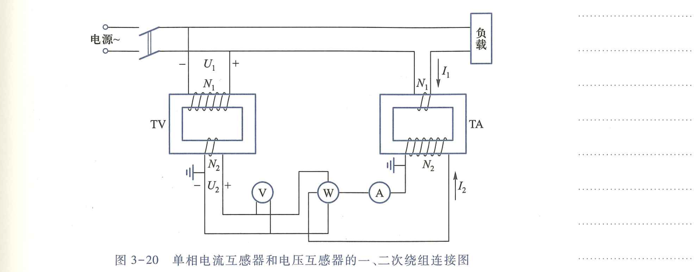

*图3-20单相电流互感器和电压互感器的一二次绕组连接图（原书第79页）*

### 3.4.1 电流互感器

电流互感器一次侧匝数很少，二次侧匝数多，将一次回路的大电流变换为二次回路的小电流（额定电流5A或1A）。

1.电流互感器的误差

电流互感器的等值电路和相量图如图3-21所示，一般电流互感器的二次负载阻抗很小，近似于在短路状态下运行。

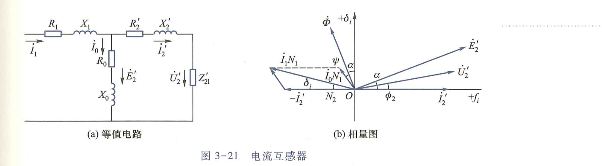

*图3-21电流互感器（原书第79页）*

相量图以二次电流为基准，在第一象限的水平轴上，毋超前0角2（二次负载功率因素角）；E；超前/；角二次总阻抗角），铁心磁通少超前90。，励磁磁势/01超前磁通为角（铁心损耗角）。其额定电流比：7N1/7N2N2/凿。其中NI、2分别为一、二次绕组的匝数。写出互感器的磁势平衡方程

$$
\dot I_1N_1+\dot I_2N_2=\dot I_0N_1
\tag{3-1}
$$

可见，由于存在1，使二次电流在数值和相位上与一次电流存在误差，分别称作电流误差和相位误差。

电流误差丆为二次电流的测量值乘以额定电流比K与实际的一次电流/1

<!-- 原书第80页；PDF第86页 -->

之差，以一次电流的百分数表示，即

$$
f_i=\frac{K_iI_2-I_1}{I_1}\times100\%=\frac{I_2N_2-I_1N_1}{I_1N_1}\times100\%
\tag{3-2}
$$

相位误差为旋转180。的二次电流相量一与一次电流相量1之间的夹角，并规定一/；超前/1时，相位〗为正值，反之为负值。

电流误差影响仪表和继电器的电流值，相位误差对功率型的仪表和继电器有影响。电流互感器的电流误差和相位误差大小与一次电流和二次阻抗等有关，减少二次阻抗或使互感器工作在额定电流附近时，会减少误差。

电流互感器的二次绕组不能开路。二次绕组开路时，去磁磁动势72：0，式（3-1）变成/1N1：/0N1，因一次电流不变，互感器的励磁磁动势由正常时很小的/0骤增到0N1，使铁心严重饱和，磁通少成为平顶波。因二次绕组的感应电势与磁通的变化率一d少/山成正比，如图3-22所示，在磁通少过零时，感应出很高的尖波电势，其值可达数千伏至上万伏，高电压危及工作人员和二次设备的安全，引起铁心和绕组过热，使铁心中产生剩磁，互感器特性变坏。因此电流互感器在运行时二次绕组是不允许开路的。即使校验电流仪表时，也需短接二次绕组。

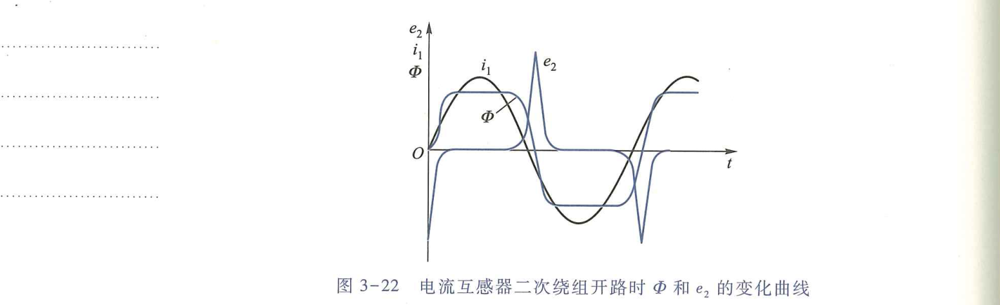

*图3-22电流互感器二次绕组开路时和的变化曲线（原书第80页）*

2.电流互感器的用途

电流互感器按用途可分为测量用电流互感器和保护用电流互感器两种，用于测量的电流互感器根据误差大小划分为不同的准确级。准确级是指在规定的二次负荷变化范围[（25%、100%）s，]内，一次电流为额定值时的最大电流误差。电流互感器的准确级分为0.2、0巧、1.、3和10级共5种。其中0.2级用于电能量计量；电流和功率量测大多数采用0.5级。

保护用电流互感器要求在一次回路短路时有较高的准确级，目前按用途可分为稳态保护用的（p）电流互感器和暂态保护用的（TP）电流互感器两类。对稳态保护用的电流互感器的准确级常用的有5P和10P两种，其准确级是以额定准确限值的一次电流下的最大复合误差来标称，如表3-2所示。为了继电保护整定的方便，制造厂提供了电流互感器的10%误差曲线如图3-23所示。此曲线表示互感器的电流误差不超过10%的条件下，一次电流与额定电流比为“时，“与

<!-- 原书第81页；PDF第87页 -->

的倍数“一，然后查得最大二次阻抗值，只要实际的二次负荷阻抗小于该值，就

可以保证互感器的复合误差小于10%。

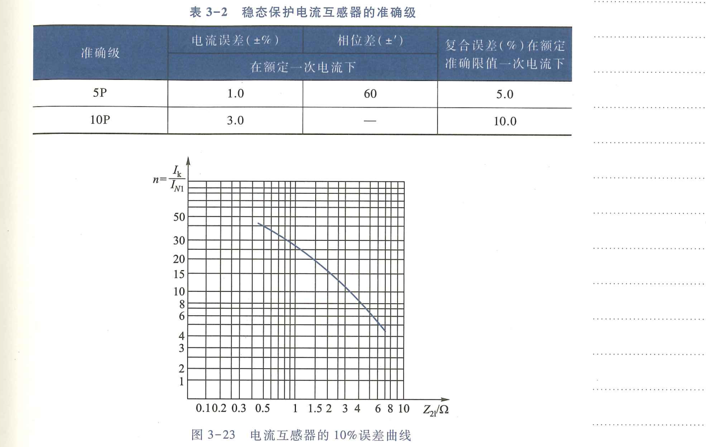

*表3-2稳态保护电流互感器的准确级；图3-23电流互感器的10%误差曲线（原书第81页）*

3.电流互感器的分类

电流互感器的种类很多，如果按安装地点可分为屋（户）内式、屋（户）外式和装人式。装人式又称装人套管式，即把电流互感器安装在变压器或断路器的套管内。

按安装方法可分为穿墙式，支持式；按绝缘可分为干式、浇注式和油浸式。干式用绝缘胶浸渍，浇注式利用环氧树脂作绝缘，浇注成型。

按一次线圈的匝数又可分为单匝式和多匝式。

按变流比可分为单变流比和多变流比的电流互感器。10kV及以上的电流互感器常采用多个没有磁联系的独立铁心和二次绕组。一台110kV级电流互感器具有3个二次绕组；220、500kV级的电流互感器有4、7个二次绕组组成。

电流互感器的二次侧接测量仪表或继电器的电流线圈，极性端按减极性法则表示。图3-24为电流互感器与测量仪表的接线图。图3-24（）常用于三相对称负荷，如电动机的一相电流的测量。图3-24（b）为星形接线，可监视三相负荷不对称的情况。图3-24（c）为不完全星形接线，用于中性点不接地系统的功率表和电度表的测量。

<!-- 原书第82页；PDF第88页 -->

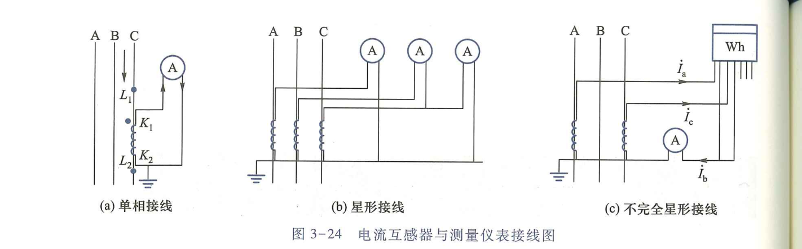

*图3-24电流互感器与测量仪表接线图（原书第82页）*

### 3.4.2 电压互感器

电压互感器一次侧匝数多，二次侧匝数很少，将一次回路的高电压变换为二次回路的低电压（额定电压100v，100丷）。二次侧不能短路。

输变电系统中广泛应用的电压互感器，按其工作原理分为电磁式和电容式两类。

1.电磁式电压互感器

电磁式电压互感器的特点是容量小，二次侧所接的测量仪表和继电器的电压线圈的阻抗很大，且二次负载基本恒定。其额定电压比为

$$
K_u=\frac{U_{N1}}{U_{N2}}
\tag{3-3}
$$

式中，1为电网的额定电压；2为二次侧额定电压，已统一为100v或100丷0，所以K“已标准化。

电压互感器的误差分为电压误差和相位误差，电压误差是指二次电压的测量值乘以额定电压比所得的值与实际的一次电压之差，用百分数表示，即

$$
f_u=\frac{K_uU_2-U_1}{U_1}\times100
\tag{3-4}
$$

相位误差为二次电压向量旋转180。，与一次电压之间的夹角，规定一@超前于时的相位误差5，，为正。相位差对功率型的仪表和继电器带来误差。

电压互感器的准确级分为0.2、0.5、1、3、3P、6P六种，准确级是指在规定的一

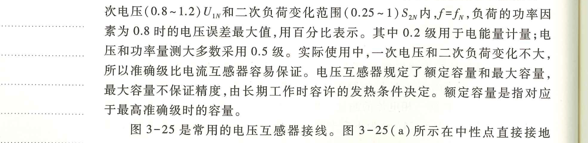

*图3-25是常用的电压互感器接线。图3-25（）所示在中性点直接接地（原书第82页）*

系统中，用一台电压互感器可测量相电压。图3-25（b）所示在中性点不接地系统中，用一台电压互感器测量线电压。图3-25（c）也称V/V接线，用于测量

<!-- 原书第83页；PDF第89页 -->

YO/YO/开口三角形接线，其二次绕组可测量相电压和线电压，辅助二次绕组接成的开口三角形可输出零序电压3。用于110kV以上时，一次回路不设熔断器。

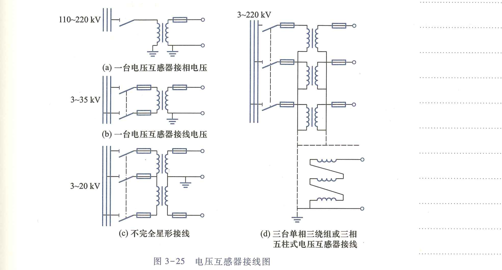

*图3-25电压互感器接线图（原书第83页）*

2.电容式电压互感器

电容式电压互感器原理接线如图3-26所示，为电容分压器的主电容，为分压电容，TV为单相油浸三绕组电磁式电压互感器，L为补偿电抗器，为补偿电抗器的保护间隙，为阻尼电阻。

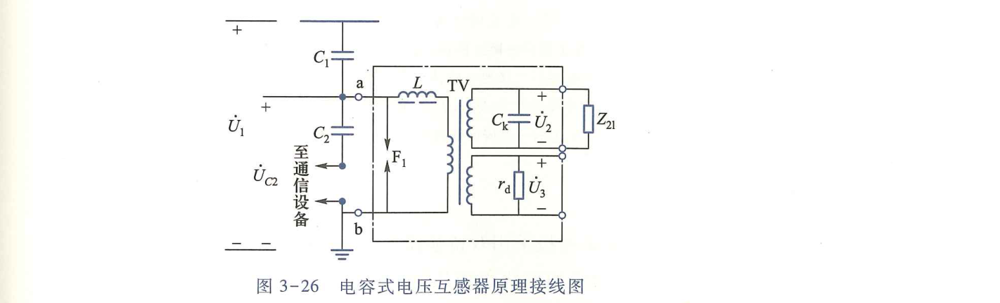

*图3-26电容式电压互感器原理接线图（原书第83页）*

电容式电压互感器由于制造简单、体积小、成本低，可兼作高频载波通道等优点，所以在中国220、500kV的电力网中得到了广泛应用。

## 3.5 直流输电系统的一次设备

如图3-27为直流输电系统主接线，其电压±500kV，输送容量单极

<!-- 原书第84页；PDF第90页 -->

60×104kW，双极120万kW，线路全长1052，25km，主要设备的作用如下所述：

1.换流器

一般接成三相全控桥式整流或逆变电路，直流系统中又称换流桥，6个桥臂称为换流阀。正常，换流器在工频一个周期内的换相次数称为脉波数。单桥换流器是6脉波的，直流侧电压含有6“次基波频率的谐波，交流侧含有6“1次特征谐波电流。两单桥串联成双桥换流器，是12脉波的，直流侧含有12“次谐波电压，交流侧含有12“±1次谐波电流（其中“=1，2，3，“.）。双桥换流器最低谐波次数高，谐波总含量少，因此双桥优于单桥。

目前可控硅元件的单个芯片直径已达100mm，能承受6kV、4kA以上电流。故直流输电用的可控硅换流阀由几十个以至于上百个硅元件串并联而成，配备有散热器、循环冷却系统、均压阻尼电路、阀电抗器和门极触发电路等机电热光的辅助系统和电子元器件。

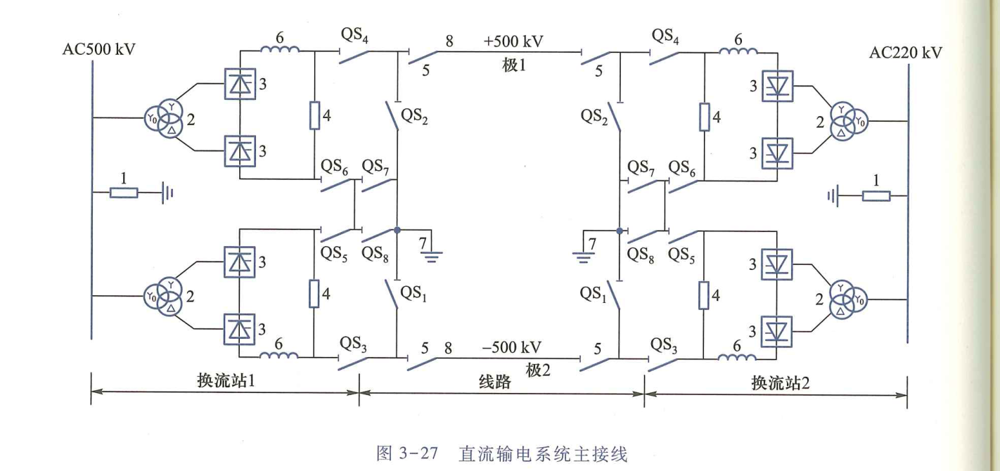

*图3-27直流输电系统主接线（原书第84页）*

1一交流滤波器组；2一换流变压器；3一换流桥；4一直流滤波器组；5一线路隔离开关；

6一平波电抗器；7一接地电极；8一直流输电线路；

QS]、QS2一旁路隔离开关，QS3、QS4一极母线隔离开关；

QS5、QS6一中性线隔离开关；QS7一金属回线隔离开关；QS8一大地回线隔离开关

2.换流变压器

直流输电系统如果每极采用双桥换流器，需要两组相位差30。的交流电源供电。因此，共安装6台单相三绕组变压器，每极3台，接成YO/Y/A，结构与普通型变压器基本相同。由于阀侧绕组需同时承受交直流电压，又为了减少高次谐波，故对变压器的绝缘强度和参数的三相对称性有严格的要求，同时换流变应有宽的有载调压范围。

3.平波电抗器

平波电抗器作用是抑制直流电流变化时的上升速度，减少直流线路中电压

<!-- 原书第85页；PDF第91页 -->

和电流的谐波分量。

4.无功补偿装置

无功补偿装置有调相机、并联电容器、交流滤波器或静止补偿器等。另外，交流滤波器在滤除高次谐波的同时，向交流系统提供一定数量的容性无功。

5.滤波器

滤波器由电容、电感、电阻串并联组成。由于换流装置是一个谐波源，在交流侧是一个谐波电流源，在直流侧则是一个谐波电压源，其含有的谐波分量会引起电容器、变压器、电动机等的谐波附加损耗、振动和严重发热，干扰邻近通信线路，并使换流器的触发控制不稳定。所以在交流母线上安装单调谐滤波器，分别滤去5、7、11、13次谐波电流；用高通滤波器吸收高次谐波电流；在直流侧用直流滤波器吸收平波电抗器后的6、12、18等次残余谐波分量。

6.直流断路器

由于直流电流无自然过零点，电弧难以熄灭，至今超高压直流断路器尚在研制试验阶段。目前两端直流输电系统故障是借助于控制系统限制故障电流，再将故障切除。

7，交直流避雷器

交直流避雷器是交直流系统绝缘配合的基础。由于直流电弧难以熄灭，故目前均采用性能优良的、无间隙的氧化锌避雷器。

8.直流互感器

直流互感器由磁放大器和电子元器件组成。

9.控制及保护设备

直流系统之所以能实现快速调节，与具有性能优良的控制保护系统有关。通过控制桥阀触发脉冲相位，调节功率大小和方向。调节可按不同参数实现，如定电流、定电压、定功率和定熄弧角等。保护系统有交流设备保护，换流阀保护和直流设备、线路保护等。

## 3.6 气体绝缘组合电器设备

气体绝缘组合电器设备（gasinsulatedswitchgear，GIS）是指全部或者部分采用气体而不采用处于大气压下的空气作为绝缘介质的金属封闭开关设备。

GIS由断路器、隔离开关、接地开关、互感器、避雷器、母线、连接件和出线终端等组成，这些设备或部件全部封闭在金属接地的外壳中，在其内部充有绝缘性

<!-- 原书第86页；PDF第92页 -->

能和灭弧性能优异的SF6（六氟化硫）气体作为绝缘和灭弧介质，故也称SF6全封闭组合电器，如图3-28所示。

*图3-28SF6全封闭组合电器设备（原书第86页）*

GIS通常为积木式结构，断路器、隔离开关、接地开关、互感器等元件可随意组合。根据用户需要与电气主接线不同，GIS总体结构也不同。图3-29为典型接线的LF一110型GIS布置图。

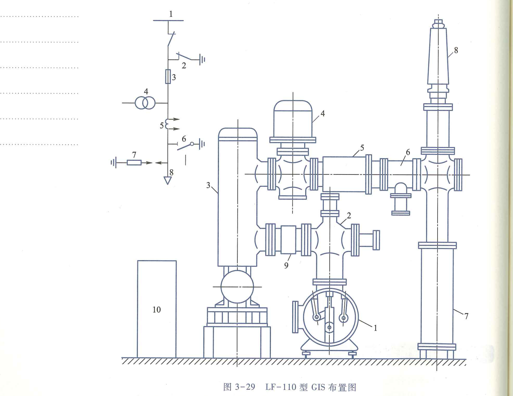

*图3-29LF一110型GIS布置图（原书第86页）*

1一母线；2一带接地装置的隔离开关；3一断路器；4一电压互感器；5一电流互感器；

6一快速接地开关；7一避雷器；8一电缆终端盒；9一波纹管；10一断路器操作机构

<!-- 原书第87页；PDF第93页 -->

分相式（即A、B、c三相分开）GIS大多数用于电压高、电流大的场合。为了进一步缩小GIS的尺寸，110kV的GIS也常用三相式结构。

GIS设备自20世纪60年代实用化以来，已广泛运行于世界各地。GIS不仅在高压、超高压领域被广泛应用，而且在特高压领域也被使用。与常规敞开式变电站相比，GIS的优点在于结构紧凑、占地面积小、可靠性高、配置灵活、安装方便、安全性强、环境适应能力强，维护工作量很小，其主要部件的维修间隔不小于20年。

## 3.7 基于重合器与分段器相互配合的配电网故障隔离

### 3.7.1 重合器与电压-时间型分段器相互配合

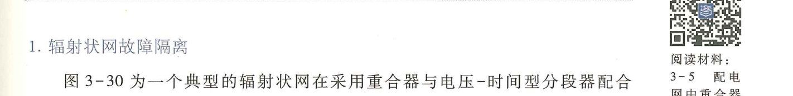

*图3-30为一个典型的辐射状网在采用重合器与电压一时间型分段器配合（原书第87页）*

时，隔离故障的过程示意图。

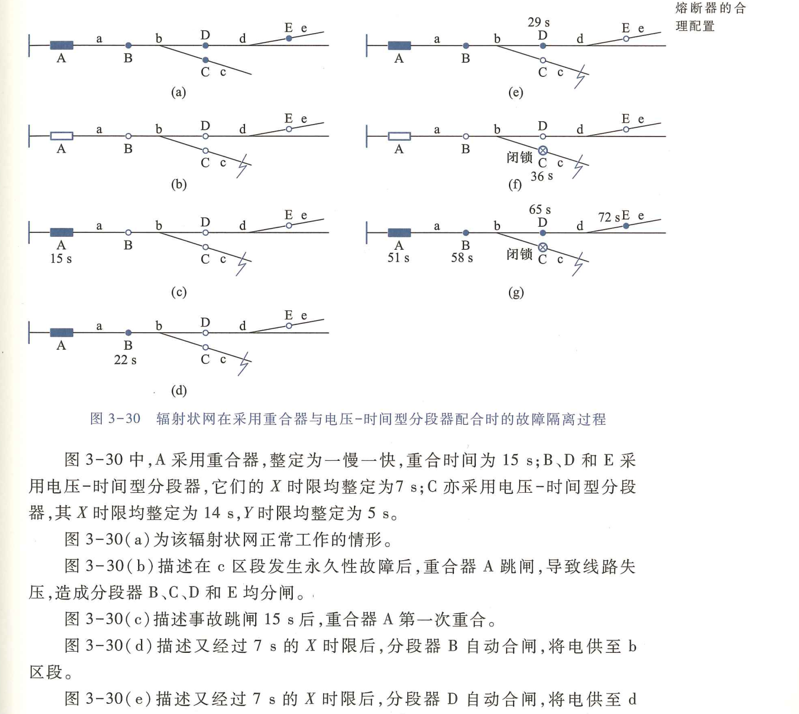

*图3-30辐射状网在采用重合器与电压一时间型分段器配合时的故障隔离过程；图3-30中，A采用重合器，整定为一慢一快，重合时间为巧；B、D和E采；图3-30（）为该辐射状网正常工作的情形。；图3-30（b）描述在c区段发生永久性故障后，重合器A跳闸，导致线路失；图3-30（c）描述事故跳闸巧后，重合器A第一次重合。；图3-30（d）描述又经过7的时限后，分段器B自动合闸，将电供至b；图3-30（）描述又经过7的x时限后，分段器D自动合闸，将电供至d（原书第87页）*

<!-- 原书第88页；PDF第94页 -->

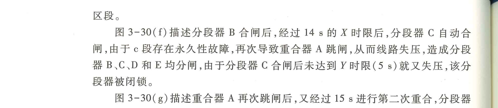

*图3-30（f）描述分段器B合闸后，经过14的时限后，分段器C自动合；图3-30（g）描述重合器A再次跳闸后，又经过巧s进行第二次重合，分段器（原书第88页）*

B、D和依次自动合闸，而分段器c因闭锁保持分闸状态，从而隔离了故障区段，恢复了健全区段供电。

*图3-31为一个典型的开环运行的环状网在采用重合器与电压一时间型分段（原书第88页）*

器配合时隔离故障的过程示意图。

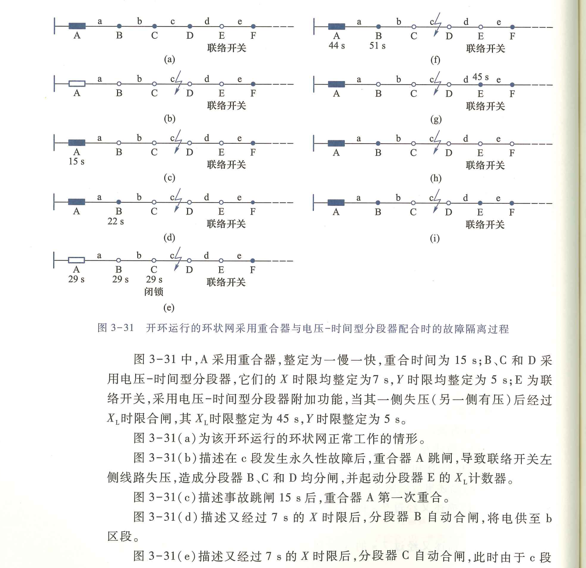

*图3-31；图3-31中，A采用重合器，整定为一慢一快，重合时间为巧s；B、c和D采；图3-31（）为该开环运行的环状网正常工作的情形。；图3-31（b）描述在c段发生永久性故障后，重合器A跳闸，导致联络开关左；图3-31（c）描述事故跳闸巧后，重合器A第一次重合。；图3-31（d）描述又经过7的x时限后，分段器B自动合闸，将电供至b；图3-31（e）描述又经过7的时限后，分段器C自动合闸，此时由于c段（原书第88页）*

<!-- 原书第89页；PDF第95页 -->

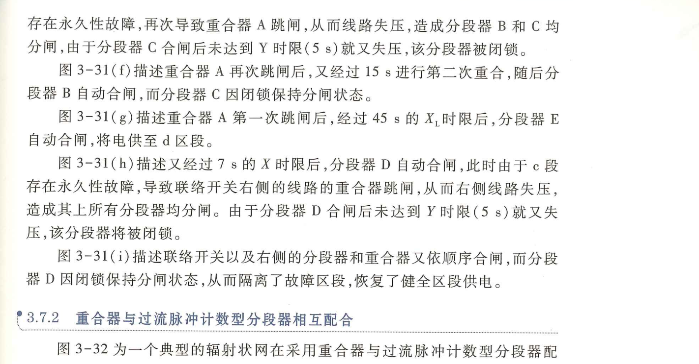

*图3-31（f）描述重合器A再次跳闸后，又经过巧s进行第二次重合，随后分；图3-31（g）描述重合器A第一次跳闸后，经过45的时限后，分段器E；图3-31（h）描述又经过7的时限后，分段器D自动合闸，此时由于段；图3-310）描述联络开关以及右侧的分段器和重合器又依顺序合闸，而分段；图3-32为一个典型的辐射状网在采用重合器与过流脉冲计数型分段器配（原书第89页）*

### 3.7.2 重合器与过流脉冲计数型分段器相互配合

合时，隔离故障区段的过程示意图。

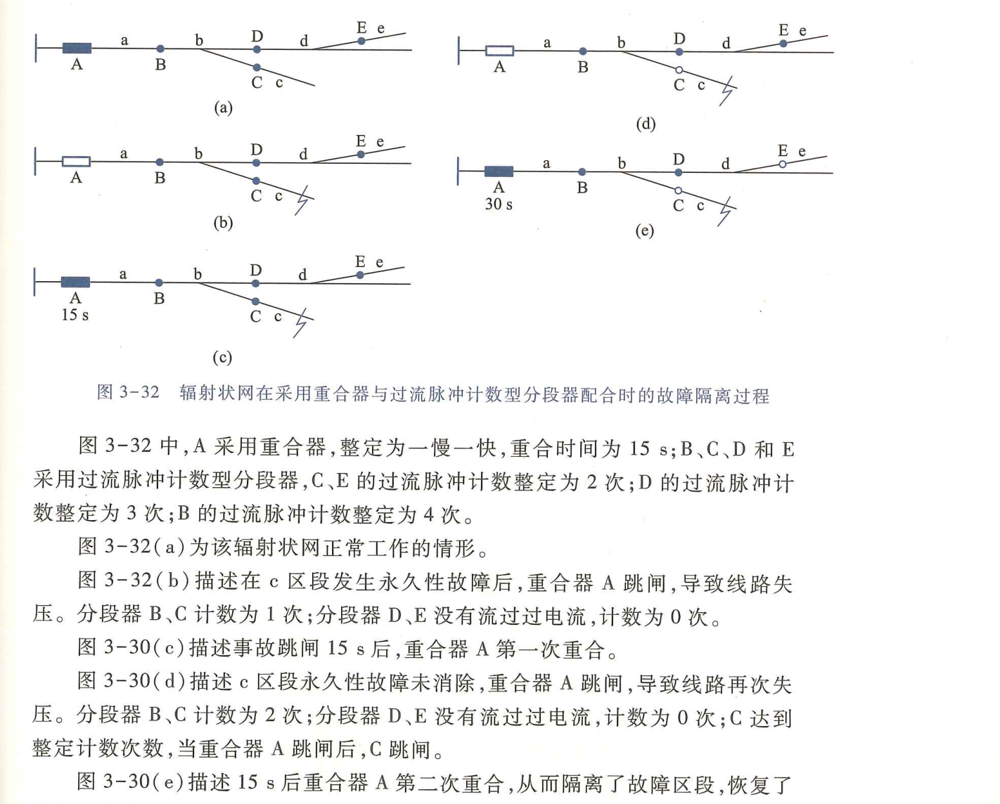

*图3-32辐射状网在采用重合器与过流脉冲计数型分段器配合时的故障隔离过程；图3-32中，A采用重合器，整定为一慢一快，重合时间为巧s；B、C、D和E；图3-32（a）为该辐射状网正常工作的情形。；图3-32（b）描述在c区段发生永久性故障后，重合器A跳闸，导致线路失；图3-30（）描述事故跳闸巧s后，重合器A第一次重合。；图3-30（d）描述c区段永久性故障未消除，重合器A跳闸，导致线路再次失；图3-30（）描述巧后重合器A第二次重合，从而隔离了故障区段，恢复了（原书第89页）*

健全区段供电。

<!-- 原书第90页；PDF第96页 -->

对于开环运行的环状网在采用重合器与过流脉冲计数型分段器配合时隔离故障的过程这里不再阐述。

问题1：电流互感器是否可以不区分测量用和保护用？

工程上测量用电流互感器和保护用电流互感器是分开使用的。测量用电流互感器在正常运行时可以保证测量精度，但在短路电流流过时会磁饱和，因此一般只用于测量，如连接电流表、功率表、间隔层装置的电流线圈等；保护用电流互感器在短路电流流过时可以保证在10%误差内，但正常运行时测量精度低，因此一般只用于继电保护，如连接电流继电器线圈等。

可不可以将电流互感器同时用于测量和继电保护呢？如果同时用于测量和继电保护，对电流互感器有何要求？什么场景下电流互感器可同时用于测量和继电保护？

问题2：如何整定电压一时间型分段器的x时限？

如图3-30所示，如果分段器c和D的时限都整定为7s，那么在重合器A重合和分段器B经过.丫时限合闸后，分段器C和D经过7s都合闸。由于故障仍然存在，A跳闸，分段器B、c和D失压分闸，导致分段器c和D都没有超过丫时限而闭锁。

这说明，电压一时间型分段器的.丫时限的整定需要相互配合，否则会扩大停电范围，降低配电网供电可靠性。

电压一时间型分段器的时限的整定如何相互配合？

问题3：如何整定过流脉冲计数型分段器的过流脉冲计数次数？

如图3-32所示，如果分段器E的过流脉冲计数次数整定为1次，那么当线路发生瞬时性故障，重合器A跳闸时，分段器E达到整定次数，E分闸。A重合后e线路停运。

如图3-32（d）所示，如果分段器B、c的过流脉冲计数次数整定为2次，那么在线路发生永久性故障时，分段器B、c都达到整定次数，分段器B、c分闸。A重合后b、c、d、e线路都停运。

这说明，过流脉冲计数型分段器的过流脉冲计数次数的整定需要相互配合，否则会扩大停电范围，降低配电网供电可靠性。

如何整定过流脉冲计数型分段器的过流脉冲计数次数？

## 课外阅读资料

本章推荐如下课外阅读内容：

（1）交流断路器灭弧原理；

（2）直流断路器灭弧原理；

（3）不同电压等级各种型号的交流断路器的结构、实现原理及技术参数；

（4）不同电压等级各种型号的直流断路器的结构、实现原理及技术参数；

（5）重合器、分段器、熔断器相互配合。

<!-- 原书第91页；PDF第97页 -->

## 思考题

3一1断路器、隔离开关、负荷开关有何区别？

3一2为什么电磁式电流互感器的二次侧不能开路？如果在电磁式电流互感器的二次侧接人一块电流表，在操作过程中如何保证电流互感器的二次侧不开路？

3一3为什么电磁式电压互感器的二次侧不能短路？如果防止电压互感器的二次侧短路带来的危害？

3一4简述交流输电系统的主要一次设备及其作用。

3一5简述直流输电系统的主要一次设备及其作用。

3一6如图3-33所示放射状配电网，为重合器，、、、为电压时间型分段器。重合器整定为2次重合，每次重合时间都为巧s，B、C、E的时限都整定为6s，D的.丫时限整定为8立时限都整定为5s。若d线路发生三相短路永久性故障，试简述其故障隔离过程。

3一7如图3-33所示放射状配电网，为重合器，、、、为过流脉冲计数型分段器。重合器每次重合时间都为10，B、c、D、E的计数次数都整定为2次。d线路发生巧的三相瞬时性故障，简述其故障隔离过程。

*图3-33（原书第91页）*

## 其他章节

- [第1章 走进电力系统](CH1走进电力系统.md)

- [第2章 电力系统的组成环节及工作原理](CH2电力系统的组成环节及工作原理.md)

- [第4章 电气一次系统](CH4电气一次系统.md)

- [第10章 电力系统继电保护](CH10电力系统继电保护.md)

- [第11章 电气二次系统](CH11电气二次系统.md)
