# 第4章 电气一次系统

> 来源：《电气工程基础》罗毅编著。原书第 92-118 页；本PDF第 98-124 页。

> 本文件由扫描教材转换，保留原书顺序、小节、例题、思考题及阅读资料。编号公式经对照原书转录为 LaTeX；插图、接线图与复杂表格保留为图片，位于相邻 assets 文件夹。正文为OCR识别稿，个别文字仍可能有识别误差。

## 小节目录

- [4.1 电力系统概述](#sec-4-1)

- [4.1.1 电力系统的分层](#sec-4-1-1)

- [4.1.2 电力系统的运行模式](#sec-4-1-2)

- [4.1.3 电力系统的接线](#sec-4-1-3)

- [4.1.4 配电网电气接线图](#sec-4-1-4)

- [4.2 电气主接线的基本形式](#sec-4-2)

- [4.2.1 有汇流母线的电气主接线形式](#sec-4-2-1)

- [4.2.2 无母线的主接线](#sec-4-2-2)

- [4.3 电力系统的中性点接地方式](#sec-4-3)

- [4.3.1 中性点不接地的电力系统](#sec-4-3-1)

- [4.3.2 中性点经消弧线圈接地的电力系统](#sec-4-3-2)

- [4.3.3 中性点直接接地的电力系统](#sec-4-3-3)

- [4.3.4 中性点经电阻接地的电力系统](#sec-4-3-4)

- [4.4 发电厂变电站电气主接线示例](#sec-4-4)

- [4.5 配电装置](#sec-4-5)

## 原文

<!-- 原书第92页；PDF第98页 -->

## 4.1 电力系统概述

### 4.1.1 电力系统的分层

随着国民经济现代化的发展，中国电力系统已经发展成为了一个380v、1000kV多电压等级复杂结构的电力网络。可按电力系统电压等级对电力网络进行纵向分层，并依据其电压等级和功能将电力网络分为输电网和配电网两大类。其中：

电力系统结构从纵向大致可以划分成三个层次：

（1）一级主干网络。500、1000kV超（特）高压电网，将能源基地（水电/风光／煤电）生产的电能输送到负荷中心。为提高可靠性，一级主干网络通常采用有备用的闭环结构，如网状、环式等接线形式。典型的一级主干网络如连接华中、华东、华北的1000kV特高压输电网络。

（2）二级输电网。330、500kV超高压电网（少部分地区还存在220kV高压网络），用于负荷中心各变电站之间的电能交换，保障电网安全经济运行。鉴于二级输电网在保障电网安全经济运行上的重要作用，一般也采用如网状、环式等接线形式的有备用闭环结构。二级输电网内部又可以划分为大区电网和省级电网两个层次。

（3）配电网。220kV及以下电网，将输电网输送来的电能降压后向各级用户供电。根据配电网供电分区的类别，配电网可以采用有备用的闭环结构，也可以采用无备用的开环结构。配电网又可以分为高压配电网010、220kV）、中压配电网00、35kV）和低压配电网（1kV以下）三个层次。

### 4.1.2 电力系统的运行模式

电力系统纵向分层后，其运行模式采用了“分层分片开环"运行模式。

（1）一级主干网络闭环运行。电力系统的运行网络拓扑为闭环网络，这样电力系统具有很高的供电可靠性，但需要维持电力系统安全稳定运行。

（2）二级输电网分片运行。各个二级输电网分片运行，仅通过一级主干网络节点电磁合环，其他节点相互之间电磁不合环。各^二级输电网都直接从一级主干网络取得电源，或省级输电网从大区电网取得电源。各个二级输电网内部闭环运行，如华中/华东等区域电网、湖北等省级电网都采用分片运行。经常

<!-- 原书第93页；PDF第99页 -->

二级输电网内部又可进一步采取分片运行。分片运行降低了电力系统的短路电流，从而降低了设备投资。

（3）配电网开环运行。不论配电网采用有备用还是无备用接线形式，配电网均采用开环运行方式，即运行时不允许两个及以上电源并列。配电网开环运行进一步减小了短路电流。为了解决开环运行的供电可靠性问题，对于A+、A、B类供电区域，普遍采用了负荷自动转供策略，即当配电网设备故障时，当故障隔离完成后通过联络开关实现网络重构，恢复非故障停电区域的供电。

### 4.1.3 电力系统的接线

电力系统的一次设备按其功能和输配电流程连接而成的电路称为电气一次接线或一次系统。电气一次接线包括电力系统接线和发电厂变电站电气主接线。

电力系统接线表征电力系统中发电厂、变电所、输电线路等主要元部件之间的连接关系。电力系统接线反映的是电力系统电能生产、输送、变换及消耗的整体结构形式。

电力系统接线有地理接线图和电气接线图两种。

电力系统地理接线图表明各发电厂、变电站的相对地理位置和它们之间的连接关系。在地理接线图中，发电厂、变电站的位置按照其经纬度坐标在地图上标定，输电线路一般不按照实际走廊绘制，直接用直线连接输电线路的首末端，如图4-1所示。不同电压等级的发电厂、变电站和输电线路经常采用不同的颜色绘制。这样，电力系统地理接线图对电力系统结构可以直观表征。

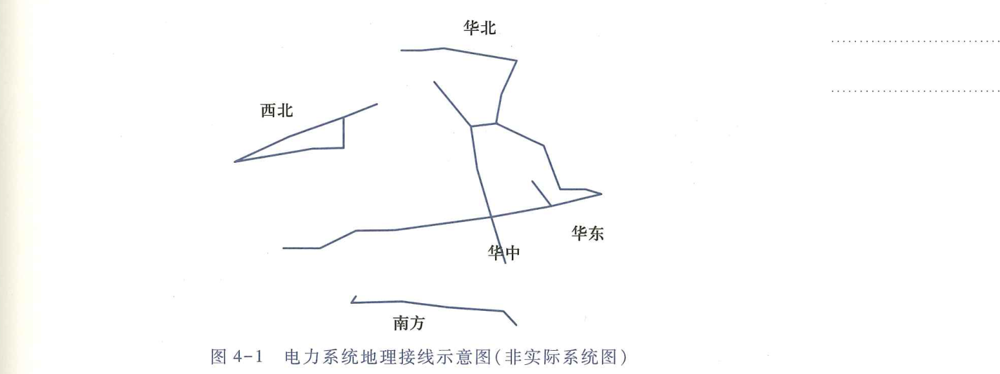

*图4-1电力系统地理接线示意图（非实际系统图）（原书第93页）*

发电厂、变电站的地理位置一般采用GP定位。为了检修方便，电网公司逐步开始对线路杆塔进行定位，并将线路按照实际走廊绘制。

电力系统的电气接线图表明电力系统中发电厂、变压站和输电线路等各主要电气元部件之间的电气连接关系，一般采用单线图。它不反映发电厂、变电站的地理位置，即发电厂、变电站的位置不是实际的经纬度，一般不按照地图方式绘制，如图4-2所示。

在绘制电气接线图过程中，一般发电厂标明发电机组、主变压器及接人系统的方式等；变电站标明主变压器、与其他变电站连接的线路、负荷接人点及大小

<!-- 原书第94页；PDF第100页 -->

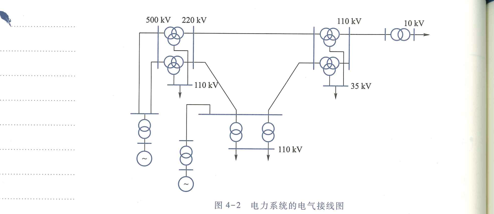

*图4-2电力系统的电气接线图（原书第94页）*

等。电气接线图经常用于电力系统分析计算，因此，在电气接线图中还可以标注分析计算结果。

按供电可靠性，电力系统接线可分为无备用和有备用接线两类。

无备用接线包括单回路放射式、干线式和链式接线等，此类接线中，每一负荷只能靠一条线路获得电能，故又称开式网络。它们的优点是接线简单，缺点是供电无备用。在干线式和链式网络中，当线路较长时，末端电压往往偏低。

有备用接线最简单的是采用双回路的供电方式，除此以外，有单环式、双环式、网状和两端供电式。有备用接线又称闭式网络，优点是每一个负荷点至少可以通过两条线路从不同方向取得电能。

### 4.1.4 配电网电气接线图

中国的配电网除了香港地区的配电网（如图4-3所示）采用闭环结构闭环运行外，其他配电网都是开环运行的。配电网的电气接线图具有很多不同的特点。

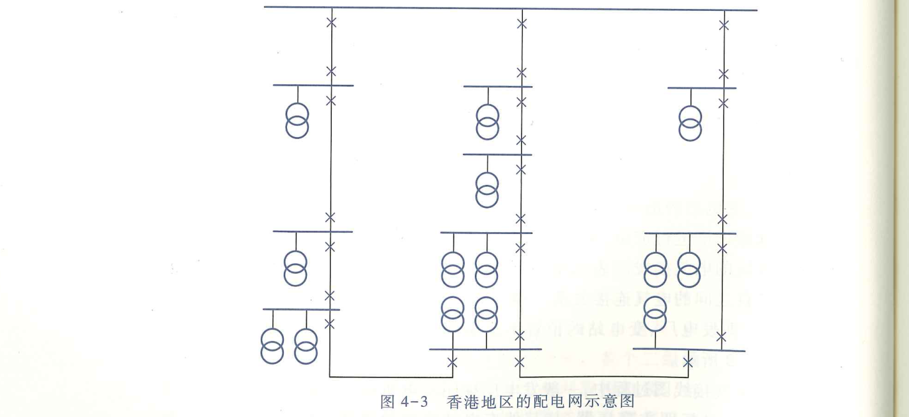

*图4-3香港地区的配电网示意图（原书第94页）*

<!-- 原书第95页；PDF第101页 -->

配电网中由于分支线路众多，较少使用母线，环接和T接是配电网两种典型的连接方式。

一般城网电源为220kV，属于输电网部分，在城市外围建设架空线双环网。若因为地理条件限制不能形成地理上的环网时，也可以采用C型电气环网。环网的适当地点设枢纽变电所，降压后送市区。

城市高压配电网采用架空线路时，城区可同杆双回架设，尽可能设双侧电源。采用电缆线路时可为多回路。当线路上T接或环人三个或三个以上变电所时，应设双侧电源，但正常运行时两侧电源不并列。对直接接人高压配电网的小电厂或自备电厂，可采用单电源辐射方式向附近供电，如图4-4所示。

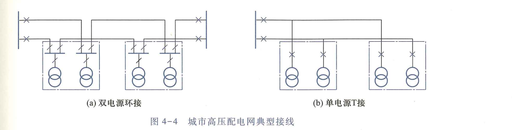

*图4-4城市高压配电网典型接线（原书第95页）*

城市中压配电网主要是10配电网。依据高压配电变电所位置和负荷分布，城市中压配电网分成若干相对独立供电分区，各个分区供电不重叠，正常运行时与10kV线路一一对应，故障时转移负荷。

市区配电网为沿道路敷设的格子形布局网络，在道路交叉口连接。全网在适当地点用杆塔开关（即柱上开关）分段，形成多区段（区段中又分段）、多连接的开式运行网络。

两端供电网络是城市中压配电网典型的接线形式，两端供电网络在配电网中又称为手拉手接线，如图4-5所示。

*图4-5手拉手接线（原书第95页）*

为了将多个变电站的10kV线路构成手拉手接线，城市配电网有三种典型方式。

（1）多变电站手拉手接线，如图4-6所示。每个变电站的其中一回10kV线路与另一个变电站的其中一回10kV线路构成手拉手接线。图中的“0"表示用柱上开关、环网柜等分段。

（2）直通式备用电缆接线，如图4-7所示。这种接线形式只有左侧有电源（变电站），右侧为开关站（只有断路器，没有变压器的变电站）。变电站与开关站之间敷设直通式备用电缆（中间虚线）。变电站每一回10kV线路都与开关站线路构成手拉手接线。

（3）分布式备用电缆接线，如图4-8所示。这种接线形式只有左侧有电源（变电站），右侧没有开关站。变电站每一回10kV线路都与备用电缆（中间虚线）上的配电环网柜的其中一回出线构成手拉手接线。

<!-- 原书第96页；PDF第102页 -->

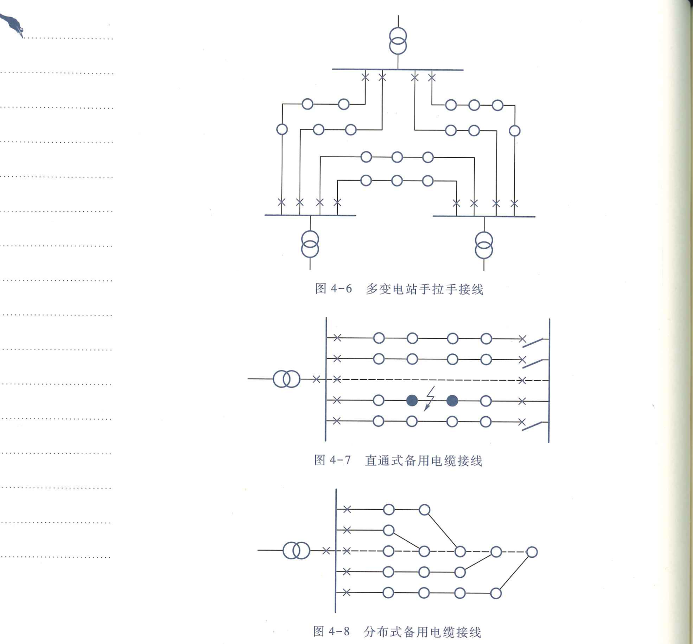

*图4-6多变电站手拉手接线；图4-7直通式备用电缆接线；图4-8分布式备用电缆接线（原书第96页）*

城郊中压配电网可以采用手拉手接线，也可以采用其他无备用接线。城郊中压配电网的一个重要特点是存在很多架空一电缆混合网络，由于电磁波的折反射使得暂态过程与单纯的架空线路不一样。

在可靠性要求很高的A+.、A供电区域，中压配电网需要采取更高可靠性的接线形式，如手拉手多联络接线，如图2-19所示；再如，网状接线。

城市低压配电网采用无备用接线，主要是放射状接线、干线式接线。

农村配电网由于可靠性要求相对较低，也主要采用无备用接线，如放射状接线、干线式接线、菊花链式接线等。但随着乡镇经济的发展，乡镇农网接线有向城网接线发展的趋势。

## 4.2 电气主接线的基本形式

发电厂和变电站中的一次设备按其功能和输配电流程连接而成的电路称为电气主接线，也称发电厂和变电站电气一次接线或一次系统。

<!-- 原书第97页；PDF第103页 -->

电气主接线的基本接线形式，可分为有汇流母线和无汇流母线两大类。有汇流母线的接线形式有：单母线、单母线分段、双母线、双母线分段、增设旁路母线、一台半断路器接线、变压器母线组接线等。无汇流母线的接线形式有：单元接线、桥形接线和角形接线。

### 4.2.1 有汇流母线的电气主接线形式

1.有母线主接线

（1）单母线接线。

单母线接线如图4-9所示。汇流母线w是线路之间的中间环节，起汇集和分配电能的作用，使各回线路在母线上并列工作。每回线路都与母线w连接。每回线路上都装有一台断路器QF，用于开断、闭合负荷电流和短路电流。断路器QF两侧都各装有一台隔离开关QSI、QS20紧靠母线侧的隔离开关QSI称做母线隔离开关，靠线路侧的隔离开关QS2称为线路隔离开关。安装隔离开关的目的是在线路停运后用隔离开关隔开电源，产生明显的断口，当检修线路或断路器时，形成一个检修人员也能看见的、明显的“断开点"。这样万一断路器的合分闸指示器失灵，对检修人员也是安全的。

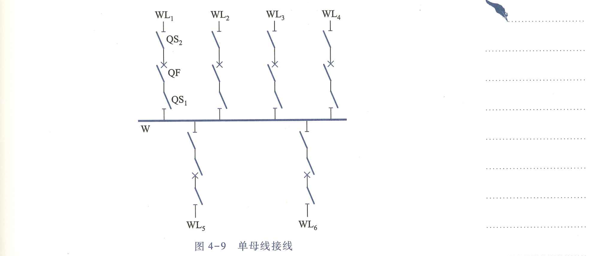

*图4-9单母线接线（原书第97页）*

在每回线路上、每台断路器旁以及母线w上通常还装设有接地隔离开关。一般不将接地隔离开关画在电气主接线图上。因为接地隔离开关数量较多，绘制出接地隔离开关会使得主接线图元件太多，不清晰。

线路WLI的断路器QF、隔离开关QSI、QS2以及WLI相关的接地隔离开关、电流互感器等一次设备构成WLI电气间隔。同一个电气间隔的设备经常在地理位置上布置在一起。如果布置在室外，则将场地划分成很多长方块状的区块，每个区块内布置同一个电气间隔的设备，另一个电气间隔的设备一定不能再布置到该区块，并在该区块内设置明显的“线路"标识牌，防止施工、操作和检修时走错电气间隔。如果布置在室内，则同样将同一个电气间隔的设备布置到同一个房间（或同一个房间的一个隔断）内，并在门上设置明显的“线路WLI"标识牌。

<!-- 原书第98页；PDF第104页 -->

运行操作时，必须严格遵守操作顺序。如WLI送电时，在接地隔离开关和断路器QF断开的情况下，先合上QSI和QS2，再合上断路器QF；如欲停止对WLI供电，须先断开QF，再断开QSI和QS20如果线路需检修，待线路对侧停电后，再合上线路接地隔离开关；如果断路器QF需检修，再合上QF旁的接地隔离开关。

单母线接线的正常运行方式：接在母线w上的所有线路的断路器闭合，母线w和所有线路都带电运行。在电力系统中，运行方式是指在一定的负荷条件下，电力系统中有功电源出力、无功电源出力和各电气设备的投退状态的集合。

如果线路故障，线路断路器QF跳闸，线路WLI停电，其他线路正常运行；如果母线w故障，需要将所有对侧有电源的线路断路器跳闸，所有线路停电；如果母线隔离开关QSI故障，也需要将对侧有电源的线路断路器跳闸，所有线路停电；如果线路隔离开关QS2故障，线路断路器QF跳闸，线路停电，其他线路正常运行。

检修母线时，需要将对侧有电源的线路断路器跳闸，所有线路停电，再合上母线接地隔离开关；检修线路断路器QF时，线路断路器QF跳闸，断开线路两侧的隔离开关QSI和QS2，线路WLI停电，再合上QF旁的接地隔离开关。

单母接线具有简单、清晰、设备少的优点。但当母线故障或检修时，母线上连接的所有线路全部停电；断路器检修期间也必须停止该线路的供电，因此这种接线只适用于单电源的发电厂和变电站，且出线回路数少，用户对供电可靠性要求不高的场合。若采用成套配电装置也可用于较重要的供电用户。

（2）双母线接线。

双母线接线如图4-10所示，有两组母线WI和W2。母线和W2之间通过母线联络断路器QF（简称母联）回路连接。每回线路上都有一台断路器，断路器两侧都有隔离开关（QS3、QS4、QS5）。每一回线路经两台隔离开关QS3和QS4分别与两组母线连接。断路器QFI和隔离开关QS3、QS4、QS5构成线路电气间隔。

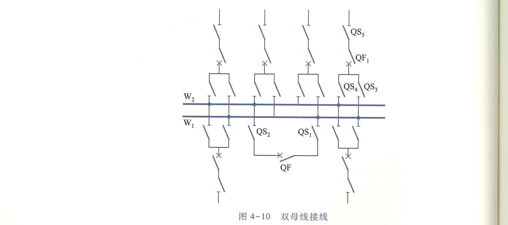

*图4-10双母线接线（原书第98页）*

双母接线可以有以下三种运行方式。

母联QF断开，一组母线运行，另一组母线备用，全部进出线接于运行母线上。该运行方式称为单母线运行方式。

<!-- 原书第99页；PDF第105页 -->

2母联QF断开，但两组母线和同时运行，进出线分别接于两组母线，两组母线解列运行。该运行方式称为解列运行方式（有文献称为硬母线分段方式）。解列运行方式适应电力系统分片运行或开环运行。

母联QF闭合，两组母线和同时运行，电源和馈线平均分配在两组母线上，使流经QF的电流较小。该运行方式称为单母线分段运行方式。若连接方式固定，则继电保护配置最简单。

双母线最常见的操作是倒闸操作。变电站的电气设备分为运行、备用（冷备用及热备用）、检修三种状态，将设备由一种状态转变为另一种状态的过程叫倒闸；通过操作隔离开关、断路器以及挂、拆接地线，将电气设备从一种状态转换为另一种状态，或改变运行方式，这种操作就是倒闸操作。为保证电力系统安全运行，倒闸操作必须严格执行操作票制度和监护制度。下面以倒母线操作为例说明倒闸操作步骤：

假设母线运行、备用，所有线路接在WI上运行。现需要将所有线路切换到W2上运行，使母线运行、备用，即倒母线操作。步骤如下：

0合母联两侧的隔离开关QSI、QS2，再合母联QF，对母线W2充电。若W2上有故障，QF跳闸；若W2上没有故障，母线充电成功。

2对每回线路，先合母线W2隔离开关（如QS4)，再分母线隔离开关（如QS3)。对所有线路操作完毕，所有线路切换到母线W2运行。

分母联QF，再分母联两侧的隔离开关QSI、QS20母线停电。

母线故障、母线隔离开关故障只会造成短时停电。任意一组母线故障或母线隔离开关故障时，继电保护使得断路器跳闸，母线及其连接在该母线上的所有线路停运。此时可以通过倒闸操作将停运线路切换到另一组母线投入运行。

任意一回线路故障，继电保护使得故障线路断路器跳闸，仅故障线路停运。检修任意一组母线，可执行上述倒母线操作，停运待检修母线，所有线路供电不中断。任意一回线路断路器检修，如图4-11所示，可采用临时跨条，跨接在线路侧和母线之间，用母联QF代替线路QFI恢复供电，此时该线路仅短时停电。

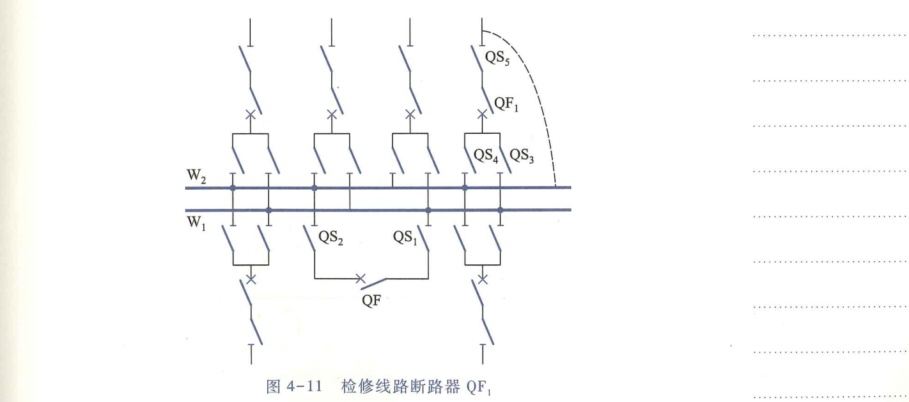

*图4-11（原书第99页）*

<!-- 原书第100页；PDF第106页 -->

例如，为了检修线路断路器QFI，可以执行如下操作：

0进行倒母线操作，将所有线路切换到w1上运行，使母线WI运行、W2备用。此时母联QF分闸。

0先分线路断路器QFI，再分QFI两侧隔离开关QS3或QS4、QS50

.在线路和母线之间装设跨条，如图4-11中虚线所示。

@合母联两侧的隔离开关QSI、QS2，再合母联QFO用母联QF代替线路QFI恢复线路供电。

可见，双母线接线在母线故障、检修时可以做到对线路不停电或短时停电；在线路断路器检修时利用跨条仅短时停电，可靠性较高，调度灵活，因此在220kV及以下电压等级得到了广泛应用。但是双母线接线的倒闸操作极易发生误操作。双母线接线可靠性在故障和检修时需要短时停电不能满足330kV及以上电压等级的接线要求。

（3）一台半断路器接线。

如图4-12所示，在母线和之间，三台断路器（QFI、QF2、QF3）及其断路器两侧的隔离开关（QSI、QS2、QS3、QS4、QS5、QS6）串接在一起，称为一个“串"每串上接有两回线路，每回线路接在串上的两台断路器之间（如线路接在断路器QFI和QF2之间）。由于QF2是两回线路WL。、WL2共用，相当于每回线路有

一台半断路器，故称为一台半断路器接线，又称一接线、1一接线。

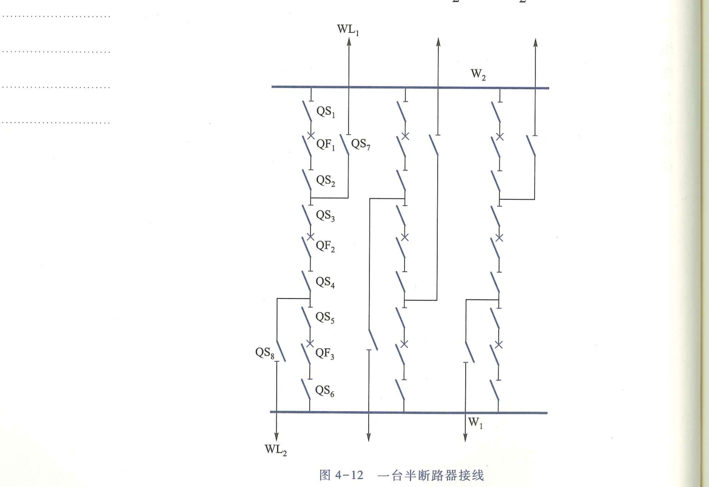

*图4-12一台（原书第100页）*

台半断路器接线的正常运行方式是所有断路器和隔离开关都合闸运行。

<!-- 原书第101页；PDF第107页 -->

一台半断路器接线要求在正常运行、检修、故障处理等过程中尽可能保证串的完整性。所谓保证串的完整性就是串上的所有开关设备都合闸运行。这样一台半断路器接线具有最高的运行可靠性。

在每回线路上都装设一台隔离开关的目的是为了检修线路时保证串的完整性。检修线路WLI的步骤是：

0分QFI、QF2，再分QS70

2合QFI、QF20

.待对侧分闸后，合线路接地隔离开关。进行线路检修。

检修完毕后的恢复供电操作是：

0分线路接地隔离开关。

0确定对侧线路接地隔离开关已分闸。

.分QFI、QF20

@合QS7

0合QFIÄQF2

一台半断路器接线在母线故障、母线检修、断路器检修时可以不停电，在任意一回线路故障、或任意一回线路检修时仅停电该线路，因此具有很高的供电可靠性及运行灵活性，广泛应用于330kV及以上电压等级的变电站和电厂。

2，母线分段

在单母线接线和双母线接线中，如果发生母线故障，接在故障母线上的所有线路都将停运。为了提高可靠性，缩小故障影响范围，故采用母线分段。

（1）单母线分段。

将图4-9所示单母线接线进行母线分段，得到如图4-13所示的单母线分段接线。QFI称为分段断路器。母线分段时一般要求两段母线上的电源和负荷尽可能均衡，即流经QFI的工作电流尽可能小。

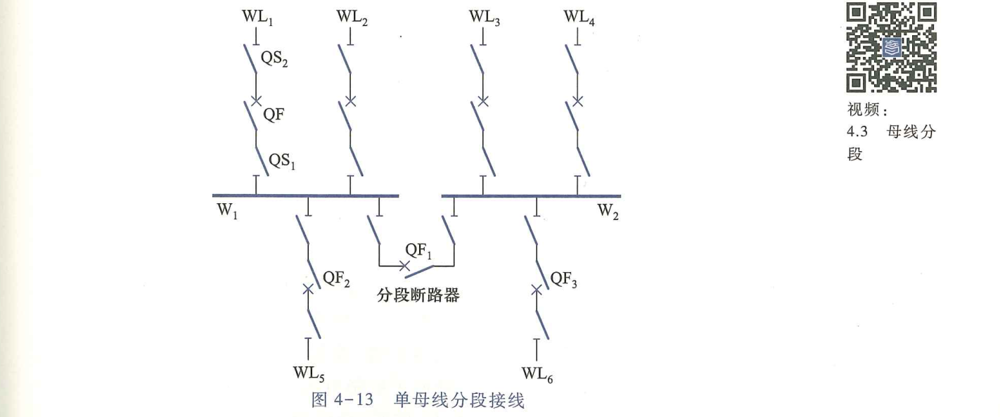

*图4-13单母线分段接线（原书第101页）*

单母线分段接线有两种正常运行方式：

0所有断路器都合上，所有线路带电运行。

2电源互为备用方式。在配电网中，如果两路电源WL5、WL6同时对负荷供

<!-- 原书第102页；PDF第108页 -->

电，为了保证开环运行，经常采用电源互为备用的运行方式。通过备用电源自动投入装置控制QFI、QF2、QF3至少有一台断路器断开，实现备用电源的切换。

如果其中一段母线（如WI）故障或者检修，则断开分段断路器QFI，另一段母线（如）可以正常运行。

母线分段的数目，通常以2、4分段为宜，分段太多增加了分段断路器数目，提高了造价。有时对线路回路数多但负荷重要程度低的场合，可以采用1台断路器+多台隔离开关的分段方式，减少断路器数目。

单母线分段适用于60kV配电装置线路回路数6回及以上，35kV线路数为4、8回及110、220kV线路数为3一4回的接线。

（2）双母线分段。

双母线分段接线如图4-14所示。将图4-11中的母线分成II、III段两段，QFI、QF2为母联，QF3为分段断路器。根据母线分段后的总母线组数，该接线形式称为双母线三分段接线。

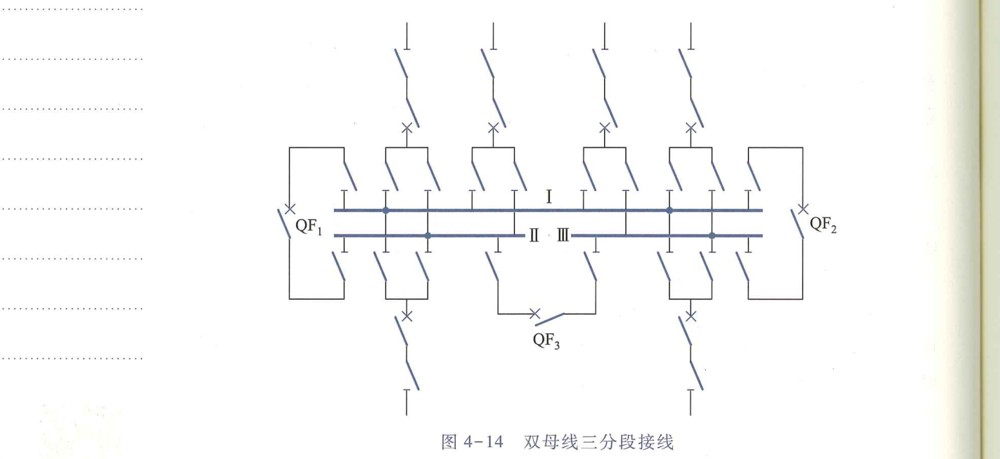

*图4-14双母线三分段接线（原书第102页）*

双母线三分段接线典型运行方式有：

方式1：母线I备用，母线II、工作，母联QFI、QF2断开，分段QF3合上。

方式2：母线I、II、III工作，母联QFI、QF2和分段QF3都合上。

方式3：母线I备用，母线II、工作，母联QFI、QF2和分段QF3都断开。

一些装机容量较小的发电厂，例如中国北方地区的热电厂，若发电机直接与机端母线连接（不采用单元接线），一台发电机机端或机端母线短路时，其他的发电机组会提供很大的短路电流，使发电机回路投资费用大增。此时，可以在分段断路器旁加装电抗器限制短路电流，如图4一巧所示。

在图4一巧中，如果发电机组GI机端短路，或者母线II短路，发电机组G2提供的短路电流受到电抗器L的限制，降低了短路电流。在发电机组GI和G2回路中，靠近发电机侧可以不加装隔离开关，此时，该回路断路器检修时发电机组需要停机；靠近发电机侧也可以加装隔离开关，这样该回路断路器检修时发电机组不需要停机，这对于火电机组是有利的。

在变电站中当短路电流过大超出了设备动稳定电流时也可以应用分段断路

<!-- 原书第103页；PDF第109页 -->

I

1

1

QFI

QF3

图4一巧分段断路器旁加装电抗器

器旁加装电抗器的方案，但需要经过计算确定。

双母线分段接线在6、10kV装置中应用较多。在220kV电压母线回路数甚多时，也采用双母线四分段的接线。

3.旁路母线

上述有母线接线方式中，除了一台半断路器接线外，在检修线路断路器时都需要对线路停电或短时停电。为了在检修线路断路器时不对线路停电，需要提供一条绕开待检修断路器的供电路径。因此需要设置旁路母线。

带旁路母线的接线有单母线分段带旁路母线接线、双母线带旁路母线接线、双母线分段带旁路母线接线等形式。下面以双母线带旁路母线接线为例，说明旁路母线的作用。

典型的双母线带旁路母线接线如图4-16所示。

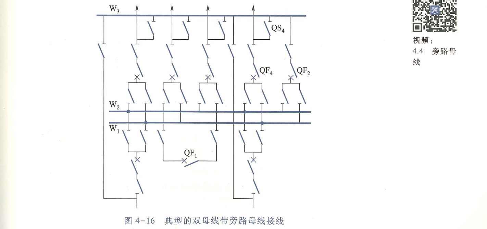

*图4-16典型的双母线带旁路母线接线（原书第103页）*

<!-- 原书第104页；PDF第110页 -->

在图4-16中，增加旁路母线、旁路回路（断路器QF2所在回路）、每回线路通过一台隔离开关（如QS4）与旁路母线连接。QF2称为旁路断路器，QS4称为旁路隔离开关。QFI为母联断路器。

正常运行时，旁路母线W3不带电，旁路断路器QF2断开，旁路隔离开关（如QS4）断开。

旁路母线的作用是不停电检修线路断路器。假设检修操作前运行，备

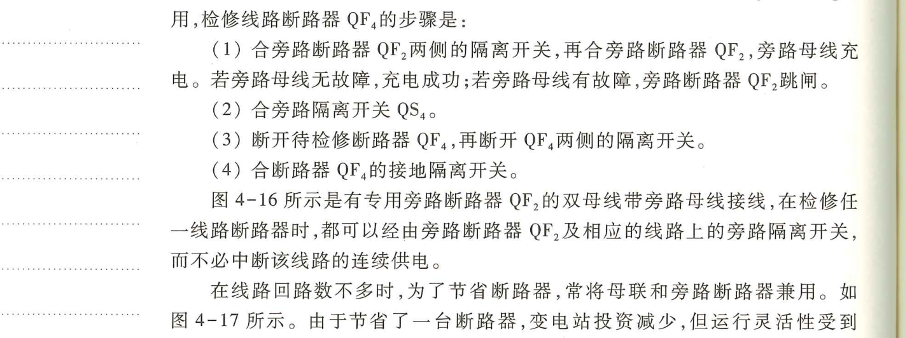

*图4-16所示是有专用旁路断路器QF2的双母线带旁路母线接线，在检修任；图4-17所示。由于节省了一台断路器，变电站投资减少，但运行灵活性受到（原书第104页）*

限制。

### 4.2.2 无母线的主接线

无汇流母线的接线，使用的断路器数量较少，结构简单。

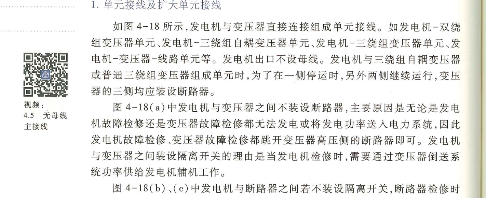

*图4-18（a）中发电机与变压器之间不装设断路器，主要原因是无论是发电；图4-18（b）、（）中发电机与断路器之间若不装设隔离开关，断路器检修时（原书第104页）*

发电机必须停机，这对于水电机组是合适的。

为了减少变压器台数和高压侧断路器数目，并节省配电装置占地面积，也可将两台发电机与一台变压器相连，组成扩大单元接线，如图4-19所示。分裂绕组变压器可以减小发电机出口短路时另一台发电机提供的短路电流，因为分裂绕组变压器的两个低压绕组被设计成很弱的磁耦合。

<!-- 原书第105页；PDF第111页 -->

QS

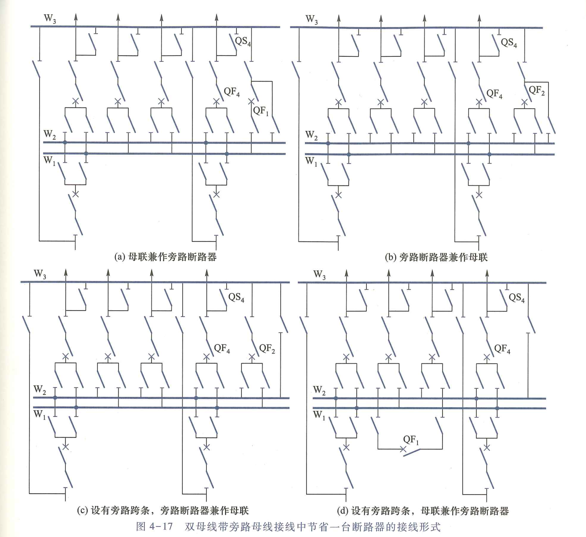

*图4-17双母线带旁路母线接线中节省一台断路器的接线形式（原书第105页）*

一了TTT丁

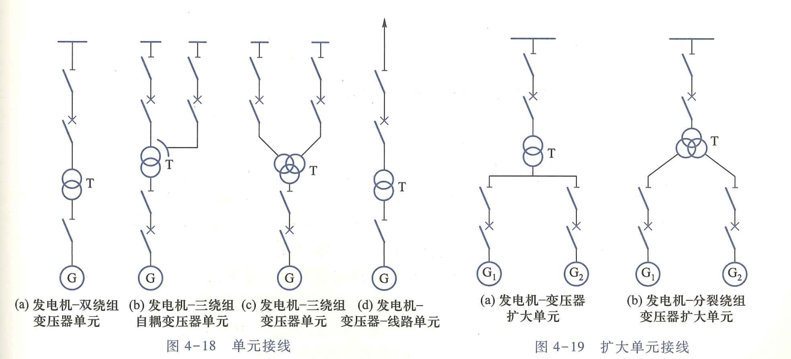

*图4-18单元接线（原书第105页）*

<!-- 原书第106页；PDF第112页 -->

2.桥形接线

当只有两台变压器和两回线路时，可采用桥形接线。按照跨接于两回线路之间的断路器（QF3）的位置，桥形接线可分为内桥形和外桥形，如图4-20所示。

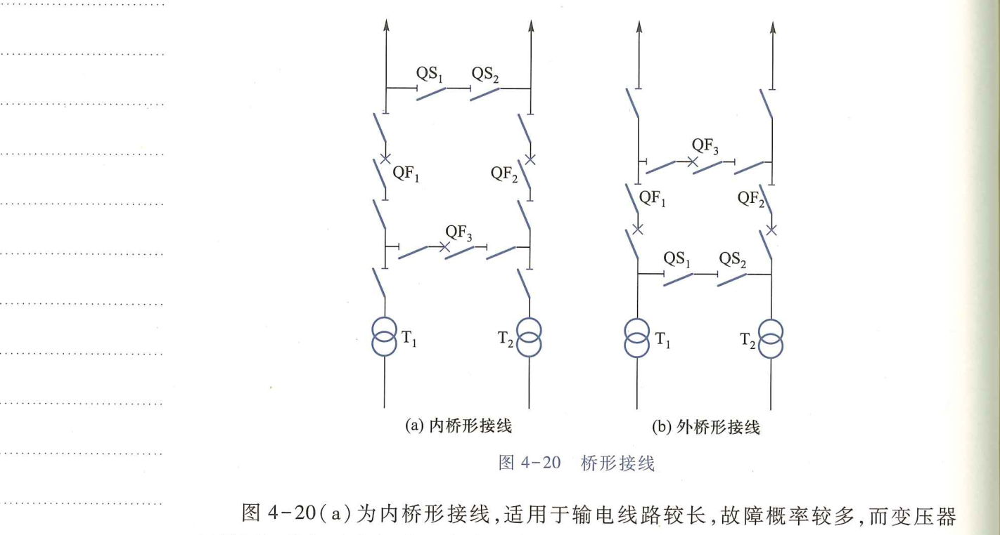

*图4-20桥形接线；图4-20（a）为内桥形接线，适用于输电线路较长，故障概率较多，而变压器（原书第106页）*

不需要经常切除的场景。线路故障仅切除一台断路器，而变压器停运需要动作两台断路器。图4-20（b）为外桥形接线，适用于线路较短，且变压器需经常投切，或系统经两线路环网情况（减少变电站穿越功率）。

为了提高桥形接线的灵活性和可靠性，避免因检修线路或变压器时影响其他回路的正常运行，一般在接线中加设一组跨线（导线）。跨线上通常设置两台串接的隔离开关QSI和QS2，以便于跨线上隔离开关进行检修，此两台隔离开关在正常运行时是断开的。对内桥接线，当检修QFI、QF2、QF3中任意一台断路器时，需要闭合QSI和QS20对外桥接线，不仅当检修QFI、QF2、QF3中任意一台断路器时需要闭合QSI和QS2，而且当检修任何一回线路时，也需要闭合QSI和QS20

桥形接线使用的断路器和设备少，接线清晰简单，但可靠性不高，可用于小型发电厂和变电站，也可作过渡性的接线。

3.角形接线

角形接线如图4-21所示，角形接线的断路器数等于回路数，且每条回路都与两台断路器相接，检修任一台断路器不致中断该回路供电，隔离开关只在检修时起隔离电源之用，不作操作电器，从而具有较高的可靠性和灵活性。

多角形接线的缺点是检修任一断路器时，造成开环，此期间若发生另一台断路器故障，可能造成解列，因此应合理安排电源和线路的连接。在开环和闭环两种状态下，各支路流通的电流差别很大，使电气设备的选择、继电保护的整定复杂化。角形接线的配电装置也不便于扩建，因此多用于不超过六回进出线的、最终规模明确的110kV及以上的发电厂和变电站中。

<!-- 原书第107页；PDF第113页 -->

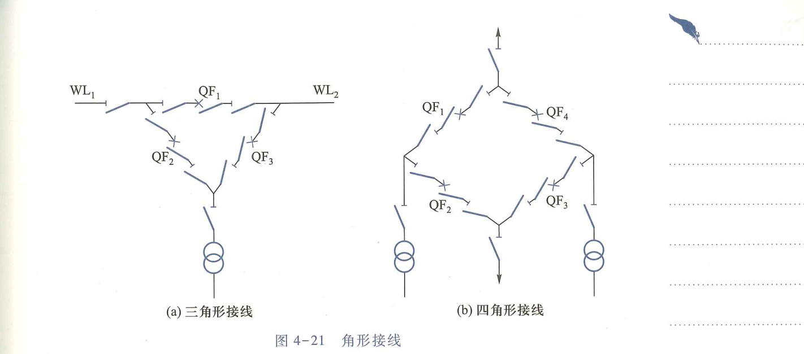

*图4-21角形接线（原书第107页）*

## 4.3 电力系统的中性点接地方式

为了保证电力网或电气设备的正常运行和工作人员的人身安全，人为地使电力网及其某个设备的某一特定地点通过导体与大地做良好的连接，称为接地。接地方式包括工作接地、保护接地、保护接零、防雷接地和防静电接地等。

工作接地是为了保证电气设备在正常或发生故障情况下可靠工作而采取的接地。工作接地一般都是通过电气设备的中性点来实现的，所以又称为电力系统中性点接地。例如电力变压器或电压互感器的中性点接地就属于工作接地。

电力系统的中性点是指星形连接的变压器或发电机的中性点。中国电力系统的中性点接地方式可划分为4种方式：中性点不接地（中性点绝缘）、中性点经消弧线圈接地、中性点直接接地和中性点经电阻接地。根据系统中发生单相接地故障时接地故障电流的大小，中性点不接地和中性点经消弧线圈接地称为小电流接地，中性点直接接地和中性点经电阻接地称为大电流接地。确定电力系统中性点接地方式时，应从供电可靠性、内部过电压、对通信线路的干扰、继电保护以及确保人身安全等方面综合考虑。

### 4.3.1 中性点不接地的电力系统

中性点不接地方式广泛应用于中国3、60kV配电网中。正常运行时三相电压、砾、Üc是对称的，所以三相导线对地电容电流//

/也是对称CA、CB、CC的，三相电容电流相量之和为零，这说明没有电容电流经过大地流动，如图4-22（）所示。

<!-- 原书第108页；PDF第114页 -->

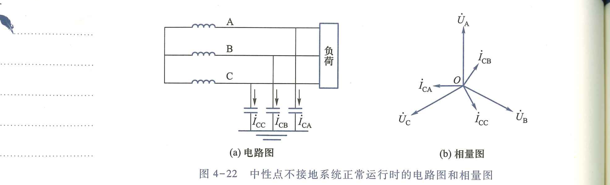

*图4-22中性点不接地系统正常运行时的电路图和相量图（原书第108页）*

如果A相发生单相金属性接地（即接地电阻为0）故障，如图4-23（）所示，相对地电压降为零，而非故障相B、c对地电压在相位和数值上均发生变化，即

$$
\begin{cases}\dot U'_A=\dot U_A+(-\dot U_A)=0\\\dot U'_B=\dot U_B+(-\dot U_A)=\dot U_{BA}\\\dot U'_C=\dot U_C+(-\dot U_A)=\dot U_{CA}\end{cases}
\tag{4-1}
$$

如图4-23（b）所示，当A相发生单相接地故障时，B相和c相对地电压变为和，和的相位差为60。，其幅值都升高到相电压的倍，等于正常运行时的线电压。因此，中性点不接地的电力系统中的线路及各种电气设备的绝缘都要按线电压设计。

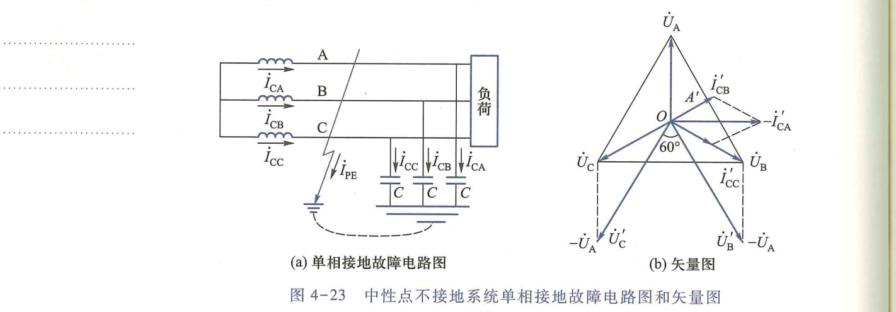

*图4-23中性点不接地系统单相接地故障电路图和矢量图（原书第108页）*

如果单相接地故障经过一定的接触电阻（亦称过渡电阻）接地，而不是金属性接地，那么故障相对地电压将大于零而小于相电压，非故障相对地电压将小于线电压而大于相电压。

由图4-23（b）还可看出，在系统发生单相接地故障时，三相之间的线电压仍然对称，用户的三相用电设备仍能照常运行，也就是说，系统发生单相接地故障时不必马上切除故障部分，这样可提高供电可靠性。但是，中性点不接地系统发生单相接地故障后，是不允许运行很长时间的，因为此时非故障相的对地电压升高到接近线电压，很容易发生对地闪络，从而造成相间短路。因此，中国有关规程规定，中性点不接地系统发生单相接地故障后，允许继续运行的时间不能超过2h，在此时间内应采取措施尽快查出故障原因，予以排除，否则就应将故障线路停电检修。

<!-- 原书第109页；PDF第115页 -->

中性点不接地系统发生单相接地故障时，在接地点将流过接地故障电流（电容电流）。例如，A相发生接地故障时，A相对地电容被短接，B、c相对地电压升高到等于线电压，所以对地电容电流变为

$$
\dot I'_{CB}=\frac{\dot U'_B}{-jX_C}=\sqrt3\,\omega C\dot U_Be^{j60^\circ}
\tag{4-2}
$$

$$
\dot I'_{CC}=\frac{\dot U'_C}{-jX_C}=\sqrt3\,\omega C\dot U_B
\tag{4-3}
$$

接地电流/就是上述电容电流的相量和，即

$$
\dot I_{PE}=-(\dot I'_{CB}+\dot I'_{CC})=-3\omega C\dot U_Be^{j30^\circ}
\tag{4-4}
$$

$$
I_{PE}=3\omega CU_\varphi=3I_{C0}
\tag{4-5}
$$

$$
I_{C0}=\omega CU_\varphi
\tag{4-6}
$$

式中,IPE为单相接地电流（A）；‰为电力网的相电压（v）；为电源的角频率(rad/s)；c为每相导线的对地电容（F）；/为系统正常运行时，每相导线的对地电容电流（A）。

由式（4-5）可知，中性点不接地系统单相接地故障电流等于正常运行时每相导线对地电容电流的三倍，因此可以通过计算线路对地电容电流来估算单相接地故障电流。但是，线路对地电容电流很难准确计算，工程中单相接地电流（电容电流）通常按下述经验公式计算

$$
I_{PE}=(l_{\mathrm{oh}}+35l_{\mathrm{cab}})\frac{U_N}{350}
\tag{4-7}
$$

式中，UN为电力网的额定线电压（kV）；/。为同级电力网具有电的直接联系的架空线路总长度（km）•l为同级电力网具有电的直接联系的电缆线路总长度（km）。

，cab

中性点不接地系统发生单相接地故障时，接地电流在故障处可能产生稳定的或间歇性的电弧。实践证明，如果接地电流大于30A时，将形成稳定电弧，成为持续性电弧接地，将可能烧毁电气设备和可能引起多相相间短路。如果接地电流大于5、10A，而小于30A，则有可能形成间歇性电弧，这是由于电力网中电感和电容形成了谐振回路所致。间歇性电弧容易引起弧光接地过电压，其幅值可达（2.5、3）‰，将危害整个电网的绝缘安全。如果接地电流在5A以下，当电流经过零值时，电弧就会自然熄灭。

### 4.3.2 中性点经消弧线圈接地的电力系统

中性点经消弧线圈接地方式也广泛应用于中国3、60kV配电网中。

如前所述，中性点不接地系统发生单相接地故障时，可能由于接地电流大产生稳定的或间歇性的电弧而导致设备损坏或引起弧光接地过电压，甚至发展成为多相短路，造成严重事故，为了克服这一缺点，可将电力系统的中性点经消弧线圈接地。

所谓消弧线圈，就是具有气隙铁心的电抗器，安装在变压器或发电机中性点与大地之间，如图4-24（a）所示。由于装设了消弧线圈，当发生单相接地故障时，接地故障相与消弧线圈构成了另一个回路，接地故障相接地电流中增加了一个感性电流，它与装设消弧线圈前的容性电流的方向刚好相反，相互补偿，减少了接地故障点的故障电流，使电弧易于自行熄灭，从而避免了由此引起的各种危害，提高了供电可靠性。

<!-- 原书第110页；PDF第116页 -->

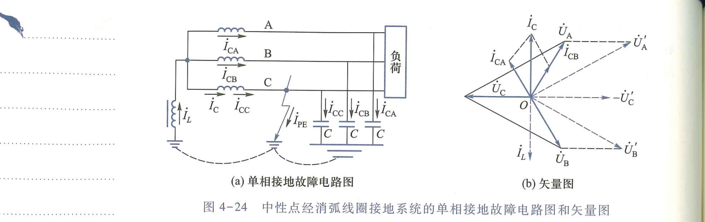

*图4-24中性点经消弧线圈接地系统的单相接地故障电路图和矢量图（原书第110页）*

如图4-24（b）所示，如果c相发生接地故障，c相对地电压降为零，A、B相对地电压升高到等于线电压，且三相线电压仍然对称。因此，与中性点不接地系统类似，中性点经消弧线圈接地的电力系统中的线路及各种电气设备的绝缘都要按线电压设计；中性点经消弧线圈接地的电力系统发生单相接地故障后，仍允许继续运行不超过2h，并需要尽快查出故障原因予以排除。

如图4-24（b）所示，如果c相发生接地故障，中性点电压变为一Üc，消弧线圈在作用下，产生电感电流/（滞后于U090。），其数值为

$$
I_L=\frac{U_C}{X_L}=\frac{U_\varphi}{X_L}
\tag{4-8}
$$

式中，U，为电力网的相电压（kV）；为消弧线圈的电抗（0）。故障点流经的单相接地电流为“其幅值为11c-1L《。

根据/一/L的大小，电力系统中性点经消弧线圈接地时，消弧线圈的补偿方式有三种：全补偿方式、欠补偿方式和过补偿方式。

（1）全补偿方式。选择消弧线圈的电感时，使/：/，则接地故障点电流为零，此即全补偿方式。这种补偿方式因为感抗等于容抗，电力网将发生谐振，产生危险的高电压或过电流，影响系统安全运行。

（2）欠补偿方式。选择消弧线圈的电感时，使/</，此时接地故障点有未被补偿的电容电流流过。当电力网运行方式改变而切除部分线路时，欠补偿方式将使整个电力网对地电容减少，有可能发展成为全补偿方式，导致电力网发生谐振，危及系统安全运行；另外，欠补偿方式容易引起铁磁谐振过电压等其他问题，所以很少被采用。

（3）过补偿方式。选择消弧线圈时，使/>/，此时接地故障点有剩余的电感电流流过。在过补偿方式下，即使电力网运行方式改变而切除部分线路时，也不会发展成为全补偿方式。同时，由于消弧线圈有一定的裕度，今后电力网发展，线路增多、对地电容增加后，原有消弧线圈还可继续使用。因此，实际工程中大多采用过补偿方式。

选择消弧线圈时，应当考虑电力网的发展规划，通常可按下式估算其容量

$$
S_{\mathrm{ar}}=\frac{1.35I_CU_N}{\sqrt3}
\tag{4-9}
$$

式中，“为消弧线圈的容量（kV·A）流为电力网的接地电容电流（A）；UN电力网的额定电压（kV）。

按中国有关规程规定，在3、60kV电力网中，电容电流超过下列数值时，电力系统中性点应装设消弧线圈：(D3、6kV电力网，30A；210kV电力网，20A；

<!-- 原书第111页；PDF第117页 -->

35、60kV电力网，10AO

中性点经消弧线圈接地的电力系统发生单相接地故障后，单相接地电流由于消弧线圈的补偿作用可能变得非常小，很多情况下无法区分是单相接地电流还是正常运行的三相不平衡电流，因此无法判断哪个线路上发生了单相接地故

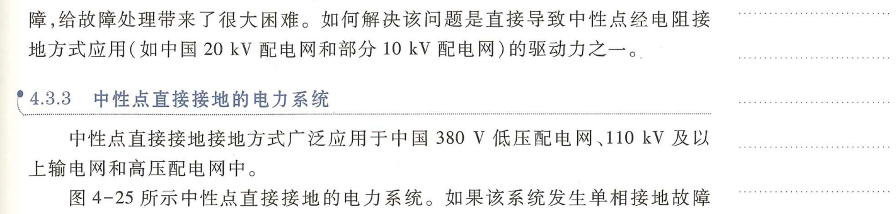

*图4-25所示中性点直接接地的电力系统。如果该系统发生单相接地故障（原书第111页）*

### 4.3.3 中性点直接接地的电力系统

时，则中性点与接地极构成单相接地短路回路，线路上将流过很大的单相短路电流琮1）

负使线路上安装的继电保护装置迅速动作，断

荷路器跳闸将故障元件断开，从而防止了单相接地故障时产生间歇性电弧过电压的可能。电力系统中发生单相接地故障的比重占整个短路故障的65%以上，当发生单相接地时图4-25中性点直接接地的电力系统切除故障线路，将中断向用户供电，使供电可靠性降低。为了弥补这个缺点，在线路上广泛安装三相或单相自动重合闸装置，靠它来尽快恢复供电，提高供电可靠性。另外，当中性点直接接地系统发生单相接地故障时，正常相的电压仍为相电压，对设备绝缘没有影响。

中性点直接接地的电力系统发生单相接地故障时，中性点电位仍为零，非故障相对地电压基本不变，因此电气设备的绝缘水平只需按电力网的相电压考虑，可以降低工程造价。由于这一优点，中国110kV以上的电力系统基本上都采用中性点直接接地方式。国外220kV及以上的电力系统也都采用这种接地方式。

对于1kV以下的低压系统来说，电力网的绝缘水平已不再成为主要矛盾，系统中性点接地与否，主要从人身安全考虑问题。在380丷220v系统中，一般都采用中性点直接接地方式，一旦发生单相接地故障，可以迅速跳开自动开关或烧断熔断丝，将故障元件断开；另一方面，此时非故障相对地电压基本不升高，不会出现人接触时超过250v的危险电压。如果系统中性点不接地，发生单相接地故障时非故障相对地电压将接近于线电压，对人身安全的危害会更大。当然，即使250v左右的接触电压，对人身安全仍是有危险的，应采取措施防止触电。

中性点直接接地系统发生单相接地故障时，单相短路电流在导线周围产生单相交变电磁场，将对附近的通信线路和信号设施产生电磁干扰。但只要采取措施减小单相接地短路电流，或采取特别的屏蔽措施，都可以减小这种干扰。

### 4.3.4 中性点经电阻接地的电力系统

我国《交流电气装置的过电压保护和绝缘配合》（DL/T620一1997）规定：“6、35kV主要由电缆线路构成的配电系统，单相接地故障电容电流较大时，可采用低电阻接地方式，但应考虑供电可靠性的要求、故障时瞬态电压、瞬态电流对电气

<!-- 原书第112页；PDF第118页 -->

设备的影响、对通信的影响和继电保护技术要求以及本地的运行经验等"。“6kV和10kV配电系统以及发电厂厂用电系统，单相接地故障电容电流较小时，为防止谐振，间歇性电弧接地过电压等对设备的损害，可用高电阻接地方式"。目前中国20kV配电网和部分10kV城市配电网采用了低电阻接地方式，并取得了一定的运行经验，较好地解决单相接地故障时的故障线路选线判别问题。

中性点经电阻接地发生单相接地故障时，流过接地点的故障电流等于故障相短路电流（流经接地电阻的电流）与对地电容电流之和。对中国20kV配电网和部分10kV城市配电网采用的低电阻接地方式，其单相接地电流特征类似于中性点直接接地系统。

中性点经电阻接地方式的接地电阻值的选择主要依据系统的单相接地电容电流lc。对高阻接地限制单相接地故障电流小于10A，IR：（1、1.5）/；对中电阻和小电阻接地，接地电阻值等于系统额定相电压与单相接地时要求流过电阻的电流之比值，实际运行中考虑电缆外皮、管线、接地处接地电阻等分流作用，电阻值可适当取小。

城市配电网由于电缆比重加大、双电源供电、环网布置、开环运行以及架空绝缘线的采用，使得中性点经电阻接地方式较中性点不接地和消弧线圈接地相比有着很明显的优势。对以电缆线路为主的配电网中的架空线，可依靠自动重合闸功能来提高供电可靠性，减少停电时间。上海、北京、深圳等地采用小电阻接地后，由于电网结构改善，自动重合闸成功率高，供电可靠性并没有出现明显降低。这些地区的运行经验表明，保证用户供电可靠性已不再是带单相接地故障运行几小时，而是靠电网结构、调度控制和配网自动化来实现。

但是对于处于多雷区农村配电网而言，其供电可靠性受到雷击跳闸的影响，采用中性点经电阻接地方式仍然需要经过工程实践的检验。

## 4.4 发电厂变电站电气主接线示例

1.发电厂的主接线

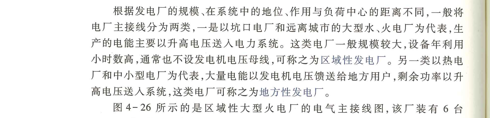

*图4-26所示的是区域性大型火电厂的电气主接线图，该厂装有6台（原书第112页）*

300MW大型机组，发电机与双绕组变压器组成单元接线，分别与220kV、500kV

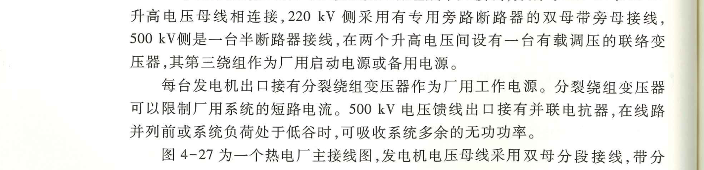

*图4-27为一个热电厂主接线图，发电机电压母线采用双母分段接线，带分（原书第112页）*

<!-- 原书第113页；PDF第119页 -->

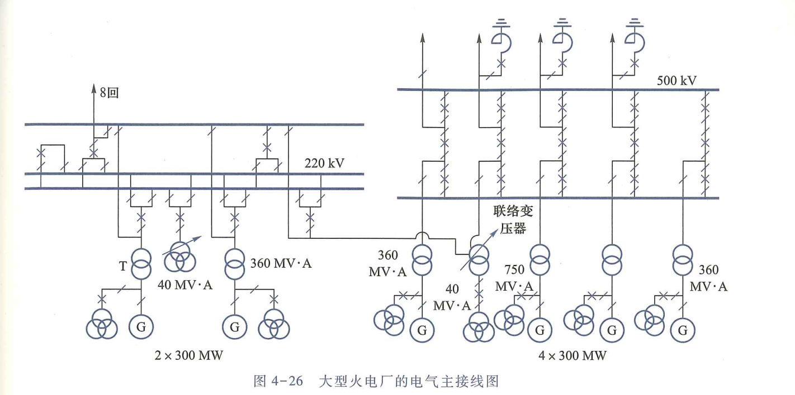

*图4-26大型火电厂的电气主接线图（原书第113页）*

段电抗器，每一分段接一台发电机，电压等级可直接供近区地方用户。为了限制短路电流和采用轻型价廉的断路器，馈线上安装有出线电抗器，为防止直击雷电对发电机的影响，10.5kV均采用了电缆出线。

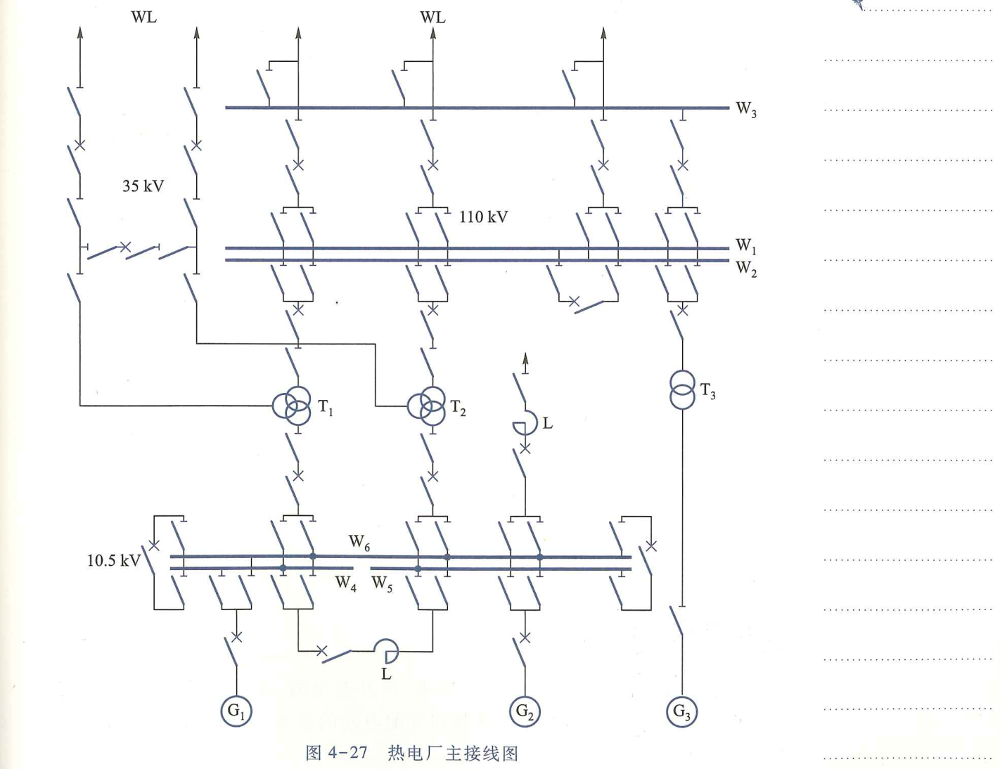

*图4-27（原书第113页）*

<!-- 原书第114页；PDF第120页 -->

发电机电压母线上的剩余功率经两台三绕组变压器送入35kV和110kV系统，35kV侧仅两回线路，故采用桥形接线。厂内3号发电机组采用单元接线与110kV母线相连，使发电厂接线简单清晰。

2.变电站主接线

原则上变电站主接线与发电厂主接线形式基本相同，如图4-28所示为一个500kV变电站的接线，变电站内设置两台主变压器。各电压等级分别采用一台半断路器接线、双母线接线和外桥形接线。不同电压等级之间采用主变压器连接。

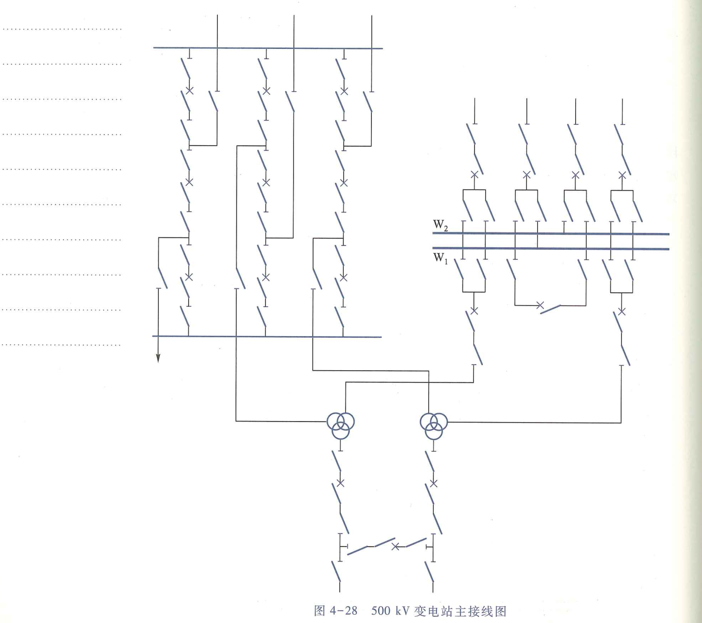

*图4-28500kV变电站主接线图（原书第114页）*

## 4.5 配电装置

配电装置是根据电气主接线的要求，由开关电器、保护和测量设备、母线和必要的辅助设备组建而成，用于接收和分配电能的装置，它是发电厂和变电站的重要组成部分。

<!-- 原书第115页；PDF第121页 -->

配电装置按电气设备装设地点不同，可分为屋内和屋外配电装置。按其组装方式，可分为装配式和成套式。在现场将设备组装而成的称为装配式配电装置；在制造厂预先将开关电器、互感器等设备组装在一起，成套供应的称为成套配电装置，其中以SF6全封闭组合电器内的设备最齐全。

1.配电装置的安全净距

所谓安全净距是指从保证电气设备和工作人员的安全出发，考虑气象条件及其他因素的影响所规定的各电气设备之间、电气设备各带电部分之间、带电部分与接地部分之间应该保持的最小空气间隙。

在配电装置中，各种间距的确定应考虑电压等级的不同。对于敞露在空气中的配电装置，最基本的是确定带电部分与接地部分之间和不同相带电部分之间的空间最小安全净距，即和值。值应保证无论在正常最高工作电压或出现内外过电压时都不致使相应空气间隙击穿。净距月、c、刀、E是在，4值基础上，再考虑一些其他因素。

表4-1列出了屋内配电装置的安全净距值及其含义，当海拔超过1000rn时，允许按每升高100m，绝缘强度增加1%来修正值。

设计配电装置带电导体之间和导体对接地构架的实际距离时，还应考虑软绞线在短路电动力、风摆、温度等作用下使相间及对地距离减小，隔离开关在开合位置改变时都不致发生相间和对地击穿。同时，还应考虑设备的外形尺寸，检修和运行时人员走动和车辆运输等安全因素。减少110kV及以上带电导体的电晕损失和考虑带电检修、安装误差等因素。工程上实际距离，通常大于规定的安全净距值。

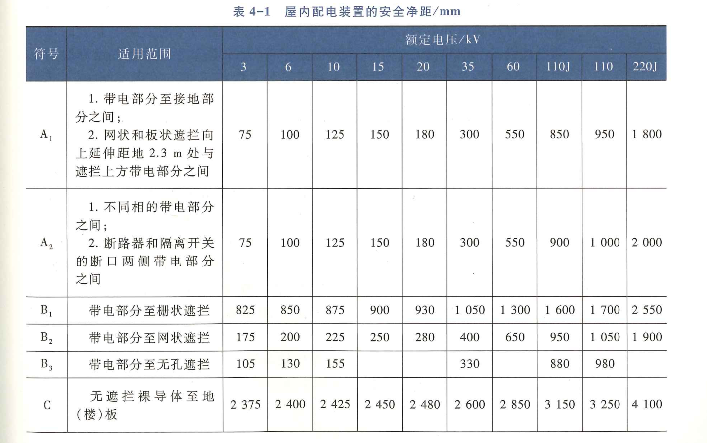

*表4-1屋内配电装置的安全净距/mm（原书第115页）*

<!-- 原书第116页；PDF第122页 -->

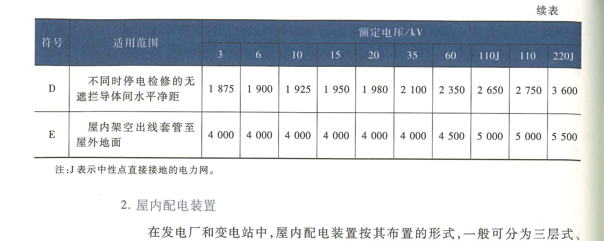

*续表（原书第116页）*

二层式和单层式。三层式是将同一回路的电气设备按接线顺序和电气设备轻重分别布置于三层中，三层式配电装置占地面积少，可靠性高，但土建设计施工比较复杂，检修不太方便。二层式有装配式和装配成套混合式。三层式和二层式均可用于出线有电抗器的情况。单层式适用于出线无电抗器的情况，如果容量不大，通常采用成套开关柜，以减少占地面积。

3.屋外配电装置

对具有汇流母线的接线形式，根据电气设备和母线布置的高度，屋外配电装置可分为中型、半高型和高型。

中型配电装置的所有电气设备都安装在同一水平面，并装在一定高度的基础上，中型配电装置母线所在的水平面稍高于电气设备所在的水平面，母线下方

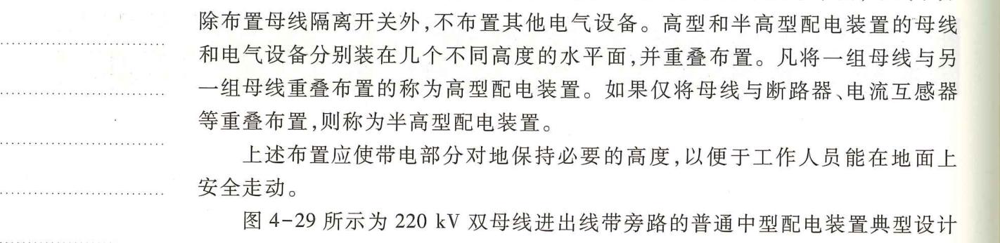

*图4-29所示为220kV双母线进出线带旁路的普通中型配电装置典型设计（原书第116页）*

断面图。采用GW4一220型隔离开关和少油断路器，除避雷器外，所有电气设备均布置在2、2巧m的基础上。母线构架17与中央门形架13合并，使结构简化。由于断路器布置在主母线的一侧（称单列布置），当配电装置两侧有进出线时，必然会出现双层构架（虚线表示），跨线多，降低了可靠性。在断路器和母线之间设置有环形道路，可作检修、搬运场地之用。图中阻波器（10）和耦合电容器（11），组成一个高频通道，前者阻止高频信号流通，使高频信号经（11）进入厂（站）内载波机或供高频保护之用。

普通中型配电装置的特点是：布置比较清晰，施工维护方便，抗震性能较好，所用钢材少，但占地面积较大。

<!-- 原书第117页；PDF第123页 -->

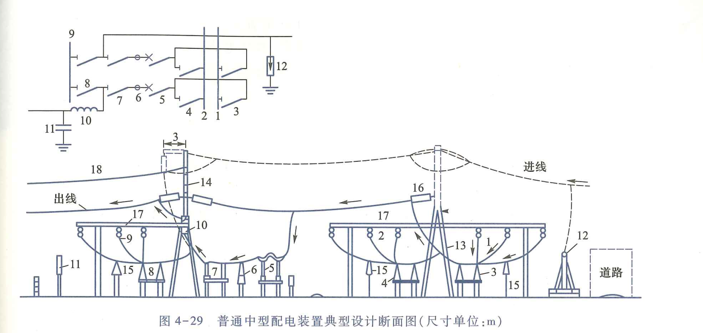

*图4-29普通中型配电装置典型设计断面图（尺寸单位：m）（原书第117页）*

4.成套配电装置

成套配电装置是在制造厂内将同一回路的开关电器、测量仪表和保护设备等组装而成，能成套供应的单元组合。分为低压成套配电装置、高压开关柜和SF6全封闭组合电器等三类，按安装地点又分为屋内型和屋外型。

（1）低压成套配电装置。

有固定式配电屏BSL系列（双面维护）、BDL系列（单面维护）和BFC系列低压成套开关柜（也称抽屉式开关柜）。

抽屉式低压柜为封闭式结构，有关设备装在一只抽屉内或手车上，回路故障时，可拉出抽屉检修或换上备用抽屉，便于迅速恢复供电，还具有布置紧凑、占地面积少的优点

‰、0

（2）高压开关柜。

目前中国生产3、35kV高压开关柜，主要有手车式和固定式两类。

.手车式高压开关柜，用于单母线结构。一般由固定的柜体和可用滚轮移动的手车两部分组成，柜体内由薄钢板或绝缘板隔成五个小室即手车室、电流互感器室、主母线室、小母线室和仪表继电器室。

2固定式高压开关柜有双母线和单母线两种结构。固定式开关柜与手车式相比较，体积大，检修不太方便，但制造工艺简单，价格便宜，加之柜内设备不断更新型号，目前技术指标也较先进。

问题1：在中性点不接地和经消弧线圈接地的10kV配电网中，变电站10kV出线处如何测量单相接地电流？

在中性点不接地的10kV配电网中，发生单相接地故障时，接地电流是各线路

<!-- 原书第118页；PDF第124页 -->

的电容电流之和，接地电流相比于正常工作电流而言很小；在中性点经消弧线圈接地的10kV配电网中，发生单相接地故障时，接地电流是各线路的电容电流与流经中性点消弧线圈的电感电流之和，接地电流相比于正常工作电流而言更小。

1

根据对称分量法，/0：一（0+/+/。），可以分别在a、b、c相装设电流互感器，3

测量/“/、/。，然后相加就得到3/0

但是，在中性点不接地和经消弧线圈接地的10kV配电网中，接地电流相比于正常工作电流而言很小，采用上述方法将会带来很大的误差，甚至完全测不准。

问题2：经消弧线圈接地的配电网如何判断哪回线路发生单相接地故障？

如表2-5所示，配电网中超过50%的故障是单相接地故障。为了保证供电可靠性，经消弧线圈接地的配电网发生单相接地故障后，仍允许运行0巧、2h，但必须尽快找到故障点，防止故障扩大。要找到故障点，首先必须找到故障线路（即故障选线）。

中性点经消弧线圈接地的城市配电网发生单相接地故障时故障电流很小，给故障选线带来了很大的困难。

根据中性点经消弧线圈接地的城市配电网发生单相接地故障时的故障特征，工程上可以采用的故障选线方法有哪些各有何优缺点？

问题3：现有城市配电网如何改造成闭环运行配电网？

目前，中国的配电网除了香港外都采用开环运行模式。由于大城市负荷密度越来越高，短时停电造成的损失也越来越大，很多用户提出了“闭环运行配电网"的要求。

但是，配电网在规划建设中就是为了开环运行，要改造成为“闭环运行配电网"，需要从技术、经济、管理等多方面进行论证。

## 课外阅读资料

本章推荐如下课外阅读内容：

（1）1000kV、500kV、220kV、110kV、35kV、10kV变电站典型接线形式；

（2）火电厂、水电厂、核电厂、风电场、太阳能光伏电场典型接线形式；

（3）小电流接地选线装置的实现原理。

## 思考题

何为电力系统分层运行？如何分层运行？

4一1

中国内陆地区配电网为什么采用开环运行？

4一2

发电厂或变电站的电气主接线的基本接线形式有哪些？

4一3

试绘出双母线带旁路断路器的电气主接线形式，写出检修某一线路断路器时，不中

4一4断该线路供电的操作步骤。

4一5何谓配电装置？配电装置是如何分类的？

4一6何谓配电装置中的最小安全净距？

4一7简述电力系统各种中性点接地方式的单相接地故障特征。

## 其他章节

- [第1章 走进电力系统](CH1走进电力系统.md)

- [第2章 电力系统的组成环节及工作原理](CH2电力系统的组成环节及工作原理.md)

- [第3章 电气一次设备](CH3电气一次设备.md)

- [第10章 电力系统继电保护](CH10电力系统继电保护.md)

- [第11章 电气二次系统](CH11电气二次系统.md)
